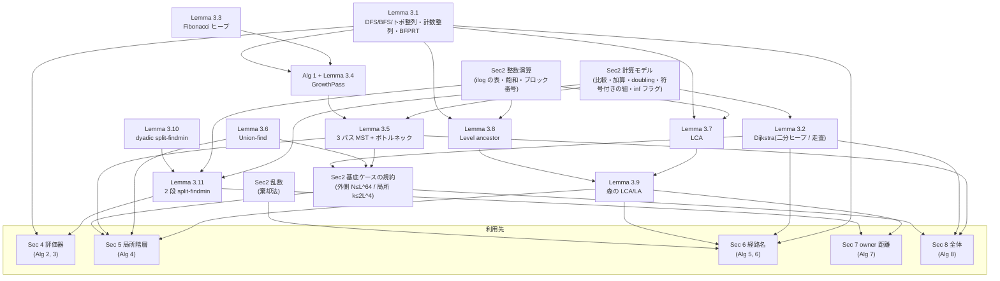

# 01 前提と基本構造(Sec 1–3)の解析

[English](01_preliminaries_primitives.md) | **日本語** | [简体中文](01_preliminaries_primitives.zh-CN.md)

- 対象: arXiv 2611.34911v1「Linear Single-Source Shortest Path, Almost」(Gholami, Hajiaghayi, 2026-11-25)
- 範囲: Section 1(Introduction / Technical Overview)、Section 2(Preliminaries)、Section 3(Graph and Data-Structure Primitives, 3.1–3.5)
- 根拠: `.cache/paper/2611.34911v1.txt`(pdftotext)の 1–640 行を通読し、数式が崩れる箇所は PDF p.4–14 で確認した。後続節での使われ方は該当行を grep して確認した(行番号は txt のもの)。
- 記法: 「【補完】」は論文に書かれていない実装上の補い。「【解釈】」は複数の読み方がありうる箇所で採った読み方。論文本文の逐語転載は避け、式は短く引用する。

---

## 0. 要点(実装チームが最初に知るべきこと)

1. **外側の閾値 `N > L_N^64` は、現実のどの入力でも成り立たない。** 計算すると最小の N は約 2^589.09(L_N = 590)である。N < 2^64 では L_N ≤ 65 なので L_N^64 ≥ 2^385 となる。したがって Algorithm 8 は**常に 4–7 行目の基底ケース**(頂点対ごとに最軽量辺を残し、走査型 Dijkstra で O(N²+m))に入る。論文の本体(Sec 5–8 の外側構成)は、そのままでは一度も実行されない。(正確な値は [thresholds.md](thresholds.md) にある。最小の N は 589^64 + 1 ≈ 1.94×10^177 で、[2^589 − 1, 590^64] では再び偽になり、590^64 + 1 以上ではすべて真である。ここと本メモの他の箇所の「約 2^589.09(L_N = 590)」は、この最後の境目であり、最小の N ではない。)
2. **局所の閾値 `N > 2 L_N^4` が成り立つのは N ≥ 209,953 から**(L_N = 18、2·18⁴ = 209,952)。Algorithm 4(LocalHierarchy)を単体で動かせば、約 21 万頂点以上で非基底の経路を試験できる。
3. したがって、非基底の経路を試験するには、閾値の指数(64 と 4)と係数(2)を引数にした **Mode B(`src/experimental/paper_experimental/`)** が要る。Mode A(`src/paper/`)では閾値を論文の値に固定し、下げない(paper-reproduction スキルの規則)。また、指数を下げると、Sec 5–8 の証明が使う定数関係(例: 1206 行「N ≥ 32, h ≤ N, K < 16h」、t = O(1+N/L_N^64))が崩れる可能性がある。Sec 4–5 と Sec 6–8 の担当と調整が要る。
4. 基底ケースの「走査型 Dijkstra O(N²+m)」(Alg 8 の 5 行)は、現実の N(10⁶ など)では遅すぎる。Mode A は、論文の通り走査版を使い、`FallbackRecord{"outer: N <= L_N^64 (paper base case)", n, m}` を必ず記録する。二分ヒープ版(Lemma 3.2 には書かれているが、Alg 8 の 5 行の指定とは違う)に替えるのは**逸脱**である。替えるなら `D-<n>` として記録し、Mode A とは別の経路(Mode B、またはオプション)にする(§2.4(a))。
5. L_N^64 を 64bit 整数で素直に計算すると桁あふれする。論文 Sec 2 の「大きさの判定に使う積は、判定する上限に達したら打ち切ってよい」(304 行)に従い、**飽和乗算**で判定すること。剰余付きの桁あふれが起きると、誤って非基底の経路に入る。
6. 計算モデルは comparison–addition である。実数(辺長)に許されるのは、コピー、比較、加算、2 倍(doubling)だけである。**床関数、log、ビット取り出し、アドレスとしての利用は禁止**(300 行)。差は「2 つの非負の和の組」で表す(a−b と c−d の比較は a+d と c+b の比較で行う)。double で実装するときは、加算の丸めが「等号で判定する tight 弧」と「差の比較」を壊しうる(§2.8)。
7. Sec 3 の計算量の要は τ(k) = 1 + log log log(k+16) である。これは MST の 3 パス(Fibonacci ヒープ、上限 B1 = max(2, ⌈log2 L_k⌉) と B2 = L_k)、union-find の 3 帯解析、split–findmin の 2 段ブロック化の 3 か所から来る。
8. split–findmin(Lemma 3.11)は、Sec 4(Algorithm 2 の 4 行目)と Sec 7(1815 行、1863 行)の評価器の中心である。`(key, 元の添字)` で同順位を解消し、最小を取った**添字**も返す API が必要になる(939 行「区間 ID を選ばれた最小の位置に置く」)。
9. LCA と level ancestor(Lemma 3.9)は、Sec 5.4(1290 行)では「LCA の子のうち、どちらの子に弧が属するか」を求める用途(LA(u, depth(lca)+1))に、Sec 6(1460 行、1468 行)では分割木上の LCA に使われる。参照実装はバイナリリフティングで十分である。
10. 記号の多重定義が多い。B(4 通り)、h(5 通り)、M(2 通り)、k、b などである(§2.2)。コードでは名前空間や接頭辞で区別すること。

---

## 1. Section 1: Introduction と Technical Overview

### 1.1 主定理(Theorem 1、p.3)

- 入力: 隣接リスト形式の無向多重グラフ(n 頂点、m 辺)、有限で非負の実数の辺長、始点 s。
- 出力: 全頂点の正確な距離と、到達可能な頂点上の最短路木。到達不能な頂点は +∞。
- 計算量: 期待値で O(m + n log log log n)。辺長の比(spread)に依存しない。m = Ω(n log log log n) のとき線形。
- 停止: ほとんど確実に停止する(almost surely)。**停止した実行はすべて正しい**(Las Vegas 型)。
- 乱数: 独立で一様な乱数ワード。使うのは標本抽出(Sec 6)と距離の推定だけである。
- 計算モデル: comparison–addition(詳細は §2.5)。

### 1.2 Technical Overview の流れと、各節との対応

| 概念(Overview の段落) | 内容の要約 | 対応する節・補題 |
|---|---|---|
| 領域分割 | MST を連結な領域に切り分け、各領域に pivot を 1 つ置く。p(v) は領域の pivot、R_v は木の上での p(v) までの長さ、r_v はその経路上の最大辺。各経路の辺数は h 以下(h は polylog)。領域をまたぐ辺 xy(重み w)は r_x, r_y ≤ w を満たす。したがって R_x + w + R_y ≤ (2h+1)w | Lemma 5.2、Sec 5.1、Sec 7.1(h = b+1、b = L_N^64) |
| 要求(request) | pivot の対ごとに、最軽量の射影辺 R_x + w + R_y を 1 本だけ残す。t は pivot 数 | Sec 6、Definition 6.1 |
| 半減の規則 | 残りの要求が 32t より多い間は、辺を標本抽出し、標本上の距離の上界 Z を推定する。同じ表の添字の中で Pλ ≥ Z を満たす最小の λ を選び、λ 以上の要求に証明書 λ を与える。半数以上が適格なら試行を受理する。32t 以下になったら、自分の射影重みを証明書にする | Algorithm 5、Lemma 6.7、6.8 |
| 補助座標 J | d_e = Pλ_e(同じ領域の中では 0)。d_e ≤ w/2 なら radial、そうでなければ macro。pivot を 1 つの根に同一視し、radial 辺の補助長を w + d_e とする。J_v は補助グラフでの根までの距離。radial 辺の上で \|ΔJ\| ≤ 3w/2。w > J_x + d_e + J_y の radial 辺は削除してよい | Lemma 7.2、Algorithm 8 の 10–12 行 |
| コピー数が定数で済む理由 | 端点の座標が M/16 以下で、頂上が M の radial 部分路は、登るのに 5M/8 以上かかる。pivot 経由の迂回は M/8 + L/2 以下なので矛盾する。比が 16² 以下なら near、それ以外は far。殻(shell)の比は 16。各頂点は 1 相あたり高々 2 窓に属する | Lemma 8.1、Sec 5.2、Sec 8.1 |
| 処理の順序 | 弧長の閾値に応じた SCC の階層を作る。併合の重みを倍化格子 [a, 2a) でまとめ、高さを a とする。slot の幅は高さ以下。offer は仮の上界。開いた群は D0 + S(X) で期限切れになる | Sec 4、Algorithm 2、3 |
| J を知らずに群を作る | 補助グラフを小さな連結集合に分け、局所構成(局所 MST、局所 pivot までの経路上の最大辺を座標にする)を適用する | Sec 5、Algorithm 7、Lemma 7.7 |
| 3 重対数の出どころ | 大きさ k の集合で、局所構成は頂点あたり O(1 + log log(k+4)) かかる。k ≤ polylog n。併合事象は O(log log n) 個の連続する 2 冪の中で二分探索するので O(log log log n) | Sec 5.4、Sec 8.2、Lemma 8.4 |
| 標本抽出 | 期待値で O(m + n) | Sec 6、Sec 8 |

Overview に出る定数(32t、16、16²、3/2、5/8、1/8、1/2)は、後続節の補題で正確に定義される。実装は後続節の定義に従うこと。Overview は直観の説明にとどまる。

### 1.3 Related Work から実装に効く点

- Pettie–Ramachandran [PR05] の split–findmin と、成分階層の考え方を引き継いでいる。本論文の Sec 3.5 は、その逆アッカーマン界を「2 段のブロック化で τ(k)」に置き換えた簡易版である。
- 区別の要点: 距離を**計算する**ことと、距離で頂点を**整列する**ことは違う。本アルゴリズムは大域的な距離順を作らない。したがって「出力が Dijkstra の取り出し順と一致する」ことを試験の基準にしてはいけない。距離と木の正しさだけを比べる。

---

## 2. Section 2: Preliminaries(p.6–7)

### 2.1 グラフと距離

- 入力は無向**多重**グラフで、自己ループと並行辺がありうる。辺長は有限の非負実数。
- walk は辺の繰り返しを許し、path は頂点の繰り返しを許さない。d_G(x,y) は walk の最小の長さで、存在しなければ +∞。
- **tight 弧**: d(s,x) と d(s,y) がともに有限で、d(s,x) + w(xy) = d(s,y) を満たす弧。無向なので、どちらの向きで定義してもよい。出力の木は tight 弧をたどって作る(Lemma 8.5、Algorithm 8 の 16 行)。**等号の判定**であることに注意(§2.8)。

### 2.2 記号とパラメータの一覧

| 記号 | 定義 | 出てくる場所 | 備考 |
|---|---|---|---|
| n, m | 入力の頂点数と辺数 | 全体 | |
| N | ある構成の中の頂点数 | Sec 2 以降 | 外側では、零辺を縮約した後の始点成分の頂点数(Alg 8 の 3 行) |
| M | 弧の数、または要求(demand)の数(「指定した場所で」) | Sec 4、6 | **Overview では頂上の座標の意味でも使う(多重定義)** |
| k, l | Sec 3 の頂点数と辺数(弧の数) | Sec 3 | k は別の意味でも頻出する |
| p | 整列・選択するレコードの数 | Lemma 3.1 | pivot の p(v) とは別物 |
| L_k | ⌈log2(k+2)⌉(整数 k ≥ 1) | 全体 | k ≥ 1 で L_k ≥ 2 |
| τ(k) | 1 + log log log(k+16) | 計算量の記述 | k ≥ 1 で τ ≥ 2(log log log 17 > 1)。**実装では使わない**(解析専用) |
| T[x,y], D_T(x,y), b_T(x,y) | 木の上の唯一の路、その長さ、その最大辺長(b_T(x,x) = 0) | Sec 3.2 以降 | |
| 深さ | 辺の数で数える。根の深さは 0 | Sec 3.4 | |
| log | 底は 2 | 全体 | |
| B(Alg 1) | GrowthPass のヒープ上限。B1 = max(2, ⌈log2 L_k⌉)、B2 = L_k、第 3 パスは +∞ | Sec 3.2 | k は**元の**頂点数 |
| B(Sec 3.4) | max(2, ⌊log2(k+1)/8⌋)、k は拡張後の頂点数 | LCA と LA | k < 2^24 では B = 2 |
| B(Sec 3.5) | max(2, ⌈log2(k+1)⌉) | split–findmin のブロック | 3.4 の B とは別 |
| b1, b2, b3 | b3 = 1 + L_k、b2 = ⌈log2(b3+1)⌉、b1 = ⌈log2(b2+1)⌉ | Lemma 3.6 の証明 | 解析専用 |
| s | ヒープの大きさ | Lemma 3.3 | |
| Q, q, q' | union/find の回数、decrease の回数、query の回数 | Lemma 3.6、3.11 | |
| h | (a)Overview: 木の経路の辺数の上界(polylog)。(b)Sec 2: 乱数の範囲 0..h−1。(c)Sec 3.4: 途中の完全ブロック数、跳躍幅 2^⌊log d⌋。(d)Sec 4: 節点の高さ h(C)。(e)Sec 7: h = b+1 | 各所 | **5 通りの多重定義** |
| b | 分離子の大きさ。局所では L_N^4(Sec 5.1)、外側では L_N^64(Sec 7.1) | Sec 5、7、8 | |
| t | pivot の数 | Sec 6 | 外側では t = O(1 + N/L_N^64) |
| P | polylog の係数。2 の冪 | Sec 6、7 | Alg 5 の 3 行では 8·256·g·u² 以上の最小の 2 冪 |
| λ_e, Z, d_e | 証明書の重み、推定の上界、d_e = Pλ_e | Sec 6、7 | |
| R_v, r_v, p(v) | 木の上での pivot までの長さ、最大辺、pivot | Sec 5、7 | |
| J_v | 補助距離(owner 座標) | Sec 7 | |
| K | 8h 以上の最小の 2 冪 | Sec 5.2 | |
| c0 | 接続定数(子をつなぐ木の連結の長さ ≤ c0·h(C)) | Definition 4.1 | 局所基底ケースでは 1、Lemma 5.10 では 2 以下 |

### 2.3 閾値条件: どこで何のために使われるか

数値の確認(Python で整数のまま厳密に計算した):

| 条件 | 初めて成り立つ N | その時の L_N | 意味 |
|---|---|---|---|
| 局所: N > 2·L_N^4 | **209,953** | 18 | これ以上なら局所の非基底構成が動く |
| 外側: N > L_N^64 | **約 2^589.09** | 590 | 現実には成り立たない。N = 2^64−1 でも L = 65 で L^64 ≈ 2^385.4 |

使用箇所:

| 閾値 | 使われる場所(txt の行) | 目的 |
|---|---|---|
| 外側 N > L_N^64 | Sec 2(286 行)の前提 | 外側構成の非自明な範囲 |
| | Algorithm 8 の 4 行(2175 行) | N ≤ L_N^64 なら基底ケース: 頂点対ごとに最軽量辺を残し、走査型 Dijkstra(Lemma 3.2)、復元、tight 弧の走査 |
| | Sec 6(1374 行)、Lemma 6.8(1605 行) | pivot 数 t = O(1 + N/L_N^64) |
| | Sec 7.1(1644 行)、Lemma 8.4(2106 行) | owner 分割の分離子の大きさ b = L_N^64、h = b+1。atom の大きさは b 未満 |
| | Lemma 7.9 の証明(1962 行)、Theorem 1 の証明(2211 行) | b ≤ L_N^64 から 1 + log log(b+4) = O(τ(N)) を導く(3 重対数の根拠) |
| 局所 N > 2·L_N^4 | Sec 2(286 行)の前提 | 局所構成の非自明な範囲 |
| | Algorithm 4 の 2 行(1248 行) | k ≤ 2L_k^4 なら基底ケース(下の §2.4) |
| | Sec 5.1(966 行) | 局所の分離子 b = L_N^4 |
| | Lemma 5.7(1062 行、1084 行) | 局所 radial 状態の構成の前提 |
| | 1206 行 | 「非自明な範囲では N ≥ 32、h ≤ N、K < 16h、よって 3hK² ≤ 768N³」という定数評価 |

「除外された大きさは絶対的に有界」(286–287 行)は形式的には正しい。しかし外側の上界は約 2^589 であり、実用上は「入力全体が基底ケース」という意味になる。

### 2.4 基底ケースの規約(Sec 2 の 287–290 行、Alg 4 の 2–5 行、Alg 8 の 4–7 行)

#### (a) 外側の基底ケース(Algorithm 8 の 4–7 行)

```
outer_base_case(G_contracted, s):            // N <= L_N^64
  E' = lightest_edge_per_pair(G)             // 同じ頂点対の辺は (長さ, 添字) が最小の 1 本だけ残す。自己ループは捨てる
  dist = dijkstra_scan(N, E', s)             // Lemma 3.2 の走査版、O(N^2 + |E'|)
  // 復元(元の頂点へ戻す、到達不能は ∞)と tight 弧の走査は Lemma 8.5(Sec 8 の担当)
```

- 【補完】頂点対ごとの最軽量辺は、(min(u,v), max(u,v)) を 2 回の安定な計数整列(Lemma 3.1)で並べ、同じ対の中で (w, id) が最小のものを残す。O(m + N)。
- 【実装上の推奨】Mode A は走査版 O(N² + m) をそのまま使い、`FallbackRecord{"outer: N <= L_N^64 (paper base case)", n, m}` を必ず記録する。外側の基底ケースは現実の全入力を覆うので、大きい N では実行時間が O(N²) になる。この事実は報告書に正直に書く。二分ヒープ版(Lemma 3.2、O((N+m) log N))は、逸脱の候補として記録する。案: `D-1: Alg 8 l.5 の走査型 Dijkstra を二分ヒープ版に替える — N が大きいと O(N²) が実用にならない — 基底ケースの費用が O(N²+m) から O((N+m) log N) に変わる。距離の正しさは変わらない(Lemma 3.2)`。これは Mode B またはオプションに置く。

#### (b) 局所の基底ケース(Algorithm 4 の 2–5 行)

入力: 正の重みを持つ連結な無向グラフ H(k 頂点、k ≤ 2L_k^4)。

```
local_base_hierarchy(H):
  states = { 頂点ごとに native entry state を 1 つ }   // π(state) = その頂点
  arcs   = 元のループでない辺を両向きにすべて(並行辺も残す)
  H1 = lightest_edge_per_pair(H)
  T  = MST(H1)                                         // 小さいので任意の MST 法でよい【解釈】
  // 同じ重みの MST 辺を同時に併合する(Kruskal 型の成分木、同じ重みの層をまとめる)
  dsu = DSU(k); node_of_root[v] = leaf(v)
  for each 重み w の MST 辺の群(w の昇順) :
      group = その群の辺の端点の現在の根の集合
      dsu で群の辺を union する
      新しい連結成分ごとに: 内部節点 C を作り、height(C) = w、
         children = その成分に含まれる、群の直前の成分節点(2 個以上)
         connector の木 = その成分の中の重み w の MST 辺(端点の状態と長さ w を記録)
  return states, arcs, π, 階層(根 = 最後の成分)
```

- 正しさの根拠(論文の 289–290 行): 子をつなぐのは重み w の木辺であり、c0 = 1。子の間に w より軽い辺はない。理由は Lemma 3.5 の b_T(x,y) ≤ w(xy) である。異なる子の頂点 x, y の間の木の路は重み w の辺を通るので、b_T(x,y) = w ≤ w(xy) となる。したがって「高さ未満の子どうしの弧」は存在せず、商グラフは自明に非巡回である。
- 境界値: k = 1 なら葉 1 個だけ(内部節点なし)。重みはすべて正(零辺は Alg 8 の 2 行で縮約済み)なので、高さも正になる。
- 試験: Definition 4.1 の不変条件を検査する。内部節点の子は 2 個以上、高さは根に向かって単調非減少、子の間の高さ未満の弧はない、connector の木が子を連結にする、各 connector の長さは c0·h 以下。

### 2.5 実数(辺長)に対する計算モデル(292–300 行)

| 操作 | 可否 | 費用 |
|---|---|---|
| コピー、比較、加算 | 可 | 1 |
| 無限大 | 別のフラグで持つ | — |
| 差 a − b | **直接は持たない**。(正の和, 負の和) の組で表す。加算は成分ごと、符号反転は成分の入れ替え | 定数 |
| a−b と c−d の比較 | a+d と c+b を比較する | 定数 |
| 2^j 倍 | j 回の doubling | j(可変なら補題の中で費用に数える) |
| 2 冪で割る | 構成の中で使う分母が固定の 2 冪なら、比較する値をすべて共通の尺度で持つ(外から来た値は入口で尺度を合わせる) | — |
| 床関数、整数部、log、ビット、アドレスとしての利用 | **禁止** | — |

使われる場所(後続節、grep による):
- 符号付きの組: Sec 4.3(794–795 行)の slot の位置合わせ(「D0 以下で最大の b − jν(C)」)、Sec 8.3(2158 行)の出力値の復元。
- doubling: Sec 5.2(1029 行、1035 行、K²r_v)、Sec 6(1389 行の中央値検査、1399 行の P、1486 行、1494 行の (H+j)Δ)、Sec 8.2(2080 行の F、2131 行)。
- 2 冪の分母: r_v/32、s_U/2、M/16 など。共通尺度で表す(1724 行「固定の 2 冪で全量を拡大した後」)。

### 2.6 整数とワードの演算(301–306 行)

- 頂点の識別子、添字、カウンタは Θ(log(n+m+2)) ビットのワード、定数個。配列参照、シフト、ビット演算、整数の加減算と比較は O(1)。
- **整数の log2**: ⌊log2 i⌋ を i = 1 から半分にする漸化式で表にする(O(k))。

  ```
  lg[1] = 0; for i in 2..K: lg[i] = lg[i >> 1] + 1
  ```

  【実装注】C++20 の `std::bit_width(i) - 1` は clz 命令になる。論文のワード演算(シフトとビット演算)に clz は明記されていない。モデルに忠実にするなら表を使い、性能を優先するなら `bit_width` を使う。どちらを採るかは ADR で決める。
- **飽和**: 大きさの判定だけに使う積は、上限に達したら打ち切る。L_N^64 の判定は必ず飽和乗算で行う(§0 の 5)。

  ```
  bool exceeds_pow(u64 N, u64 L, int e):   // N > L^e を判定
    acc = 1
    repeat e times: if acc > N / L: return false  // L^e > N(打ち切り)【補完】除算を避けるなら __int128 を使う
                    acc *= L
    return N > acc
  ```

- 固定の大きさのブロック: 走査のときに各要素のブロック番号とオフセットを保存しておけば、整数の除算はいらない(【実装注】実装では `/` と `%` を使っても計算量は変わらない)。

### 2.7 乱数(307–310 行)

```
uniform_below(h):            // 0..h-1 の一様整数
  if h == 1: return 0
  c = ceil_log2(h)
  loop: x = next_bits(c)     // 偏りのないビット c 個
        if x < h: return x   // 棄却法。成功確率は 1/2 より大きい
```

- 【実装注】`std::uniform_int_distribution` は実装ごとに結果が違い、再現できない。`std::mt19937_64` か SplitMix64 にシードを与え、上の棄却法を自前で書く。剰余(`x % h`)は偏るので禁止。
- 期待値は、固定した入力に対する乱数についてとる。乱数を使うのは Sec 6 だけである(標本抽出、一様置換、j ∈ {0..H−1})。

### 2.8 double で実装したときに問題になる箇所

| # | 箇所 | 問題 | 対策の案 |
|---|---|---|---|
| D1 | 経路長の加算全般 | 丸めにより結合法則が崩れる。足す順序が違う 2 つの経路は、厳密には同じ長さでも違う値になりうる | 正確さの試験は整数の重み(`uint64_t`、総和 < 2^53 なら `double` でも正確)で行う |
| D2 | tight 弧の判定 d(x)+w == d(y)(Lemma 8.5、Alg 8 の 16 行) | 評価器が出した値と、出力時の「木に沿った和」(2156 行)の足し順が違うと、等号が成り立たない。木が途切れる | 丸めが単調(a ≤ b なら fl(a+w) ≤ fl(b+w))なので、Dijkstra と同じ左からの足し込みなら成り立つ。評価器の値が別の順で足された場合は保証がない。整数モードで検証し、double モードでは相対誤差で判定し、`Diagnostics` に記録する |
| D3 | 符号付きの組の比較 a+d vs c+b(Sec 4.3 の slot の位置合わせなど) | 両辺の和がそれぞれ丸められ、差が ulp 未満のとき比較を誤る。期限(deadline)の判定がずれる | 整数モードを正とする。double では `long double` か、組を使わない式変形を検討する |
| D4 | 木の距離 D_T(u,v) = rd(u) + rd(v) − 2·rd(lca)(Sec 5.1 の 963–965 行、「w(uv) > D_T(u,v) なら削除」) | 厳密には w < D_T なのに、丸めで w > D_T と判定すると、**必要な辺を消して距離が狂う**。厳密に w = D_T の場合は消しても安全 | 比較は w + 2·rd(lca) > rd(u) + rd(v) の形で行う(モデル通り)。それでも丸めは残るので、整数モードで検証する |
| D5 | 2 冪の倍率(K、P、F、H = (16t)^5 以上の最小 2 冪) | double の 2^j 倍は正確だが、**桁あふれ**(2^1024 超)と**下位桁あふれ**(非正規化数、0)が起きうる。たとえば h = L^64+1 だと K ≈ 2^(log h+3) になり、F > 2P(2h+1)(8K²h)² は N = 2^20 でも 2^1700 程度で、double の範囲を超える。外側構成は N > L^64 でしか動かないので実際には起きないが、**指数を下げて試験するときは要注意** | 長さの型に「指数のずれ」を別に持たせる(共通尺度を整数の指数で管理する)か、`long double` を使う。uint64 では即座に桁あふれするので、検査付きの加算(`WeightTraits::checked_add`)を使う |
| D6 | 無限大 | double の inf は比較と加算では問題ない。しかし組の表現で inf − inf になると NaN | 論文の通り、無限大は別のフラグで持つ。uint64 では `infinity() = max` と `checked_add` を使う |
| D7 | 格子の分類(r_v/32 以下の最大の格子値、s_U の床など) | `std::floor(log2(w))`、`frexp`、`ilogb` は**モデル違反**(300 行)。速いが、論文の計算量の主張の外になる | 忠実モードでは doubling と二分探索で行う。最適化モードで frexp を使うなら ADR に記録する |
| D8 | 入力の検証 | NaN、負の値、inf は論文の前提外。−0.0 は 0 と等しく比較されるが、ビット列が違う | `validate_edges` がすでに弾いている。−0.0 は +0.0 に正規化する【補完】 |
| D9 | 零辺 | Sec 5 以降は正の重みを前提にする。Sec 3 のプリミティブは零を許す | Algorithm 8 の 2 行で縮約する。プリミティブは零重みの試験を持つ |
| D10 | 同順位 | (長さ, 添字) の組で全順序にする。double の等しさの比較は正確なので問題ない | 比較関数を 1 か所に集める |

---

## 3. Section 3: Graph and Data-Structure Primitives

共通: 各プリミティブは、頂点数と辺数(k, l)の両方への依存を明示して証明されている(315–316 行)。稠密なグラフでも辺の項が線形になるためである。

### P1. DFS、BFS、トポロジカル整列(Sec 3.1、Lemma 3.1、p.7–8)

- 入力: k 頂点、l 弧の(有向または無向の)グラフ。出力: 発見順、または全弧が前を向く順序。
- 擬似コード:

  ```
  topo_sort(k, out_adj):                  // Kahn 法
    indeg[v] = 入次数; queue = { v : indeg[v] == 0 }
    order = []
    while queue nonempty: v = pop; order.push(v)
      for (v->x): if --indeg[x] == 0: push x
    if |order| < k: 閉路あり(前提違反)【補完】検出して例外を投げる
  ```

  DFS と BFS は、発見時に印をつけ、各隣接リストを 1 回だけ走査する。【補完】再帰は深さ k でスタックがあふれるので、明示的なスタックで書く。
- 計算量: 時間 O(k + l)、空間 O(k)。整数演算だけを使う。
- 決定的。境界値: k = 0、孤立点、自己ループ(トポロジカル整列では閉路になる)、並行弧。
- 試験: 返った順序で全弧が前を向くこと、閉路の検出、無作為な DAG で `std` を使った参照と比べる(順序は一意でないので、性質で比べる)。
- 注意: Kahn 法の順序は一意でない。Sec 4.2 の子の順序は独自の走査で作るので(759 行)、このトポロジカル整列の順序に依存してはいけない。

### P2. 安定な計数整列と多座標の基数整列(Sec 3.1、Lemma 3.1)

- 入力: p 個のレコード、整数座標 [0, k)。出力: 安定に並べた順序。
- 擬似コード:

  ```
  counting_sort_stable(recs, key, k):
    cnt[0..k] = 0; for r: cnt[key(r)+1]++
    prefix sum; for r in input order: out[cnt[key(r)]++] = r
  radix_sort(recs, keys[0..c-1]):  for j = c-1 downto 0: counting_sort_stable(recs, keys[j])
  ```

- 計算量: 1 パスあたり O(p + k)。座標の数は定数。整数演算だけを使う。
- **実数の重みを座標にしてはいけない**(アドレスとして使えない)。
- 試験: `std::stable_sort` と比べる。p = 0、k = 1、全部が同じ鍵、の場合を含める。

### P3. 選択(BFPRT、Sec 3.1、Lemma 3.1)

- 入力: 比較可能な p 個の鍵と順位 r。出力: 順位 r の鍵。
- 擬似コード:

  ```
  select(A, r):                          // 0-indexed rank
    if |A| <= C0: 直接整列して A[r] を返す   // C0 は固定の定数【補完】例: 8
    groups = A を 5 個ずつに分ける(最後は 5 個未満でもよい)
    meds = 各群の中央値
    piv = select(meds, (|meds|-1)/2)
    (lt, eq, gt) = 3 分割(piv との比較)
    if r < |lt|: return select(lt, r)
    if r < |lt|+|eq|: return piv
    return select(gt, r - |lt| - |eq|)
  ```

- 計算量: 最悪 O(p) 回の比較と基本操作(厳密な側は 7p/10 + O(1) 以下)。比較だけを使い、モデルに合う。決定的。
- 境界値: 同じ値が多い場合(3 分割でまとめて扱う)、p = 1、r が端。
- 使用箇所: Sec 6(1389 行、1407 行の「中央値を doubling で検査」、1621 行)、Sec 8.2(2131 行)。
- 参照実装: `std::nth_element`。libstdc++ では introselect で、最悪 O(p log p)。順位の値が一致するかで比べる。

### P4. Dijkstra 探索(Sec 3.1、Lemma 3.2、p.8)

- 入力: 非負の弧長のグラフ、始点(と初期値)、任意で半径 R。出力: 確定した頂点と距離。
- 不変条件: 仮の値は、発見された walk の長さである(過小評価はしない)。確定した値は真の距離に等しい。
- 擬似コード:

  ```
  struct SearchArena { vector<u32> stamp; vector<Len> dist; u32 cur; }   // 探索 ID による再利用
  //  get(v) = (stamp[v]==cur) ? dist[v] : INF。新しい探索は cur++ だけ(触った要素だけ初期化)
  dijkstra(G, s, R = +INF, arena, heap):
    arena.begin(); arena.set(s, 0); heap.insert(s, 0)
    while !heap.empty():
      (d, v) = heap.extract_min()
      if d > R: break                    // 「最小の有限値が R を超えたら停止」 => d ≤ R は確定する
      settle(v, d)
      for (v -> x, w):
        nd = d + w
        if nd < arena.get(x): arena.set(x, nd); heap.insert_or_decrease(x, nd)
  dijkstra_scan(...):  ヒープの代わりに、毎回未確定の頂点を全走査して最小を選ぶ。O(k^2 + l)
  ```

  【補完】`cur` が 2^32 で一周するときは、`stamp` 全体を 0 に戻す。
- 計算量: 二分ヒープなら、操作 1 回あたり O(1 + log(k+1))(最悪)。全体で O((k + l) log k)。走査版は O(k² + l)。加算と比較だけを使い、モデルに合う。決定的。
- 境界値: 零重み、到達不能(∞ のまま)、R = 0(始点と距離 0 の頂点だけ)、同順位(任意の順で取り出してよい)、並行辺、自己ループ。
- 使用箇所: Sec 6 の Lemma 6.6(1558 行、多中心で枝刈りする二分ヒープ版)、Algorithm 8 の 5 行(走査版)。
- 試験: `baseline::dijkstra_binary_heap` と `bellman_ford` と距離を比べる。半径つきでは、確定集合が {v : d(v) ≤ R} と一致すること。arena を再利用したとき、前の探索が漏れないこと。

### P5. Fibonacci ヒープ(Sec 3.2、Lemma 3.3、p.9–10)

- 構造: 根のリストと子のリストは双方向リスト。各節点は親へのポインタ、次数、印のビットを持つ。最小へのポインタを持つ。
- 擬似コード(標準の FT87):

  ```
  insert(x): 単独の根を追加し、必要なら min を更新する
  decrease(x, k): key[x] = k
     if x が根でなく key[x] < key[parent]: cut(x); cascading_cut(old parent)
     min を更新する
  cut(x): x を親から外して根にし、印を消す
  cascading_cut(y): if y が根でない: if !mark[y]: mark[y] = true  else: cut(y); cascading_cut(parent(y))
  extract_min():
     z = min。z の子をすべて根にする(印を消す)。z を外す
     deg_arr[0 .. 3 + 2*ceil_log2(s+1)] = null      // 論文の大きさ
     for each root r: while deg_arr[deg r] != null: link(大きい鍵の根を小さい鍵の根の子にする), deg++
     min を作り直す
  ```

- 計算量: insert と decrease は償却 O(1)。大きさ s からの extract は償却 O(1 + log(s+1))。比較だけを使う(鍵は (長さ, 添字) の組)。決定的。
- 不変条件: 次数 d の節点の部分木の大きさは F_{d+2} 以上。根は印を持たない。新しくつながった子も印を持たない。
- 境界値: 空のヒープ、要素 1 個、同じ鍵、同じ値への decrease、捨てるときに全節点を解放すること(Algorithm 1 では成長ごとに新しいヒープを作る)。
- 試験: 無作為な操作列で `std::multiset` の参照モデルと比べる。各操作の後に、ヒープ順序、次数と子の数の一致、根に印がないことを検査する。
- 既存資産: `baseline::dijkstra_fibonacci_heap` が FT87 のヒープを持っている。ここで使うには「添字で扱える」「size() を数える」「成長 ID で使い捨てる」の 3 点が要る。共通のヘッダに切り出すかを、baseline の担当と相談する。

### P6. GrowthPass(Algorithm 1、Lemma 3.4、p.8–10)

- 入力: 連結な商グラフ H(各商頂点は元の頂点の連結な集合。各商辺は元の辺の添字を保つ)、上限 B ≥ 1 または +∞。
- 出力: 残した元の辺の添字の集合 F と、F の成分で縮約したループのない商グラフ。
- 前提: 辺の比較は (長さ, 添字) の組で行う。全順序なので MST は一意になる。
- 擬似コード(C++ に落とせる粒度):

  ```
  // QAdj: 商頂点 u -> list of (to, len, edge_id)
  GrowthPassResult growth_pass(u32 kq, const QAdj& adj, size_t B /* SIZE_MAX = +inf */):
    F = []
    growth_of[0..kq) = NONE           // 訪問済みの印。成長 ID を入れる
    heap_gid[0..kq)  = NONE           // ヒープの要素が有効かどうかを成長 ID で判定
    for u0 in 0..kq-1:
      if growth_of[u0] != NONE: continue
      gid = new_growth_id(); heap = FibHeap<(Len, EdgeId), u32>()    // 新しいヒープ
      u = u0
      loop:
        growth_of[u] = gid
        for (x, w, id) in adj[u]:
          if growth_of[x] == gid: continue                   // この成長の内部(ループもここで飛ばす)
          key = (w, id)
          if heap_gid[x] != gid: heap_gid[x] = gid; h[x] = heap.insert(key, x)
          else if key < heap.key(h[x]): heap.decrease(h[x], key)
        if heap.empty() or heap.size() > B: break            // 9–10 行
        ((w, id), v) = heap.extract_min(); F.push(id)        // 11 行
        if growth_of[v] != NONE: break                       // 以前の成長に達した(12–13 行)
        u = v
    // 15 行: F による成分で商を作る
    comp = connected_components(kq, F の辺)                  // DFS(Lemma 3.1)
    adj' = { (comp[a], comp[b], w, id) : 元の商辺 (a,b,w,id), comp[a] != comp[b] }   // ループを捨てる。並行辺は残す
    return F, num_comp, adj'
  ```

- 不変条件: ヒープの要素は「この成長の外の頂点 x」につき 1 つで、現在の成長から x への最軽量の切断辺を指す。heap.size() は**外の異なる頂点の数**である。
- 計算量(Lemma 3.4): k' 頂点、l' 辺の 1 パスで O(l' + k'(1 + log(min(k', B) + 1)))。B が有限なら、残る商頂点は 1 + 2l'/B 以下。extract はヒープの大きさが B 以下のときにだけ起きる(大きさの判定は extract の前)。
- 正しさ: 選ばれた辺はすべて、(長さ, 添字) の順序で一意な MST に属する(切断性質)。各辺は高々 1 回しか選ばれない。
- 決定的。境界値: kq = 1(パスは不要)、自己ループ、並行辺(decrease で最軽量だけが残る)、B = 1 と 2、B = +∞(最初の成長が全体を覆う)。
- 【解釈】Lemma 3.5 は H が連結であることを前提にする。連結でない入力でも、各成長は空のヒープで止まるので、全域森(MSF)が得られる。Algorithm 8 は始点成分だけを渡すので連結である。
- 参照実装との置き換えの注意: 遅延削除の二分ヒープ(同じ頂点の要素が重複する)で置き換えると、size() が重複を数えてしまい、9 行の判定が変わる。正しさ(選ぶ辺が MST に属すること)は保てるが、パスの振る舞いと計算量の主張が変わる。添字つきヒープ(重複なし)を使うこと。

### P7. 3 パスの MST とボトルネック性質(Lemma 3.5、p.10–11)

- 入力: 連結な無向多重グラフ(k ≥ 1 頂点、l 辺)。出力: MST の辺の添字(k−1 本)。
- 擬似コード:

  ```
  mst_three_pass(k, edges):
    if k == 1: return []
    Lk = L(k); B1 = max(2, ceil_log2(Lk)); B2 = Lk          // 元の k から決める
    q = 初期の商(各頂点が単独、ループを捨てる)
    Fall = []
    for B in [B1, B2, +INF]:
      if q.num_vertices == 1: break                           // 【補完】早めに終える
      (F, q) = growth_pass(q, B); Fall += F
    assert |Fall| == k - 1
    return Fall
  ```

- 計算量: O(l + kτ(k))。比較だけを使う(長さの加算はしない)。決定的。
  - 解析: 商頂点の数は k、1 + 2l/B1、1 + 2l/B2 と減る。extract の項は k·log B1 ≈ k log log log k、(l/B1)·log B2 ≈ l、(l/B2)·log k ≈ l。
- ボトルネック性質: 任意の MST T と異なる x, y について、b_T(x,y) は x–y walk の最大辺長の最小値に等しい。特に、ループでない辺 xy について b_T(x,y) ≤ w(xy)。この性質は Sec 5.1(963 行)、局所基底ケース、Sec 5.3 の掃引で使われる。
- 境界値: k = 1、全部が同じ重み(添字で順序が決まる)、零重み、並行辺の最軽量、ループだけの頂点。
- 試験:
  - 単体: 出力が k−1 本であること、全域木であること、(長さ, 添字) の順序の Kruskal と**辺集合が完全に一致する**こと(順序が全順序なので MST は一意)。
  - 性質: 無作為なグラフで、全頂点対について b_T(x,y) がミニマックス路の値(Kruskal の DSU で求める)と一致すること。
  - 計数: 各パスの後の商頂点の数が 1 + 2l'/B 以下であること(`Diagnostics.counters` に記録する)。
- 参照実装: Kruskal(整列 + DSU、O(l log l))。

### P8. Union-find(Sec 3.3、Lemma 3.6、p.11)

- 入力: k 個の要素。操作: find、union。併合事象の順序が決まっている場合は、その順に処理する(順序づけの費用は呼び出し側が持つ)。
- 擬似コード:

  ```
  init: parent[i] = i; rank[i] = 0
  find(x): r = x; while parent[r] != r: r = parent[r]
           while parent[x] != r: nx = parent[x]; parent[x] = r; x = nx      // 完全な経路圧縮
           return r
  unite(a, b): ra = find(a); rb = find(b); if ra == rb: return false
           if rank[ra] < rank[rb]: swap; parent[rb] = ra
           if rank[ra] == rank[rb]: rank[ra]++
           return true
  ```

- 計算量: 初期化と Q 回の操作で O(Q + kτ(k))(3 帯の解析: b3 = 1 + L_k、b2 = ⌈log2(b3+1)⌉、b1 = ⌈log2(b2+1)⌉)。整数演算だけを使う。決定的。
- 境界値: k = 1、自分自身との union、同じ union の繰り返し。
- 使用箇所: 局所基底ケース、Sec 5.3–5.4(1179 行、1233 行、1260 行の同じクラスの結合)、Sec 6 の Kruskal 掃引(1475 行。ただし Sec 6 は小さい側のリストを付け替える方式、1485 行)。
- 試験: 素朴な実装(成分ラベルを配列で持つ)と無作為な操作列で比べる。階数が親に向かって真に増えること、階数 ≤ ⌊log2 k⌋ であること。

### P9. LCA(Sec 3.4、Lemma 3.7、p.11–12)

- 入力: 根つきの森(子の順序を固定)。前処理: 共通の根 R を加えて拡張し、各頂点の元の成分を記録する。k は拡張後の頂点数。
- 出力: lca(u, v)。違う木なら「なし」(成分の比較で判定する)。
- 擬似コード(Bender–Farach-Colton の ±1 RMQ):

  ```
  build:
    B = max(2, lg[k+1] / 8)                       // ⌊log2(k+1)/8⌋ = ⌊⌊log2(k+1)⌋/8⌋
    E[0..2k-2], D[...] = オイラー巡回(各辺をたどるたびに到達した頂点を記録)。first[v] = 最初の出現
    blk[i], off[i] = i / B, i % B を走査で表にする(論文は除算を使わない)
    code[b] = ブロック b の深さの変化の符号 B-1 ビット(最後の短いブロックは任意の符号で埋める)
    in_tbl[code][i][j] = 符号列 code で、区間 [i, j] の最小深さの最初の位置(全 code、全 i ≤ j を直接列挙)
    bmin[b] = ブロック b の最小の最初の位置
    sp[0][b] = bmin[b]; sp[i][b] = argmin_first(sp[i-1][b], sp[i-1][b + 2^(i-1)])
  query(u, v):
    if comp[u] != comp[v]: return NONE
    l = first[u]; r = first[v]; if l > r: swap
    bl = blk[l]; br = blk[r]
    if bl == br: pos = bl*B + in_tbl[code[bl]][off[l]][off[r]]
    else:
      cands = { bl*B + in_tbl[code[bl]][off[l]][B-1], br*B + in_tbl[code[br]][0][off[r]] }
      h = br - bl - 1
      if h > 0: i = lg[h]; cands += { sp[i][bl+1], sp[i][br - 2^i] }
      pos = cands のうち深さ最小(同じなら位置が最小)
    return E[pos]
  ```

- 計算量: 前処理の時間と空間は O(k)(符号表は O(2^B B³))。query は O(1)。整数演算だけを使う。決定的。
- 正しさ: 2 つの最初の出現の間の巡回区間で、最小の深さをとるのは LCA だけである。
- 境界値: u = v、u が v の祖先、根どうし、違う木、k = 1 または 2(定数の大きさは直接表にしてよい)、最後の短いブロック。
- 【実装注】k < 2^24 では B = 2 である。この範囲の実用的な大きさでは、ブロック化はほとんど効かない。疎表は約 (k/2)·log k 語になる。線形の主張は漸近的なものにとどまる。
- 試験: 素朴な実装(親をたどる)と全対で比べる(小さい木)。大きい木では無作為な問い合わせで比べる。森で成分が違う場合を含める。
- 参照実装: 素朴な実装、またはバイナリリフティング O(k log k)。

### P10. Level ancestor(Sec 3.4、Lemma 3.8、p.12–13)

- 入力: 拡張した根つき木(B は P9 と同じ)。query(v, j): v の祖先のうち、深さ j のもの(0 ≤ j ≤ depth(v)、拡張後の深さ)。
- 擬似コード(macro–micro 分割 + 跳躍ポインタ + ladder):

  ```
  build:
    // (1) 印づけ(後行順)
    for v in postorder: res[v] = 1 + Σ res[c]; if res[v] >= B: marked[v] = true; res[v] = 0
    marked[R] = true
    // (2) micro 木 = 印のない頂点の連結成分(各成分は B 頂点未満)。top(v) = 成分の最上の頂点
    //     形の符号 = 先頭に 1 + DFS で入るとき 1、出るとき 0(2B ビット未満)
    //     局所の前行順の位置 <-> 元の頂点の対応を保存する
    // (3) 形の表: 長さ 2s の正しい括弧列(s < B)をすべて列挙し、
    //     anc[shape][pos][rd] = 局所の位置 pos の祖先のうち、相対深さ rd の局所位置
    // (4) 印のある p について jump[p][i] = 2^i 本上の祖先(存在するとき)
    //     DFS 中に「深さで引けるスタック」を持てば、それぞれ 1 回の参照で求まる
    // (5) 高さ(辺の数)を後行順で求める。各内部頂点で高さ最大の子を 1 つ選ぶ【補完】同じなら子の順序で最初のもの
    //     選んだ辺で頂点が路に分かれる。各路を深さ順の配列にし、上へ「路の頂点数」だけ(根までで打ち切り)延長する = ladder
    //     各頂点は、自分の(延長前の)路の延長後の配列での位置を持つ
  query(v, j):
    if !marked[v] and j >= depth[top(v)]:
       return local_to_global[micro(v)][ anc[shape(v)][pre(v)][j - depth[top(v)]] ]
    p = marked[v] ? v : parent[top(v)]       // top の親は必ず印つき
    d = depth[p] - j
    if d == 0: return p
    i = lg[d]; h = 1 << i; x = jump[p][i]
    (ld, idx) = ladder_pos[x]; return ladder[ld][idx - (d - h)]
  ```

- 計算量: 前処理の時間と空間は O(k)(形の表は O(2^{2B} B³) = O(k^{1/4} B³))。query は O(1)。整数演算だけを使う。決定的。
- 正しさの要点: 跳躍の後、x の高さは h 以上である。したがって x の路は h+1 頂点以上あり、延長で d − h < h 本上の祖先を覆う。
- 境界値: j = depth(v)(自分自身)、j = 0(根)、v が印つき、micro 木の中で完結する場合、路のような木(高さ k)、星形の木。
- 試験: 素朴な実装(親をたどる)と全 (v, j) で比べる(小さい木)。無作為な木の形(路、星、二分木、毛虫)で試す。
- 参照実装: バイナリリフティング O(k log k) の空間と O(log k) の query。または素朴な実装。
- 【実装注】Sec 5.4 の用途は「lca の子のうちどちらか」= LA(u, depth(lca)+1) だけである(1290 行)。オフラインの代替(前行順の範囲で子を二分探索する、O(log deg))でも足りる。

### P11. 森の上の LCA と LA(Lemma 3.9、p.13)

- Lemma 3.7 と 3.8 をまとめたもの。根を 1 つ加え、深さを 1 ずらして元に戻す。LCA は成分の比較で「違う木」を判定する。LA は 0 ≤ j ≤ depth(v)(元の深さ)を前提にする。
- 公開 API の案: `ForestQueries(parent[], child order)`、`lca(u,v) -> optional<Vertex>`、`level_ancestor(v, j) -> Vertex`、`depth(v)`、`component(v)`。
- 使用箇所: Sec 5.1(LCA と根からの距離で木の距離を求める)、Sec 5.4(1256 行、1290 行)、Sec 6(1460 行、1468 行、1600 行)、Sec 7.4(1853 行)。

### P12. Dyadic split–findmin(Sec 3.5、Lemma 3.10、p.13)

- 入力: 大きさ k の固定配列(鍵、元の添字)。初めは区間 1 つ。
- 操作:
  - split(pos): pos を含む区間を、境界 pos で空でない 2 区間に切る。
  - decrease(i, key): 鍵を下げる。
  - query(i): i を含む区間の最小(鍵, 添字)を返す。同順位は元の添字で解消する。
  - interval_of(i): 区間の記述子を返す。
- 構造:
  - 2 冪 K ≥ k に埋め(使わない位置は無視する)、均衡二分木(ヒープ順の節点番号)を作る。
  - 各区間 = その区間に含まれる極大の木節点の順序リスト(深さごとに高々 2 個)。
  - 節点は (min, 区間記述子, リストの前後) を持つ。要素は自分の極大節点を指す。記述子は (lo, hi, リストの先頭と末尾, min) を持つ。
- 擬似コード:

  ```
  decrease(i, key): K[i] = key; n = node_of[i]
     if (key,i) < n.min: n.min = (key,i)
     if (key,i) < n.desc.min: n.desc.min = (key,i)
  query(i): return node_of[i].desc.min
  split(pos):                       // [lo,hi) -> [lo,pos), [pos,hi)。前提: lo < pos < hi
     n = node_of[pos]
     if n.lo_used == pos: L = 先頭から n の手前まで、Rl = n から末尾まで
     else:                          // n が切れ目をまたぐ(高々 1 個)
        left_exp = []; right_exp = []; x = n
        while x が pos をまたぐ:
           (a, b) = children(x); mid = b.lo
           if pos <= mid: right_exp.push_front(b); x = a    // b は完全に右
              if pos == mid: left_exp.push_back(a); break
           else: left_exp.push_back(a); x = b
        // 新しく見えた節点ごとに、要素を走査して node_of と min を設定する(要素は真に深い節点へ移る)
        リストの n を left_exp ++ right_exp に置き換え、その境目で切る
     dl, dr = 新しい記述子。2 つのリストを走査して desc を設定し、min を計算し直す
  ```

  【補完】「使わない位置を無視する」とは、節点の「使っている部分」がすべて区間に入っていれば、その節点を含まれるとみなすことである。最後の節点の右端は min(hi, k) で扱う。
- 計算量: 初期化とすべての split の合計が O(k(1 + log k))。decrease、query、記述子の参照は最悪 O(1)。鍵の比較だけ(と整数演算)を使う。決定的。
- 境界値: k = 1(split は不可能)、隣り合う境界、すでに境界がある位置の split(前提違反なので検出する)、鍵が +∞(無限大のフラグ。全部が ∞ の区間は最小の添字を返す)、同じ鍵。

### P13. 2 段ブロック化の split–findmin(Lemma 3.11、p.13–14)

- 構造(1 段):
  - B = max(2, ⌈log2(k+1)⌉) の大きさのブロックに分ける(最後は短くてよい)。
  - 下位構造: 各ブロックの中で、生きている区間とブロックの共通部分を扱う。
  - 上位構造: ブロックごとの代理(proxy)。ブロックが「まるごと」(内部で切られていない)の間は、代理の鍵は (ブロックの最小の元の鍵, その添字)。内部で切られたら、代理は永久に孤立させて無視する。
  - 生きている区間 = 高々 2 個の端の断片(下位構造の区間)+ まるごとのブロックの並び 1 つ(上位構造の区間)。
  - 所有者の記述子 = (lo, hi, 高々 3 個の部分の記述子, それらの min の min)。下位と上位の記述子は所有者を指す。
- 擬似コード:

  ```
  query(i):  b = blk(i)
     o = whole[b] ? owner_up[upper.interval_of(b)] : owner_low[b][lower[b].interval_of(off(i))]
     return o.min
  decrease(i, key):  b = blk(i)
     lower[b].decrease(off(i), (key, i))
     if whole[b] and (key,i) < proxykey[b]: proxykey[b] = (key,i); upper.decrease(b, (key,i))
     o = owner(i); o.min = min(o の各部分の min)                    // 高々 3 個
  split(pos):  o = owner(pos); b = blk(pos)
     if off(pos) == 0:                       // ブロックの境目
        if upper の区間が b-1 と b をともに含む: upper.split(b)
     else:                                    // ブロックの内部
        lower[b].split(off(pos))
        if whole[b]: whole[b] = false
           if upper の区間が b-1 を含む: upper.split(b)
           if upper の区間が b+1 を含む: upper.split(b+1)               // 代理 b を孤立させる
     oL = [o.lo, pos), oR = [pos, o.hi) の所有者を作る:
        端点から、端の断片と、最初と最後のまるごとのブロックを決める
        各部分の要素(または代理)で interval_of を引いて記述子を得る。所有者のポインタを付け替え、min を計算し直す
  ```

- 2 段化: 上位は dyadic(P12)のまま、下位に「1 段目のブロック化をした構造」を使う。つまり `SplitFindmin = Blocked<upper = Dyadic, lower = Blocked<upper = Dyadic, lower = Dyadic>>`。
  - 【解釈】内側の Blocked のブロックの大きさは、そのブロックの大きさ B から B' = max(2, ⌈log2(B+1)⌉) と決める。
  - 実用的な大きさ: k = 2^32 なら B = 33、B' = 6。
- 計算量: k 個のレコードに対し、初期化、すべての split、q 回の decrease、q' 回の query で合計 O(q + q' + kτ(k))。query、decrease、記述子の参照は最悪 O(1)。split は償却。
- 不変条件: 各論理区間は部分(断片と並び)に分割される。区間の min は部分の min の最小である。まるごとのブロックの代理の鍵は、そのブロックの最小に等しい。
- 境界値: 区間が 1 ブロックの中に収まる(proper なら断片 1 つ、ブロック全体なら代理 1 つ)。隣り合う 2 つの部分ブロックが、間にまるごとのブロックを挟まずに 1 区間を作る場合。k < B(ブロック 1 つ)。最後の短いブロック。
- 使用箇所: Sec 4 の Algorithm 2 の 4 行(区間の最小 z と、それを与える葉)、939–947 行(葉の配置で、すべての split が 1 つの列の split になる。区間 ID を最小の位置に置く)、Sec 7.4(1815 行、1863 行)。
- 試験:
  - 参照実装: `std::set<size_t>` で境界を持ち、セグメント木で範囲の最小 (鍵, 添字) を求める。各操作は O(log k) で、書くのは簡単である。
  - 差分試験: 無作為な split、decrease、query の列(数万回)で、P12、P13 の 1 段、2 段、参照実装の 4 つの結果が一致すること。k = 1..70 は全部を試し、ブロックの端を集中的に試す。
  - 不変条件: 各操作の後(デバッグ時)に、すべての区間の min を愚直に計算し直して比べる。
  - 計数: 要素の再走査の回数が k·(1 + log k) 以下であること(P12)。

---

## 4. 曖昧な点、誤植や矛盾と思われる点

| # | 箇所 | 内容 | 根拠と影響 | 推奨 |
|---|---|---|---|---|
| A1 | Sec 2(286 行)、Alg 8 の 4 行 | 外側の閾値は N ≥ 約 2^589 でしか成り立たない。基底ケースは走査型 Dijkstra O(N²) | §2.3 の計算。論文の主定理は正しいが、定数は天文学的である。実装はそのままでは「O(N²) の Dijkstra」になる | Mode A は閾値を固定し、走査版を使って Fallback を記録する。指数を引数にするのは Mode B に限る。二分ヒープ版への置き換えは D-1(§2.4(a))として記録する。報告書にこの事実を明記する |
| A2 | 同上 | 指数を下げて非基底の経路を試すと、Sec 5–8 の定数評価の前提(1206 行など)を外れる可能性がある | 1206 行の「N ≥ 32、h ≤ N、K < 16h」は N > 2L^4 から導かれる。外側にも同様の前提がありうる | Sec 4–5 と Sec 6–8 の担当と、下げてよい下限を合意する。試験用の値は ADR に記録する |
| A3 | Sec 2 の 287–290 行と Alg 4 の 2–5 行 | Sec 2 は「元の両向きのループでない辺を 1 頂点 1 状態に保つ」と言い、Alg 4 は「頂点対ごとに最軽量辺を残してから MST」と言う | 矛盾ではない。状態の弧は全辺、MST は重複を除いたもの | §2.4(b)の通りに実装する |
| A4 | Alg 4 の 4 行 | 基底ケースで MST を作る方法が指定されていない | 「定数の大きさ」なので任意(ただし k ≤ 209,952 まである) | Lemma 3.5 の実装を使い回す |
| A5 | 記号全般 | B、h、M、k、b、p の多重定義 | §2.2 の表 | コードでは `growth_limit`、`lca_block`、`sfm_block` のように名前を分ける |
| A6 | Sec 3.4 の B | ⌊log2(k+1)/8⌋ は ⌊⌊log2(k+1)⌋/8⌋ と等しい(実数 y について ⌊y/8⌋ = ⌊⌊y⌋/8⌋) | 曖昧さはない。ただし k < 2^24 では B = 2 で、実効的には O(k log k) の疎表になる | 整数の log の表で計算する |
| A7 | Lemma 3.11 の 2 段目 | 下位構造の中のブロックの大きさ(B から計算するか、k から計算するか)が明記されていない | 証明の「O(k(1 + log log(B+4)))」は、ブロックの大きさ B から B' を決める読み方と合う | 【解釈】B' = max(2, ⌈log2(B+1)⌉) |
| A8 | Sec 3.5 | 区間 ID(記述子)が split の後に新しくなるのか、片方が古いものを引き継ぐのかが明記されていない | 「2 つの新しい所有者の記述子を作る」(619 行) | split の後は両方とも新しい ID とする。呼び出し側(Sec 4)は古い ID を持ち続けてはいけない。Sec 4–5 の担当と合意する |
| A9 | Sec 3.5 | 鍵が +∞ のときの扱いが書かれていない。Sec 4(1858 行「無限の鍵で初期化」)で必要になる | 無限大は別のフラグ(Sec 2) | (inf フラグ, 値, 添字) の辞書式順序。呼び出し側が有限かどうかを見る |
| A10 | Sec 3.5 | 「decrease が鍵を下げる」だけで、上げる操作がない | 上げると min の保守が壊れる | デバッグ時に、上げようとしたら assert する |
| A11 | Algorithm 1 の 9 行 | 「ヒープの大きさが B を超える」= 外の**異なる頂点**の数 | Lemma 3.4 の「B 個を超える異なる境界辺」 | 添字つきヒープで実装する(P6 の注意) |
| A12 | Lemma 3.5 | 連結を前提にする。連結でない入力の扱いは書かれていない | 空のヒープで止まる成長が成分ごとに起きるので、全域森になる(解析の項は変わる) | 公開 API では連結を要求し、全域森の版は別名にする |
| A13 | Sec 3.1 の Dijkstra | 「最小の有限値が R を超えたら停止」= 距離がちょうど R の頂点は確定する | Lemma 3.2 の「距離が R 以下の到達可能な頂点をちょうど確定する」 | `d > R` で停止する(`>=` ではない)。試験で境界を確認する |
| A14 | Lemma 3.3 | 次数の配列の大きさ 3 + 2⌈log2(s+1)⌉ は余裕がある(実際の最大次数は約 1.44 log2 s) | 正しい | そのまま使う |
| A15 | Lemma 3.6 の証明 | 「階数 r に達する頂点は k/2^r 以下」は「一度でも階数 r 以上になった頂点」と読めば正しい | 誤りではない | — |
| A16 | Sec 2 の乱数 | 「大きい範囲では定数個のワードでビットを賄う」。ワード長は Θ(log(n+m+2)) | 64bit のワード 1 個で足りる | 実装は 64bit の生成器 |
| A17 | Theorem 1 と Sec 5 | 主定理は非負の重みだが、Sec 5 は正の重みを要求する | Alg 8 の 2 行で零辺の成分を縮約するので矛盾しない | 零辺の縮約を Alg 8 の入口で必ず行う |
| A18 | Overview(5 ページ) | 「近い(near)= 比が 16² 以下」。txt では「162」と崩れている | PDF p.5 で 16² を確認した | 実装は Sec 8.1 の正確な定義に従う |
| A19 | Related Work(130–140 行) | txt では √ と指数が崩れている(例: O(m√(log n log log n))) | PDF p.4 で確認した。実装には無関係 | — |

誤植と断定できる箇所は、Sec 1–3 では見つからなかった。上の A1・A2(閾値の大きさ)が、実装上いちばん大きな問題である。

---

## 5. 「論文の計算量を満たす実装」と「簡単だが遅い参照実装」

| プリミティブ | 論文の計算量を満たす実装 | 参照実装(暫定) | 置き換えるときの注意 |
|---|---|---|---|
| DFS、BFS、トポロジカル整列 | 明示スタックと Kahn 法(どちらも線形) | 同じ | トポロジカル順は一意でない。性質で試験する |
| 安定な整列 | 計数整列と基数整列 O(p + k) | `std::stable_sort` | 実数の鍵では使えない |
| 選択 | BFPRT(最悪 O(p)) | `std::nth_element` | 同順位の扱い(返す値が等しければよい) |
| Dijkstra | 二分ヒープ(Lemma 3.2)、走査版 O(k²+l) | `baseline::dijkstra_binary_heap` | 探索 ID による arena 再利用の API を合わせる |
| 優先度キュー(MST 用) | Fibonacci ヒープ(Lemma 3.3) | 添字つきの二分ヒープまたは 4 分ヒープ | decrease が O(log B) になり、パスの費用が O(l log B) に増える。size() の意味を保つこと |
| MST | 3 パスの GrowthPass(Lemma 3.5)O(l + kτ(k)) | Kruskal(整列 + DSU)O(l log l) | (長さ, 添字) の順序なら MST は一意なので、辺集合が完全一致するはず |
| Union-find | 階数による併合 + 経路圧縮 | 同じ(または素朴なラベル付け替え) | — |
| LCA | オイラー巡回 + ±1 RMQ(Lemma 3.7) | バイナリリフティング、または素朴な実装 | 違う木の判定を同じにする(成分の比較) |
| LA | macro–micro + 跳躍 + ladder(Lemma 3.8) | バイナリリフティング | j の範囲の前提(0..depth) |
| split–findmin | 2 段ブロック化(Lemma 3.11)O(q + q' + kτ(k)) | 境界の `std::set` + セグメント木 O(log k)/操作 | 区間 ID の意味(split 後に新しくなる)と、同順位の解消を合わせる。参照実装は ID を「区間の左端」にすると簡単 |
| 整数の log | 表(Sec 2) | `std::bit_width` | モデルへの忠実さだけの違い |
| 一様乱数 | 棄却法 | 同じ | 剰余は禁止 |

置き換えの共通方針: 公開ヘッダでは概念(またはテンプレート引数)で差し替えられるようにする。差分試験では、両方を同じ入力で動かして結果の一致を確かめる。最初は参照実装で上位の節(Sec 4–8)を組み、その後で論文の実装に差し替える。

---

## 6. 依存関係グラフ(Sec 1–3 と、その利用先)



---

## 7. 実装モジュールの案(`src/paper/` 配下)

前提: 既存の `include/sssp/graph.hpp`(`CsrGraph<W>`、`Edge`、`Arc`、`WeightTraits`)と `include/sssp/result.hpp`(`OpCounters`、`FallbackRecord`、`SSSP_COUNT`)に合わせる。`CMakeLists.txt` は `src/*.cpp` を glob するので、ファイルを足すだけで組み込まれる。テストは Catch2 で、`tests/<category>/` 以下を glob する。テンプレートの明示的実体化は `uint64_t` と `double` の 2 つ。

| ファイル | 公開する関数と型 | テスト(ファイル、TEST_CASE の名前の例) |
|---|---|---|
| `src/paper/model/params.hpp` | Mode A は定数に固定する(`kOuterExponent = 64`、`kLocalExponent = 4`、`kLocalCoeff = 2`)。Mode B(`src/experimental/paper_experimental/params.hpp`)だけが `struct PaperParams { int outer_exponent; int local_exponent; int local_coeff; }` で注入できる。乱数のシードは両方で明示的に渡す、`u32 L(u64 k)`、`bool outer_nontrivial(u64 N, const PaperParams&)`、`bool local_nontrivial(u64 N, const PaperParams&)`、`bool exceeds_pow_saturating(u64 N, u64 L, int e)` | `tests/unit/paper/model/test_params.cpp`: 「L_k matches ceil(log2(k+2))」「local threshold first holds at 209953」「outer threshold never holds below 2^64」「saturating power never wraps」 |
| `src/paper/model/length.hpp` | `template<class W> struct Len`(inf フラグ、`add`、`less`、`mul_pow2(j)`)、`template<class W> struct SignedPair`(`plus`、`neg`、`less`)、`EdgeKey<W>{W w; EdgeId id;}`(全順序) | `test_length.cpp`: 「signed pair compares a-b vs c-d via a+d vs c+b」「infinity flag absorbs addition」「mul_pow2 exact for double」「EdgeKey ties broken by index」 |
| `src/paper/model/ilog.hpp` | `class IlogTable`(`build(K)`、`floor_log2(i)`)、`ceil_log2(u64)` | `test_ilog.cpp`: 「table equals bit_width-1 for 1..2^20」 |
| `src/paper/model/random.hpp` | `class WordRng`(SplitMix64 または mt19937_64、`next_word()`、`next_bits(c)`)、`u64 uniform_below(WordRng&, u64 h)`、`void random_permutation(...)` | `test_random.cpp`: 「uniform_below(1)==0」「chi-square on small ranges」「deterministic under fixed seed」 |
| `src/paper/primitives/search.hpp/.cpp` | `dfs_order`、`bfs_order`、`connected_components`、`topological_sort`(閉路なら例外)、`counting_sort_stable`、`radix_sort_pairs`、`template<class T, class Cmp> T select_bfprt(span<T>, size_t r, Cmp)` | `tests/unit/paper/primitives/test_search.cpp`: 「topo order has all arcs forward」「cycle detected」; `test_sort.cpp`: 「counting sort stable vs std::stable_sort」; `test_select.cpp`: 「bfprt equals nth_element on random and many-duplicate inputs」 |
| `src/paper/primitives/dijkstra.hpp/.cpp` | `template<class W> class SearchArena`、`dijkstra_radius(const CsrGraph<W>&, Vertex s, Len<W> R, SearchArena<W>&)`(二分ヒープ)、`dijkstra_scan(...)` | `test_dijkstra.cpp`: 「binary-heap and scan agree with baseline」「radius cutoff settles exactly d<=R」「arena reuse does not leak」「zero weights」 |
| `src/paper/primitives/fib_heap.hpp` | `template<class Key, class Payload> class FibHeap`(`insert -> Handle`、`decrease`、`extract_min`、`size`、`empty`、`key(Handle)`) | `test_fib_heap.cpp`: 「random ops match multiset model」「structural invariants after each op」 |
| `src/paper/primitives/mst.hpp/.cpp` | `growth_pass(const QuotientGraph<W>&, size_t B) -> GrowthPassResult`、`mst_three_pass(n, span<const Edge<W>>) -> vector<EdgeId>`、`spanning_forest_three_pass(...)`、`mst_kruskal_ref(...)`、`lightest_edge_per_pair(...)` | `test_mst.cpp`: 「three-pass equals Kruskal edge set exactly」「bottleneck equals minimax path value」「quotient size <= 1+2l/B after each pass」「parallel edges and loops」「all-equal weights」 |
| `src/paper/primitives/dsu.hpp` | `class DisjointSets`(`find`、`unite -> bool`、`size`) | `test_dsu.cpp`: 「matches naive labels under random ops」「rank strictly increases along parent chain」 |
| `src/paper/primitives/forest_queries.hpp/.cpp` | `class LcaTable`(Lemma 3.7)、`class LevelAncestor`(Lemma 3.8)、`class ForestQueries`(Lemma 3.9: `lca(u,v)->optional<Vertex>`、`level_ancestor(v,j)`、`depth`、`component`)、参照の `class BinaryLiftingRef` | `test_lca.cpp`: 「lca equals naive on all pairs of small random forests」「different trees return nullopt」; `test_level_ancestor.cpp`: 「LA equals naive for all (v,j)」「path / star / caterpillar shapes」 |
| `src/paper/primitives/split_findmin.hpp/.cpp` | `concept SplitFindminLike`、`class DyadicSplitFindmin<Key>`(Lemma 3.10)、`template<class Upper, class Lower> class BlockedSplitFindmin`、`using SplitFindmin = BlockedSplitFindmin<Dyadic, BlockedSplitFindmin<Dyadic, Dyadic>>`(Lemma 3.11)、`class SplitFindminRef`(set + セグメント木)。共通 API: `split(pos)`、`decrease(i, key)`、`query(i) -> pair<Key, u32>`、`interval_of(i) -> IntervalId`、`bounds(IntervalId)` | `tests/unit/paper/primitives/test_split_findmin.cpp`: 「exhaustive k=1..70 random op sequences: dyadic == blocked1 == blocked2 == ref」「infinite keys return smallest index」「ties by original index」「split at existing boundary rejected」; `tests/property/paper/test_split_findmin_property.cpp`: 「rescans bounded by k(1+log k)」 |
| `src/paper/base_cases.hpp/.cpp` | `outer_base_case(const CsrGraph<W>&, Vertex s, Diagnostics&)`(Mode A は走査版を使い、Fallback を記録する。二分ヒープ版は D-1 として別の関数にする)、`local_base_hierarchy(...)`(§2.4(b)。階層の型は Sec 4–5 の担当と共有する) | `tests/unit/paper/test_base_cases.cpp`: 「outer base case equals baseline dijkstra and records fallback」「local base hierarchy satisfies Definition 4.1 invariants」 |
| `tests/differential/paper/test_primitives_vs_ref.cpp` | — | 「mst/lca/la/sfm paper implementation vs reference on generated graphs (seeds 0..99)」 |

試験の共通方針:
- 正確さは整数の重み(`uint64_t`)で検証し、`double` では同じ入力で結果が一致すること、または相対誤差の範囲内であることを見る。
- 計算量の主張は、`Diagnostics.counters`(例: `mst.pass_quotient_size[i]`、`sfm.rescans`、`dsu.find_steps`)を数え、理論の上界と比べる性質試験にする。時間の計測は benchmark の担当に任せる。
- 閾値: Mode A は論文の値(64、4、2)に固定して試験する。指数を下げた試験は Mode B で行い、A2 の合意の後に足す。
- 対応表: 各行を `docs/PAPER_MAPPING.md` に登録し(Paper item、Module、Tests、Mode、Status、Deviations)、それからコードを書く。§4 の曖昧な点は `docs/research/open-questions.md` に、場所を正確に書いて移す(この 2 ファイルはメインの担当が扱う)。
