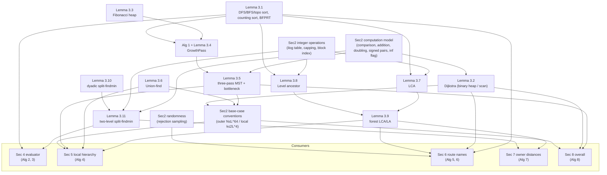

# 01 Analysis of Preliminaries and Primitives (Sec 1–3)

**English** | [日本語](01_preliminaries_primitives.ja.md) | [简体中文](01_preliminaries_primitives.zh-CN.md)

- Target: arXiv 2611.34911v1 "Linear Single-Source Shortest Path, Almost" (Gholami, Hajiaghayi, 2026-11-25)
- Scope: Section 1 (Introduction / Technical Overview), Section 2 (Preliminaries), Section 3 (Graph and Data-Structure Primitives, 3.1–3.5)
- Basis: Lines 1–640 of `.cache/paper/2611.34911v1.txt` (pdftotext) were read in full, and places where formulas are garbled were checked against PDF p.4–14. Uses in later sections were checked by grepping the relevant lines (line numbers refer to the txt).
- Notation: "[Supplement]" marks an implementation-side addition not written in the paper. "[Interpretation]" marks the reading adopted where more than one reading is possible. Verbatim reproduction of the paper text is avoided, and formulas are quoted briefly.

---

## 0. Key points (what the implementation team should know first)

1. **The outer threshold `N > L_N^64` does not hold for any realistic input.** Computing it, the smallest N is about 2^589.09 (L_N = 590). For N < 2^64, L_N ≤ 65, so L_N^64 ≥ 2^385. Therefore Algorithm 8 **always enters the base case of lines 4–7** (keep a lightest edge per vertex pair, then scanning Dijkstra in O(N²+m)). The body of the paper (the outer construction of Sec 5–8) is never executed as is. (Exact values are in [thresholds.md](thresholds.md): the smallest N is 589^64 + 1 ≈ 1.94×10^177, the test is false again on [2^589 − 1, 590^64], and it holds for every N ≥ 590^64 + 1; "about 2^589.09 (L_N = 590)" here and elsewhere in this note is that last bound, not the smallest N.)
2. **The local threshold `N > 2 L_N^4` holds from N ≥ 209,953** (L_N = 18, 2·18⁴ = 209,952). If Algorithm 4 (LocalHierarchy) is run on its own, the non-base path can be tested from about 210 thousand vertices upward.
3. Therefore, testing the non-base path requires **Mode B (`src/experimental/paper_experimental/`)**, which takes the threshold exponents (64 and 4) and the coefficient (2) as parameters. Mode A (`src/paper/`) fixes the thresholds at the paper's values and never lowers them (a rule of the paper-reproduction skill). Moreover, lowering the exponents may break constant relations used by the proofs in Sec 5–8 (e.g. line 1206 "N ≥ 32, h ≤ N, K < 16h", t = O(1+N/L_N^64)). Coordination with the Sec 4–5 and Sec 6–8 maintainers is needed.
4. The base case's "scanning Dijkstra O(N²+m)" (Alg 8 line 5) is too slow for realistic N (such as 10⁶). Mode A uses the scanning version as the paper says and always records `FallbackRecord{"outer: N <= L_N^64 (paper base case)", n, m}`. Replacing it with the binary-heap version (described in Lemma 3.2, but different from what Alg 8 line 5 specifies) is a **deviation**. If replaced, record it as `D-<n>` and put it on a path separate from Mode A (Mode B, or an option) (§2.4(a)).
5. Computing L_N^64 naively in 64-bit integers overflows. Following Sec 2 of the paper, "products used solely in size tests may be capped once they reach the tested limit" (line 304), test with **saturating (capped) multiplication**. A wrapping (modular) overflow would wrongly enter the non-base path.
6. The computation model is comparison–addition. The only operations allowed on reals (edge lengths) are copy, comparison, addition, and doubling. **Floor, log, bit extraction, and use as an address are forbidden** (line 300). A difference is represented as "a pair of two nonnegative sums" (comparing a−b with c−d is done by comparing a+d with c+b). In a double implementation, rounding in addition can break "tight arcs decided by equality" and "comparisons of differences" (§2.8).
7. The crux of the complexity in Sec 3 is τ(k) = 1 + log log log(k+16). It comes from three places: the three passes of MST (Fibonacci heap, limits B1 = max(2, ⌈log2 L_k⌉) and B2 = L_k), the three-band analysis of union-find, and the two-level blocking of split–findmin.
8. split–findmin (Lemma 3.11) is central to the evaluators of Sec 4 (Algorithm 2 line 4) and Sec 7 (lines 1815 and 1863). The API must break ties by `(key, original index)` and also return the **index** that attains the minimum (line 939 "place the interval ID at the position of the selected minimum").
9. LCA and level ancestor (Lemma 3.9) are used in Sec 5.4 (line 1290) to find "which child of the LCA an arc belongs to" (LA(u, depth(lca)+1)), and in Sec 6 (lines 1460 and 1468) for LCA on the partition tree. Binary lifting suffices as the reference implementation.
10. Symbols are heavily overloaded: B (4 meanings), h (5 meanings), M (2 meanings), k, b, and so on (§2.2). Distinguish them in code with namespaces or prefixes.

---

## 1. Section 1: Introduction and Technical Overview

### 1.1 Main theorem (Theorem 1, p.3)

- Input: an undirected multigraph in adjacency-list form (n vertices, m edges), finite nonnegative real edge lengths, and a source s.
- Output: exact distances for all vertices and a shortest-path tree on the reachable vertices. Unreachable vertices get +∞.
- Complexity: O(m + n log log log n) in expectation. Independent of the ratio of edge lengths (spread). Linear when m = Ω(n log log log n).
- Termination: terminates almost surely. **Every terminating run is correct** (Las Vegas type).
- Randomness: independent uniformly random words. Used only for sampling (Sec 6) and distance estimation.
- Computation model: comparison–addition (details in §2.5).

### 1.2 Flow of the Technical Overview and correspondence with the sections

| Concept (Overview paragraph) | Summary of content | Corresponding section / lemma |
|---|---|---|
| Region decomposition | Cut the MST into connected regions and place one pivot in each region. p(v) is the region's pivot, R_v is the length along the tree to p(v), and r_v is the maximum edge on that path. Each path has at most h edges (h is polylog). An edge xy crossing regions (weight w) satisfies r_x, r_y ≤ w. Hence R_x + w + R_y ≤ (2h+1)w | Lemma 5.2, Sec 5.1, Sec 7.1 (h = b+1, b = L_N^64) |
| Request | For each pair of pivots, keep only one lightest projected edge R_x + w + R_y. t is the number of pivots | Sec 6, Definition 6.1 |
| Halving rule | While more than 32t requests remain, sample edges and estimate an upper bound Z on the sampled distance. Among requests with the same table index, choose the smallest λ with Pλ ≥ Z, and give certificate λ to the requests at or above λ. Accept the trial if at least half qualify. Once at most 32t remain, use each request's own projected weight as its certificate | Algorithm 5, Lemma 6.7, 6.8 |
| Auxiliary coordinate J | d_e = Pλ_e (0 within one region). Radial if d_e ≤ w/2, macro otherwise. Identify the pivots into a single root and give each radial edge auxiliary length w + d_e. J_v is the distance to the root in the auxiliary graph. On a radial edge \|ΔJ\| ≤ 3w/2. A radial edge with w > J_x + d_e + J_y may be deleted | Lemma 7.2, Algorithm 8 lines 10–12 |
| Why a constant number of copies suffices | A radial subpath whose endpoint coordinates are at most M/16 and whose summit is M takes at least 5M/8 to climb. The detour via the pivots is at most M/8 + L/2, a contradiction. Near if the ratio is at most 16², far otherwise. Shells have ratio 16. Each vertex belongs to at most 2 windows per phase | Lemma 8.1, Sec 5.2, Sec 8.1 |
| Processing order | Build a hierarchy of SCCs according to arc-length thresholds. Group merge weights by the doubling grid [a, 2a) and set the height to a. A slot's width is at most the height. An offer is a tentative upper bound. An open group expires at D0 + S(X) | Sec 4, Algorithm 2, 3 |
| Forming groups without knowing J | Split the auxiliary graph into small connected sets and apply the local construction (local MST, with the maximum edge on the path to the local pivot as coordinate) | Sec 5, Algorithm 7, Lemma 7.7 |
| Where the triple log comes from | On a set of size k, the local construction costs O(1 + log log(k+4)) per vertex. k ≤ polylog n. Merge events are found by binary search among O(log log n) consecutive powers of 2, hence O(log log log n) | Sec 5.4, Sec 8.2, Lemma 8.4 |
| Sampling | O(m + n) in expectation | Sec 6, Sec 8 |

The constants in the Overview (32t, 16, 16², 3/2, 5/8, 1/8, 1/2) are defined precisely in the lemmas of later sections. Implementations must follow the definitions of the later sections. The Overview only explains intuition.

### 1.3 Points from Related Work that matter for implementation

- It inherits split–findmin and the component-hierarchy idea from Pettie–Ramachandran [PR05]. Sec 3.5 of this paper is a simplified version that replaces their inverse-Ackermann bound with "τ(k) via two-level blocking".
- Key distinction: **computing** distances is different from **sorting** vertices by distance. This algorithm does not produce a global distance order. Therefore "the output matches Dijkstra's extraction order" must not be used as a test criterion. Compare only the correctness of distances and the tree.

---

## 2. Section 2: Preliminaries (p.6–7)

### 2.1 Graphs and distances

- The input is an undirected **multigraph**, possibly with self-loops and parallel edges. Edge lengths are finite nonnegative reals.
- A walk may repeat edges; a path does not repeat vertices. d_G(x,y) is the minimum length of a walk, or +∞ if none exists.
- **Tight arc**: an arc with d(s,x) and d(s,y) both finite and d(s,x) + w(xy) = d(s,y). Since the graph is undirected, either orientation may be used for the definition. The output tree is built by following tight arcs (Lemma 8.5, Algorithm 8 line 16). Note that this is an **equality test** (§2.8).

### 2.2 Symbols and parameters

| Symbol | Definition | Where it appears | Remarks |
|---|---|---|---|
| n, m | Number of vertices and edges of the input | Throughout | |
| N | Number of vertices within a construction | Sec 2 onward | In the outer construction, the vertex count of the source component after contracting zero edges (Alg 8 line 3) |
| M | Number of arcs, or number of demands ("where specified") | Sec 4, 6 | **The Overview also uses it for the summit coordinate (overloaded)** |
| k, l | Number of vertices and edges (arcs) in Sec 3 | Sec 3 | k also appears frequently with other meanings |
| p | Number of records to sort or select | Lemma 3.1 | Unrelated to the pivot p(v) |
| L_k | ⌈log2(k+2)⌉ (integer k ≥ 1) | Throughout | L_k ≥ 2 for k ≥ 1 |
| τ(k) | 1 + log log log(k+16) | Complexity statements | τ ≥ 2 for k ≥ 1 (log log log 17 > 1). **Not used in the implementation** (analysis only) |
| T[x,y], D_T(x,y), b_T(x,y) | The unique path in the tree, its length, and its maximum edge length (b_T(x,x) = 0) | Sec 3.2 onward | |
| Depth | Counted in edges. The root has depth 0 | Sec 3.4 | |
| log | Base 2 | Throughout | |
| B (Alg 1) | Heap limit of GrowthPass. B1 = max(2, ⌈log2 L_k⌉), B2 = L_k, +∞ for the third pass | Sec 3.2 | k is the **original** vertex count |
| B (Sec 3.4) | max(2, ⌊log2(k+1)/8⌋), where k is the vertex count after augmentation | LCA and LA | B = 2 for k < 2^24 |
| B (Sec 3.5) | max(2, ⌈log2(k+1)⌉) | split–findmin blocks | Different from the B of 3.4 |
| b1, b2, b3 | b3 = 1 + L_k, b2 = ⌈log2(b3+1)⌉, b1 = ⌈log2(b2+1)⌉ | Proof of Lemma 3.6 | Analysis only |
| s | Heap size | Lemma 3.3 | |
| Q, q, q' | Number of union/find operations, number of decreases, number of queries | Lemma 3.6, 3.11 | |
| h | (a) Overview: bound on the edge count of tree paths (polylog). (b) Sec 2: random range 0..h−1. (c) Sec 3.4: number of whole blocks in the middle, jump width 2^⌊log d⌋. (d) Sec 4: node height h(C). (e) Sec 7: h = b+1 | Various | **Overloaded 5 ways** |
| b | Separator size. L_N^4 in the local construction (Sec 5.1), L_N^64 in the outer construction (Sec 7.1) | Sec 5, 7, 8 | |
| t | Number of pivots | Sec 6 | In the outer construction t = O(1 + N/L_N^64) |
| P | Polylog factor. A power of 2 | Sec 6, 7 | In Alg 5 line 3, the smallest power of 2 that is at least 8·256·g·u² |
| λ_e, Z, d_e | Certificate weight, estimated upper bound, d_e = Pλ_e | Sec 6, 7 | |
| R_v, r_v, p(v) | Length along the tree to the pivot, maximum edge, pivot | Sec 5, 7 | |
| J_v | Auxiliary distance (owner coordinate) | Sec 7 | |
| K | Smallest power of 2 that is at least 8h | Sec 5.2 | |
| c0 | Connector constant (length of the tree connection linking the children ≤ c0·h(C)) | Definition 4.1 | 1 in the local base case, at most 2 in Lemma 5.10 |

### 2.3 Threshold conditions: where and why they are used

Numerical check (computed exactly with integers in Python):

| Condition | First N where it holds | L_N at that point | Meaning |
|---|---|---|---|
| Local: N > 2·L_N^4 | **209,953** | 18 | At or above this, the local non-base construction runs |
| Outer: N > L_N^64 | **about 2^589.09** | 590 | Never holds in practice. Even at N = 2^64−1, L = 65 and L^64 ≈ 2^385.4 |

Places of use:

| Threshold | Where it is used (txt line) | Purpose |
|---|---|---|
| Outer N > L_N^64 | Assumption in Sec 2 (line 286) | Nontrivial range of the outer construction |
| | Algorithm 8 line 4 (line 2175) | If N ≤ L_N^64, base case: keep a lightest edge per vertex pair, scanning Dijkstra (Lemma 3.2), restoration, scan of tight arcs |
| | Sec 6 (line 1374), Lemma 6.8 (line 1605) | Pivot count t = O(1 + N/L_N^64) |
| | Sec 7.1 (line 1644), Lemma 8.4 (line 2106) | Separator size of the owner decomposition b = L_N^64, h = b+1. Atom size is less than b |
| | Proof of Lemma 7.9 (line 1962), proof of Theorem 1 (line 2211) | Derives 1 + log log(b+4) = O(τ(N)) from b ≤ L_N^64 (the basis of the triple log) |
| Local N > 2·L_N^4 | Assumption in Sec 2 (line 286) | Nontrivial range of the local construction |
| | Algorithm 4 line 2 (line 1248) | Base case if k ≤ 2L_k^4 (§2.4 below) |
| | Sec 5.1 (line 966) | Local separator b = L_N^4 |
| | Lemma 5.7 (lines 1062, 1084) | Assumption for constructing the local radial states |
| | Line 1206 | The constant estimate "in the nontrivial range N ≥ 32, h ≤ N, K < 16h, hence 3hK² ≤ 768N³" |

"The excluded sizes are absolutely bounded" (lines 286–287) is formally correct. However, the outer bound is about 2^589, so in practice it means "the entire input is a base case".

### 2.4 Base-case conventions (Sec 2 lines 287–290, Alg 4 lines 2–5, Alg 8 lines 4–7)

#### (a) Outer base case (Algorithm 8 lines 4–7)

```
outer_base_case(G_contracted, s):            // N <= L_N^64
  E' = lightest_edge_per_pair(G)             // keep only the one edge with the smallest (length, index) per vertex pair; drop self-loops
  dist = dijkstra_scan(N, E', s)             // scanning version of Lemma 3.2, O(N^2 + |E'|)
  // restoration (map back to original vertices, unreachable = ∞) and the tight-arc scan belong to Lemma 8.5 (Sec 8 maintainer)
```

- [Supplement] For the lightest edge per vertex pair, order (min(u,v), max(u,v)) with two stable counting-sort passes (Lemma 3.1) and keep the one with the smallest (w, id) within each pair. O(m + N).
- [Implementation recommendation] Mode A uses the scanning version O(N² + m) as is and always records `FallbackRecord{"outer: N <= L_N^64 (paper base case)", n, m}`. Since the outer base case covers every realistic input, the running time becomes O(N²) for large N. State this fact honestly in reports. Record the binary-heap version (Lemma 3.2, O((N+m) log N)) as a deviation candidate. Draft: `D-1: Replace the scanning Dijkstra of Alg 8 l.5 with the binary-heap version — O(N²) is impractical for large N — the cost of the base case changes from O(N²+m) to O((N+m) log N). Distance correctness is unchanged (Lemma 3.2)`. Put this in Mode B or behind an option.

#### (b) Local base case (Algorithm 4 lines 2–5)

Input: a connected undirected graph H with positive weights (k vertices, k ≤ 2L_k^4).

```
local_base_hierarchy(H):
  states = { one native entry state per vertex }      // π(state) = that vertex
  arcs   = all original nonloop edges in both directions (parallel edges kept)
  H1 = lightest_edge_per_pair(H)
  T  = MST(H1)                                         // small, so any MST method works [Interpretation]
  // merge equal-weight MST edges simultaneously (Kruskal-style component tree, grouping layers of equal weight)
  dsu = DSU(k); node_of_root[v] = leaf(v)
  for each group of MST edges of weight w (in increasing order of w):
      group = set of current roots of the endpoints of the group's edges
      union the group's edges in dsu
      for each new connected component: create internal node C, height(C) = w,
         children = the component nodes just before the group that are contained in the component (2 or more)
         connector tree = the MST edges of weight w inside the component (record endpoint states and length w)
  return states, arcs, π, hierarchy (root = the last component)
```

- Basis of correctness (paper lines 289–290): the children are linked by tree edges of weight w, and c0 = 1. There is no edge lighter than w between the children, because of b_T(x,y) ≤ w(xy) in Lemma 3.5. The tree path between vertices x, y in different children passes through an edge of weight w, so b_T(x,y) = w ≤ w(xy). Hence there is no "arc below the height between children", and the quotient graph is trivially acyclic.
- Boundary values: for k = 1, only one leaf (no internal node). All weights are positive (zero edges were contracted in Alg 8 line 2), so heights are positive too.
- Tests: check the invariants of Definition 4.1. Internal nodes have 2 or more children, heights are monotonically nondecreasing toward the root, there is no arc below the height between children, the connector tree connects the children, and each connector length is at most c0·h.

### 2.5 Computation model for reals (edge lengths) (lines 292–300)

| Operation | Allowed? | Cost |
|---|---|---|
| Copy, comparison, addition | Allowed | 1 |
| Infinity | Kept as a separate flag | — |
| Difference a − b | **Not stored directly**. Represented as a pair (positive sum, negative sum). Addition is componentwise; negation swaps the components | Constant |
| Comparing a−b with c−d | Compare a+d with c+b | Constant |
| Multiplying by 2^j | j doublings | j (charged in the lemma's bound when variable) |
| Dividing by a power of 2 | If the denominators used in a construction are a fixed power of 2, keep all compared values on a common scale (values from outside are rescaled on entry) | — |
| Floor, integer part, log, bits, use as an address | **Forbidden** | — |

Where they are used (later sections, by grep):
- Signed pairs: slot alignment in Sec 4.3 (lines 794–795) ("the largest b − jν(C) that is at most D0"), restoration of output values in Sec 8.3 (line 2158).
- Doubling: Sec 5.2 (lines 1029, 1035, K²r_v), Sec 6 (median test at line 1389, P at line 1399, (H+j)Δ at lines 1486 and 1494), Sec 8.2 (F at line 2080, line 2131).
- Power-of-2 denominators: r_v/32, s_U/2, M/16, and so on. Represented on a common scale (line 1724 "after scaling all quantities by a fixed power of two").

### 2.6 Integer and word operations (lines 301–306)

- Vertex identifiers, indices, and counters are a constant number of words of Θ(log(n+m+2)) bits. Array access, shifts, bit operations, and integer addition, subtraction, and comparison are O(1).
- **Integer log2**: tabulate ⌊log2 i⌋ by the halving recurrence starting from i = 1 (O(k)).

  ```
  lg[1] = 0; for i in 2..K: lg[i] = lg[i >> 1] + 1
  ```

  [Implementation note] C++20 `std::bit_width(i) - 1` compiles to a clz instruction. The paper's word operations (shifts and bit operations) do not explicitly include clz. Use the table to stay faithful to the model, or `bit_width` to favor performance. Decide which one in an ADR.
- **Capping**: products used only in size tests are capped once they reach the limit. Always test L_N^64 with saturating multiplication (§0 item 5).

  ```
  bool exceeds_pow(u64 N, u64 L, int e):   // tests N > L^e
    acc = 1
    repeat e times: if acc > N / L: return false  // L^e > N (cap) [Supplement] use __int128 to avoid division
                    acc *= L
    return N > acc
  ```

- Fixed-size blocks: if a scan stores each element's block index and offset, no integer division is needed ([Implementation note] using `/` and `%` in the implementation does not change the complexity).

### 2.7 Randomness (lines 307–310)

```
uniform_below(h):            // uniform integer in 0..h-1
  if h == 1: return 0
  c = ceil_log2(h)
  loop: x = next_bits(c)     // c unbiased bits
        if x < h: return x   // rejection sampling; success probability greater than 1/2
```

- [Implementation note] `std::uniform_int_distribution` gives different results across implementations and is not reproducible. Seed `std::mt19937_64` or SplitMix64 and write the rejection sampling above by hand. Modulo (`x % h`) is biased and is forbidden.
- Expectations are over the random draws on a fixed input. Randomness is used only in Sec 6 (sampling, uniform permutation, j ∈ {0..H−1}).

### 2.8 Places that become problematic in a double implementation

| # | Place | Problem | Proposed countermeasure |
|---|---|---|---|
| D1 | Path-length addition in general | Rounding breaks associativity. Two paths summed in different orders can produce different values even when their exact lengths are equal | Test correctness with integer weights (`uint64_t`; `double` is also exact if the total is < 2^53) |
| D2 | Tight-arc test d(x)+w == d(y) (Lemma 8.5, Alg 8 line 16) | If the evaluator's values and the "sum along the tree" at output time (line 2156) are summed in different orders, equality fails and the tree is broken | Rounding is monotone (a ≤ b implies fl(a+w) ≤ fl(b+w)), so it holds for left-to-right accumulation as in Dijkstra. There is no guarantee if the evaluator's values were summed in another order. Verify in integer mode; in double mode decide by relative error and record it in `Diagnostics` |
| D3 | Signed-pair comparison a+d vs c+b (slot alignment in Sec 4.3, etc.) | Each side's sum is rounded separately, and when the difference is below an ulp the comparison can be wrong. Deadline tests can shift | Treat integer mode as authoritative. For double, consider `long double` or a rewritten formula that avoids pairs |
| D4 | Tree distance D_T(u,v) = rd(u) + rd(v) − 2·rd(lca) (Sec 5.1 lines 963–965, "delete if w(uv) > D_T(u,v)") | If w < D_T exactly but rounding decides w > D_T, **a needed edge is deleted and distances go wrong**. Deleting is safe when w = D_T exactly | Compare in the form w + 2·rd(lca) > rd(u) + rd(v) (as in the model). Rounding still remains, so verify in integer mode |
| D5 | Power-of-2 factors (K, P, F, H = smallest power of 2 that is at least (16t)^5) | Multiplying a double by 2^j is exact, but **overflow** (beyond 2^1024) and **underflow** (subnormals, 0) can occur. For example, with h = L^64+1, K ≈ 2^(log h+3), and F > 2P(2h+1)(8K²h)² is around 2^1700 even at N = 2^20, beyond the range of double. The outer construction runs only for N > L^64, so this does not happen in practice, but **take care when testing with lowered exponents** | Give the length type a separate "exponent offset" (manage the common scale with an integer exponent), or use `long double`. uint64 overflows immediately, so use checked addition (`WeightTraits::checked_add`) |
| D6 | Infinity | double inf is fine for comparison and addition. But inf − inf in the pair representation gives NaN | As in the paper, keep infinity as a separate flag. For uint64 use `infinity() = max` and `checked_add` |
| D7 | Grid classification (the largest grid value at most r_v/32, the floor of s_U, etc.) | `std::floor(log2(w))`, `frexp`, and `ilogb` are **model violations** (line 300). They are fast but fall outside the paper's complexity claims | In faithful mode, use doubling and binary search. If frexp is used in an optimized mode, record it in an ADR |
| D8 | Input validation | NaN, negative values, and inf are outside the paper's assumptions. −0.0 compares equal to 0 but has a different bit pattern | `validate_edges` already rejects them. Normalize −0.0 to +0.0 [Supplement] |
| D9 | Zero edges | Sec 5 onward assumes positive weights. The Sec 3 primitives allow zero | Contract them in Algorithm 8 line 2. The primitives have zero-weight tests |
| D10 | Ties | Make a total order with the (length, index) pair. Equality comparison of doubles is exact, so there is no problem | Gather the comparison function in one place |

---

## 3. Section 3: Graph and Data-Structure Primitives

Common: each primitive is proved with explicit dependence on both the vertex count and the edge count (k, l) (lines 315–316). This keeps the edge term linear even on dense graphs.

### P1. DFS, BFS, topological sort (Sec 3.1, Lemma 3.1, p.7–8)

- Input: a (directed or undirected) graph with k vertices and l arcs. Output: discovery order, or an order in which all arcs point forward.
- Pseudocode:

  ```
  topo_sort(k, out_adj):                  // Kahn's algorithm
    indeg[v] = in-degree; queue = { v : indeg[v] == 0 }
    order = []
    while queue nonempty: v = pop; order.push(v)
      for (v->x): if --indeg[x] == 0: push x
    if |order| < k: cycle exists (precondition violated) [Supplement] detect and throw an exception
  ```

  DFS and BFS mark vertices on discovery and scan each adjacency list exactly once. [Supplement] Recursion overflows the stack at depth k, so write it with an explicit stack.
- Complexity: O(k + l) time, O(k) space. Uses only integer operations.
- Deterministic. Boundary values: k = 0, isolated vertices, self-loops (a cycle for topological sort), parallel arcs.
- Tests: all arcs point forward in the returned order, cycle detection, comparison on random DAGs against a reference using `std` (the order is not unique, so compare by properties).
- Caution: the order from Kahn's algorithm is not unique. The child order in Sec 4.2 is produced by its own traversal (line 759), so it must not depend on the order of this topological sort.

### P2. Stable counting sort and multi-coordinate radix sort (Sec 3.1, Lemma 3.1)

- Input: p records with integer coordinates in [0, k). Output: a stably sorted order.
- Pseudocode:

  ```
  counting_sort_stable(recs, key, k):
    cnt[0..k] = 0; for r: cnt[key(r)+1]++
    prefix sum; for r in input order: out[cnt[key(r)]++] = r
  radix_sort(recs, keys[0..c-1]):  for j = c-1 downto 0: counting_sort_stable(recs, keys[j])
  ```

- Complexity: O(p + k) per pass. The number of coordinates is constant. Uses only integer operations.
- **Real weights must not be used as coordinates** (they cannot be used as addresses).
- Tests: compare against `std::stable_sort`. Include p = 0, k = 1, and all-equal keys.

### P3. Selection (BFPRT, Sec 3.1, Lemma 3.1)

- Input: p comparable keys and a rank r. Output: the key of rank r.
- Pseudocode:

  ```
  select(A, r):                          // 0-indexed rank
    if |A| <= C0: sort directly and return A[r]   // C0 is a fixed constant [Supplement] e.g. 8
    groups = split A into groups of 5 (the last may have fewer than 5)
    meds = median of each group
    piv = select(meds, (|meds|-1)/2)
    (lt, eq, gt) = 3-way partition (comparison with piv)
    if r < |lt|: return select(lt, r)
    if r < |lt|+|eq|: return piv
    return select(gt, r - |lt| - |eq|)
  ```

- Complexity: worst-case O(p) comparisons and basic operations (the strict side has at most 7p/10 + O(1)). Uses only comparisons, consistent with the model. Deterministic.
- Boundary values: many equal values (handled together by the 3-way partition), p = 1, r at either end.
- Where used: Sec 6 (lines 1389, 1407 "test the median by doubling", 1621), Sec 8.2 (line 2131).
- Reference implementation: `std::nth_element`. In libstdc++ it is introselect, worst case O(p log p). Compare by whether the rank values match.

### P4. Dijkstra search (Sec 3.1, Lemma 3.2, p.8)

- Input: a graph with nonnegative arc lengths, a source (and initial values), and optionally a radius R. Output: settled vertices and distances.
- Invariants: a tentative value is the length of a discovered walk (never an underestimate). A settled value equals the true distance.
- Pseudocode:

  ```
  struct SearchArena { vector<u32> stamp; vector<Len> dist; u32 cur; }   // reuse by search ID
  //  get(v) = (stamp[v]==cur) ? dist[v] : INF. A new search is just cur++ (only touched elements are initialized)
  dijkstra(G, s, R = +INF, arena, heap):
    arena.begin(); arena.set(s, 0); heap.insert(s, 0)
    while !heap.empty():
      (d, v) = heap.extract_min()
      if d > R: break                    // "stop when the least finite value exceeds R" => d ≤ R gets settled
      settle(v, d)
      for (v -> x, w):
        nd = d + w
        if nd < arena.get(x): arena.set(x, nd); heap.insert_or_decrease(x, nd)
  dijkstra_scan(...):  instead of a heap, scan all unsettled vertices each time to pick the minimum. O(k^2 + l)
  ```

  [Supplement] When `cur` wraps around at 2^32, reset all of `stamp` to 0.
- Complexity: with a binary heap, O(1 + log(k+1)) per operation (worst case). O((k + l) log k) overall. The scanning version is O(k² + l). Uses only addition and comparison, consistent with the model. Deterministic.
- Boundary values: zero weights, unreachable (stays ∞), R = 0 (only the source and vertices at distance 0), ties (may be extracted in any order), parallel edges, self-loops.
- Where used: Lemma 6.6 in Sec 6 (line 1558, binary-heap version with multi-center pruning), Algorithm 8 line 5 (scanning version).
- Tests: compare distances against `baseline::dijkstra_binary_heap` and `bellman_ford`. With a radius, the settled set equals {v : d(v) ≤ R}. When the arena is reused, nothing leaks from the previous search.

### P5. Fibonacci heap (Sec 3.2, Lemma 3.3, p.9–10)

- Structure: the root list and child lists are doubly linked lists. Each node has a parent pointer, a degree, and a mark bit. A pointer to the minimum is kept.
- Pseudocode (standard FT87):

  ```
  insert(x): add a singleton root and update min if needed
  decrease(x, k): key[x] = k
     if x is not a root and key[x] < key[parent]: cut(x); cascading_cut(old parent)
     update min
  cut(x): detach x from its parent, make it a root, and clear its mark
  cascading_cut(y): if y is not a root: if !mark[y]: mark[y] = true  else: cut(y); cascading_cut(parent(y))
  extract_min():
     z = min. Make all children of z roots (clear their marks). Remove z
     deg_arr[0 .. 3 + 2*ceil_log2(s+1)] = null      // size from the paper
     for each root r: while deg_arr[deg r] != null: link (make the root with the larger key a child of the root with the smaller key), deg++
     rebuild min
  ```

- Complexity: insert and decrease are amortized O(1). Extract from a heap of size s is amortized O(1 + log(s+1)). Uses only comparisons (keys are (length, index) pairs). Deterministic.
- Invariants: the subtree of a node of degree d has size at least F_{d+2}. Roots are unmarked. Newly linked children are also unmarked.
- Boundary values: empty heap, one element, equal keys, decrease to the same value, freeing all nodes on disposal (Algorithm 1 creates a new heap for each growth).
- Tests: compare against a `std::multiset` reference model on random operation sequences. After each operation, check heap order, agreement between degree and child count, and that no root is marked.
- Existing assets: `baseline::dijkstra_fibonacci_heap` has an FT87 heap. To use it here, three things are needed: "addressable by index", "counts size()", and "disposable per growth ID". Discuss with the baseline owner whether to extract it into a shared header.

### P6. GrowthPass (Algorithm 1, Lemma 3.4, p.8–10)

- Input: a connected quotient graph H (each quotient vertex is a connected set of original vertices; each quotient edge keeps its original edge index), and a limit B ≥ 1 or +∞.
- Output: the set F of retained original edge indices, and the loop-free quotient graph obtained by contracting the components of F.
- Precondition: edges are compared by the (length, index) pair. This is a total order, so the MST is unique.
- Pseudocode (at a granularity that maps to C++):

  ```
  // QAdj: quotient vertex u -> list of (to, len, edge_id)
  GrowthPassResult growth_pass(u32 kq, const QAdj& adj, size_t B /* SIZE_MAX = +inf */):
    F = []
    growth_of[0..kq) = NONE           // visited mark; stores the growth ID
    heap_gid[0..kq)  = NONE           // decides by growth ID whether a heap entry is valid
    for u0 in 0..kq-1:
      if growth_of[u0] != NONE: continue
      gid = new_growth_id(); heap = FibHeap<(Len, EdgeId), u32>()    // new heap
      u = u0
      loop:
        growth_of[u] = gid
        for (x, w, id) in adj[u]:
          if growth_of[x] == gid: continue                   // inside this growth (loops are skipped here too)
          key = (w, id)
          if heap_gid[x] != gid: heap_gid[x] = gid; h[x] = heap.insert(key, x)
          else if key < heap.key(h[x]): heap.decrease(h[x], key)
        if heap.empty() or heap.size() > B: break            // lines 9–10
        ((w, id), v) = heap.extract_min(); F.push(id)        // line 11
        if growth_of[v] != NONE: break                       // reached an earlier growth (lines 12–13)
        u = v
    // line 15: build the quotient from the components of F
    comp = connected_components(kq, edges of F)              // DFS (Lemma 3.1)
    adj' = { (comp[a], comp[b], w, id) : original quotient edge (a,b,w,id), comp[a] != comp[b] }   // drop loops, keep parallel edges
    return F, num_comp, adj'
  ```

- Invariants: there is one heap entry per "vertex x outside this growth", pointing to the lightest cut edge from the current growth to x. heap.size() is **the number of distinct outside vertices**.
- Complexity (Lemma 3.4): one pass over k' vertices and l' edges takes O(l' + k'(1 + log(min(k', B) + 1))). If B is finite, at most 1 + 2l'/B quotient vertices remain. An extract happens only when the heap size is at most B (the size test comes before the extract).
- Correctness: every selected edge belongs to the unique MST under the (length, index) order (cut property). Each edge is selected at most once.
- Deterministic. Boundary values: kq = 1 (no pass needed), self-loops, parallel edges (decrease keeps only the lightest), B = 1 and 2, B = +∞ (the first growth covers everything).
- [Interpretation] Lemma 3.5 assumes H is connected. Even on a disconnected input, each growth stops on an empty heap, so a spanning forest (MSF) is obtained. Algorithm 8 passes only the source component, so the input is connected.
- Caution when substituting a reference implementation: replacing it with a lazy-deletion binary heap (duplicate entries for the same vertex) makes size() count duplicates and changes the test on line 9. Correctness (selected edges belong to the MST) is preserved, but the pass's behavior and the complexity claim change. Use an indexed heap (no duplicates).

### P7. Three-pass MST and the bottleneck property (Lemma 3.5, p.10–11)

- Input: a connected undirected multigraph (k ≥ 1 vertices, l edges). Output: the edge indices of the MST (k−1 edges).
- Pseudocode:

  ```
  mst_three_pass(k, edges):
    if k == 1: return []
    Lk = L(k); B1 = max(2, ceil_log2(Lk)); B2 = Lk          // determined from the original k
    q = initial quotient (each vertex alone, drop loops)
    Fall = []
    for B in [B1, B2, +INF]:
      if q.num_vertices == 1: break                           // [Supplement] finish early
      (F, q) = growth_pass(q, B); Fall += F
    assert |Fall| == k - 1
    return Fall
  ```

- Complexity: O(l + kτ(k)). Uses only comparisons (no length additions). Deterministic.
  - Analysis: the number of quotient vertices decreases as k, 1 + 2l/B1, 1 + 2l/B2. The extract terms are k·log B1 ≈ k log log log k, (l/B1)·log B2 ≈ l, and (l/B2)·log k ≈ l.
- Bottleneck property: for any MST T and distinct x, y, b_T(x,y) equals the minimum, over x–y walks, of the maximum edge length. In particular, for a nonloop edge xy, b_T(x,y) ≤ w(xy). This property is used in Sec 5.1 (line 963), the local base case, and the sweep of Sec 5.3.
- Boundary values: k = 1, all-equal weights (order decided by index), zero weights, lightest among parallel edges, vertices with only loops.
- Tests:
  - Unit: the output has k−1 edges, forms a spanning tree, and **has exactly the same edge set** as Kruskal under the (length, index) order (the order is total, so the MST is unique).
  - Property: on random graphs, b_T(x,y) equals the minimax path value (computed with Kruskal's DSU) for all vertex pairs.
  - Counting: after each pass, the number of quotient vertices is at most 1 + 2l'/B (recorded in `Diagnostics.counters`).
- Reference implementation: Kruskal (sort + DSU, O(l log l)).

### P8. Union-find (Sec 3.3, Lemma 3.6, p.11)

- Input: k elements. Operations: find, union. If the order of merge events is given, process them in that order (the caller bears the cost of ordering).
- Pseudocode:

  ```
  init: parent[i] = i; rank[i] = 0
  find(x): r = x; while parent[r] != r: r = parent[r]
           while parent[x] != r: nx = parent[x]; parent[x] = r; x = nx      // full path compression
           return r
  unite(a, b): ra = find(a); rb = find(b); if ra == rb: return false
           if rank[ra] < rank[rb]: swap; parent[rb] = ra
           if rank[ra] == rank[rb]: rank[ra]++
           return true
  ```

- Complexity: O(Q + kτ(k)) for initialization and Q operations (three-band analysis: b3 = 1 + L_k, b2 = ⌈log2(b3+1)⌉, b1 = ⌈log2(b2+1)⌉). Uses only integer operations. Deterministic.
- Boundary values: k = 1, union with itself, repeating the same union.
- Where used: the local base case, Sec 5.3–5.4 (joining the same class at lines 1179, 1233, 1260), the Kruskal sweep of Sec 6 (line 1475; however, Sec 6 uses the relink-the-smaller-list scheme, line 1485).
- Tests: compare with a naive implementation (component labels in an array) on random operation sequences. Ranks strictly increase toward the parent, and rank ≤ ⌊log2 k⌋.

### P9. LCA (Sec 3.4, Lemma 3.7, p.11–12)

- Input: a rooted forest (with fixed child order). Preprocessing: augment it by adding a common root R, and record each vertex's original component. k is the vertex count after augmentation.
- Output: lca(u, v). "None" if they are in different trees (decided by comparing components).
- Pseudocode (Bender–Farach-Colton ±1 RMQ):

  ```
  build:
    B = max(2, lg[k+1] / 8)                       // ⌊log2(k+1)/8⌋ = ⌊⌊log2(k+1)⌋/8⌋
    E[0..2k-2], D[...] = Euler tour (record the vertex reached each time an edge is traversed). first[v] = first occurrence
    tabulate blk[i], off[i] = i / B, i % B by a scan (the paper uses no division)
    code[b] = the B-1 sign bits of depth changes in block b (pad the last short block with arbitrary signs)
    in_tbl[code][i][j] = for sign sequence code, the first position of the minimum depth in range [i, j] (enumerate all codes and all i ≤ j directly)
    bmin[b] = first position of the minimum in block b
    sp[0][b] = bmin[b]; sp[i][b] = argmin_first(sp[i-1][b], sp[i-1][b + 2^(i-1)])
  query(u, v):
    if comp[u] != comp[v]: return NONE
    l = first[u]; r = first[v]; if l > r: swap
    bl = blk[l]; br = blk[r]
    if bl == br: pos = bl*B + in_tbl[code[bl]][off[l]][off[r]]
    else:
      cands = { bl*B + in_tbl[code[bl]][off[l]][B-1], br*B + in_tbl[code[br]][0][off[r]] }
      h = br - bl - 1
      if h > 0: i = lg[h]; cands += { sp[i][bl+1], sp[i][br - 2^i] }
      pos = the candidate with minimum depth (smallest position on ties)
    return E[pos]
  ```

- Complexity: O(k) preprocessing time and space (the sign table is O(2^B B³)). Query is O(1). Uses only integer operations. Deterministic.
- Correctness: within the tour range between the two first occurrences, only the LCA attains the minimum depth.
- Boundary values: u = v, u an ancestor of v, two roots, different trees, k = 1 or 2 (constant sizes may be tabulated directly), the last short block.
- [Implementation note] For k < 2^24, B = 2. In this range of practical sizes, blocking has almost no effect. The sparse table is about (k/2)·log k words. The linear claim is only asymptotic.
- Tests: compare against a naive implementation (walking parents) on all pairs (small trees). On large trees, compare on random queries. Include forests with different components.
- Reference implementation: naive, or binary lifting O(k log k).

### P10. Level ancestor (Sec 3.4, Lemma 3.8, p.12–13)

- Input: the augmented rooted tree (B is the same as in P9). query(v, j): the ancestor of v at depth j (0 ≤ j ≤ depth(v), depth after augmentation).
- Pseudocode (macro–micro decomposition + jump pointers + ladders):

  ```
  build:
    // (1) marking (postorder)
    for v in postorder: res[v] = 1 + Σ res[c]; if res[v] >= B: marked[v] = true; res[v] = 0
    marked[R] = true
    // (2) micro trees = connected components of unmarked vertices (each has fewer than B vertices). top(v) = topmost vertex of the component
    //     shape code = a leading 1 + 1 on entering and 0 on leaving during DFS (fewer than 2B bits)
    //     store the mapping between local preorder positions and original vertices
    // (3) shape table: enumerate all valid parenthesis strings of length 2s (s < B),
    //     anc[shape][pos][rd] = the local position of the ancestor of local position pos at relative depth rd
    // (4) for marked p, jump[p][i] = the ancestor 2^i edges up (when it exists)
    //     keeping a "stack indexed by depth" during DFS gives each in one lookup
    // (5) compute heights (in edges) in postorder. At each internal vertex select one child of maximum height [Supplement] on ties, the first in child order
    //     the selected edges split the vertices into paths. Make each path an array in depth order and extend it upward by "the number of vertices on the path" (cut off at the root) = ladder
    //     each vertex stores its position in the extended array of its own (pre-extension) path
  query(v, j):
    if !marked[v] and j >= depth[top(v)]:
       return local_to_global[micro(v)][ anc[shape(v)][pre(v)][j - depth[top(v)]] ]
    p = marked[v] ? v : parent[top(v)]       // the parent of top is always marked
    d = depth[p] - j
    if d == 0: return p
    i = lg[d]; h = 1 << i; x = jump[p][i]
    (ld, idx) = ladder_pos[x]; return ladder[ld][idx - (d - h)]
  ```

- Complexity: O(k) preprocessing time and space (the shape table is O(2^{2B} B³) = O(k^{1/4} B³)). Query is O(1). Uses only integer operations. Deterministic.
- Key to correctness: after the jump, the height of x is at least h. Hence x's path has at least h+1 vertices, and its extension covers the ancestor d − h < h edges up.
- Boundary values: j = depth(v) (itself), j = 0 (root), v marked, queries that stay inside a micro tree, path-like trees (height k), star-shaped trees.
- Tests: compare against a naive implementation (walking parents) for all (v, j) (small trees). Try random tree shapes (path, star, binary tree, caterpillar).
- Reference implementation: binary lifting with O(k log k) space and O(log k) query, or a naive implementation.
- [Implementation note] The only use in Sec 5.4 is "which child of the lca" = LA(u, depth(lca)+1) (line 1290). An offline alternative (binary search over children by preorder range, O(log deg)) also suffices.

### P11. LCA and LA on forests (Lemma 3.9, p.13)

- Combines Lemmas 3.7 and 3.8. Add one root, shift depths by 1, and shift them back. LCA detects "different trees" by comparing components. LA assumes 0 ≤ j ≤ depth(v) (original depth).
- Proposed public API: `ForestQueries(parent[], child order)`, `lca(u,v) -> optional<Vertex>`, `level_ancestor(v, j) -> Vertex`, `depth(v)`, `component(v)`.
- Where used: Sec 5.1 (tree distance from LCA and distance from the root), Sec 5.4 (lines 1256, 1290), Sec 6 (lines 1460, 1468, 1600), Sec 7.4 (line 1853).

### P12. Dyadic split–findmin (Sec 3.5, Lemma 3.10, p.13)

- Input: a fixed array of size k (key, original index). Initially one interval.
- Operations:
  - split(pos): cut the interval containing pos at boundary pos into two nonempty intervals.
  - decrease(i, key): lower a key.
  - query(i): return the minimum (key, index) of the interval containing i. Ties are broken by original index.
  - interval_of(i): return the interval's descriptor.
- Structure:
  - Pad to a power of 2 K ≥ k (unused positions are ignored) and build a balanced binary tree (node numbers in heap order).
  - Each interval = the ordered list of maximal tree nodes contained in the interval (at most 2 per depth).
  - A node holds (min, interval descriptor, previous/next in the list). Each element points to its maximal node. A descriptor holds (lo, hi, head and tail of the list, min).
- Pseudocode:

  ```
  decrease(i, key): K[i] = key; n = node_of[i]
     if (key,i) < n.min: n.min = (key,i)
     if (key,i) < n.desc.min: n.desc.min = (key,i)
  query(i): return node_of[i].desc.min
  split(pos):                       // [lo,hi) -> [lo,pos), [pos,hi). Precondition: lo < pos < hi
     n = node_of[pos]
     if n.lo_used == pos: L = from the head up to just before n, Rl = from n to the tail
     else:                          // n straddles the cut (at most 1)
        left_exp = []; right_exp = []; x = n
        while x straddles pos:
           (a, b) = children(x); mid = b.lo
           if pos <= mid: right_exp.push_front(b); x = a    // b is entirely on the right
              if pos == mid: left_exp.push_back(a); break
           else: left_exp.push_back(a); x = b
        // for each newly exposed node, scan its elements to set node_of and min (elements move to strictly deeper nodes)
        replace n in the list with left_exp ++ right_exp and cut at their boundary
     dl, dr = new descriptors. Scan the two lists to set desc and recompute min
  ```

  [Supplement] "Ignoring unused positions" means a node counts as contained if all of its "used part" lies in the interval. The right end of the last node is treated as min(hi, k).
- Complexity: O(k(1 + log k)) in total for initialization and all splits. decrease, query, and descriptor lookup are worst-case O(1). Uses only key comparisons (and integer operations). Deterministic.
- Boundary values: k = 1 (split impossible), adjacent boundaries, split at a position that is already a boundary (a precondition violation, to be detected), keys equal to +∞ (infinity flag; an all-∞ interval returns the smallest index), equal keys.

### P13. Two-level blocked split–findmin (Lemma 3.11, p.13–14)

- Structure (one level):
  - Divide into blocks of size B = max(2, ⌈log2(k+1)⌉) (the last may be shorter).
  - Lower structure: within each block, handles the intersections of live intervals with the block.
  - Upper structure: one proxy per block. While the block is "whole" (not split internally), the proxy's key is (least original key in the block, its index). Once split internally, the proxy is permanently isolated and ignored.
  - Live interval = at most 2 end fragments (lower-structure intervals) + one run of whole blocks (an upper-structure interval).
  - Owner descriptor = (lo, hi, descriptors of at most 3 parts, min of their mins). Lower and upper descriptors point to the owner.
- Pseudocode:

  ```
  query(i):  b = blk(i)
     o = whole[b] ? owner_up[upper.interval_of(b)] : owner_low[b][lower[b].interval_of(off(i))]
     return o.min
  decrease(i, key):  b = blk(i)
     lower[b].decrease(off(i), (key, i))
     if whole[b] and (key,i) < proxykey[b]: proxykey[b] = (key,i); upper.decrease(b, (key,i))
     o = owner(i); o.min = min(mins of o's parts)                   // at most 3
  split(pos):  o = owner(pos); b = blk(pos)
     if off(pos) == 0:                       // block boundary
        if the upper interval contains both b-1 and b: upper.split(b)
     else:                                    // inside a block
        lower[b].split(off(pos))
        if whole[b]: whole[b] = false
           if the upper interval contains b-1: upper.split(b)
           if the upper interval contains b+1: upper.split(b+1)               // isolate proxy b
     build owners for oL = [o.lo, pos), oR = [pos, o.hi):
        from the endpoints, determine the end fragments and the first and last whole blocks
        look up interval_of on each part's elements (or proxies) to get descriptors. Repoint the owner pointers and recompute min
  ```

- Two levels: the upper stays dyadic (P12), and the lower uses "a structure with the first level of blocking". That is, `SplitFindmin = Blocked<upper = Dyadic, lower = Blocked<upper = Dyadic, lower = Dyadic>>`.
  - [Interpretation] The block size of the inner Blocked is determined from that block's size B as B' = max(2, ⌈log2(B+1)⌉).
  - Practical sizes: for k = 2^32, B = 33 and B' = 6.
- Complexity: for k records, O(q + q' + kτ(k)) in total for initialization, all splits, q decreases, and q' queries. query, decrease, and descriptor lookup are worst-case O(1). split is amortized.
- Invariants: each logical interval is partitioned into parts (fragments and a run). An interval's min is the minimum of its parts' mins. The proxy key of a whole block equals that block's minimum.
- Boundary values: an interval inside a single block (one fragment if proper, one proxy if the whole block). Two adjacent partial blocks forming one interval without a whole block between them. k < B (a single block). The last short block.
- Where used: Algorithm 2 line 4 in Sec 4 (the interval minimum z and the leaf that gives it), lines 939–947 (with the leaf placement, all splits become splits of one sequence; place the interval ID at the position of the minimum), Sec 7.4 (lines 1815, 1863).
- Tests:
  - Reference implementation: keep boundaries in a `std::set<size_t>` and find the range minimum (key, index) with a segment tree. Each operation is O(log k), and it is easy to write.
  - Differential tests: on random sequences of split, decrease, and query (tens of thousands of operations), the results of the four implementations P12, P13 one level, two levels, and the reference agree. Test all of k = 1..70 exhaustively, focusing on block edges.
  - Invariants: after each operation (in debug), recompute every interval's min naively and compare.
  - Counting: the number of element rescans is at most k·(1 + log k) (P12).

---

## 4. Ambiguities, and apparent typos or contradictions

| # | Place | Content | Basis and impact | Recommendation |
|---|---|---|---|---|
| A1 | Sec 2 (line 286), Alg 8 line 4 | The outer threshold holds only for N ≥ about 2^589. The base case is scanning Dijkstra O(N²) | Computation in §2.3. The paper's main theorem is correct, but the constants are astronomical. As is, the implementation becomes "an O(N²) Dijkstra" | Mode A fixes the threshold, uses the scanning version, and records a Fallback. Parameterizing the exponents is limited to Mode B. Record the replacement by the binary-heap version as D-1 (§2.4(a)). State this fact explicitly in reports |
| A2 | Same | Testing the non-base path with lowered exponents may leave the assumptions of the constant estimates in Sec 5–8 (line 1206, etc.) | Line 1206's "N ≥ 32, h ≤ N, K < 16h" is derived from N > 2L^4. Similar assumptions may exist in the outer construction | Agree with the Sec 4–5 and Sec 6–8 maintainers on the lowest values that may be used. Record the test values in an ADR |
| A3 | Sec 2 lines 287–290 and Alg 4 lines 2–5 | Sec 2 says "keep the original bidirected nonloop edges on one state per vertex", while Alg 4 says "keep a lightest edge per vertex pair, then MST" | Not a contradiction. The state arcs are all edges; the MST is built on the deduplicated edges | Implement as in §2.4(b) |
| A4 | Alg 4 line 4 | The method for building the MST in the base case is not specified | Arbitrary since it is "constant size" (though k goes up to 209,952) | Reuse the Lemma 3.5 implementation |
| A5 | Symbols in general | Overloading of B, h, M, k, b, p | Table in §2.2 | In code, separate the names, e.g. `growth_limit`, `lca_block`, `sfm_block` |
| A6 | B in Sec 3.4 | ⌊log2(k+1)/8⌋ equals ⌊⌊log2(k+1)⌋/8⌋ (for real y, ⌊y/8⌋ = ⌊⌊y⌋/8⌋) | No ambiguity. However, B = 2 for k < 2^24, effectively an O(k log k) sparse table | Compute with the integer log table |
| A7 | Second level of Lemma 3.11 | The block size inside the lower structure (computed from B or from k) is not stated | The proof's "O(k(1 + log log(B+4)))" matches the reading that determines B' from the block size B | [Interpretation] B' = max(2, ⌈log2(B+1)⌉) |
| A8 | Sec 3.5 | It is not stated whether interval IDs (descriptors) become new after a split, or one side inherits the old one | "Form the two new owner descriptors" (line 619) | After a split, both get new IDs. The caller (Sec 4) must not keep old IDs. Agree with the Sec 4–5 maintainer |
| A9 | Sec 3.5 | Handling of +∞ keys is not described. It is needed in Sec 4 (line 1858 "initialize with infinite keys") | Infinity is a separate flag (Sec 2) | Lexicographic order on (inf flag, value, index). The caller checks finiteness |
| A10 | Sec 3.5 | Only "decrease lowers a key"; there is no operation to raise one | Raising would break min maintenance | Assert in debug on an attempt to raise |
| A11 | Algorithm 1 line 9 | "The heap size exceeds B" = the number of **distinct outside vertices** | Lemma 3.4's "more than B distinct boundary edges" | Implement with an indexed heap (caution in P6) |
| A12 | Lemma 3.5 | Assumes connectivity. Handling of disconnected inputs is not described | Growths stopping on an empty heap occur per component, giving a spanning forest (the analysis terms change) | Require connectivity in the public API; give the spanning-forest version a separate name |
| A13 | Dijkstra in Sec 3.1 | "Stop when the least finite value exceeds R" = vertices at distance exactly R are settled | Lemma 3.2's "settles exactly the reachable vertices at distance at most R" | Stop on `d > R` (not `>=`). Check the boundary in tests |
| A14 | Lemma 3.3 | The degree array size 3 + 2⌈log2(s+1)⌉ has slack (the actual maximum degree is about 1.44 log2 s) | Correct | Use as is |
| A15 | Proof of Lemma 3.6 | "At most k/2^r vertices reach rank r" is correct if read as "vertices that ever reach rank r or more" | Not an error | — |
| A16 | Randomness in Sec 2 | "For larger ranges a constant number of words supplies the bits". Word length is Θ(log(n+m+2)) | One 64-bit word suffices | Implement with a 64-bit generator |
| A17 | Theorem 1 and Sec 5 | The main theorem has nonnegative weights, but Sec 5 requires positive weights | No contradiction, since Alg 8 line 2 contracts zero-edge components | Always contract zero edges at the entry of Alg 8 |
| A18 | Overview (page 5) | "Near = ratio at most 16²". The txt garbles it as "162" | Confirmed 16² on PDF p.5 | Implementations follow the exact definition in Sec 8.1 |
| A19 | Related Work (lines 130–140) | The txt garbles √ and exponents (e.g. O(m√(log n log log n))) | Confirmed on PDF p.4. Irrelevant to implementation | — |

No place could be definitively identified as a typo in Sec 1–3. A1 and A2 above (the size of the thresholds) are the biggest implementation issues.

---

## 5. "Implementations meeting the paper's complexity" vs. "simple but slow reference implementations"

| Primitive | Implementation meeting the paper's complexity | Reference implementation (provisional) | Caution when substituting |
|---|---|---|---|
| DFS, BFS, topological sort | Explicit stack and Kahn's algorithm (both linear) | Same | Topological order is not unique. Test by properties |
| Stable sort | Counting sort and radix sort O(p + k) | `std::stable_sort` | Cannot be used with real keys |
| Selection | BFPRT (worst-case O(p)) | `std::nth_element` | Tie handling (fine if the returned values are equal) |
| Dijkstra | Binary heap (Lemma 3.2), scanning version O(k²+l) | `baseline::dijkstra_binary_heap` | Align the API for arena reuse by search ID |
| Priority queue (for MST) | Fibonacci heap (Lemma 3.3) | Indexed binary heap or 4-ary heap | decrease becomes O(log B), raising the pass cost to O(l log B). Preserve the meaning of size() |
| MST | Three-pass GrowthPass (Lemma 3.5) O(l + kτ(k)) | Kruskal (sort + DSU) O(l log l) | Under the (length, index) order the MST is unique, so the edge sets should match exactly |
| Union-find | Union by rank + path compression | Same (or naive relabeling) | — |
| LCA | Euler tour + ±1 RMQ (Lemma 3.7) | Binary lifting, or naive | Make the different-tree test the same (component comparison) |
| LA | macro–micro + jump + ladder (Lemma 3.8) | Binary lifting | Precondition on the range of j (0..depth) |
| split–findmin | Two-level blocking (Lemma 3.11) O(q + q' + kτ(k)) | `std::set` of boundaries + segment tree, O(log k) per operation | Align the meaning of interval IDs (new after a split) and tie breaking. For the reference, making the ID "the interval's left end" is simple |
| Integer log | Table (Sec 2) | `std::bit_width` | Differs only in faithfulness to the model |
| Uniform random | Rejection sampling | Same | Modulo is forbidden |

Common substitution policy: make implementations swappable in the public headers via concepts (or template parameters). In differential tests, run both on the same input and confirm the results agree. First assemble the higher sections (Sec 4–8) on the reference implementations, then swap in the paper's implementations.

---

## 6. Dependency graph (Sec 1–3 and their consumers)



---

## 7. Proposed implementation modules (under `src/paper/`)

Assumption: align with the existing `include/sssp/graph.hpp` (`CsrGraph<W>`, `Edge`, `Arc`, `WeightTraits`) and `include/sssp/result.hpp` (`OpCounters`, `FallbackRecord`, `SSSP_COUNT`). `CMakeLists.txt` globs `src/*.cpp`, so adding a file is enough to include it in the build. Tests use Catch2 and are globbed under `tests/<category>/`. Templates are explicitly instantiated for two types, `uint64_t` and `double`.

| File | Public functions and types | Tests (file, example TEST_CASE names) |
|---|---|---|
| `src/paper/model/params.hpp` | Mode A fixes constants (`kOuterExponent = 64`, `kLocalExponent = 4`, `kLocalCoeff = 2`). Only Mode B (`src/experimental/paper_experimental/params.hpp`) allows injection via `struct PaperParams { int outer_exponent; int local_exponent; int local_coeff; }`. Both pass the random seed explicitly, `u32 L(u64 k)`, `bool outer_nontrivial(u64 N, const PaperParams&)`, `bool local_nontrivial(u64 N, const PaperParams&)`, `bool exceeds_pow_saturating(u64 N, u64 L, int e)` | `tests/unit/paper/model/test_params.cpp`: "L_k matches ceil(log2(k+2))" "local threshold first holds at 209953" "outer threshold never holds below 2^64" "saturating power never wraps" |
| `src/paper/model/length.hpp` | `template<class W> struct Len` (inf flag, `add`, `less`, `mul_pow2(j)`), `template<class W> struct SignedPair` (`plus`, `neg`, `less`), `EdgeKey<W>{W w; EdgeId id;}` (total order) | `test_length.cpp`: "signed pair compares a-b vs c-d via a+d vs c+b" "infinity flag absorbs addition" "mul_pow2 exact for double" "EdgeKey ties broken by index" |
| `src/paper/model/ilog.hpp` | `class IlogTable` (`build(K)`, `floor_log2(i)`), `ceil_log2(u64)` | `test_ilog.cpp`: "table equals bit_width-1 for 1..2^20" |
| `src/paper/model/random.hpp` | `class WordRng` (SplitMix64 or mt19937_64, `next_word()`, `next_bits(c)`), `u64 uniform_below(WordRng&, u64 h)`, `void random_permutation(...)` | `test_random.cpp`: "uniform_below(1)==0" "chi-square on small ranges" "deterministic under fixed seed" |
| `src/paper/primitives/search.hpp/.cpp` | `dfs_order`, `bfs_order`, `connected_components`, `topological_sort` (throws on a cycle), `counting_sort_stable`, `radix_sort_pairs`, `template<class T, class Cmp> T select_bfprt(span<T>, size_t r, Cmp)` | `tests/unit/paper/primitives/test_search.cpp`: "topo order has all arcs forward" "cycle detected"; `test_sort.cpp`: "counting sort stable vs std::stable_sort"; `test_select.cpp`: "bfprt equals nth_element on random and many-duplicate inputs" |
| `src/paper/primitives/dijkstra.hpp/.cpp` | `template<class W> class SearchArena`, `dijkstra_radius(const CsrGraph<W>&, Vertex s, Len<W> R, SearchArena<W>&)` (binary heap), `dijkstra_scan(...)` | `test_dijkstra.cpp`: "binary-heap and scan agree with baseline" "radius cutoff settles exactly d<=R" "arena reuse does not leak" "zero weights" |
| `src/paper/primitives/fib_heap.hpp` | `template<class Key, class Payload> class FibHeap` (`insert -> Handle`, `decrease`, `extract_min`, `size`, `empty`, `key(Handle)`) | `test_fib_heap.cpp`: "random ops match multiset model" "structural invariants after each op" |
| `src/paper/primitives/mst.hpp/.cpp` | `growth_pass(const QuotientGraph<W>&, size_t B) -> GrowthPassResult`, `mst_three_pass(n, span<const Edge<W>>) -> vector<EdgeId>`, `spanning_forest_three_pass(...)`, `mst_kruskal_ref(...)`, `lightest_edge_per_pair(...)` | `test_mst.cpp`: "three-pass equals Kruskal edge set exactly" "bottleneck equals minimax path value" "quotient size <= 1+2l/B after each pass" "parallel edges and loops" "all-equal weights" |
| `src/paper/primitives/dsu.hpp` | `class DisjointSets` (`find`, `unite -> bool`, `size`) | `test_dsu.cpp`: "matches naive labels under random ops" "rank strictly increases along parent chain" |
| `src/paper/primitives/forest_queries.hpp/.cpp` | `class LcaTable` (Lemma 3.7), `class LevelAncestor` (Lemma 3.8), `class ForestQueries` (Lemma 3.9: `lca(u,v)->optional<Vertex>`, `level_ancestor(v,j)`, `depth`, `component`), reference `class BinaryLiftingRef` | `test_lca.cpp`: "lca equals naive on all pairs of small random forests" "different trees return nullopt"; `test_level_ancestor.cpp`: "LA equals naive for all (v,j)" "path / star / caterpillar shapes" |
| `src/paper/primitives/split_findmin.hpp/.cpp` | `concept SplitFindminLike`, `class DyadicSplitFindmin<Key>` (Lemma 3.10), `template<class Upper, class Lower> class BlockedSplitFindmin`, `using SplitFindmin = BlockedSplitFindmin<Dyadic, BlockedSplitFindmin<Dyadic, Dyadic>>` (Lemma 3.11), `class SplitFindminRef` (set + segment tree). Common API: `split(pos)`, `decrease(i, key)`, `query(i) -> pair<Key, u32>`, `interval_of(i) -> IntervalId`, `bounds(IntervalId)` | `tests/unit/paper/primitives/test_split_findmin.cpp`: "exhaustive k=1..70 random op sequences: dyadic == blocked1 == blocked2 == ref" "infinite keys return smallest index" "ties by original index" "split at existing boundary rejected"; `tests/property/paper/test_split_findmin_property.cpp`: "rescans bounded by k(1+log k)" |
| `src/paper/base_cases.hpp/.cpp` | `outer_base_case(const CsrGraph<W>&, Vertex s, Diagnostics&)` (Mode A uses the scanning version and records a Fallback; the binary-heap version is a separate function as D-1), `local_base_hierarchy(...)` (§2.4(b); the hierarchy type is shared with the Sec 4–5 maintainer) | `tests/unit/paper/test_base_cases.cpp`: "outer base case equals baseline dijkstra and records fallback" "local base hierarchy satisfies Definition 4.1 invariants" |
| `tests/differential/paper/test_primitives_vs_ref.cpp` | — | "mst/lca/la/sfm paper implementation vs reference on generated graphs (seeds 0..99)" |

Common testing policy:
- Verify correctness with integer weights (`uint64_t`), and for `double` check that results on the same input agree, or are within relative error.
- Turn complexity claims into property tests that count `Diagnostics.counters` (e.g. `mst.pass_quotient_size[i]`, `sfm.rescans`, `dsu.find_steps`) and compare them with the theoretical bounds. Leave timing measurements to the benchmark owner.
- Thresholds: Mode A is tested with the thresholds fixed at the paper's values (64, 4, 2). Tests with lowered exponents are done in Mode B and added after the agreement in A2.
- Mapping: register each row in `docs/PAPER_MAPPING.md` (Paper item, Module, Tests, Mode, Status, Deviations) before writing code. Move the ambiguities in §4 to `docs/research/open-questions.md` with exact locations (these two files are handled by the lead maintainer).
