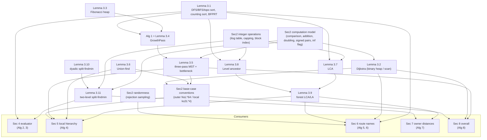

# 01 预备知识与基本构件分析(Sec 1–3)

[English](01_preliminaries_primitives.md) | [日本語](01_preliminaries_primitives.ja.md) | **简体中文**

- 对象:arXiv 2611.34911v1 "Linear Single-Source Shortest Path, Almost"(Gholami, Hajiaghayi, 2026-11-25)
- 范围:Section 1(引言 / 技术概览)、Section 2(预备知识)、Section 3(图与数据结构的基本构件,3.1–3.5)
- 依据:通读了 `.cache/paper/2611.34911v1.txt`(pdftotext)的第 1–640 行,公式乱码之处对照 PDF p.4–14 作了核对。后文各节中的用法通过 grep 相关行加以确认(行号指 txt 的行号)。
- 记号:"[Supplement]" 表示论文中没有写、由实现方补充的内容。"[Interpretation]" 表示存在多种读法时所采用的读法。避免逐字转载论文原文,公式只做简短引用。

---

## 0. 要点(实现团队首先应当了解的事)

1. **外层阈值 `N > L_N^64` 对任何现实的输入都不成立。** 经计算,满足条件的最小 N 约为 2^589.09(L_N = 590)。对于 N < 2^64,L_N ≤ 65,故 L_N^64 ≥ 2^385。因此 Algorithm 8 **总是进入第 4–7 行的基本情形**(每个顶点对只保留一条最轻的边,然后用 O(N²+m) 的扫描式 Dijkstra)。论文正文(Sec 5–8 的外层构造)按原样根本不会被执行。(精确值见 [thresholds.zh-CN.md](thresholds.zh-CN.md):最小的 N 是 589^64 + 1 ≈ 1.94×10^177,该判定在 [2^589 − 1, 590^64] 上再次为假,对所有 N ≥ 590^64 + 1 成立;本笔记中此处及他处所说的"约 2^589.09(L_N = 590)"指的是最后这个界,而不是最小的 N。)
2. **局部阈值 `N > 2 L_N^4` 从 N ≥ 209,953 起成立**(L_N = 18,2·18⁴ = 209,952)。如果单独运行 Algorithm 4(LocalHierarchy),从约 21 万个顶点起即可测试非基本情形的路径。
3. 因此,测试非基本情形的路径需要 **Mode B(`src/experimental/paper_experimental/`)**,它把阈值的指数(64 和 4)与系数(2)作为参数。Mode A(`src/paper/`)把阈值固定为论文的值,绝不调低(paper-reproduction skill 的规则)。此外,调低指数可能破坏 Sec 5–8 的证明所用的常数关系(例如第 1206 行 "N ≥ 32, h ≤ N, K < 16h"、t = O(1+N/L_N^64))。需要与 Sec 4–5 和 Sec 6–8 的负责人协调。
4. 基本情形的"扫描式 Dijkstra O(N²+m)"(Alg 8 第 5 行)对现实的 N(如 10⁶)而言太慢。Mode A 按论文所述使用扫描版本,并始终记录 `FallbackRecord{"outer: N <= L_N^64 (paper base case)", n, m}`。把它换成二叉堆版本(Lemma 3.2 中描述,但与 Alg 8 第 5 行的规定不同)属于**偏离**。若要替换,须记为 `D-<n>`,并放在与 Mode A 分开的路径上(Mode B 或选项)(§2.4(a))。
5. 用 64 位整数朴素地计算 L_N^64 会溢出。按照论文 Sec 2 的"仅用于规模判断的乘积,一旦达到被判断的界即可封顶"(第 304 行),应使用**饱和(封顶)乘法**来判断。回绕(模)溢出会错误地进入非基本情形的路径。
6. 计算模型是比较–加法模型。对实数(边长)只允许复制、比较、加法和加倍。**取整、log、位提取、用作地址均被禁止**(第 300 行)。差被表示为"两个非负和的二元组"(比较 a−b 与 c−d 时,改为比较 a+d 与 c+b)。在 double 实现中,加法的舍入可能破坏"由等式判定的紧弧"和"差的比较"(§2.8)。
7. Sec 3 复杂度的关键是 τ(k) = 1 + log log log(k+16)。它来自三处:MST 的三遍处理(Fibonacci 堆,限制 B1 = max(2, ⌈log2 L_k⌉) 与 B2 = L_k)、并查集的三段分析,以及 split–findmin 的两级分块。
8. split–findmin(Lemma 3.11)是 Sec 4(Algorithm 2 第 4 行)和 Sec 7(第 1815 行和第 1863 行)的求值器的核心。API 必须按 `(key, original index)` 打破平局,并同时返回取得最小值的**下标**(第 939 行"把区间 ID 放在所选最小值的位置上")。
9. LCA 与层级祖先(Lemma 3.9)用于 Sec 5.4(第 1290 行)判断"某条弧属于 LCA 的哪个子节点"(LA(u, depth(lca)+1)),以及 Sec 6(第 1460 行和第 1468 行)在划分树上求 LCA。作为参考实现,二进制倍增(binary lifting)即可。
10. 符号重载严重:B(4 种含义)、h(5 种含义)、M(2 种含义)、k、b 等等(§2.2)。在代码中应通过命名空间或前缀加以区分。

---

## 1. Section 1:引言与技术概览

### 1.1 主定理(Theorem 1,p.3)

- 输入:邻接表形式的无向多重图(n 个顶点、m 条边)、有限的非负实数边长,以及源点 s。
- 输出:所有顶点的精确距离,以及可达顶点上的最短路径树。不可达的顶点为 +∞。
- 复杂度:期望 O(m + n log log log n)。与边长之比(spread)无关。当 m = Ω(n log log log n) 时为线性。
- 终止性:几乎必然终止。**每一次终止的运行都是正确的**(Las Vegas 型)。
- 随机性:独立均匀随机的字。仅用于采样(Sec 6)和距离估计。
- 计算模型:比较–加法模型(详见 §2.5)。

### 1.2 技术概览的流程及与各节的对应

| 概念(Overview 的段落) | 内容概要 | 对应的节 / 引理 |
|---|---|---|
| 区域分解 | 把 MST 切成连通的区域,每个区域放一个枢轴(pivot)。p(v) 是该区域的枢轴,R_v 是沿树到 p(v) 的长度,r_v 是该路径上的最大边。每条路径至多有 h 条边(h 为 polylog)。跨区域的边 xy(权重 w)满足 r_x, r_y ≤ w。于是 R_x + w + R_y ≤ (2h+1)w | Lemma 5.2、Sec 5.1、Sec 7.1(h = b+1,b = L_N^64) |
| 请求(Request) | 对每一对枢轴,只保留一条最轻的投影边 R_x + w + R_y。t 是枢轴的个数 | Sec 6、Definition 6.1 |
| 折半规则 | 当剩余请求多于 32t 个时,对边采样并估计采样距离的上界 Z。在表下标相同的请求中,选取满足 Pλ ≥ Z 的最小 λ,并把证书 λ 赋予 λ 及以上的请求。若至少一半满足,则接受该次试验。一旦剩余至多 32t 个,就把每个请求自身的投影权重用作其证书 | Algorithm 5、Lemma 6.7、6.8 |
| 辅助坐标 J | d_e = Pλ_e(同一区域内为 0)。若 d_e ≤ w/2 为径向(radial),否则为宏观(macro)。把枢轴识别为单个根,并给每条径向边赋予辅助长度 w + d_e。J_v 是辅助图中到根的距离。在径向边上 \|ΔJ\| ≤ 3w/2。满足 w > J_x + d_e + J_y 的径向边可以删除 | Lemma 7.2、Algorithm 8 第 10–12 行 |
| 为什么常数份拷贝就够 | 一条径向子路径,若其端点坐标至多为 M/16、顶点(summit)为 M,则攀升至少需要 5M/8。经由枢轴的绕行至多为 M/8 + L/2,矛盾。比值至多为 16² 则为近(near),否则为远(far)。壳(shell)的比值为 16。每个顶点在每个阶段至多属于 2 个窗口 | Lemma 8.1、Sec 5.2、Sec 8.1 |
| 处理顺序 | 按弧长阈值构建 SCC 的层次结构。把合并权重按倍增网格 [a, 2a) 分组,并把高度设为 a。槽(slot)的宽度至多为高度。报价(offer)是暂定的上界。开放的组在 D0 + S(X) 时过期 | Sec 4、Algorithm 2、3 |
| 不知道 J 时如何形成组 | 把辅助图切分成小的连通集合,并应用局部构造(局部 MST,以到局部枢轴的路径上的最大边作为坐标) | Sec 5、Algorithm 7、Lemma 7.7 |
| 三重 log 从哪里来 | 在大小为 k 的集合上,局部构造每个顶点的代价为 O(1 + log log(k+4))。k ≤ polylog n。合并事件通过在 O(log log n) 个连续的 2 的幂之间做二分查找来发现,故为 O(log log log n) | Sec 5.4、Sec 8.2、Lemma 8.4 |
| 采样 | 期望 O(m + n) | Sec 6、Sec 8 |

Overview 中的常数(32t、16、16²、3/2、5/8、1/8、1/2)由后文各节的引理精确定义。实现必须遵循后文各节的定义。Overview 只是解释直观。

### 1.3 Related Work 中对实现重要的要点

- 它继承了 Pettie–Ramachandran [PR05] 的 split–findmin 和组件层次(component hierarchy)思想。本文的 Sec 3.5 是其简化版,把他们的反 Ackermann 界替换为"通过两级分块得到的 τ(k)"。
- 关键区别:**计算**距离不同于按距离对顶点**排序**。该算法不产生全局的距离顺序。因此,不得把"输出与 Dijkstra 的取出顺序一致"作为测试标准。只比较距离与树的正确性。

---

## 2. Section 2:预备知识(p.6–7)

### 2.1 图与距离

- 输入是无向的**多重图**,可能含有自环和平行边。边长是有限的非负实数。
- 游走(walk)可以重复边;路径(path)不重复顶点。d_G(x,y) 是游走的最小长度,若不存在则为 +∞。
- **紧弧(tight arc)**:d(s,x) 与 d(s,y) 均有限且 d(s,x) + w(xy) = d(s,y) 的弧。由于图是无向的,定义时可以使用任一方向。输出的树是沿着紧弧构建的(Lemma 8.5,Algorithm 8 第 16 行)。注意这是一个**相等性测试**(§2.8)。

### 2.2 符号与参数

| 符号 | 定义 | 出现之处 | 备注 |
|---|---|---|---|
| n, m | 输入的顶点数和边数 | 全篇 | |
| N | 某次构造内的顶点数 | Sec 2 以后 | 在外层构造中,指收缩零边之后源点所在分量的顶点数(Alg 8 第 3 行) |
| M | 弧数,或需求数("在指定处") | Sec 4, 6 | **Overview 中也把它用作顶点(summit)坐标(重载)** |
| k, l | Sec 3 中的顶点数和边(弧)数 | Sec 3 | k 也经常用于其他含义 |
| p | 要排序或选择的记录数 | Lemma 3.1 | 与枢轴 p(v) 无关 |
| L_k | ⌈log2(k+2)⌉(整数 k ≥ 1) | 全篇 | k ≥ 1 时 L_k ≥ 2 |
| τ(k) | 1 + log log log(k+16) | 复杂度陈述 | k ≥ 1 时 τ ≥ 2(log log log 17 > 1)。**实现中不使用**(仅用于分析) |
| T[x,y], D_T(x,y), b_T(x,y) | 树中唯一的路径、其长度及其最大边长(b_T(x,x) = 0) | Sec 3.2 以后 | |
| Depth | 以边数计。根的深度为 0 | Sec 3.4 | |
| log | 以 2 为底 | 全篇 | |
| B (Alg 1) | GrowthPass 的堆上限。B1 = max(2, ⌈log2 L_k⌉),B2 = L_k,第三遍为 +∞ | Sec 3.2 | k 是**原始**顶点数 |
| B (Sec 3.4) | max(2, ⌊log2(k+1)/8⌋),其中 k 是扩充之后的顶点数 | LCA 与 LA | k < 2^24 时 B = 2 |
| B (Sec 3.5) | max(2, ⌈log2(k+1)⌉) | split–findmin 的块 | 与 3.4 的 B 不同 |
| b1, b2, b3 | b3 = 1 + L_k,b2 = ⌈log2(b3+1)⌉,b1 = ⌈log2(b2+1)⌉ | Lemma 3.6 的证明 | 仅用于分析 |
| s | 堆的大小 | Lemma 3.3 | |
| Q, q, q' | union/find 操作数、decrease 次数、查询次数 | Lemma 3.6, 3.11 | |
| h | (a) Overview:树路径边数的上界(polylog)。(b) Sec 2:随机范围 0..h−1。(c) Sec 3.4:中间完整块的个数,跳跃宽度 2^⌊log d⌋。(d) Sec 4:节点高度 h(C)。(e) Sec 7:h = b+1 | 多处 | **5 重重载** |
| b | 分隔集(separator)大小。局部构造中为 L_N^4(Sec 5.1),外层构造中为 L_N^64(Sec 7.1) | Sec 5, 7, 8 | |
| t | 枢轴的个数 | Sec 6 | 外层构造中 t = O(1 + N/L_N^64) |
| P | polylog 因子。2 的幂 | Sec 6, 7 | 在 Alg 5 第 3 行,是不小于 8·256·g·u² 的最小 2 的幂 |
| λ_e, Z, d_e | 证书权重、估计的上界,d_e = Pλ_e | Sec 6, 7 | |
| R_v, r_v, p(v) | 沿树到枢轴的长度、最大边、枢轴 | Sec 5, 7 | |
| J_v | 辅助距离(所有者坐标) | Sec 7 | |
| K | 不小于 8h 的最小 2 的幂 | Sec 5.2 | |
| c0 | 连接器常数(连接各子节点的树连接的长度 ≤ c0·h(C)) | Definition 4.1 | 局部基本情形中为 1,Lemma 5.10 中至多为 2 |

### 2.3 阈值条件:在何处、为何使用

数值检查(用 Python 的整数精确计算):

| 条件 | 首次成立的 N | 此时的 L_N | 含义 |
|---|---|---|---|
| 局部:N > 2·L_N^4 | **209,953** | 18 | 达到或超过此值时,局部的非基本构造开始运行 |
| 外层:N > L_N^64 | **约 2^589.09** | 590 | 实际中永远不成立。即使 N = 2^64−1,L = 65 且 L^64 ≈ 2^385.4 |

使用之处:

| 阈值 | 使用位置(txt 行号) | 目的 |
|---|---|---|
| 外层 N > L_N^64 | Sec 2 中的假设(第 286 行) | 外层构造的非平凡范围 |
| | Algorithm 8 第 4 行(第 2175 行) | 若 N ≤ L_N^64,则为基本情形:每个顶点对保留一条最轻的边,扫描式 Dijkstra(Lemma 3.2),还原,扫描紧弧 |
| | Sec 6(第 1374 行)、Lemma 6.8(第 1605 行) | 枢轴个数 t = O(1 + N/L_N^64) |
| | Sec 7.1(第 1644 行)、Lemma 8.4(第 2106 行) | 所有者分解的分隔集大小 b = L_N^64,h = b+1。原子(atom)的大小小于 b |
| | Lemma 7.9 的证明(第 1962 行)、Theorem 1 的证明(第 2211 行) | 由 b ≤ L_N^64 推出 1 + log log(b+4) = O(τ(N))(三重 log 的依据) |
| 局部 N > 2·L_N^4 | Sec 2 中的假设(第 286 行) | 局部构造的非平凡范围 |
| | Algorithm 4 第 2 行(第 1248 行) | 若 k ≤ 2L_k^4 则为基本情形(见下文 §2.4) |
| | Sec 5.1(第 966 行) | 局部分隔集 b = L_N^4 |
| | Lemma 5.7(第 1062、1084 行) | 构造局部径向状态的假设 |
| | 第 1206 行 | 常数估计"在非平凡范围 N ≥ 32, h ≤ N, K < 16h 内,故 3hK² ≤ 768N³" |

"被排除的规模有绝对上界"(第 286–287 行)在形式上是正确的。然而外层的界约为 2^589,所以实际上它意味着"整个输入都是基本情形"。

### 2.4 基本情形的约定(Sec 2 第 287–290 行,Alg 4 第 2–5 行,Alg 8 第 4–7 行)

#### (a) 外层基本情形(Algorithm 8 第 4–7 行)

```
outer_base_case(G_contracted, s):            // N <= L_N^64
  E' = lightest_edge_per_pair(G)             // 每个顶点对只保留 (length, index) 最小的一条边;丢弃自环
  dist = dijkstra_scan(N, E', s)             // Lemma 3.2 的扫描版本,O(N^2 + |E'|)
  // 还原(映射回原始顶点,不可达 = ∞)与紧弧扫描属于 Lemma 8.5(Sec 8 的负责人)
```

- [Supplement] 对每个顶点对的最轻边,用两遍稳定计数排序(Lemma 3.1)对 (min(u,v), max(u,v)) 排序,并在每一对中保留 (w, id) 最小的一条。O(m + N)。
- [Implementation recommendation] Mode A 按原样使用扫描版本 O(N² + m),并始终记录 `FallbackRecord{"outer: N <= L_N^64 (paper base case)", n, m}`。由于外层基本情形覆盖所有现实的输入,对大的 N 运行时间变为 O(N²)。在报告中须如实说明这一事实。把二叉堆版本(Lemma 3.2,O((N+m) log N))记录为偏离候选。草案:`D-1: Replace the scanning Dijkstra of Alg 8 l.5 with the binary-heap version — O(N²) is impractical for large N — the cost of the base case changes from O(N²+m) to O((N+m) log N). Distance correctness is unchanged (Lemma 3.2)`。把它放在 Mode B 或选项之后。

#### (b) 局部基本情形(Algorithm 4 第 2–5 行)

输入:一个带正权重的连通无向图 H(k 个顶点,k ≤ 2L_k^4)。

```
local_base_hierarchy(H):
  states = { one native entry state per vertex }      // π(state) = 该顶点
  arcs   = 所有原始的非自环边,两个方向都有(保留平行边)
  H1 = lightest_edge_per_pair(H)
  T  = MST(H1)                                         // 规模小,所以任何 MST 方法都可以 [Interpretation]
  // 同时合并权重相等的 MST 边(Kruskal 式的组件树,把权重相等的各层分为一组)
  dsu = DSU(k); node_of_root[v] = leaf(v)
  for each group of MST edges of weight w (in increasing order of w):
      group = 该组各边端点当前的根的集合
      在 dsu 中 union 该组的各边
      for each new connected component: 创建内部节点 C,height(C) = w,
         children = 该组之前、包含在此分量中的各个分量节点(2 个或更多)
         connector tree = 此分量内权重为 w 的 MST 边(记录端点状态和长度 w)
  return states, arcs, π, hierarchy (root = 最后一个分量)
```

- 正确性的依据(论文第 289–290 行):各子节点由权重为 w 的树边相连,且 c0 = 1。各子节点之间没有比 w 更轻的边,这是由 Lemma 3.5 中的 b_T(x,y) ≤ w(xy) 得出的。位于不同子节点的顶点 x, y 之间的树路径会经过一条权重为 w 的边,所以 b_T(x,y) = w ≤ w(xy)。因此不存在"子节点之间低于高度的弧",商图显然是无环的。
- 边界值:k = 1 时只有一个叶子(没有内部节点)。所有权重都是正的(零边已在 Alg 8 第 2 行收缩),所以高度也是正的。
- 测试:检查 Definition 4.1 的不变式。内部节点有 2 个或更多子节点,高度向根单调不减,子节点之间没有低于高度的弧,连接器树把各子节点连通,且每个连接器的长度至多为 c0·h。

### 2.5 实数(边长)的计算模型(第 292–300 行)

| 操作 | 是否允许 | 代价 |
|---|---|---|
| 复制、比较、加法 | 允许 | 1 |
| 无穷大 | 作为单独的标志保存 | — |
| 差 a − b | **不直接存储**。表示为二元组(正和,负和)。加法按分量进行;取负则交换两个分量 | 常数 |
| 比较 a−b 与 c−d | 比较 a+d 与 c+b | 常数 |
| 乘以 2^j | j 次加倍 | j(当 j 可变时计入引理的界) |
| 除以 2 的幂 | 若某次构造中使用的分母是固定的 2 的幂,则让所有被比较的值保持在同一尺度上(来自外部的值在进入时重新缩放) | — |
| 取整、整数部分、log、位、用作地址 | **禁止** | — |

使用之处(后文各节,通过 grep):
- 有符号二元组:Sec 4.3 的槽对齐(第 794–795 行)("不超过 D0 的最大 b − jν(C)"),Sec 8.3 输出值的还原(第 2158 行)。
- 加倍:Sec 5.2(第 1029、1035 行,K²r_v),Sec 6(第 1389 行的中位数测试,第 1399 行的 P,第 1486 和 1494 行的 (H+j)Δ),Sec 8.2(第 2080 行的 F,第 2131 行)。
- 2 的幂分母:r_v/32、s_U/2、M/16 等等。表示在同一尺度上(第 1724 行"在把所有量按一个固定的 2 的幂缩放之后")。

### 2.6 整数与字操作(第 301–306 行)

- 顶点标识符、下标和计数器是 Θ(log(n+m+2)) 位的常数个字。数组访问、移位、位操作以及整数加、减、比较都是 O(1)。
- **整数 log2**:从 i = 1 开始用折半递推把 ⌊log2 i⌋ 制成表(O(k))。

  ```
  lg[1] = 0; for i in 2..K: lg[i] = lg[i >> 1] + 1
  ```

  [Implementation note] C++20 的 `std::bit_width(i) - 1` 会编译为 clz 指令。论文的字操作(移位和位操作)并未明确包含 clz。为忠于模型,用表;为侧重性能,用 `bit_width`。选哪个,在 ADR 中决定。
- **封顶**:仅用于规模判断的乘积,一旦达到上限即封顶。判断 L_N^64 时务必使用饱和乘法(§0 第 5 条)。

  ```
  bool exceeds_pow(u64 N, u64 L, int e):   // 判断 N > L^e
    acc = 1
    repeat e times: if acc > N / L: return false  // L^e > N(封顶) [Supplement] 用 __int128 以避免除法
                    acc *= L
    return N > acc
  ```

- 固定大小的块:若扫描时保存每个元素的块下标和偏移量,就不需要整数除法([Implementation note] 实现中使用 `/` 和 `%` 不改变复杂度)。

### 2.7 随机性(第 307–310 行)

```
uniform_below(h):            // 0..h-1 中的均匀整数
  if h == 1: return 0
  c = ceil_log2(h)
  loop: x = next_bits(c)     // c 个无偏的比特
        if x < h: return x   // 拒绝采样;成功概率大于 1/2
```

- [Implementation note] `std::uniform_int_distribution` 在不同实现之间给出不同的结果,不可复现。给 `std::mt19937_64` 或 SplitMix64 设种子,并手写上述拒绝采样。取模(`x % h`)有偏差,禁止使用。
- 期望是对固定输入上的随机抽取而言的。随机性只用于 Sec 6(采样、均匀排列、j ∈ {0..H−1})。

### 2.8 在 double 实现中会成为问题的地方

| # | 位置 | 问题 | 建议的对策 |
|---|---|---|---|
| D1 | 一般的路径长度加法 | 舍入破坏结合律。即使精确长度相等,按不同顺序求和的两条路径也可能得到不同的值 | 用整数权重(`uint64_t`;若总和 < 2^53,则 `double` 也是精确的)测试正确性 |
| D2 | 紧弧测试 d(x)+w == d(y)(Lemma 8.5,Alg 8 第 16 行) | 若求值器的值与输出时的"沿树求和"(第 2156 行)按不同顺序求和,等式会不成立,树会被破坏 | 舍入是单调的(a ≤ b 蕴含 fl(a+w) ≤ fl(b+w)),所以对像 Dijkstra 那样从左到右累加的情形成立。若求值器的值是按别的顺序求和的,则没有保证。在整数模式下验证;在 double 模式下按相对误差判定,并记入 `Diagnostics` |
| D3 | 有符号二元组比较 a+d 对 c+b(Sec 4.3 的槽对齐等) | 两边的和分别舍入,当差小于一个 ulp 时比较可能出错。截止期限(deadline)测试可能发生偏移 | 以整数模式为准。对于 double,考虑 `long double` 或改写成避免使用二元组的公式 |
| D4 | 树距离 D_T(u,v) = rd(u) + rd(v) − 2·rd(lca)(Sec 5.1 第 963–965 行,"若 w(uv) > D_T(u,v) 则删除") | 若精确地有 w < D_T,但舍入判定为 w > D_T,则**必要的边被删除,距离出错**。当 w = D_T 精确成立时删除是安全的 | 按 w + 2·rd(lca) > rd(u) + rd(v) 的形式比较(如模型所述)。舍入仍然存在,所以要在整数模式下验证 |
| D5 | 2 的幂因子(K、P、F、H = 不小于 (16t)^5 的最小 2 的幂) | double 乘以 2^j 是精确的,但会发生**上溢**(超过 2^1024)和**下溢**(次正规数、0)。例如,取 h = L^64+1 时,K ≈ 2^(log h+3),而 F > 2P(2h+1)(8K²h)² 即使在 N = 2^20 时也在 2^1700 左右,超出 double 的范围。外层构造只在 N > L^64 时运行,所以实际中不会发生,但**用调低的指数做测试时要当心** | 给长度类型增加单独的"指数偏移"(用整数指数管理共同的尺度),或使用 `long double`。uint64 会立即溢出,所以使用带检查的加法(`WeightTraits::checked_add`) |
| D6 | 无穷大 | double 的 inf 在比较和加法中没有问题。但在二元组表示中 inf − inf 会得到 NaN | 如论文所述,把无穷大作为单独的标志。对 uint64 使用 `infinity() = max` 和 `checked_add` |
| D7 | 网格分类(不超过 r_v/32 的最大网格值、s_U 的取整等) | `std::floor(log2(w))`、`frexp` 和 `ilogb` 是**对模型的违反**(第 300 行)。它们很快,但超出了论文的复杂度声明 | 在忠实模式下,使用加倍和二分查找。若在优化模式下使用 frexp,须记入 ADR |
| D8 | 输入校验 | NaN、负值和 inf 超出论文的假设。−0.0 与 0 比较相等,但位模式不同 | `validate_edges` 已经拒绝它们。把 −0.0 规范化为 +0.0 [Supplement] |
| D9 | 零边 | Sec 5 以后假设权重为正。Sec 3 的基本构件允许零 | 在 Algorithm 8 第 2 行收缩它们。基本构件带有零权重的测试 |
| D10 | 平局 | 用 (length, index) 二元组构成全序。double 的相等比较是精确的,所以没有问题 | 把比较函数集中在一处 |

---

## 3. Section 3:图与数据结构的基本构件

通用:每个基本构件的证明都显式依赖于顶点数和边数 (k, l)(第 315–316 行)。这使得即使在稠密图上,边这一项也保持线性。

### P1. DFS、BFS、拓扑排序(Sec 3.1,Lemma 3.1,p.7–8)

- 输入:一个有 k 个顶点和 l 条弧的(有向或无向)图。输出:发现顺序,或使所有弧都指向前方的顺序。
- 伪代码:

  ```
  topo_sort(k, out_adj):                  // Kahn 算法
    indeg[v] = in-degree; queue = { v : indeg[v] == 0 }
    order = []
    while queue nonempty: v = pop; order.push(v)
      for (v->x): if --indeg[x] == 0: push x
    if |order| < k: 存在环(前提被违反) [Supplement] 检测并抛出异常
  ```

  DFS 和 BFS 在发现顶点时标记它,并且每个邻接表只恰好扫描一次。[Supplement] 递归在深度为 k 时会使栈溢出,所以用显式栈来写。
- 复杂度:O(k + l) 时间,O(k) 空间。只使用整数操作。
- 确定性。边界值:k = 0、孤立顶点、自环(对拓扑排序而言是一个环)、平行弧。
- 测试:在返回的顺序中所有弧都指向前方,环检测,在随机 DAG 上与使用 `std` 的参考实现比较(顺序不唯一,所以按性质比较)。
- 注意:Kahn 算法给出的顺序不唯一。Sec 4.2 中的子节点顺序由它自己的遍历产生(第 759 行),所以不得依赖这个拓扑排序的顺序。

### P2. 稳定计数排序与多坐标基数排序(Sec 3.1,Lemma 3.1)

- 输入:p 条记录,其整数坐标在 [0, k) 内。输出:稳定排序后的顺序。
- 伪代码:

  ```
  counting_sort_stable(recs, key, k):
    cnt[0..k] = 0; for r: cnt[key(r)+1]++
    prefix sum; for r in input order: out[cnt[key(r)]++] = r
  radix_sort(recs, keys[0..c-1]):  for j = c-1 downto 0: counting_sort_stable(recs, keys[j])
  ```

- 复杂度:每一遍 O(p + k)。坐标个数为常数。只使用整数操作。
- **不得把实数权重用作坐标**(它们不能用作地址)。
- 测试:与 `std::stable_sort` 比较。包含 p = 0、k = 1 和全部键相等的情形。

### P3. 选择(BFPRT,Sec 3.1,Lemma 3.1)

- 输入:p 个可比较的键和一个秩 r。输出:秩为 r 的键。
- 伪代码:

  ```
  select(A, r):                          // 从 0 开始的秩
    if |A| <= C0: 直接排序并返回 A[r]   // C0 是固定常数 [Supplement] 例如 8
    groups = 把 A 分成每 5 个一组(最后一组可以少于 5 个)
    meds = 每组的中位数
    piv = select(meds, (|meds|-1)/2)
    (lt, eq, gt) = 三路划分(与 piv 比较)
    if r < |lt|: return select(lt, r)
    if r < |lt|+|eq|: return piv
    return select(gt, r - |lt| - |eq|)
  ```

- 复杂度:最坏情况 O(p) 次比较和基本操作(严格的一侧至多为 7p/10 + O(1))。只使用比较,与模型一致。确定性。
- 边界值:大量相等的值(由三路划分统一处理)、p = 1、r 位于任一端。
- 使用之处:Sec 6(第 1389、1407 行"通过加倍测试中位数"、1621 行),Sec 8.2(第 2131 行)。
- 参考实现:`std::nth_element`。在 libstdc++ 中它是 introselect,最坏情况 O(p log p)。按秩对应的值是否一致来比较。

### P4. Dijkstra 搜索(Sec 3.1,Lemma 3.2,p.8)

- 输入:一个弧长非负的图、一个源点(以及初始值),以及可选的半径 R。输出:已确定(settled)的顶点和距离。
- 不变式:暂定值是已发现的某条游走的长度(绝不低估)。已确定的值等于真实距离。
- 伪代码:

  ```
  struct SearchArena { vector<u32> stamp; vector<Len> dist; u32 cur; }   // 按搜索 ID 复用
  //  get(v) = (stamp[v]==cur) ? dist[v] : INF. 新的搜索只需 cur++(只初始化被触及的元素)
  dijkstra(G, s, R = +INF, arena, heap):
    arena.begin(); arena.set(s, 0); heap.insert(s, 0)
    while !heap.empty():
      (d, v) = heap.extract_min()
      if d > R: break                    // "当最小的有限值超过 R 时停止" => d ≤ R 的被确定
      settle(v, d)
      for (v -> x, w):
        nd = d + w
        if nd < arena.get(x): arena.set(x, nd); heap.insert_or_decrease(x, nd)
  dijkstra_scan(...):  不用堆,每次扫描所有未确定的顶点来选出最小值。O(k^2 + l)
  ```

  [Supplement] 当 `cur` 在 2^32 处回绕时,把 `stamp` 全部重置为 0。
- 复杂度:使用二叉堆时,每次操作 O(1 + log(k+1))(最坏情况)。总体 O((k + l) log k)。扫描版本为 O(k² + l)。只使用加法和比较,与模型一致。确定性。
- 边界值:零权重、不可达(保持 ∞)、R = 0(只有源点以及距离为 0 的顶点)、平局(可以按任意顺序取出)、平行边、自环。
- 使用之处:Sec 6 的 Lemma 6.6(第 1558 行,带多中心剪枝的二叉堆版本),Algorithm 8 第 5 行(扫描版本)。
- 测试:把距离与 `baseline::dijkstra_binary_heap` 和 `bellman_ford` 比较。带半径时,已确定的集合等于 {v : d(v) ≤ R}。复用 arena 时,上一次搜索不应留下任何残留。

### P5. Fibonacci 堆(Sec 3.2,Lemma 3.3,p.9–10)

- 结构:根链表和子链表是双向链表。每个节点有父指针、度数和标记位。保留一个指向最小值的指针。
- 伪代码(标准的 FT87):

  ```
  insert(x): 加入一个单点的根,必要时更新 min
  decrease(x, k): key[x] = k
     if x is not a root and key[x] < key[parent]: cut(x); cascading_cut(old parent)
     更新 min
  cut(x): 把 x 从其父节点分离,使其成为根,并清除其标记
  cascading_cut(y): if y is not a root: if !mark[y]: mark[y] = true  else: cut(y); cascading_cut(parent(y))
  extract_min():
     z = min. 把 z 的所有子节点变成根(清除它们的标记)。移除 z
     deg_arr[0 .. 3 + 2*ceil_log2(s+1)] = null      // 大小来自论文
     for each root r: while deg_arr[deg r] != null: link(使键较大的根成为键较小的根的子节点), deg++
     重建 min
  ```

- 复杂度:insert 和 decrease 为均摊 O(1)。从大小为 s 的堆中 extract 为均摊 O(1 + log(s+1))。只使用比较(键是 (length, index) 二元组)。确定性。
- 不变式:度数为 d 的节点的子树大小至少为 F_{d+2}。根没有标记。新链接的子节点也没有标记。
- 边界值:空堆、一个元素、相等的键、decrease 到相同的值、销毁时释放所有节点(Algorithm 1 每次增长都创建一个新堆)。
- 测试:在随机操作序列上与 `std::multiset` 参考模型比较。每次操作之后,检查堆序、度数与子节点数是否一致,以及没有根被标记。
- 现有资产:`baseline::dijkstra_fibonacci_heap` 中有一个 FT87 堆。要在此使用,需要三点:"可按下标寻址"、"统计 size()"和"可按增长 ID 销毁"。是否把它提取到共享头文件,与 baseline 的负责人讨论。

### P6. GrowthPass(Algorithm 1,Lemma 3.4,p.8–10)

- 输入:一个连通的商图 H(每个商顶点是原始顶点的一个连通集合;每条商边保留其原始边下标),以及上限 B ≥ 1 或 +∞。
- 输出:保留的原始边下标集合 F,以及收缩 F 的各分量后得到的无环(无自环)商图。
- 前提:边按 (length, index) 二元组比较。这是全序,所以 MST 唯一。
- 伪代码(粒度可映射到 C++):

  ```
  // QAdj: 商顶点 u -> (to, len, edge_id) 的列表
  GrowthPassResult growth_pass(u32 kq, const QAdj& adj, size_t B /* SIZE_MAX = +inf */):
    F = []
    growth_of[0..kq) = NONE           // 访问标记;保存增长 ID
    heap_gid[0..kq)  = NONE           // 按增长 ID 判断某个堆条目是否有效
    for u0 in 0..kq-1:
      if growth_of[u0] != NONE: continue
      gid = new_growth_id(); heap = FibHeap<(Len, EdgeId), u32>()    // 新堆
      u = u0
      loop:
        growth_of[u] = gid
        for (x, w, id) in adj[u]:
          if growth_of[x] == gid: continue                   // 在本次增长之内(自环在此也被跳过)
          key = (w, id)
          if heap_gid[x] != gid: heap_gid[x] = gid; h[x] = heap.insert(key, x)
          else if key < heap.key(h[x]): heap.decrease(h[x], key)
        if heap.empty() or heap.size() > B: break            // 第 9–10 行
        ((w, id), v) = heap.extract_min(); F.push(id)        // 第 11 行
        if growth_of[v] != NONE: break                       // 到达了更早的增长(第 12–13 行)
        u = v
    // 第 15 行:由 F 的各分量构建商图
    comp = connected_components(kq, edges of F)              // DFS(Lemma 3.1)
    adj' = { (comp[a], comp[b], w, id) : original quotient edge (a,b,w,id), comp[a] != comp[b] }   // 丢弃自环,保留平行边
    return F, num_comp, adj'
  ```

- 不变式:对每个"本次增长之外的顶点 x",堆中有一个条目,指向从当前增长到 x 的最轻割边。heap.size() 是**不同的外部顶点的个数**。
- 复杂度(Lemma 3.4):对 k' 个顶点和 l' 条边的一遍,用时 O(l' + k'(1 + log(min(k', B) + 1)))。若 B 有限,至多剩余 1 + 2l'/B 个商顶点。仅当堆大小至多为 B 时才进行 extract(大小测试先于 extract)。
- 正确性:每条被选中的边都属于 (length, index) 序下唯一的 MST(割性质)。每条边至多被选中一次。
- 确定性。边界值:kq = 1(不需要遍历)、自环、平行边(decrease 只保留最轻的)、B = 1 和 2、B = +∞(第一次增长覆盖全部)。
- [Interpretation] Lemma 3.5 假设 H 连通。即使对不连通的输入,每次增长也会在堆为空时停止,所以得到的是生成森林(MSF)。Algorithm 8 只传入源点所在的分量,所以输入是连通的。
- 替换参考实现时的注意事项:换成惰性删除的二叉堆(同一顶点有重复条目)会使 size() 把重复条目也算进去,从而改变第 9 行的测试。正确性(被选中的边属于 MST)得以保持,但该遍的行为和复杂度声明会改变。请使用带下标的堆(无重复)。

### P7. 三遍 MST 与瓶颈性质(Lemma 3.5,p.10–11)

- 输入:一个连通的无向多重图(k ≥ 1 个顶点,l 条边)。输出:MST 的边下标(k−1 条边)。
- 伪代码:

  ```
  mst_three_pass(k, edges):
    if k == 1: return []
    Lk = L(k); B1 = max(2, ceil_log2(Lk)); B2 = Lk          // 由原始的 k 决定
    q = initial quotient (each vertex alone, drop loops)
    Fall = []
    for B in [B1, B2, +INF]:
      if q.num_vertices == 1: break                           // [Supplement] 提前结束
      (F, q) = growth_pass(q, B); Fall += F
    assert |Fall| == k - 1
    return Fall
  ```

- 复杂度:O(l + kτ(k))。只使用比较(不做长度加法)。确定性。
  - 分析:商顶点的个数依次降为 k、1 + 2l/B1、1 + 2l/B2。extract 各项为 k·log B1 ≈ k log log log k、(l/B1)·log B2 ≈ l、(l/B2)·log k ≈ l。
- 瓶颈性质:对任意 MST T 和不同的 x, y,b_T(x,y) 等于所有 x–y 游走的最大边长的最小值。特别地,对非自环的边 xy,b_T(x,y) ≤ w(xy)。该性质用于 Sec 5.1(第 963 行)、局部基本情形,以及 Sec 5.3 的扫描。
- 边界值:k = 1、全部权重相等(由下标决定顺序)、零权重、平行边中最轻的一条、只有自环的顶点。
- 测试:
  - 单元:输出有 k−1 条边,构成生成树,并且与 (length, index) 序下的 Kruskal 的边集**完全相同**(该序是全序,所以 MST 唯一)。
  - 性质:在随机图上,对所有顶点对,b_T(x,y) 等于极小极大路径值(用 Kruskal 的 DSU 计算)。
  - 计数:每一遍之后,商顶点的个数至多为 1 + 2l'/B(记录在 `Diagnostics.counters` 中)。
- 参考实现:Kruskal(排序 + DSU,O(l log l))。

### P8. 并查集(Sec 3.3,Lemma 3.6,p.11)

- 输入:k 个元素。操作:find、union。若给定了合并事件的顺序,则按该顺序处理(排序的代价由调用方承担)。
- 伪代码:

  ```
  init: parent[i] = i; rank[i] = 0
  find(x): r = x; while parent[r] != r: r = parent[r]
           while parent[x] != r: nx = parent[x]; parent[x] = r; x = nx      // 完全路径压缩
           return r
  unite(a, b): ra = find(a); rb = find(b); if ra == rb: return false
           if rank[ra] < rank[rb]: swap; parent[rb] = ra
           if rank[ra] == rank[rb]: rank[ra]++
           return true
  ```

- 复杂度:初始化和 Q 次操作为 O(Q + kτ(k))(三段分析:b3 = 1 + L_k,b2 = ⌈log2(b3+1)⌉,b1 = ⌈log2(b2+1)⌉)。只使用整数操作。确定性。
- 边界值:k = 1、与自身 union、重复同一个 union。
- 使用之处:局部基本情形,Sec 5.3–5.4(在第 1179、1233、1260 行合并同一类),Sec 6 的 Kruskal 扫描(第 1475 行;不过 Sec 6 使用的是把较小的表重新链接的方案,第 1485 行)。
- 测试:在随机操作序列上与朴素实现(用数组保存分量标签)比较。秩朝父节点方向严格增大,且 rank ≤ ⌊log2 k⌋。

### P9. LCA(Sec 3.4,Lemma 3.7,p.11–12)

- 输入:一个有根森林(子节点顺序固定)。预处理:通过添加公共根 R 来扩充它,并记录每个顶点原来所属的分量。k 是扩充之后的顶点数。
- 输出:lca(u, v)。若在不同的树中则为"无"(通过比较分量判定)。
- 伪代码(Bender–Farach-Colton 的 ±1 RMQ):

  ```
  build:
    B = max(2, lg[k+1] / 8)                       // ⌊log2(k+1)/8⌋ = ⌊⌊log2(k+1)⌋/8⌋
    E[0..2k-2], D[...] = Euler 游览(每次遍历一条边就记录所到达的顶点)。first[v] = 首次出现的位置
    通过扫描制成 blk[i], off[i] = i / B, i % B 的表(论文不使用除法)
    code[b] = 块 b 中深度变化的 B-1 个符号位(最后一个较短的块用任意符号补齐)
    in_tbl[code][i][j] = 对符号序列 code,区间 [i, j] 内最小深度的第一个位置(直接枚举所有 code 和所有 i ≤ j)
    bmin[b] = 块 b 中最小值的第一个位置
    sp[0][b] = bmin[b]; sp[i][b] = argmin_first(sp[i-1][b], sp[i-1][b + 2^(i-1)])
  query(u, v):
    if comp[u] != comp[v]: return NONE
    l = first[u]; r = first[v]; if l > r: swap
    bl = blk[l]; br = blk[r]
    if bl == br: pos = bl*B + in_tbl[code[bl]][off[l]][off[r]]
    else:
      cands = { bl*B + in_tbl[code[bl]][off[l]][B-1], br*B + in_tbl[code[br]][0][off[r]] }
      h = br - bl - 1
      if h > 0: i = lg[h]; cands += { sp[i][bl+1], sp[i][br - 2^i] }
      pos = 深度最小的候选(平局时取位置最小的)
    return E[pos]
  ```

- 复杂度:O(k) 的预处理时间和空间(符号表为 O(2^B B³))。查询为 O(1)。只使用整数操作。确定性。
- 正确性:在两次首次出现之间的游览范围内,只有 LCA 取得最小深度。
- 边界值:u = v、u 是 v 的祖先、两个根、不同的树、k = 1 或 2(常数大小可以直接制表)、最后一个较短的块。
- [Implementation note] 当 k < 2^24 时,B = 2。在这个实际规模的范围内,分块几乎没有效果。稀疏表约为 (k/2)·log k 个字。线性的说法只是渐近意义上的。
- 测试:与朴素实现(沿父节点上走)在所有顶点对上比较(小树)。在大树上,用随机查询比较。包含具有不同分量的森林。
- 参考实现:朴素实现,或二进制倍增 O(k log k)。

### P10. 层级祖先(Sec 3.4,Lemma 3.8,p.12–13)

- 输入:扩充后的有根树(B 与 P9 中相同)。query(v, j):v 在深度 j 处的祖先(0 ≤ j ≤ depth(v),为扩充之后的深度)。
- 伪代码(宏–微分解 + 跳跃指针 + 梯子):

  ```
  build:
    // (1) 标记(后序)
    for v in postorder: res[v] = 1 + Σ res[c]; if res[v] >= B: marked[v] = true; res[v] = 0
    marked[R] = true
    // (2) 微树 = 未标记顶点的连通分量(每个的顶点数都少于 B)。top(v) = 该分量的最顶端顶点
    //     形状码 = 一个开头的 1,加上 DFS 中进入时的 1 和离开时的 0(少于 2B 位)
    //     保存局部先序位置与原始顶点之间的映射
    // (3) 形状表:枚举所有长度为 2s(s < B)的合法括号串,
    //     anc[shape][pos][rd] = 局部位置 pos 在相对深度 rd 处的祖先的局部位置
    // (4) 对已标记的 p,jump[p][i] = 向上 2^i 条边处的祖先(若存在)
    //     在 DFS 中维护一个"以深度为下标的栈",每个祖先一次查找即可得到
    // (5) 按后序计算高度(以边数计)。在每个内部顶点选择一个高度最大的子节点 [Supplement] 平局时取子节点顺序中的第一个
    //     被选中的边把顶点划分为若干路径。把每条路径做成按深度排序的数组,并向上延伸"该路径上的顶点数"(在根处截断)= 梯子(ladder)
    //     每个顶点保存其自身(延伸之前)路径在延伸后的数组中的位置
  query(v, j):
    if !marked[v] and j >= depth[top(v)]:
       return local_to_global[micro(v)][ anc[shape(v)][pre(v)][j - depth[top(v)]] ]
    p = marked[v] ? v : parent[top(v)]       // top 的父节点总是已标记的
    d = depth[p] - j
    if d == 0: return p
    i = lg[d]; h = 1 << i; x = jump[p][i]
    (ld, idx) = ladder_pos[x]; return ladder[ld][idx - (d - h)]
  ```

- 复杂度:O(k) 的预处理时间和空间(形状表为 O(2^{2B} B³) = O(k^{1/4} B³))。查询为 O(1)。只使用整数操作。确定性。
- 正确性的关键:跳跃之后,x 的高度至少为 h。因此 x 所在的路径至少有 h+1 个顶点,其延伸部分覆盖向上 d − h < h 条边处的祖先。
- 边界值:j = depth(v)(自身)、j = 0(根)、v 已标记、停留在一棵微树内的查询、路径状的树(高度为 k)、星形的树。
- 测试:对所有 (v, j) 与朴素实现(沿父节点上走)比较(小树)。尝试随机的树形状(路径、星形、二叉树、毛毛虫)。
- 参考实现:空间 O(k log k)、查询 O(log k) 的二进制倍增,或朴素实现。
- [Implementation note] 在 Sec 5.4 中唯一的用法是"lca 的哪个子节点" = LA(u, depth(lca)+1)(第 1290 行)。一个离线的替代方案(按先序范围在子节点上二分查找,O(log deg))也足够。

### P11. 森林上的 LCA 与 LA(Lemma 3.9,p.13)

- 结合 Lemma 3.7 和 3.8。添加一个根,把深度平移 1,再平移回来。LCA 通过比较分量来检测"不同的树"。LA 假设 0 ≤ j ≤ depth(v)(原始深度)。
- 建议的公共 API:`ForestQueries(parent[], child order)`、`lca(u,v) -> optional<Vertex>`、`level_ancestor(v, j) -> Vertex`、`depth(v)`、`component(v)`。
- 使用之处:Sec 5.1(来自 LCA 的树距离和到根的距离),Sec 5.4(第 1256、1290 行),Sec 6(第 1460、1468、1600 行),Sec 7.4(第 1853 行)。

### P12. 二进(dyadic)split–findmin(Sec 3.5,Lemma 3.10,p.13)

- 输入:一个大小为 k 的固定数组(key, original index)。初始时为一个区间。
- 操作:
  - split(pos):在边界 pos 处把包含 pos 的区间切成两个非空区间。
  - decrease(i, key):降低一个键。
  - query(i):返回包含 i 的区间的最小 (key, index)。平局按原始下标打破。
  - interval_of(i):返回该区间的描述符。
- 结构:
  - 补齐到 2 的幂 K ≥ k(未使用的位置被忽略),并构建一棵平衡二叉树(节点编号按堆序)。
  - 每个区间 = 包含在该区间内的极大树节点的有序列表(每个深度至多 2 个)。
  - 节点保存 (min, 区间描述符, 列表中的前驱/后继)。每个元素指向它的极大节点。描述符保存 (lo, hi, 列表的头和尾, min)。
- 伪代码:

  ```
  decrease(i, key): K[i] = key; n = node_of[i]
     if (key,i) < n.min: n.min = (key,i)
     if (key,i) < n.desc.min: n.desc.min = (key,i)
  query(i): return node_of[i].desc.min
  split(pos):                       // [lo,hi) -> [lo,pos), [pos,hi). 前提:lo < pos < hi
     n = node_of[pos]
     if n.lo_used == pos: L = 从头到 n 之前, Rl = 从 n 到尾
     else:                          // n 跨越切点(至多 1 个)
        left_exp = []; right_exp = []; x = n
        while x straddles pos:
           (a, b) = children(x); mid = b.lo
           if pos <= mid: right_exp.push_front(b); x = a    // b 完全在右侧
              if pos == mid: left_exp.push_back(a); break
           else: left_exp.push_back(a); x = b
        // 对每个新暴露的节点,扫描其元素以设置 node_of 和 min(元素移到严格更深的节点)
        在列表中用 left_exp ++ right_exp 替换 n,并在它们的边界处切断
     dl, dr = 新的描述符。扫描这两个列表以设置 desc 并重新计算 min
  ```

  [Supplement] "忽略未使用的位置"意味着:如果一个节点"已使用的部分"全部位于区间内,就算作被包含。最后一个节点的右端点按 min(hi, k) 处理。
- 复杂度:初始化和所有 split 合计 O(k(1 + log k))。decrease、query 和描述符查找为最坏情况 O(1)。只使用键比较(以及整数操作)。确定性。
- 边界值:k = 1(无法 split)、相邻的边界、在已经是边界的位置处 split(违反前提,应当检测)、等于 +∞ 的键(无穷大标志;全为 ∞ 的区间返回最小的下标)、相等的键。

### P13. 两级分块的 split–findmin(Lemma 3.11,p.13–14)

- 结构(一级):
  - 划分为大小 B = max(2, ⌈log2(k+1)⌉) 的块(最后一个可以更短)。
  - 下层结构:在每个块内,处理存活区间与该块的交集。
  - 上层结构:每个块一个代理(proxy)。当块是"完整的"(内部未被切分)时,代理的键为 (块内最小的原始键, 其下标)。一旦内部被切分,该代理就被永久隔离并被忽略。
  - 存活区间 = 至多 2 个端点片段(下层结构的区间)+ 一段完整块(一个上层结构的区间)。
  - 所有者描述符 = (lo, hi, 至多 3 个部分的描述符, 它们各自 min 的 min)。下层和上层的描述符指向所有者。
- 伪代码:

  ```
  query(i):  b = blk(i)
     o = whole[b] ? owner_up[upper.interval_of(b)] : owner_low[b][lower[b].interval_of(off(i))]
     return o.min
  decrease(i, key):  b = blk(i)
     lower[b].decrease(off(i), (key, i))
     if whole[b] and (key,i) < proxykey[b]: proxykey[b] = (key,i); upper.decrease(b, (key,i))
     o = owner(i); o.min = min(mins of o's parts)                   // 至多 3 个
  split(pos):  o = owner(pos); b = blk(pos)
     if off(pos) == 0:                       // 块边界
        if the upper interval contains both b-1 and b: upper.split(b)
     else:                                    // 在块内部
        lower[b].split(off(pos))
        if whole[b]: whole[b] = false
           if the upper interval contains b-1: upper.split(b)
           if the upper interval contains b+1: upper.split(b+1)               // 隔离代理 b
     为 oL = [o.lo, pos)、oR = [pos, o.hi) 构建所有者:
        由端点确定端点片段以及第一个和最后一个完整块
        对每个部分的元素(或代理)查找 interval_of 以得到描述符。重新指向所有者指针并重新计算 min
  ```

- 两级:上层保持二进(P12),下层使用"带有第一级分块的结构"。即 `SplitFindmin = Blocked<upper = Dyadic, lower = Blocked<upper = Dyadic, lower = Dyadic>>`。
  - [Interpretation] 内层 Blocked 的块大小由该块的大小 B 按 B' = max(2, ⌈log2(B+1)⌉) 决定。
  - 实际规模:对 k = 2^32,B = 33 且 B' = 6。
- 复杂度:对 k 条记录,初始化、所有 split、q 次 decrease 和 q' 次 query 合计 O(q + q' + kτ(k))。query、decrease 和描述符查找为最坏情况 O(1)。split 为均摊。
- 不变式:每个逻辑区间被划分为若干部分(片段和一段连续块)。区间的 min 是其各部分 min 的最小值。完整块的代理键等于该块的最小值。
- 边界值:位于单个块内的区间(若是真子区间则为一个片段,若是整个块则为一个代理)。两个相邻的部分块构成一个区间且其间没有完整块。k < B(单个块)。最后一个较短的块。
- 使用之处:Sec 4 的 Algorithm 2 第 4 行(区间最小值 z 及给出它的叶子),第 939–947 行(通过叶子放置,所有 split 都变成对一个序列的 split;把区间 ID 放在最小值的位置),Sec 7.4(第 1815、1863 行)。
- 测试:
  - 参考实现:把边界保存在 `std::set<size_t>` 中,并用线段树求区间最小 (key, index)。每次操作为 O(log k),易于编写。
  - 差分测试:在 split、decrease 和 query 的随机序列(数万次操作)上,P12、P13 一级、两级和参考实现这四种实现的结果一致。对 k = 1..70 全部做穷举测试,重点放在块的边缘。
  - 不变式:每次操作之后(在调试中),朴素地重新计算每个区间的 min 并比较。
  - 计数:元素重新扫描的次数至多为 k·(1 + log k)(P12)。

---

## 4. 含糊之处,以及疑似的笔误或矛盾

| # | 位置 | 内容 | 依据与影响 | 建议 |
|---|---|---|---|---|
| A1 | Sec 2(第 286 行),Alg 8 第 4 行 | 外层阈值仅对 N ≥ 约 2^589 成立。基本情形是扫描式 Dijkstra O(N²) | §2.3 中的计算。论文的主定理是正确的,但常数是天文数字。照此实现就变成了"一个 O(N²) 的 Dijkstra" | Mode A 固定阈值,使用扫描版本,并记录一条 Fallback。把指数参数化仅限于 Mode B。把换成二叉堆版本记录为 D-1(§2.4(a))。在报告中明确说明这一事实 |
| A2 | 同上 | 用调低的指数测试非基本情形的路径,可能使 Sec 5–8 中的常数估计(第 1206 行等)的假设不再成立 | 第 1206 行的"N ≥ 32, h ≤ N, K < 16h"是由 N > 2L^4 推出的。外层构造中可能存在类似的假设 | 与 Sec 4–5 和 Sec 6–8 的负责人商定可以使用的最低值。把测试值记入 ADR |
| A3 | Sec 2 第 287–290 行与 Alg 4 第 2–5 行 | Sec 2 说"在每个顶点一个状态上保留原始的双向非自环边",而 Alg 4 说"每个顶点对保留一条最轻的边,然后求 MST" | 并不矛盾。状态弧是所有的边;MST 是在去重后的边上构建的 | 按 §2.4(b) 实现 |
| A4 | Alg 4 第 4 行 | 基本情形中构建 MST 的方法未作规定 | 因为是"常数大小",所以任意(尽管 k 最大可达 209,952) | 复用 Lemma 3.5 的实现 |
| A5 | 符号总体 | B、h、M、k、b、p 的重载 | §2.2 中的表 | 在代码中分开命名,例如 `growth_limit`、`lca_block`、`sfm_block` |
| A6 | Sec 3.4 中的 B | ⌊log2(k+1)/8⌋ 等于 ⌊⌊log2(k+1)⌋/8⌋(对实数 y,⌊y/8⌋ = ⌊⌊y⌋/8⌋) | 没有歧义。不过 k < 2^24 时 B = 2,实际上是一个 O(k log k) 的稀疏表 | 用整数 log 表计算 |
| A7 | Lemma 3.11 的第二级 | 下层结构内的块大小(由 B 还是由 k 计算)未说明 | 证明中的"O(k(1 + log log(B+4)))"与"由块大小 B 决定 B'"的读法相符 | [Interpretation] B' = max(2, ⌈log2(B+1)⌉) |
| A8 | Sec 3.5 | 未说明 split 之后区间 ID(描述符)是否变为新的,还是其中一侧继承旧的 | "构成两个新的所有者描述符"(第 619 行) | split 之后,两者都得到新的 ID。调用方(Sec 4)不得保留旧的 ID。与 Sec 4–5 的负责人商定 |
| A9 | Sec 3.5 | 没有描述对 +∞ 键的处理。Sec 4 中需要它(第 1858 行"用无穷大的键初始化") | 无穷大是单独的标志(Sec 2) | 按 (inf 标志, 值, 下标) 的字典序。由调用方检查有限性 |
| A10 | Sec 3.5 | 只有"decrease 降低一个键";没有提高一个键的操作 | 提高会破坏 min 的维护 | 在调试中,对试图提高的操作作断言 |
| A11 | Algorithm 1 第 9 行 | "堆大小超过 B" = **不同的外部顶点**的个数 | Lemma 3.4 中的"多于 B 条不同的边界边" | 用带下标的堆实现(见 P6 的注意事项) |
| A12 | Lemma 3.5 | 假设连通。没有描述对不连通输入的处理 | 在堆为空时停止的增长按每个分量发生,得到一个生成森林(分析中的各项会改变) | 公共 API 中要求连通;为生成森林版本另取一个名字 |
| A13 | Sec 3.1 中的 Dijkstra | "当最小的有限值超过 R 时停止" = 距离恰为 R 的顶点被确定 | Lemma 3.2 的"恰好确定距离至多为 R 的可达顶点" | 在 `d > R`(而不是 `>=`)时停止。在测试中检查边界 |
| A14 | Lemma 3.3 | 度数数组的大小 3 + 2⌈log2(s+1)⌉ 有余量(实际的最大度数约为 1.44 log2 s) | 正确 | 照用 |
| A15 | Lemma 3.6 的证明 | "至多 k/2^r 个顶点达到秩 r"若理解为"曾经达到秩 r 或更高的顶点"则是正确的 | 不是错误 | — |
| A16 | Sec 2 中的随机性 | "对更大的范围,常数个字提供比特"。字长为 Θ(log(n+m+2)) | 一个 64 位字就够了 | 用 64 位生成器实现 |
| A17 | Theorem 1 与 Sec 5 | 主定理是非负权重,而 Sec 5 要求正权重 | 并不矛盾,因为 Alg 8 第 2 行收缩了零边分量 | 在 Alg 8 的入口处始终收缩零边 |
| A18 | Overview(第 5 页) | "近 = 比值至多为 16²"。txt 把它弄乱成了 "162" | 在 PDF p.5 上确认为 16² | 实现遵循 Sec 8.1 的精确定义 |
| A19 | Related Work(第 130–140 行) | txt 把 √ 和指数弄乱了(例如 O(m√(log n log log n))) | 在 PDF p.4 上已确认。与实现无关 | — |

在 Sec 1–3 中没有哪处能被确定地认定为笔误。上面的 A1 和 A2(阈值的大小)是最大的实现问题。

---

## 5. "满足论文复杂度的实现"对"简单但较慢的参考实现"

| 基本构件 | 满足论文复杂度的实现 | 参考实现(暂定) | 替换时的注意事项 |
|---|---|---|---|
| DFS、BFS、拓扑排序 | 显式栈和 Kahn 算法(都是线性的) | 相同 | 拓扑顺序不唯一。按性质测试 |
| 稳定排序 | 计数排序和基数排序 O(p + k) | `std::stable_sort` | 不能用于实数键 |
| 选择 | BFPRT(最坏情况 O(p)) | `std::nth_element` | 平局的处理(只要返回的值相等就没问题) |
| Dijkstra | 二叉堆(Lemma 3.2)、扫描版本 O(k²+l) | `baseline::dijkstra_binary_heap` | 对齐按搜索 ID 复用 arena 的 API |
| 优先队列(用于 MST) | Fibonacci 堆(Lemma 3.3) | 带下标的二叉堆或 4 叉堆 | decrease 变为 O(log B),使每一遍的代价升到 O(l log B)。保持 size() 的含义 |
| MST | 三遍 GrowthPass(Lemma 3.5)O(l + kτ(k)) | Kruskal(排序 + DSU)O(l log l) | 在 (length, index) 序下 MST 唯一,所以边集应当完全一致 |
| 并查集 | 按秩合并 + 路径压缩 | 相同(或朴素重标号) | — |
| LCA | Euler 游览 + ±1 RMQ(Lemma 3.7) | 二进制倍增,或朴素实现 | 让"不同的树"的测试保持一致(分量比较) |
| LA | 宏–微 + 跳跃 + 梯子(Lemma 3.8) | 二进制倍增 | 对 j 的范围的前提(0..depth) |
| split–findmin | 两级分块(Lemma 3.11)O(q + q' + kτ(k)) | 边界的 `std::set` + 线段树,每次操作 O(log k) | 对齐区间 ID 的含义(split 之后为新的)和平局的打破。对参考实现,让 ID 取"区间的左端点"最简单 |
| 整数 log | 表(Sec 2) | `std::bit_width` | 仅在对模型的忠实程度上不同 |
| 均匀随机 | 拒绝采样 | 相同 | 禁止取模 |

通用的替换方针:通过 concept(或模板参数)使公共头文件中的各实现可以互换。在差分测试中,对同一输入运行两者并确认结果一致。先在参考实现之上组装更高层的各节(Sec 4–8),然后再换入论文的实现。

---

## 6. 依赖图(Sec 1–3 及其使用方)



---

## 7. 建议的实现模块(位于 `src/paper/` 之下)

前提:与现有的 `include/sssp/graph.hpp`(`CsrGraph<W>`、`Edge`、`Arc`、`WeightTraits`)和 `include/sssp/result.hpp`(`OpCounters`、`FallbackRecord`、`SSSP_COUNT`)对齐。`CMakeLists.txt` 会 glob `src/*.cpp`,所以只需添加文件即可纳入构建。测试使用 Catch2,并在 `tests/<category>/` 下被 glob。模板针对 `uint64_t` 和 `double` 两种类型做显式实例化。

| 文件 | 公共函数与类型 | 测试(文件,TEST_CASE 名称示例) |
|---|---|---|
| `src/paper/model/params.hpp` | Mode A 固定常数(`kOuterExponent = 64`、`kLocalExponent = 4`、`kLocalCoeff = 2`)。只有 Mode B(`src/experimental/paper_experimental/params.hpp`)允许通过 `struct PaperParams { int outer_exponent; int local_exponent; int local_coeff; }` 注入。两者都显式传递随机种子,`u32 L(u64 k)`、`bool outer_nontrivial(u64 N, const PaperParams&)`、`bool local_nontrivial(u64 N, const PaperParams&)`、`bool exceeds_pow_saturating(u64 N, u64 L, int e)` | `tests/unit/paper/model/test_params.cpp`:"L_k matches ceil(log2(k+2))" "local threshold first holds at 209953" "outer threshold never holds below 2^64" "saturating power never wraps" |
| `src/paper/model/length.hpp` | `template<class W> struct Len`(inf 标志、`add`、`less`、`mul_pow2(j)`)、`template<class W> struct SignedPair`(`plus`、`neg`、`less`)、`EdgeKey<W>{W w; EdgeId id;}`(全序) | `test_length.cpp`:"signed pair compares a-b vs c-d via a+d vs c+b" "infinity flag absorbs addition" "mul_pow2 exact for double" "EdgeKey ties broken by index" |
| `src/paper/model/ilog.hpp` | `class IlogTable`(`build(K)`、`floor_log2(i)`)、`ceil_log2(u64)` | `test_ilog.cpp`:"table equals bit_width-1 for 1..2^20" |
| `src/paper/model/random.hpp` | `class WordRng`(SplitMix64 或 mt19937_64,`next_word()`、`next_bits(c)`)、`u64 uniform_below(WordRng&, u64 h)`、`void random_permutation(...)` | `test_random.cpp`:"uniform_below(1)==0" "chi-square on small ranges" "deterministic under fixed seed" |
| `src/paper/primitives/search.hpp/.cpp` | `dfs_order`、`bfs_order`、`connected_components`、`topological_sort`(遇环时抛出异常)、`counting_sort_stable`、`radix_sort_pairs`、`template<class T, class Cmp> T select_bfprt(span<T>, size_t r, Cmp)` | `tests/unit/paper/primitives/test_search.cpp`:"topo order has all arcs forward" "cycle detected";`test_sort.cpp`:"counting sort stable vs std::stable_sort";`test_select.cpp`:"bfprt equals nth_element on random and many-duplicate inputs" |
| `src/paper/primitives/dijkstra.hpp/.cpp` | `template<class W> class SearchArena`、`dijkstra_radius(const CsrGraph<W>&, Vertex s, Len<W> R, SearchArena<W>&)`(二叉堆)、`dijkstra_scan(...)` | `test_dijkstra.cpp`:"binary-heap and scan agree with baseline" "radius cutoff settles exactly d<=R" "arena reuse does not leak" "zero weights" |
| `src/paper/primitives/fib_heap.hpp` | `template<class Key, class Payload> class FibHeap`(`insert -> Handle`、`decrease`、`extract_min`、`size`、`empty`、`key(Handle)`) | `test_fib_heap.cpp`:"random ops match multiset model" "structural invariants after each op" |
| `src/paper/primitives/mst.hpp/.cpp` | `growth_pass(const QuotientGraph<W>&, size_t B) -> GrowthPassResult`、`mst_three_pass(n, span<const Edge<W>>) -> vector<EdgeId>`、`spanning_forest_three_pass(...)`、`mst_kruskal_ref(...)`、`lightest_edge_per_pair(...)` | `test_mst.cpp`:"three-pass equals Kruskal edge set exactly" "bottleneck equals minimax path value" "quotient size <= 1+2l/B after each pass" "parallel edges and loops" "all-equal weights" |
| `src/paper/primitives/dsu.hpp` | `class DisjointSets`(`find`、`unite -> bool`、`size`) | `test_dsu.cpp`:"matches naive labels under random ops" "rank strictly increases along parent chain" |
| `src/paper/primitives/forest_queries.hpp/.cpp` | `class LcaTable`(Lemma 3.7)、`class LevelAncestor`(Lemma 3.8)、`class ForestQueries`(Lemma 3.9:`lca(u,v)->optional<Vertex>`、`level_ancestor(v,j)`、`depth`、`component`)、参考实现 `class BinaryLiftingRef` | `test_lca.cpp`:"lca equals naive on all pairs of small random forests" "different trees return nullopt";`test_level_ancestor.cpp`:"LA equals naive for all (v,j)" "path / star / caterpillar shapes" |
| `src/paper/primitives/split_findmin.hpp/.cpp` | `concept SplitFindminLike`、`class DyadicSplitFindmin<Key>`(Lemma 3.10)、`template<class Upper, class Lower> class BlockedSplitFindmin`、`using SplitFindmin = BlockedSplitFindmin<Dyadic, BlockedSplitFindmin<Dyadic, Dyadic>>`(Lemma 3.11)、`class SplitFindminRef`(set + 线段树)。通用 API:`split(pos)`、`decrease(i, key)`、`query(i) -> pair<Key, u32>`、`interval_of(i) -> IntervalId`、`bounds(IntervalId)` | `tests/unit/paper/primitives/test_split_findmin.cpp`:"exhaustive k=1..70 random op sequences: dyadic == blocked1 == blocked2 == ref" "infinite keys return smallest index" "ties by original index" "split at existing boundary rejected";`tests/property/paper/test_split_findmin_property.cpp`:"rescans bounded by k(1+log k)" |
| `src/paper/base_cases.hpp/.cpp` | `outer_base_case(const CsrGraph<W>&, Vertex s, Diagnostics&)`(Mode A 使用扫描版本并记录一条 Fallback;二叉堆版本是作为 D-1 的单独函数)、`local_base_hierarchy(...)`(§2.4(b);层次结构类型与 Sec 4–5 的负责人共享) | `tests/unit/paper/test_base_cases.cpp`:"outer base case equals baseline dijkstra and records fallback" "local base hierarchy satisfies Definition 4.1 invariants" |
| `tests/differential/paper/test_primitives_vs_ref.cpp` | — | "mst/lca/la/sfm paper implementation vs reference on generated graphs (seeds 0..99)" |

通用的测试方针:
- 用整数权重(`uint64_t`)验证正确性,对 `double` 则检查同一输入上的结果一致,或在相对误差之内。
- 把复杂度声明变成对 `Diagnostics.counters` 计数的性质测试(例如 `mst.pass_quotient_size[i]`、`sfm.rescans`、`dsu.find_steps`),并与理论上界比较。计时测量留给基准测试的负责人。
- 阈值:Mode A 在阈值固定为论文的值(64、4、2)的条件下测试。调低指数的测试在 Mode B 中进行,并在 A2 达成一致之后添加。
- 映射:在写代码之前,把每一行登记到 `docs/PAPER_MAPPING.md`(Paper item、Module、Tests、Mode、Status、Deviations)。把 §4 中的含糊之处连同精确位置移到 `docs/research/open-questions.md`(这两个文件由主负责人处理)。
