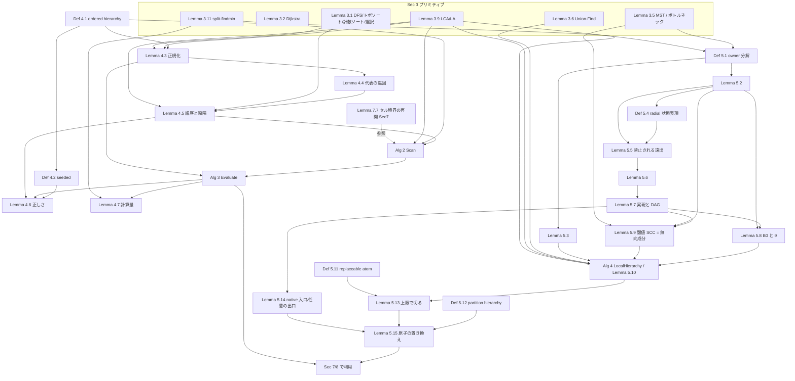

# 02 順序付き階層の評価(Sec 4)と局所階層(Sec 5)の解析

[English](02_ordered_hierarchy_local.md) | 日本語

対象: arXiv 2611.34911v1 "Linear Single-Source Shortest Path, Almost"(Gholami, Hajiaghayi)
範囲: Sec 4(Def 4.1–4.2, 4.1–4.3, Lemma 4.3–4.7, Alg 2 `Scan`, Alg 3 `Evaluate`)と
Sec 5(Def 5.1, 5.4, 5.11, 5.12, Lemma 5.2–5.15, Alg 4 `LocalHierarchy`)。
前提として Sec 2(記号・計算モデル・小規模の場合の扱い)と Sec 3(プリミティブ)を参照し、Sec 7 の Lemma 7.7(セル境界での再開)のうち Sec 4 から参照される部分も読んだ。
引用は txt の行番号(`l.NNN`)と論文のページ番号(`p.NN`)で示す。txt の数式は PDF の p.15–18 と p.21–26 で照合し、崩れが無いことを確かめた。

表記: 論文に書かれていない実装上の補いは **【補完】**、論文の誤りや曖昧点は **【曖昧】** と書く。

---

## 0. 重要な発見(要約)

1. **局所構成の閾値 `N > 2 L_N^4` を初めて満たすのは N = 209,953。** それ以下では Alg 4 は基本の場合(l.2–5)になり、頂点ごとに 1 状態、双方向の辺、等重み辺を同時に併合する Kruskal 木を作るだけである。Sec 7・8 で Alg 4 に渡される原子は大きさが polylog n なので、**実用規模ではどの原子も常に基本の場合になる**。Sec 5.1–5.4 の radial 構成(owner 分解、shell、θ、格子)は、Mode A では実際には一度も実行されない。動かして確かめるには、閾値と b を引数にした Mode B が必要になる(§4)。
2. **Sec 5.2–5.3 の補題(5.2, 5.5–5.9)の証明は N ≥ 2 と K ≥ 8h しか使っていない。** `N > 2L_N^4` を本当に使うのは Sec 5.4 の多項式の定数(N ≥ 32、h ≤ N、K < 16h から `3hK² ≤ N^5`、c = 10、区間の上端 `N^16 σ`)だけである。閾値を下げると壊れるのは 5.4 の「整列(aligned)判定」「非整列ブロックの MST 長 < σ_U/2」「格子の見張り値」で、階層の高さが単調でなくなる危険がある。直し方は §4.3 に書いた。
3. **補足の申し出(supplemental offer)`u = max{b, z+S(i)+g(i,j)}` は計算量のためだけにある**(Lemma 4.7)。正しさ(Lemma 4.6)は「上界が保たれる」ことしか使わない。補足の申し出を切った版を作れば、正しさは変わらず、計算量だけが悪くなる。差分テストの軸として使える。
4. **Def 4.1 の下では、2 つ以上の状態を通る長さ 0 の有向閉路を持つ入力は作れない。** 子の間の長さ 0 の弧は、どの正の高さに対しても軽い弧になり、軽い弧の商は非巡回でなければならないからである。零重みの成分は呼び出し側で縮約しておく必要がある(Sec 5.1 l.962 "Zero-length components may be contracted")。
5. Evaluate の正しさは、オラクルで検査できる 4 つの不変条件に翻訳できる。(I1) すべての申し出が δ 以上、(I2) 保護された状態は δ をちょうど 1 回出力する、(I5) Scan(X,I,c) から戻った時点で、X の下に I∩(−∞,c] に入るキーが残っていない、(I8) 開いた時点で、X の下の未出力の保護状態はすべて δ ≥ D₀ である(§2.8)。
6. 正しさの検査に使う参照用の階層生成器として、**「閾値ごとの SCC で正確な高さを付ける階層」**(Tarjan を重みの数だけ回す)が使える。任意の有向状態グラフに対して Def 4.1 を満たす(c₀ = 1)ので、Evaluate を Sec 5 と切り離して検査できる。
7. Lemma 5.9(無向の結合レコードの成分 = 閾値 W の有向 SCC)は、全数で照合できる。小さいグラフで、すべての W について Tarjan の SCC と Union-Find の結果を比べる。これは Sec 5 で最も価値の高いテストである。
8. 数値の注意。`N^3 σ`, `N^c σ`, `N^16 σ` は uint64 で簡単に溢れる。ただし分類と見張りにしか使わないので、飽和演算か、上限を「実際の最大重み × 2」で打ち切る方法で足りる。距離そのもの(z+S+g、オフセット b−jν など)は、整数型の重みなら正確に計算できる。double では下界の向きに丸めると実行可能性(feasibility)が壊れるおそれがある(§6)。

---

## 1. 前提(Sec 2・3 から使うもの)

- `L_k = ⌈log2(k+2)⌉`, `τ(k) = 1 + log log log(k+16)`(l.284)。
- 小規模の場合(l.286–290): 局所構成は `N > 2L_N^4` を仮定する。それ以外では「頂点ごとに 1 状態に元の非ループ辺を双方向に置き、等重みの MST 辺を同時に併合する。木の辺が併合の子をつなぎ、Lemma 3.5 によりそれより軽い辺は子の間に無い」。
- 計算モデル(l.292–311): 長さは不透明な実数で、使える演算は比較・加算・コピー。符号付きの値は非負の和 2 つの組で表す。2^j 倍は j 回の倍加で行う。整数の添字には O(1) の語演算が使える。**Sec 4・5 は乱択を使わない**(5.3 は "deterministic" と明記、5.4 の中央値選択も決定的な BFPRT)。
- 使うプリミティブ:
  - Lemma 3.1: DFS/BFS/トポロジカルソート、計数ソート、中央値選択。
  - Lemma 3.2: Dijkstra(テストのオラクル)。
  - Lemma 3.5: MST(3 回の成長パス)と、`b_T(x,y)` が最小ボトルネックであること。
  - Lemma 3.6: Union-Find(順序付きの併合イベント)。
  - Lemma 3.9: LCA と level ancestor が O(1)。
  - Lemma 3.11: split–findmin。分割と減少を受け付け、区間の最小を O(1) で返す。同値は元の添字で破る。

---

## 2. Sec 4 順序付き階層の評価

### 2.1 Def 4.1 Ordered hierarchy(p.14–15, l.646–658)

**構成要素**
- 有限の有向状態グラフ `D`。弧長は非負。
- 射影 `π: 状態 → 物理グラフ(無向)の頂点`。
- 根付き森 `H`。葉がちょうど状態全体になる。

**条件**
- (H1) 各弧 `x→y`(長さ ℓ)は、π(x) から π(y) への長さ ≤ ℓ の物理的な歩道に射影される。
- (H2) 内部節点 C は子を 2 つ以上持ち、高さ `h(C) > 0` を持つ。高さは根に向かって非減少。
- (H3) **軽い弧**(C の相異なる子の間を結び、長さ `< h(C)` の弧)を子の商に縮めると非巡回になる。
- (H4) 根どうしを結ぶ**全ての**弧(軽い弧に限らない)による根の商は非巡回。
- (H5) 各内部節点では、子どうしが**リンク**の木でつながっている。リンクは `(端点状態 x, 端点状態 y, 長さの上界 ℓ ≤ c₀·h(C))` で、π(x)–π(y) 間に長さ ≤ ℓ の物理的な歩道があることを証明する。向きはどちらでもよい。c₀ は絶対定数(Alg 4 の出力では c₀ ≤ 2、基本の場合と正確な併合では c₀ = 1)。
- (H6) 証明にだけ使うリンクは、緩和される弧にはならない。

**データ構造案【補完】**
```
struct HNode { int parent; vector<int> children; Real h; vector<Link> links; /*正規化後*/ Real nu, S; int rank_in_parent; StateId rep; Real gap_to_next; };
struct Link  { StateId x, y; Real len; };            // len ≤ c0*h(parent)
struct OrderedHierarchy { StateGraph D; vector<PhysV> pi; vector<HNode> nodes; vector<int> leaf_node_of_state; vector<int> roots; Real c0; };
```

### 2.2 Def 4.2 Seeded ordered hierarchy(p.15, l.659–672)

- 重み付きの物理的な源 `(v_i, c_i)` と、初期の状態申し出 Q。
- 目標距離は `δ(v) = min_i { c_i + d(v_i, v) }`。d は物理グラフの距離。
- **申し出(offer)**は有限の値で、+∞ は「申し出が無い」ことを表す。状態 x の申し出が**実行可能(feasible)**とは、値 ≥ δ(π(x)) であること。初期申し出はすべて実行可能でなければならない。
- **タイトな証拠(tight witness)**: 有向の状態パスで、「初期申し出 + 弧長の和 = 最後の状態の像での δ」となるもの。証拠を持つ状態を**保護された(protected)**状態と呼ぶ。要求された有限の目標それぞれについて、それに写る状態のうち少なくとも 1 つが保護されていなければならない(これは入力側の義務で、Evaluate は検査しない)。
- 観察: タイトな証拠の接頭辞はすべてタイトである(l.670)。
  - オラクルで保護集合を計算する方法【補完】: 初期申し出 q が δ(π(x)) と等しい状態 x から出発し、`δ(π(y)) + ℓ(y→x) = δ(π(x))` を満たす弧 y→x だけをたどって BFS する。到達した状態が保護集合である。

### 2.3 4.1 正規化と Lemma 4.3(p.15–16, l.674–723)

**入力**: Def 4.1 の階層(状態 N 個、弧 M 本)。
**出力**: 生き残った内部節点それぞれに単位 `ν(C)` と質量(物理的な直径の上界)`S(C)`。子の順位付けに使う軽い弧の割り当てと、根の商。

**定義**
- `F`: 全節点のリンクを無向の辺(長さ = 証明された上界)として集めた森。d 個の子を持つ節点はリンクを d−1 本出すので、F は状態上の森になる。長さ 0 のリンクも含める。
- 質量 `S(C)`: C の部分木にある (a) F の選ばれた辺の長さの和と、(b) 内部節点の高さ h の和、を足したもの。葉の質量は 0。F[C](C の下の状態を張る F の部分木)の上の路長 ≤ S(C) であり、S(C) ≥ h(C) が成り立つ。
- **正規化リンク**: 内部節点の子 C と親 P について `4·S(C) ≥ h(P)` が成り立つとき、C と P をリンクでつなぐ。
- 正規化リンクでつながった集合(連結な部分木の形になる)ごとに、その中の最小の高さ `h_min` から 2 の冪の表 `h_min·2^k` を作る。`ν(C)` は表の値のうち h(C) 以下で最大のもので、`ν(C) ∈ (h(C)/2, h(C)]` を満たす。リンクの無い節点は、自分だけの表(`ν = h`)を持つと読める【補完】。
- リンクされていない境界では `ν(P) > 2S(C)` が成り立つ(`h(P) > 4S(C)` と `ν(P) > h(P)/2` から)。
- 単位の等しい親子のリンクを**縮約**する。C の子は P の子になり、C のリンクは P のリンクに移る。縮約した節点の S には、**最上位の元の質量**(P の S)を使う。
- 自己ループの弧は捨てる。根どうしを結ぶ弧は根の商に送る。それ以外の弧は、正規化後の LCA に置く。`ℓ < ν(LCA)` のものが軽い弧で、子の順位を決める。

**Lemma 4.3**: 時間 O(M+N)。親の単位 ≥ 2 × 子の単位、`Σ_C S(C)/ν(C) = O(N)`。親子は**倍数で整列**しているか(親の単位が子の単位の 2 の冪倍)、`2S(C) < ν(P)` のどちらかである。前提は c₀ が定数であること。

**擬似コード**
```
Normalize(H):
  F ← ⋃_C links(C)                         // 無向の森、長さ = len
  F の preorder・根からの距離 rd・LCA(Lemma 3.9)を前計算
  postorder で S(C) = h(C) + Σ links(C).len + Σ_{内部の子 C'} S(C')   // 葉の S は 0
  for 内部節点 C(親 P あり): linked[C] ← (4·S(C) ≥ h(P))
  for リンク集合 Λ(linked でつながる連結成分。最上位の節点 top を持つ):
     hmin ← min_{C∈Λ} h(C)
     table ← [hmin, 2hmin, 4hmin, … ] を max_{C∈Λ} h(C) を覆うまで倍加で作る
     top から下に向かって: idx(C) ← idx(parent) から減らしていき、table[idx] ≤ h(C) で止める
     ν(C) ← table[idx(C)]
  縮約: linked[C] かつ ν(C) = ν(P) のとき C を P に吸収する(S(P) と ν(P) はそのまま)
  for 弧 (x→y, ℓ): x = y なら捨てる
     root(x) ≠ root(y) なら根の商に追加
     そうでなければ L ← LCA(x,y)、ci, cj ← L の子のうち x, y を含むもの(level ancestor)
        ℓ < ν(L) なら light[L].push(ci→cj, 末尾 x, 先頭 y)
  根の商と各 L の light をトポロジカルソートする(ν で決まる順位は §2.4 で付け直す)
```
- 計算モデル: 実数は比較・加算・倍加だけ。表の添字は整数。
- テスト:
  - `ν(P) ≥ 2ν(C)`。
  - `ν(P)/ν(C)` が 2 の冪、または `2S(C) < ν(P)`。
  - `ν(C) ∈ (h/2, h]`(縮約前の値で)。
  - `S(C) ≥ max_{x,y∈C} d_phys(π(x),π(y))`(Dijkstra のオラクルで)。
  - `Σ S/ν ≤ κ·N` を満たす κ を記録する。
  - 縮約後も各節点の軽い商が非巡回であること。

### 2.4 4.2 子の順序と Lemma 4.4・4.5(p.16–17, l.725–779)

**入力**: 正規化された階層、F の preorder、各節点 X の軽い弧(`ℓ < ν(X)`)。
**出力**: 各 X について、子のトポロジカル順(順位)、子ごとの代表 `x_i`(状態)、隣り合う子の間の間隔 `g(i,j) = g(j,i)`。g は π(x_i)–π(x_j) 間の物理的な歩道の長さの上界である。

**Lemma 4.4**: 逆の終了順に代表を巡る物理的な歩道の長さ ≤ `2 Σ_i S(i) + 2dν(X) + 2S(X)`。
**Lemma 4.5**: `Σ_X Σ_{i,j} g(i,j)/ν(X) = O(N)`。全体で O(M+N) 時間。

**擬似コード**(コストは「F の辺 = 証明された上界、選ばれた弧 = 弧長」で数える)
```
OrderChildren(X):
  for 子 i: prov[i] ← i の下の任意の状態      // 【補完】F-preorder 最小の状態を推奨
  out[i] ← 子 i から出る軽い弧を、末尾状態の F-preorder でソートした列
  acc ← 0; cur ← ⊥; finish ← []
  for 子 r(prov[r] の F-preorder 順。計数ソートで O(N)):
     if visited[r]: continue
     if cur ≠ ⊥: acc += D_F(cur, prov[r])     // D_F = rd(a)+rd(b)−2rd(lca)
     cur ← prov[r]; DFS(r, prov[r])
  topo ← reverse(finish)                       // 子の順位
  for k: g(topo[k], topo[k+1]) ← mark[topo[k]] − mark[topo[k+1]]
  rep[i] ← x_i

DFS(i, entry):
  visited[i] ← true; x_i ← entry
  for out[i] の弧 a=(t→y, ℓ) を、entry の preorder 位置から巡回的に:
     j ← y を含む X の子
     if visited[j]: continue                   // 木の弧でない弧はたどらない
     acc += D_F(cur, t); cur ← t                // F[i] の中を移動
     acc += ℓ; cur ← y
     DFS(j, y)                                  // 戻ると cur = x_j = y
     acc += ℓ; cur ← t                          // 弧を逆向きにたどって戻る
  acc += D_F(cur, entry); cur ← entry
  mark[i] ← acc; finish.push(i)
```
- 論文は、巡回の開始位置を O(1) で引く表を (親, 子, preorder) の三つ組で計数ソートして作る(l.773–777)。簡易版では二分探索 O(log) で代用できる(逸脱として記録する)。
- 差の計算(`D_F` と mark の差)には減算が要る。論文は符号付きの組で行う。整数の重みなら正確に計算できる。
- 境界: 出る軽い弧の無い子は即座に終了する(l.776)。子が葉なら S = 0、F[i] は 1 点。
- テスト:
  - 軽い弧がすべて順位の前向きであること。
  - `g(topo[k],topo[k+1]) ≥ d_phys(π(x_k), π(x_{k+1}))`。
  - `Σ g ≤ 2ΣS(i)+2dν+2S(X)`(Lemma 4.4 の式そのもの)。
  - `Σ g/ν ≤ κ'N` を満たす κ' を記録する。

### 2.5 4.3 スロット、期限、run、補足の申し出(p.17–18, l.781–832)

**状態**
- 各節点の状態は unopened / live / retired のいずれか。
- 各葉は、出力する(settled)か retired になるまで、キーの減少を受け付ける。
- 最小値は (値, 葉 ID) の辞書式順で比べる。

**窓**
- 名目上のスロットは半開区間 `[a,b)`。恒久の期限 c は**閉区間側に含む**。
- 候補 z が**期限内(due)**であるとは `a ≤ z < b` かつ `z ≤ c` のこと。c は継承した物理的な期限の最小値(無ければ +∞)。

**開く(open)と満了(expiry)**
- 内部節点 C は、親の実際の窓の中で有限の最小キー `D₀` を見つけたときに開く。
- 絶対的な満了時刻は `D₀ + S(C)`。C へのタイトな到着はすべてこの時刻以下になる(三角不等式)。
- 全葉が settled か retired になるか、満了時刻を(等号を含めて)覆ったら終わる。

**局所スロットの原点**(Pettie–Ramachandran の整列規則、l.794)
- `D₀ + S(C) < b` なら原点は `D₀`。
- そうでなければ、`b − jν(C) ≤ D₀` を満たす最大の値を原点にする。b は**親の名目スロットの右端**(Lemma 7.7 l.1887 で明示)。j は逐次の減算で求め、コストは O(1 + S/ν)。
- 根では常に 1 つ目の規則を使う。
- 原点は親のスロットの内側に入る。非整列の境界では `2S < ν(P)` から、整列した境界では割り切れることから。
- 最後のスロットが、この呼び出しで満了する部分木の上界を越える場合は、その上界を追加の上限(cap)として伝え、上限を越える出力を止める。格子は常に名目スロットの端に合わせる。

**葉の配置と run**
- 階層の葉を、子の順位に従う DFS 順に並べる。各節点は連続区間を占める。
- 開いた X は連結リストを持つ。リストには、登録済みの live な子と、未登録の子の**極大な連続 run** が元の順で並ぶ。
- 満了した子や完了した子はリストから外す。run の位置は変えず、隣の run と結合しなくてよい。
- run の最小キーは split–findmin で持つ。X を初めて開いたときは、子のリスト全体が 1 つの run である。

**run の分割**
- due な最小 z の葉が直下の子 i に属するとき(i は level ancestor で求める)、run を「空でない左の部分 run、子 i、空でない右の部分 run」に置き換える。区間の分割は高々 2 回。
- カーソルは**新しく作った最初の断片**に置く。順位の低い子に先に機会を与えるためである。

**補足の申し出**
- 新しくできた部分 run それぞれについて、i に隣接する子 j(左なら順位 i−1、右なら i+1)の代表 `x_j` に `u = max{b, z + S(i) + g(i,j)}` を申し出る。
- 実行可能性: 最小の葉から F[i] の中を通って x_i へ(長さ ≤ S(i))、さらに間隔の歩道で x_j へ行ける。
- b まで切り上げるので、同じスロットで順位の低い子が新たに due になることはない。

### 2.6 Algorithm 2 `Scan(X, I, c)`(p.18, l.834–864)

**入力**: live な節点 X、名目スロット `[a,b)` の一部 `I = [a', b')`、閉区間側の期限 c。
**出力**: 出力した (状態, 値) と、未処理の申し出。

```
Scan(X, I=[a',b'), nominal=[a,b), c):               // Alg 2
  p ← X.list.first                                   // l.2 カーソル順(トポロジカル順)
  while p ≠ end:
    if p は未登録の run:                             // l.3
      (z, leaf) ← SF.min(p.interval)                  // Lemma 3.11
      if a' ≤ z < b' and z ≤ c:                       // l.4 due
        i ← LevelAncestor(leaf, depth(X)+1)
        (L, i, R) ← p を分割(空の断片は作らない)。SF.split を高々 2 回
        register(i)                                   // l.5
        if L ≠ ∅: j ← L の最後の子; offer(x_j, max{b, z + S(i) + g(i,j)})   // l.6
        if R ≠ ∅: j ← R の最初の子; offer(x_j, max{b, z + S(i) + g(i,j)})
        p ← (L ≠ ∅ ? L : i); continue                 // l.7
      p ← next(p); continue                           // due でない run は通過
    else:                                             // 登録済みの子 i、l.8
      if i は葉:
        if key(i) が due(I 内かつ ≤ c)かつ i が未出力:   // l.11
          emit(i, key(i)); settled[i] ← true
          for 弧 (i→y, ℓ): if !settled[y] and !retired[y]: SF.decrease(y, key(i)+ℓ)
          unlink(i)
      else:
        if i が unopened:                             // l.9
          D0 ← SF.min(i.interval) の値                 // 登録済みなので due のまま(§2.8 の I3)
          origin(i) ← (D0+S(i) < b) ? D0 : max{ b − jν(i) ≤ D0 }
          expiry(i) ← D0 + S(i); status(i) ← live; i.list ← [run(i の全ての子)]
        c_i ← min(c, expiry(i))
        for i の名目スロット J = [o_k, o_k+ν(i)) を現在の k から、J∩I ≠ ∅ かつ o_k ≤ c_i の間:   // l.10
          Scan(i, J∩I, J, c_i)
          if i が完了: break
          if J ⊆ I: k ← k+1 else break               // 切り取られたスロットは次の portion で再開
        if i が完了 or (c_i < b' すなわち満了時刻を覆った): retire(i); unlink(i)
      p ← next(p)
  完了した断片と、恒久の期限を覆った断片を retire する     // l.12
```
- `retire(C)` は、C にまだつながっている断片だけを歩く。登録済みの子には再帰し、未登録の run の下の部分木は丸ごとたどる。新しく retired になった葉に印を付ける。以後の申し出は、葉の settled / retired の印を見てから入れる。
- 1 回の訪問で、live な節点は、その訪問と交わる局所スロットをすべて進める。新しい申し出が無くても進める(l.863)。
- `I` は、通常の呼び出しでは「名目スロット ∩ 親から渡された窓」である。Lemma 7.7(Sec 7 の担当)では外部のセル境界で切り取られ、カーソルは次のセルで最初の live な順位から再開する。補足の申し出の切り上げには名目の `b` を使う(`b'` ではない。l.1890)。
- **【補完】** 上の while ループと「J ⊆ I のときだけ k を進める」という扱いは、本文の "clock persists across visits" と Lemma 7.7 の「切り取られたスロットを再開する」から再構成したもの。

### 2.7 Algorithm 3 `Evaluate(D, H, Q)`(p.19, l.866–882)

```
Evaluate(D, H, Q):
  Normalize(H); OrderChildren(すべての X)                  // l.2  Lemma 4.3, 4.5
  layout ← 葉の DFS 順(子の順位に従う); SF ← split–findmin(全キー +∞)
  根の境界ごとに SF.split; 状態ごとに最小の初期申し出を SF.decrease で入れる   // l.3
  for 根 X(根の商のトポロジカル順):                          // l.4
    if SF.min(X) = +∞: continue                             // l.5
    if X は葉: emit(X, key); 出る弧を緩和                     // l.6–7
    else:
      D0 ← SF.min(X); origin ← D0; c ← D0 + S(X); X.list ← [run(全ての子)]   // l.9
      for k = 0,1,…: I ← [D0+kν, D0+(k+1)ν); if D0+kν > c: break          // l.10
        Scan(X, I, I, c); if X が完了: break                                 // l.11
  return 出力した (状態, 値) の組                                            // l.12
```
- 物理頂点 v の最終的な距離は、`π(x) = v` を満たす状態 x の出力の最小値である(呼び出し側の Sec 8 l.2192 が取る)。

### 2.8 Lemma 4.6(正しさ)の骨子と、検査できる不変条件

**主張**: 保護された状態 x は δ(π(x)) を出力する。それ以外の出力はすべて ≥ δ(π(x))。

**骨子**
- 上界: 弧(H1)と間隔の証明(Lemma 4.4)が上界を保つ。
- 下界側(タイトな到着を見逃さないこと)は、次の順の入れ子の帰納法で示す。根について → 同じ節点の時間順の portion について → portion 内の子の順位について → 残りの高さについて再帰的に。
  1. portion `[u,v)` の中で、タイトなパスが目標の子に最後に入る入口を見る。
     - 前任者の時刻が u より前なら、以前の portion で処理済み。
     - 前任者の時刻が u 以上なら、横断の長さは `< v−u ≤ ν(C)` なので軽い弧であり、前任者は順位の低い子にいて、すでに出力している(H3 + Lemma 4.5)。
     - 種、または C の外からの入口なら、呼び出しの不変条件により申し出がすでに入っている。
  2. まだ出力していない最初の状態は、due な申し出を持つ。未登録の run は、必要な順位までに due な最小値を持つ。弧長が非負なので、生きている申し出は過ぎた窓に入り込まない。順位の低い子への弧は、スロットの右端以上の値しか作らない。境界の申し出は b に切り上げてある。
  3. 初めて開くとき: 最小値より厳密に早いタイトな到着は存在しない。満了時刻は `D₀+S(C)` 以下(物理的な直径の上界、Lemma 4.3)。満了で retire するのは、等号を含めてその時刻を覆った後だけ。
- 依存: Def 4.1(H1, H3, H5)、Lemma 4.3(S が直径の上界になる)、Lemma 4.5(順位と間隔)、Lemma 3.11(区間の最小)、Def 4.2(接頭辞のタイト性)。

**実装で検査できる不変条件**(デバッグ時だけ有効にする。オラクルは物理グラフの Dijkstra で求めた δ と、§2.2 の保護集合)
- **I1 上界**: `SF.decrease(x, v)` を呼ぶたびに `v ≥ δ(π(x))`。補足の申し出も含む。
- **I2 出力**: 各状態の出力は高々 1 回で、出力値 ≥ δ。保護された状態は必ず出力し、その値は δ に等しい。
- **I3 時計の単調性**: 節点 X の portion `[a',b')` を処理している間に生まれる新しいキーは ≥ a'。カーソルより順位の低い X の子に落ちるキーは ≥ b'(軽い弧が前向きであることの帰結)。
- **I4 スロットの規律**: 出力値 z は、出力したときの portion I に入り、z ≤ c。同じ節点では、出力のスロット番号が単調に増える。
- **I5 取りこぼしが無いこと**: `Scan(X,I,c)` から戻ったとき、X の下の未出力・未 retire の状態に、キーが `I ∩ (−∞, c]` に入るものは無い。
- **I6 満了の健全性**: X が retire するとき、X の下の保護された状態はすべて出力済み(`δ ≤ D₀+S(X)` も同時に確かめる)。
- **I7 原点の整列**: 子の原点が親の名目スロットの内側にある。子の格子が b に合っている(倍数で整列しているか、`D₀+S < b`)。
- **I8 開くときの下界**: X が D₀ で開くとき、X の下の未出力の保護された状態はすべて `δ ≥ D₀`。

### 2.9 Lemma 4.7(計算量)(p.20, l.922–948)

- 主張: O(M + N τ(N) + Q)。入力の走査で、状態ごとの最小の初期申し出だけを残す。
- 内訳:
  - 補足の申し出があるので、各部分 run の失敗した訪問は `O(1 + (S(i)+g(i,j))/ν(X))` 回で済む。
  - 登録済みの子への訪問は `O(1 + S(i)/ν(X))`。
  - これらを合計すると Lemma 4.3 と 4.5 により O(N)。
  - 廃棄は O(N)。補足の減少は O(N) 回、元の緩和は O(M) 回。
  - split–findmin が `O(q + q' + Nτ(N))`(Lemma 3.11)。
- 空間 O(M+N)。計算モデルは、実数の比較・加算と整数の添字。整数の辞書や実数キーのヒープは使わない(l.942)。
- 実装の簡易版: split–findmin をセグメント木(O(log N))で置き換える。これは計算量の逸脱(D-*)として記録する。

### 2.10 Sec 4 の境界値・退化ケース

| ケース | 論文の扱い / 推奨 |
|---|---|
| 状態 1 つの根 | 「最良の有限申し出を処理するだけ」(l.723)。Alg 3 の l.6–7 |
| 有限の申し出の無い根 | 飛ばす(l.5)。その根の状態は出力しない |
| 自己ループの弧 | 正規化で捨てる(l.719) |
| 長さ 0 の弧 | 許される(Def 4.1 は非負)。ただし子の間の長さ 0 の弧は常に軽いので、2 状態以上を通る長さ 0 の有向閉路は Def 4.1 に反する。呼び出し側で縮約する(Sec 5.1 l.962)。入力検査で拒否するとよい |
| 同値 | 最小値は (値, 葉 ID) で比べる(l.784)。出力値は同値の破り方によらない |
| 非連結(複数の根) | 根の商をトポロジカル順に処理する。根の商が非巡回であることは入力の義務(H4) |
| h(C) = 0 | Def 4.1 で禁止 |
| D₀ + S(C) が b にちょうど等しい | 2 つ目の規則(`<` が成り立たないので) |
| 満了時刻ちょうどの値 | 含む(閉区間側)。親の窓の右端は含まない(l.803–807) |
| c₀ が大きい | Lemma 4.3 の定数が `max(1,c₀)` 倍になる。正しさには影響しない |

### 2.11 Sec 4 のテスト提案

1. **参照階層の生成器【補完】** `build_threshold_scc_hierarchy(D, π)`
   - 相異なる弧長 W を昇順に見て、`ℓ ≤ W` の弧で Tarjan の SCC を求める。SCC が併合されたところに高さ W の節点を作る。
   - 子は「`< W` の SCC」なので、軽い弧(`< W`)の商は SCC の凝縮であり、非巡回になる。
   - リンクは「`≤ W` の弧で子の商を張る木」の弧から取る(c₀ = 1)。
   - 物理グラフ = 弧 (π(x), π(y), ℓ) の無向多重グラフとすれば (H1) が成り立つ。
   - 長さ 0 の閉路を作らないよう、生成時に正の長さだけを使う。
   - ~~高さに `h(C) = 2W` などの係数を掛けた版も作り、軽い弧が実際に子の間にある階層を作る。~~
     **訂正(2026-11-27)。** `h(C) = 2W` の版は順序付き階層にならない。節点 C は長さ ≤ W(C) の弧の強連結成分なので、高さを W(C) より上げると、違う子どうしを結ぶそうした弧がすべて light(長さ < h)になり、子の上の light の商が強連結になって、すべての内部節点で H3(Def 4.1、l.650)が崩れる。正しくなるのは、高さを逆に下げたときに限る: 0 < h'(子) ≤ h'(C) ≤ W(C) を満たす高さなら、c₀ = 各節点での ⌈(C の最長のリンク) / h'(C)⌉ の最大として Def 4.1 を満たす(すべての高さを半分にすれば c₀ = 2)。`tests/unit/paper/hierarchy/test_reference_hierarchy_heights.cpp` で固定した。
2. **差分テスト**
   - (a) 基本の場合の局所階層(Kruskal)+ 頂点 1 つの源: 物理頂点ごとの最小値を Dijkstra と比べる。
   - (b) 任意の有向状態グラフ + 参照階層: 保護された状態の出力 = δ、全出力 ≥ δ(I1, I2)。
   - (c) 複数の源 `(v_i, c_i)`。
   - (d) 補足の申し出を有効にした版と無効にした版で、保護状態の出力が一致すること。
   - (e) split–findmin の 2 つの実装の差分。
3. **不変条件のテスト**: §2.8 の I1–I8 を `SSSP_PAPER_CHECKS` の下でアサートし、乱数の小さなグラフ(N ≤ 60)を 1 万件流す。
4. **構造のテスト**: Lemma 4.3 と 4.5 の性質(§2.3, §2.4)。`Σ S/ν`、`Σ g/ν`、スロット数、失敗した訪問回数を数え、N で割った値が N によらず有界であることを記録する。計算量は測定で確かめる。
5. **手計算の例**: 状態 3 つの鎖(子 2 つ、軽い弧 1 本)で、スロット・分割・補足の申し出の値を手で計算して一致を見る。

---

## 3. Sec 5 任意の正の長さに対する局所階層

前提: 連結で正の重みのグラフ G。頂点 N 個、辺 m 本。`L_N = ⌈log2(N+2)⌉`。

### 3.1 5.1 Owner 分解(Def 5.1、Lemma 5.2、5.3)(p.21–22, l.960–1018)

**構成**(`b = L_N^4`、外側の構成では別の b)
1. MST T を作る(Lemma 3.5)。`w(uv) > D_T(u,v)` を満たす非木辺を消す(簡約グラフ)。これ以降、全辺で `b_T(u,v) ≤ w(uv) ≤ D_T(u,v)` が成り立つ。`D_T` は LCA と根からの距離で求める。
2. `A₀`: 根付きの T を postorder でたどる。子の残りサイズの和 + 1 を求め、それが b 以上になったら印を付けて 0 を返す。印が 1 つも無ければ、ピボットを 1 つ置く(【補完】根を推奨)。`|A₀| ≤ max{1, ⌊N/b⌋}` で、T − A₀ の各成分は b 頂点未満。
3. `A = A₀ ∪ {A₀ を張る最小部分木で次数 3 以上の頂点}`。`|A| = O(1+N/b)` で、T − A の各成分はピボットの隣接を高々 2 つしか持たない。
4. 回廊の切断:
   - ピボットの隣接を 2 つ持つ成分では、2 つのピボットを結ぶ回廊(木の道)のうち、重み最大の木辺を 1 本消す(【曖昧】同値の破り方は書かれていない → 辺の添字で決める)。
   - 隣り合う 2 つのピボットでは、その間の辺を消す。
   - 残った成分が **owner セル**で、各セルにピボットがちょうど 1 つある。
5. `p(v)`: v のセルのピボット。`R_v = D_T(v,p(v))`, `r_v = b_T(v,p(v))`(ピボットでは 0)、`h = b+1`(セル内でピボットまでのホップ数の上界)、`R_v ≤ h·r_v`。
6. 消した回廊の辺は、A の上の木 `T_A` を作る。`σ(p,q) = T_A[p,q]` 上の最大重み `= b_T(p,q)`、`σ(p,p) = 0`。

- 計算量: 組合せの部分は線形。T_A とその併合階層(ソート)を合わせて O(N + |A| log(|A|+1))。

**Lemma 5.2**
- セル間の辺 xy(重み w)では `w ≥ max{r_x, r_y, σ(p(x),p(y))}`。
- セル内で半径の異なる辺では `w ≥ max{r_x, r_y}`。
- すべての辺で `w ≤ h(r_x+r_y) + N σ(p(x),p(y))`。2 つのピボットを経由する木の道から出る。

**Lemma 5.3**: すべてのピボット q について `b_T(v,q) ≥ r_v`。

- テスト:
  - T − A の成分が b 頂点未満で、ピボットの隣接が ≤ 2。
  - 各セルにピボットがちょうど 1 つ。
  - Lemma 5.2 の 3 つの不等式を全辺で確かめる。
  - Lemma 5.3 を全 (v, q) で確かめる。
  - `σ = b_T` であること。
  - b を引数にして b ∈ {1, 2, 3, N+1} で動かす(b = 1 なら全頂点がピボット、b > N なら 1 ピボット)。

### 3.2 5.2 局所状態グラフ(Def 5.4、Lemma 5.5–5.7)(p.22–24, l.1020–1107)

**辺の分類**
- **macro**: セル間の辺で `w ≤ N³ σ(p,q)`。消した回廊の辺は必ず macro になる。macro では `σ ≤ w ≤ N³σ` が成り立ち、名前の付いた回廊の最大値(そのキー σ)を持つ。
- **radial**: それ以外。`w ≤ 3h·max{r_x, r_y}` が成り立つ(Lemma 5.2 と `σ < w/N³` から。N ≥ 2 で成り立つ)。
- ピボットどうしを結ぶ正の radial 辺は存在しない。
- `N³σ` は、整数 N の 2 進展開で加算と倍加を 3 回ずつ行って作る(ピボット木の最大値ごとに O(log N))。

**shell の構成**
- `K` = 8h 以上で最小の 2 の冪。
- radial 辺の両端の半径がともに正で、比が ≤ K² のとき **near**、比が > K² のとき **far** と呼ぶ。
- near な radial 辺で正の半径の頂点を結んだ成分を **near 成分**と呼ぶ(孤立した頂点も成分 1 つ)。
- 成分の最小半径を a として、**native shell** `i(v)` を `a K^{i(v)} ≤ r_v < a K^{i(v)+1}` で定める。
  - near な全域木の上で隣り合う頂点の添字の差は ≤ 2。最小の頂点から木をたどり、K の冪をキャッシュする。O(m + N log K)。
- **窓**(状態の集合):
  - inward 窓 j(j ≥ 0)は shell j と j+1 を含む。
  - outward 窓 j(j ≥ 0)は shell j−1 と j を含む。
  - 窓ごとに頂点の**別のコピー**を作り、両端がその窓にある near な radial 辺を双方向で入れる。
  - この窓内グラフの連結成分を **block** と呼ぶ。
  - 正の半径の頂点 v のコピーは、`in_{i(v)}`(native inward)、`in_{i(v)−1}`(i ≥ 1 のとき)、`out_{i(v)}`(native outward)、`out_{i(v)+1}` の高々 4 つ。
  - ピボットのコピーは `in(p)` と `out(p)` の 2 つ。

**弧**(長さは元の物理的な長さ。切り替えだけ 0)
| 種類 | 末尾 → 先頭 |
|---|---|
| 窓内 | 同じ窓のコピーの間の near 辺を双方向 |
| inward near 移行 | inward 窓 j のコピー → 隣の頂点のうち native shell `i < j` のものの inward 窓 i(= native inward) |
| outward near 移行 | outward 窓 j のコピー → native shell `i > j` の隣の頂点の outward 窓 i(native outward) |
| far(inward) | 半径の高い端点の**全ての** inward コピー → 半径の低い端点の native inward |
| far(outward) | 半径の低い端点の全ての outward コピー → 半径の高い端点の native outward |
| 位相の切り替え | 各頂点の各 inward コピー → native outward(長さ 0)。ピボットは `in(p)→out(p)` |
| ピボットの radial | v の(正の)inward コピー → `in(p)`、`out(p)` → v の native outward(【曖昧】"from positive inward states" は far の規則と同じく「全ての inward コピー」と読む) |
| macro | 各向き x→y について、x の**全ての**コピー → y の native inward |
| 源 | 源の native inward に、与えられた費用で初期申し出 |

**Def 5.4**(radial 状態表現)は、上の有向グラフに、物理頂点への射影と、各頂点の native inward 入口を合わせたもの。パラメータは座標(ここでは r_v、Sec 8 では J_v)、比 K、radial / macro の分類。

**Lemma 5.5(禁止される遠出)**
- 前提: `N > 2L_N^4`、macro 判定 `w ≤ N³σ`、`K ≥ 8h`。
- 主張: 最短路の連続した radial 区間で、最大の半径または辺重みを M > 0 とする。このとき両端の半径がともに `≤ M/K` にはならない。
- 証明: 区間の費用は ≥ M。一方、2 つのピボットを経由する道は `2hM/K + M/N² ≤ M/4 + M/4 < M` で済む。
- 実際に使うのは **N ≥ 2 と K ≥ 8h だけ**である。

**Lemma 5.6**: 最短路の極大な radial run を、半径が最小の頂点で 2 つに分ける。前半では、半径が「それまでの最小 × K」を超えない。後半では、半径が「それまでの最大 ÷ K」を下回らない。

**Lemma 5.7**
- 状態 O(N)、弧 O(m+N)。
- native inward の初期状態から、すべての物理的な測地線を同じ長さで実現できる。
- macro 弧を除いて block を縮めると DAG になる。
  - inward の移行では、数値としての shell の底が厳密に減る。
  - outward の移行では厳密に増える。
  - 切り替えは inward から outward への一方向。
- 逆向き: 状態パスは物理的な歩道に射影される。したがって、コピー全体の最小値 = 物理距離。個々のコピーの距離はそれより大きいこともある(∞ もありうる)。

**擬似コード(構成)**
```
BuildRadialStates(G, T, owner):           // Alg 4 l.7–8
  for 辺 e=xy: kind[e] ← (p(x)≠p(y) and w ≤ N³σ(p(x),p(y))) ? MACRO : RADIAL
  near 成分 ← r>0 の両端を持ち比 ≤ K² の radial 辺の Union-Find(または BFS)
  for 成分: a ← 最小の r; 全域木の上で i(v) を K の冪の比較で決める
  コピーを作る: in[v][0/1], out[v][0/1]、ピボットは in/out
  上の表に従って弧を張る(弧の種類を記録する: INTRA, NEAR_T, FAR_T, SWITCH, PIVOT, MACRO)
  block ← INTRA 弧で連結な成分
```
- テスト:
  - (a) 状態グラフ上の多始点 Dijkstra で、各頂点のコピーの最小値 = 物理 Dijkstra(複数の源、任意の初期費用で)。
  - (b) 全コピーの距離 ≥ 物理距離。
  - (c) macro を除いて block を縮めたグラフが DAG。
  - (d) Lemma 5.5 と 5.6 を Dijkstra 木の最短路の radial run で全数検査する。
  - (e) 状態数 ≤ 4N、弧数 ≤ c(m+N)。

### 3.3 5.3 閾値成分と結合(Lemma 5.8、5.9)(p.24–25, l.1109–1180)

**定義**(状態 z について。許容される道 = radial 弧と切り替えだけ)
- `I₀(z)`: 先頭のリセット(native inward)から z に到達できる macro の最小重み。
- `O₀(z)`: z から到達できる末尾コピーを持つ macro の最小重み。
- 空なら +∞。達成する macro(と、その名前付きキー σ)を保持する。
- `B₀ = max{I₀, O₀}`。
- `I*(z), O*(z)`: 同じ許容パスで、前後の macro を含めた**ボトルネック**(最大の物理的な弧重み)を最小化した値。`θ(z) = max{I*, O*}`。

**計算**
- `I₀`: block DAG をトポロジカル順にたどり、最小値を前向きに伝える。種は macro の先頭の native inward コピーで、値は w。
- `O₀`: 逆向き。種は全ての末尾コピー。
- `I*`: block DAG の順にたどる。block の中は「block の MST S 上の多始点ボトルネック `min_x max{c_x, b_S(x,v)}`」で解く。postorder で、自分の種と子からの値(辺重みまで切り上げたもの)の最小を取り、preorder で親の値を子に返す。block の間の移行は `max(値, 弧長)` で緩和する。`O*` は向きを逆にして同じことをする。
- 結合レコード: ピボットごとに補助頂点を 1 つ置き、次の 3 種類を作る。
  - block の MST 辺は、端点どうしを物理的な重みで結ぶ。
  - 有限の θ(z) を持つ状態 z は、owner の補助頂点と重み θ(z) で結ぶ。
  - 補助頂点どうしは回廊の重みで結ぶ。
- **core**(閾値 W): 回廊の重み ≤ W に制限したピボット木の非自明な成分について、そのピボット状態を含む SCC。

**Lemma 5.8**: B₀ が有限の状態では `r ≤ θ` かつ `B₀ ≤ θ ≤ 3hK² B₀` で、`σ ≤ θ ≤ 3hK²N³σ`。有限性は B₀ と θ で一致する。

**Lemma 5.9**: W > 0 を固定する。block の MST 辺、θ での状態と owner の結合、回廊の辺のうち重み ≤ W のものを残す。その無向成分を状態に制限したものは、**弧長 ≤ W の有向グラフの SCC と一致する**。不等号を全部 `<` に変えた版も成り立つ。union イベントは O(N) 個で、O(m) 本の弧に閾値の順位は要らない。

- 計算量: block の MST と 2 回の走査で O(m + N log log N)。決定的。
- テスト:
  - (a) I₀・O₀・I*・O* を全数(macro ごとの BFS とボトルネックの Dijkstra)で計算して照合する。
  - (b) Lemma 5.8 の不等式。
  - (c) **Lemma 5.9 の全数照合**: すべての相異なる W(弧長 ∪ 結合の重み)について、`≤ W` と `< W` の両方で Tarjan と Union-Find を比べる。

### 3.4 5.4 局所階層の組み立てと Algorithm 4、Lemma 5.10(p.25–28, l.1182–1300)

**block ごとの扱い**
- 1 状態の block: 有限の結合を 1 つだけ持ち、内部の尺度判定は行わない。
- 正の半径で 2 状態以上の block U:
  - `s_U` = 窓に現れる最も低い native shell の下端(outward 窓 0 では実際の最小の正の境界)。`s_U ≤ r_x < K² s_U` が成り立ち、窓内の辺は `≤ 3hK² s_U`。
  - `t_U ∈ [s_U/2, s_U]`(後で決める)より軽い窓内辺の成分 Y を、**階層の上でだけ**縮める。
    - Y の中では owner と半径が共通で(`r_Y ≥ s_U`)、Y はピボットを避ける(Lemma 5.3)。したがって Y は T−A の 1 成分に収まり、b 頂点未満。
    - Y ごとに正確な Kruskal の併合木を作る(< b 本の辺をソートし、等重みは同時に併合)。費用 O(N log(b+2))。
  - U 内の θ の最小が ∞ なら、U の階層はすべて局所的。そうでなければ `z_U = argmin θ`、`σ_U` = `B₀(z_U)` の名前付きキー。`σ_U ≤ θ(z_U) ≤ N^{O(1)} σ_U`、`s_U ≤ θ(z_U)`。

**定数**: `c = 10`。`N > 2L_N^4` から `N ≥ 32`、`h ≤ N`、`K < 16h` が出て、`3hK² ≤ 768N³ ≤ N^5` と `N·3hK² ≤ N^{c−2}`。

**整列の判定**
- `s_U ≥ σ_U/N^c` なら **aligned**。
  - aligned な block の重要な重み(≥ s_U/2)は σ_U の多項式倍に収まる。
- 非整列の block は MST の全長が `< σ_U/2` になり、最初の macro の付着より下で 1 つの局所木になる。全メンバーの θ は等しく、`s_U` から始まる**別の格子**を使う。付着の無い block も同じ扱い。
- 判定は σ キーごとにまとめ、中央値で分割して行う。`N^c σ` はキーごとに 1 回だけ計算する。全体で O(N + |A| log² N)。

**大域の倍加格子**
- 名前付きの回廊キー σ ごとに区間 `[min(σ, そのキーに割り当てた aligned な s_U), N^16 σ]` を作る(`θ ≤ N^8σ`、block の重み ≤ `N^13 σ`)。
- 有限の θ(z) は自分のキーの区間に入れる。
- 端点をソートし、重なる区間を併合する。併合した成分ごとに最小値から倍加の格子を張る。全体で O(|A| log N)。
- 値の分類は O(log N) 個の格子点の上の二分探索で、O(log log N)。
- aligned な U では `t_U` = s_U が入る階級の下端。別格子の U では `t_U = s_U`(階級は O(log(hK+2)) 個)。

**併合節点**
- 大域的に整列した union イベントを階級の順に処理する。階級 `[h₀, 2h₀)` ごとに**同時併合**し、その階級以下の全重みで生まれた成分を**高さ h₀**の節点として記録する。
- 軽い弧の判定は `< h₀`、接続に使う弧は `< 2h₀`(c₀ = 2)。
- 局所木(Y の木、別格子の block)は、付着イベントのところで差し込む。

**Algorithm 4 `LocalHierarchy(H)`**(l.1244–1261)
```
LocalHierarchy(H):                       // H: 連結、k 頂点、正の重み
  if k ≤ 2·L_k^4:                        // l.2 基本の場合(Sec 2 l.286–290)
     頂点ごとに状態 1 つ(native entry = 自分)、元の非ループ辺を双方向の弧にする     // l.3
     頂点対ごとに最軽量の辺を残して MST、等重み辺を同時に併合した Kruskal 木を作る
     節点の高さ = その併合の重み、リンク = その重みの MST 辺(c0 = 1)              // l.4
     return                                                                         // l.5
  MST(Lemma 3.5) → 木で支配される辺を除く → owner セル(b = L_k^4)                // l.6
  radial / macro の分類(T_A の最大値は LCA と level ancestor で、Lemma 3.9)         // l.7
  inward と outward の窓、macro のリセット(§3.2)                                   // l.8
  I0・O0・I*・O* の伝播(§3.3)                                                      // l.9
  結合レコードの線形リストを作り、重要な重みを格子で分類する                          // l.10
  同じ階級の結合を Union-Find(Lemma 3.6)で結合し、局所木を差し込み、軽い子の弧を順序付ける   // l.11
  return 状態表現と、物理的なリンク付きの階層                                       // l.12
```

**Lemma 5.10 の後処理**(l.1286–1300)
- 空の補助節点を捨て、子が 1 つの節点を詰める。
- 根の間の弧は凝縮の商に送る。
- 各弧を、LCA と level ancestor で「共通の親での子の対」に割り当てる。
- 親(高さ h₀)ごとに `< 2h₀` の弧で子の隣接リストを作り、DFS の発見辺をリンクにする。
- `< h₀` の弧で子をトポロジカルソートする。
- 状態グラフの SCC が複数あれば、極大成分を凝縮の順に並べる(複数の根になる)。

**Lemma 5.10**
- N ≥ 1 なら順序付き階層を返し、全頂点に native entry がある。
- 全ての測地線を native entry から同じ長さで実現でき、全ての状態弧は実行可能な物理的な歩道に射影される。
- 時間 O(m + N log log(N+4))。節点 O(N)、弧 O(m+N)。接続定数 ≤ 2。計算モデルは比較と加算(+整数の添字)。

**【補完】Mode B の簡易組み立て(正確な高さ)**
- 結合レコードを重みでソートし(O(N log N))、等しい重みを同時に併合する。節点の高さ = その重み W、子 = `< W` の成分。
- 軽い弧は `< W`(Lemma 5.9 の strict 版で非巡回)、リンクは `≤ W` の弧(c₀ = 1)。
- 格子(5.4 の後半)を丸ごと省けるので、**正しさの基準実装**として先に作る価値がある。

### 3.5 5.5 連結部分グラフの局所階層への置き換え(Def 5.11、5.12、Lemma 5.13–5.15)(p.28–29, l.1302–1364)

**Def 5.11 置き換え可能な原子**(cutoff c > 0)
- 状態の集合で、内部の無向グラフ H が連結。辺は正で双方向、物理的な歩道に射影される。
- 与えられた H の全域木の辺はすべて < 2c。
- 外からの弧、種、目標はどの状態に付いてもよい。
- 大きな階層の葉であるときは、親の高さ ≥ c。

**Def 5.12 分割階層**
- 葉が状態を分割する森で、各部分は 1 状態か置き換え可能な原子。
- 高さ・軽い弧の順序・根の順序・リンクが、部分の上で Def 4.1 を満たす(子どうしは、下にある状態の間の全ての弧で比べる)。
- 親を持つ原子の cutoff ≤ 親の高さ。

**置き換えの手順**
1. H に Alg 4 を適用する。
2. 高さが c **未満**の極大な局所部分木を残す。どれにも覆われない 1 状態の葉もそのまま残す。
3. 残ったものが複数なら、高さ c の共通の根を付ける。
4. 古い入る弧と種は、端点の native inward に向け直す。
5. 古い末尾の**全てのコピー**に、元の外への出口を付ける。
6. 古い目標のコピーは、元の物理的な像を保つ。

**Lemma 5.13(上限で切る)**
- 1 本の根を持つ順序付き階層になり、高さは ≤ c、新しい根で加えるリンクは < 2c。
- 順序: c 未満の閉路は、取り除いた高さ ≥ c の節点の軽い商で禁じられる。
- 接続: 同じ旧状態のコピーどうしを長さ 0 の証明で結び、H の木の辺の両端のコピーも結ぶ。縮約後の商の全域木を取る。

**Lemma 5.14**: 原子を何度通っても、タイトな証拠は保たれる。内部の各区間は H の中の最短路であり、Lemma 5.7(または基本の場合)が native inward からある出口コピーまでを実現する。

**Lemma 5.15**: 各原子が b 状態未満なら、全ての置き換えで順序付き階層が得られ、証拠は保たれる。費用は O(m + N log log(b+4))。

- テスト:
  - 置き換えの後で Def 4.1 の検査器を通る。
  - 置き換えの前後で Evaluate の出力(物理頂点ごとの最小値)が一致する。
  - 高さ ≤ c、根のリンク < 2c。
  - 外への出口が全てのコピーに付いている。

### 3.6 Sec 5 の境界値・退化ケース

| ケース | 扱い |
|---|---|
| N = 1 | 基本の場合(状態 1、節点は葉だけ)。`LocalHierarchy` は単独の葉の根を返す |
| N ≤ 209,952 | 常に基本の場合(§0-1) |
| 辺重み 0 | Alg 4 の入力では禁止(正の重み)。呼び出し側で零成分を縮約する(l.962)。基本の場合で高さ 0 の節点を作ると Def 4.1 に反する |
| 同重み | MST は (重み, 添字) で順序付ける(l.365)。併合は等重みを同時に行う(基本の場合、Y の木、正確な高さの版)。回廊の最大辺の同値は【曖昧】→ 添字で決める |
| 多重辺・自己ループ | 自己ループは捨てる。多重辺は、基本の場合では頂点対ごとに最軽量だけを残す。radial 版では「木で厳密に支配される辺」を除いたあとも残りうる |
| 非連結 | Alg 4 の前提違反。連結成分ごとに呼ぶ(呼び出し側の Sec 7 と 8) |
| ピボット 1 つ(b ≥ N) | macro が無く、θ = ∞。全ての block が局所的になる。有効だが自明 |
| 半径の比が極端 | shell の添字の差は near の範囲で ≤ 2。far の移行で格子が付け直される |
| `N > 2L_N^4` を満たさない | 基本の場合に切り替える(Alg 4 l.2)。論文は「除外した大きさは絶対的に有界」として O(1) 扱い(l.286) |

---

## 4. 閾値とパラメータ(Mode B の検討材料)

### 4.1 どこで使われるか

| パラメータ | 定義 | 使われる場所 |
|---|---|---|
| `2L_N^4` | 局所構成の閾値 | Alg 4 l.2、Lemma 5.5 と 5.7 の仮定、5.4 の「N ≥ 32, h ≤ N」 |
| `b = L_N^4` | 区切りの大きさ | 5.1 の A₀ の印、T−A の成分 < b、Y < b(費用 O(N log b))、Lemma 5.15 |
| `h = b+1` | owner までのホップ上界 | `R ≤ h r`、Lemma 5.2 の上界、radial の上界 `3h`、K |
| `K` = 8h 以上の最小の 2 の冪 | shell の比 | Lemma 5.5(`2h/K ≤ 1/4`)、near と far、shell、Lemma 5.8(`3hK²`) |
| `N³` | macro 判定 | radial の上界(`Nσ < w/N²`)、Lemma 5.5(`M/N²`)、Lemma 5.8(`3hK²N³σ`) |
| `c = 10`、`N^c` | 整列の判定 | 5.4: 非整列 ⇒ MST の全長 < σ/2 |
| `N^16` | 区間の上端(見張り) | 5.4: 格子の範囲、二分探索の幅 O(log N) |

### 4.2 閾値を下げると壊れる補題

- **壊れないもの**(N ≥ 2 と任意の b ≥ 1 で成り立つ): Lemma 5.2、5.3、radial の上界 `w ≤ 3h max r`(N²/(N²−1) ≤ 3/2 は N ≥ 2 で成り立つ)、5.5(`1/N² + 2h/K ≤ 1/4 + 1/4 < 1`)、5.6、5.7、5.8、5.9。
  - **N > 2L_N^4 は、これらの証明では実際には使われていない**(Lemma 5.5 と 5.7 は仮定に書いているだけ)。
- **壊れるもの**(5.4、`h ≤ N` と `N ≥ 32` に依存):
  - `3hK² ≤ N^5` と `N·3hK² ≤ N^8` が成り立たなくなる。たとえば N = 1000、b = L^4 = 10⁴ では h > N。
  - その結果「非整列の block の MST 全長 < σ_U/2」が保証されず、局所木の高さが包む大域の併合より上に来うる。Def 4.1 の高さの単調性と、Lemma 5.10 の「局所の子は真の strict 閾値成分にある」が崩れる。
  - `θ ≤ N^8 σ` と「block の重み ≤ N^13 σ」も崩れ、値が見張り `N^16 σ` を越えると分類が失敗する。
  - Lemma 5.10 の計算量の主張(O(log log N) 回の比較での分類、`O(N log(b+2))`)が崩れる。正しさには影響しない。
- なお b = L_N^4 のまま閾値だけ下げると、N ≤ b のとき印が付かずピボットが 1 つになるので、構成は自明になる。**Mode B では b も引数にする必要がある。**

### 4.3 Mode B の提案(逸脱として記録する)

1. `LocalParams { size_threshold, b, h=b+1, K=pow2≥8h, macro_factor=N³, align_cut, grid_top }` を引数にする。
2. 5.4 の `N^c` を `Λ = 2·N·3hK²` に置き換える(非整列 ⇒ MST の全長 ≤ N·3hK²·σ/Λ = σ/2 が回復する)。上端 `N^16σ` は `2·(3hK²)²·N³·σ` に置き換えるか、`2·実際の最大重み` で打ち切る。こうすれば任意の N ≥ 2 と b ≥ 1 で証明が通る。
3. さらに単純な正しさの基準として、格子を使わない**正確な高さの組み立て**(§3.4【補完】)を用意し、格子版と出力(物理頂点ごとの距離)を差分で比べる。
4. 推奨する設定: b ∈ {1, 2, 3, 4, ⌈log2 N⌉}、閾値 = 2(N ≥ 2 で radial 版)。b = 1(全頂点がピボット、全て macro)と b > N(ピボット 1 つ、macro 無し)は、両極端の退化テストに使う。

---

## 5. 曖昧点・誤植・矛盾(根拠つき)

| # | 場所 | 内容 | 推奨する解釈 |
|---|---|---|---|
| A1 | Sec 4.1 l.684–689 | 「単位の等しい親子のリンクを縮約する」(l.710)の対象が正規化リンクだけかどうか。リンクの無い境界では `ν(P) > 2S(C) ≥ 2ν(C)` なので、単位が等しくなるのは同じリンク集合の中だけ | 正規化リンクに限る(結果は同じ)。縮約した節点の S は最上位のもの(l.713) |
| A2 | Sec 4.1 | リンクの無い節点の ν が明示されていない | 1 節点の集合として表は h から始まり、`ν = h` |
| A3 | Sec 4.2 l.726 | 仮の代表の選び方は任意 | F-preorder で最小の状態(決定的にするため) |
| A4 | Alg 2 l.2 | 「cursor order (Lemma 4.4)」とあるが、順序を与えるのは Lemma 4.5(トポロジカル順) | 引用の誤植と見なす |
| A5 | Alg 2 l.10 | 「その live なスロットのうち I と交わるもの」の進め方(切り取られたスロットの再開)は Sec 7 の Lemma 7.7 に書かれていて、Sec 4 だけでは決まらない | §2.6 の再構成(J ⊆ I のときだけ k を進める) |
| A6 | Sec 4.3 l.794 | 原点の規則の b が親の名目の右端か、実際の窓の右端か | 名目(Lemma 7.7 l.1887 で明示) |
| A7 | Sec 4.3 l.826 | u の b が名目か portion の端か | 名目の b(l.1890 "New subruns use b₁ for padding") |
| A8 | Def 4.1 | 長さ 0 の閉路の扱いが書かれていない。H3 があるので、長さ 0 の有向閉路が 2 状態以上を通る入力は満たせない | 前提として入力検査で拒否する。零成分の縮約は呼び出し側の責任 |
| A9 | Lemma 4.6 | 出力は「状態ごとに 1 回」だが、保護されていない状態の出力値は実装(同値の破り方、補足の申し出)に依存する | テストは保護された状態と物理頂点ごとの最小値だけを比べる |
| A10 | Sec 5.1 | 回廊の最大辺に同値があるときの選び方、印が無いときのピボットの選び方 | 辺の添字が最小のもの、根 |
| A11 | Sec 5.2 l.1052 | ピボットの radial 弧で「from positive inward states」が全ての inward コピーを指すのか | far の規則と同じく、全ての inward コピー → `in(p)` |
| A12 | Sec 5.2 l.1040 | outward 窓 0 は shell −1 と 0 を含むはずだが、shell −1 は存在しない。5.4 l.1185 の「actual minimum positive boundary」と対応する | outward 窓 0 は shell 0 だけ。`s_U = a` |
| A13 | Sec 5.4 l.1216 | 「named corridor key」の集合が「B₀ を達成する macro のキー」なのか「T_A の全ての辺重み」なのか。回廊の結合(T_A の辺)も格子で分類する必要があるので、後者を含む必要がある | T_A の全ての辺重みを名前付きキーとし、区間を作る |
| A14 | Lemma 5.5 と 5.7 | 仮定に `N > 2L_N^4` があるが、証明では使っていない | §4.2 |
| A15 | Sec 5.4 l.1206 | 「3hK² ≤ 768N³」は `h ≤ N` を使う。`h = L^4+1 ≤ N` は `N > 2L^4` から出る | 正しい。Mode B では成り立たない |
| A16 | Lemma 5.10 l.1270 | 「The base case is given in Section 2」とあるが、Sec 2 の記述は 3 文だけで、正確な Kruskal の手順(同値をどう同時に扱うか)は Lemma 3.5 の参照に頼っている | 等しい重みの MST 辺をまとめて併合する(高さ = その重み、子 ≥ 2) |
| A17 | Sec 4.3 l.859 | 「Place settled leaves in singleton intervals」。split–findmin は減少しか持たない | 出力済みの葉はすでに登録済みの子として単独の区間になっている。以後は触らない(キーを ∞ に戻す操作は不要) |
| A18 | Lemma 4.7 | O(M + Nτ(N) + Q) には、LCA と level ancestor の前処理(Lemma 3.9)、split–findmin(Lemma 3.11)が O(Nτ(N)) で実装されていることが前提 | 簡易版(セグメント木、二分探索)は逸脱として記録する |

---

## 6. 数値表現の注意(実装に影響すること)

- 正しさは「上界が下にずれないこと」に依存する(I1)。`double` の加算で下向きに丸めると、実行可能性(feasibility)が崩れうる。最初の差分テストは `uint64_t` の重みで行う(既存の `WeightTraits` は整数を正確に扱う)。
- 原点 `b − jν` は逐次の減算で計算する。整数なら正確。ν は `h_min·2^k` なので、重みが整数なら整数。
- `N³σ`, `N^c σ`, `N^16σ`, `3hK²` は uint64 で溢れる(h ≈ 10⁵、K ≈ 2²⁰ なら 3hK² ≈ 3·10¹⁷)。これらは分類と見張りにしか使わないので、飽和演算(`__int128` + 上限で打ち切り)にするか、`2·max_weight` で打ち切る(§4.3)。
- 計算モデルからの逸脱になりうるもの: shell の添字や格子の階級を `log2`/`frexp` で求めること。論文は比較・倍加・キャッシュした冪だけで計算する。Mode A ではこれらを使わない。

---

## 7. 依存関係グラフ



---

## 8. 実装モジュール案(`src/paper/`)とテスト

名前空間は `sssp::paper`。重みの型 `W` は `uint64_t` と `double` を想定する(`include/sssp/graph.hpp` の `WeightTraits`)。

| ファイル | 公開関数・型 | 対応する論文 | テスト(`tests/unit/paper/…`) |
|---|---|---|---|
| `src/paper/hierarchy/ordered_hierarchy.hpp/.cpp` | `OrderedHierarchy<W>`, `StateGraph<W>`, `Link<W>`, `validate_ordered_hierarchy(H, phys, c0) -> ValidationReport` | Def 4.1, 4.2 | `test_ordered_hierarchy_validate.cpp`(H1–H6 の違反を 1 つずつ作り、検出されることを確かめる) |
| `src/paper/hierarchy/reference_hierarchy.cpp`(テスト支援) | `build_threshold_scc_hierarchy(D, pi, height_scale)` | §2.11【補完】 | `test_reference_hierarchy.cpp` |
| `src/paper/hierarchy/normalize.cpp` | `NormalizedHierarchy<W> normalize(const OrderedHierarchy<W>&)`(ν, S, 縮約, 弧の割り当て) | Sec 4.1, Lemma 4.3 | `test_normalize.cpp`: `UnitsAtLeastDouble`, `DyadicOrMassSeparated`, `MassBoundsPhysicalDiameter`, `MassOverUnitLinear`, `LightQuotientAcyclicAfterContraction` |
| `src/paper/hierarchy/child_order.cpp` | `void order_children(NormalizedHierarchy<W>&)`(rank, rep, gap) | Sec 4.2, Lemma 4.4, 4.5 | `test_child_order.cpp`: `LightArcsForward`, `GapIsPhysicalUpperBound`, `TourBoundLemma44`, `GapOverUnitLinear`, `NoOutgoingLightArcsChild` |
| `src/paper/hierarchy/split_findmin.hpp` | `SplitFindmin<W>` インタフェース + `SegTreeSplitFindmin`(簡易版)。Lemma 3.11 の本実装は Sec 3 の担当 | Lemma 3.11 | `test_split_findmin_diff.cpp`(2 つの実装の差分) |
| `src/paper/hierarchy/evaluate.hpp/.cpp` | `EvalResult<W> evaluate(const SeededOrderedHierarchy<W>&, const EvalOptions<W>& = {})`、`evaluate_normalized(const NormalizedHierarchy<W>&, span<const StateOffer<W>>, const EvalOptions<W>& = {}, Diagnostics* = nullptr)`。`Scan` は内部関数。`EvalOptions{ bool supplemental_offers = true; EvalHooks<W>* hooks = nullptr; }`。`PortionedEvaluator`(Lemma 7.7 のセル単位の訪問)は main にあり、同じ Scan の状態機械を使う(P3-EVAL-PORTIONED) | Alg 2, Alg 3, Lemma 4.6, 4.7, Lemma 7.7 | `test_evaluate.cpp`(手計算の追跡)、`test_eval_invariants.cpp`(I1–I8 の検査器の自己テスト)、`test_eval_oracle.cpp`(オラクルの自己テスト)、`tests/differential/paper/test_evaluate_vs_dijkstra.cpp`(`BaseCaseSingleSource`, `MultiSource`, `RandomDirectedStateGraph`, `SupplementalOffersOffEquivalent`, `ZeroLengthArcsAcyclic`、乱数の階層 10^4 件での I1–I8、整数でない double の丸めの許容誤差)、`tests/property/paper/test_evaluate_property.cpp`(Lemma 4.7 の訪問の勘定)。`PortionedEvaluator` は `test_portioned_evaluate.cpp`、`tests/differential/paper/test_portioned_vs_evaluate.cpp`、`tests/property/paper/test_portioned_evaluate_property.cpp`。(ファイル名を main に合わせて更新、2026-11-27) |
| `src/paper/local/base_case.cpp` | `LocalHierarchyResult<W> local_hierarchy_base_case(const CsrGraph<W>&)` | Sec 2 l.286–290, Alg 4 l.2–5 | `test_local_base_case.cpp`: `KruskalSimultaneousTies`, `NoLightArcs`, `ValidatesDef41`, `SingleVertex` |
| `src/paper/local/owner_decomposition.cpp` | `OwnerDecomposition<W> owner_decomposition(const CsrGraph<W>&, const Mst&, size_t b)` | Sec 5.1, Def 5.1, Lemma 5.2, 5.3 | `test_owner_decomposition.cpp`: `ComponentsBelowB`, `AtMostTwoPivotNeighbours`, `OnePivotPerCell`, `Lemma52Inequalities`, `Lemma53TreeAccess`, `SigmaEqualsTreeBottleneck`, `ExtremeB` |
| `src/paper/local/radial_states.cpp` | `RadialStateGraph<W> build_radial_states(const OwnerDecomposition<W>&, LocalParams)` | Sec 5.2, Def 5.4, Lemma 5.5–5.7 | `test_radial_states.cpp`: `MinOverCopiesEqualsDijkstra`, `CopiesNeverBelowPhysical`, `BlockDagAcyclic`, `ForbiddenExcursion`, `RunningShellLemma56`, `SizeBounds` |
| `src/paper/local/threshold_joins.cpp` | `Joins<W> compute_joins(const RadialStateGraph<W>&)`(I₀, O₀, I*, O*, θ, block の MST, 結合レコード) | Sec 5.3, Lemma 5.8, 5.9 | `test_threshold_joins.cpp`: `BruteForceI0O0`, `BruteForceBottleneck`, `Lemma58Bounds`, `Lemma59ExhaustiveNonStrict`, `Lemma59ExhaustiveStrict` |
| `src/paper/local/assemble.cpp` | `assemble_local_hierarchy(...)`(格子、整列、Y の木、同時併合、リンク、順序) | Sec 5.4, Lemma 5.10 | `test_local_assemble.cpp`: `ValidatesDef41C0Two`, `GridVsExactHeightsSameDistances`, `AlignedUnalignedSplit` |
| `src/paper/local/local_hierarchy.cpp` | `LocalHierarchyResult<W> local_hierarchy(const CsrGraph<W>&)`(Alg 4 の入口。閾値で分岐し、基本の場合なら `FallbackRecord` を残す) | Alg 4 | `test_local_hierarchy.cpp`: `ThresholdBoundary209952`, `RealizesGeodesics` |
| `src/paper/local/atom_replacement.cpp` | `cap_local_hierarchy(...)`, `substitute_atoms(PartitionHierarchy<W>&)` | Sec 5.5, Def 5.11, 5.12, Lemma 5.13–5.15 | `test_atom_replacement.cpp`: `CappedHeightsAtMostC`, `RootLinksBelow2C`, `ExitsOnAllCopies`, `EvaluateInvariantUnderReplacement` |
| `src/experimental/paper_experimental/local_params.cpp` | Mode B: `LocalParams` を引数にした版、`Λ` による整列、正確な高さの組み立て | §4.3 | `test_local_mode_b.cpp`: `ModeBMatchesDijkstra_b{1,2,3,logN}`, `ModeBGridMatchesExact` |

**実装の順序の提案**(並列にできる塊は「‖」で示す)
1. `ordered_hierarchy`(型と検査器)‖ `reference_hierarchy` ‖ `base_case` ‖ `SegTreeSplitFindmin`。互いに依存しない。
2. `normalize` → `child_order`(Lemma 4.3 の結果を使う)。
3. `evaluate`(簡易の split–findmin で)。差分テスト (a) 基本の場合 と (b) 参照階層 を GREEN にする。**ここで、実用規模で動く経路(基本の場合 + Evaluate)が完成する。**
4. ‖ `owner_decomposition` → `radial_states` → `threshold_joins`(Lemma 5.9 の全数照合を GREEN に)。3 と並列に進められる。
5. `assemble` の正確な高さの版(Mode B)→ 格子版(Mode A)。両者の差分を取る。
6. `atom_replacement`(Sec 7 と 8 の担当と、インタフェースを先に合わせる)。
7. split–findmin と LCA/LA を Sec 3 の担当の本実装に差し替え、計算量(回数)を測定する。
