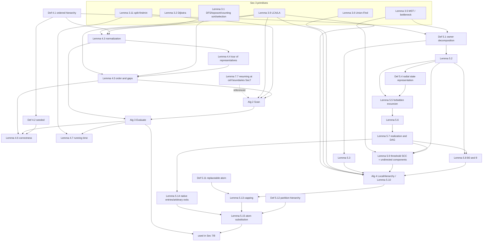

# 02 Analysis of Ordered Hierarchy Evaluation (Sec 4) and Local Hierarchies (Sec 5)

**English** | [日本語](02_ordered_hierarchy_local.ja.md) | [简体中文](02_ordered_hierarchy_local.zh-CN.md)

Subject: arXiv 2611.34911v1 "Linear Single-Source Shortest Path, Almost" (Gholami, Hajiaghayi)
Scope: Sec 4 (Def 4.1–4.2, 4.1–4.3, Lemma 4.3–4.7, Alg 2 `Scan`, Alg 3 `Evaluate`) and
Sec 5 (Def 5.1, 5.4, 5.11, 5.12, Lemma 5.2–5.15, Alg 4 `LocalHierarchy`).
As prerequisites we consulted Sec 2 (notation, computation model, handling of small cases) and Sec 3 (primitives), and we also read the parts of Sec 7's Lemma 7.7 (resuming at cell boundaries) that Sec 4 refers to.
Citations give the txt line number (`l.NNN`) and the paper page number (`p.NN`). The formulas in the txt were checked against PDF p.15–18 and p.21–26 and confirmed to be intact.

Notation: implementation details that the paper does not state are marked **[Supplement]**; errors or ambiguities in the paper are marked **[Ambiguous]**.

---

## 0. Key findings (summary)

1. **The smallest N satisfying the local-construction threshold `N > 2 L_N^4` is N = 209,953.** Below it, Alg 4 takes the base case (l.2–5): one state per vertex, edges in both directions, and a Kruskal tree that merges equal-weight edges simultaneously. The atoms passed to Alg 4 in Sec 7 and 8 have polylog n size, so **at practical scales every atom always takes the base case**. The radial construction of Sec 5.1–5.4 (owner decomposition, shells, θ, grids) is never actually executed in Mode A. Exercising it requires a Mode B that takes the threshold and b as parameters (§4).
2. **The proofs of the Sec 5.2–5.3 lemmas (5.2, 5.5–5.9) use only N ≥ 2 and K ≥ 8h.** `N > 2L_N^4` is genuinely used only by the polynomial constants of Sec 5.4 (N ≥ 32, h ≤ N, and, from K < 16h, `3hK² ≤ N^5`, c = 10, and the interval upper endpoint `N^16 σ`). Lowering the threshold breaks the "aligned test", "MST length of an unaligned block < σ_U/2" and the "grid sentinel" of 5.4, with the risk that hierarchy heights stop being monotone. A fix is given in §4.3.
3. **The supplemental offer `u = max{b, z+S(i)+g(i,j)}` exists only for the running time** (Lemma 4.7). Correctness (Lemma 4.6) only uses "upper bounds are preserved". A variant with supplemental offers removed keeps correctness and only worsens the running time. This can serve as an axis for differential testing.
4. **Under Def 4.1, no input can have a directed cycle of length 0 that passes through two or more states.** A length-0 arc between children is a light arc for every positive height, and the quotient by light arcs must be acyclic. Zero-weight components must be contracted by the caller (Sec 5.1 l.962 "Zero-length components may be contracted").
5. The correctness of Evaluate translates into four invariants that can be checked against an oracle: (I1) every offer is ≥ δ, (I2) a protected state emits δ exactly once, (I5) on return from Scan(X,I,c), no key under X lies in I∩(−∞,c], (I8) at opening time, every unemitted protected state under X has δ ≥ D₀ (§2.8).
6. As a reference hierarchy generator for correctness checks, a **"hierarchy with exact heights from per-threshold SCCs"** (running Tarjan once per weight) can be used. It satisfies Def 4.1 (c₀ = 1) for any directed state graph, so Evaluate can be tested independently of Sec 5.
7. Lemma 5.9 (components of the undirected join records = directed SCCs at threshold W) can be verified exhaustively: on small graphs, compare Tarjan's SCCs with the Union-Find result for every W. This is the most valuable test in Sec 5.
8. Numerical caveat: `N^3 σ`, `N^c σ` and `N^16 σ` easily overflow uint64. They are used only for classification and sentinels, so saturating arithmetic or capping the bound at "actual maximum weight × 2" suffices. The distances themselves (z+S+g, offsets b−jν, etc.) are computed exactly for integer weight types. With double, rounding in the lower direction may break feasibility (§6).

---

## 1. Prerequisites (used from Sec 2 and 3)

- `L_k = ⌈log2(k+2)⌉`, `τ(k) = 1 + log log log(k+16)` (l.284).
- Small cases (l.286–290): the local construction assumes `N > 2L_N^4`. Otherwise "place one state per vertex with the original non-loop edges in both directions, and merge equal-weight MST edges simultaneously. Tree edges connect the merged children, and by Lemma 3.5 no lighter edge lies between children."
- Computation model (l.292–311): lengths are opaque reals, and the allowed operations are comparison, addition and copying. Signed values are represented as a pair of two nonnegative sums. Multiplication by 2^j is done by j doublings. Integer indices may use O(1) word operations. **Sec 4 and 5 use no randomness** (5.3 says "deterministic" explicitly, and the median selection in 5.4 is the deterministic BFPRT).
- Primitives used:
  - Lemma 3.1: DFS/BFS/topological sort, counting sort, median selection.
  - Lemma 3.2: Dijkstra (test oracle).
  - Lemma 3.5: MST (three growth passes), and `b_T(x,y)` is the minimum bottleneck.
  - Lemma 3.6: Union-Find (ordered union events).
  - Lemma 3.9: LCA and level ancestor in O(1).
  - Lemma 3.11: split–findmin. Accepts splits and decreases, and returns the minimum of an interval in O(1). Ties are broken by the original index.

---

## 2. Sec 4 Evaluating ordered hierarchies

### 2.1 Def 4.1 Ordered hierarchy (p.14–15, l.646–658)

**Components**
- A finite directed state graph `D` with nonnegative arc lengths.
- A projection `π: states → vertices of the physical (undirected) graph`.
- A rooted forest `H` whose leaves are exactly the states.

**Conditions**
- (H1) Each arc `x→y` (length ℓ) projects to a physical walk of length ≤ ℓ from π(x) to π(y).
- (H2) An internal node C has at least two children and a height `h(C) > 0`. Heights are nondecreasing toward the root.
- (H3) Contracting the **light arcs** (arcs between distinct children of C with length `< h(C)`) to the quotient on children gives an acyclic graph.
- (H4) The root quotient by **all** arcs between roots (not only light arcs) is acyclic.
- (H5) At each internal node the children are connected by a tree of **links**. A link is `(endpoint state x, endpoint state y, length bound ℓ ≤ c₀·h(C))` and certifies a physical walk of length ≤ ℓ between π(x) and π(y). Either direction is fine. c₀ is an absolute constant (c₀ ≤ 2 for the output of Alg 4, c₀ = 1 for the base case and exact merges).
- (H6) Links used only for proofs do not become relaxed arcs.

**Proposed data structures [Supplement]**
```
struct HNode { int parent; vector<int> children; Real h; vector<Link> links; /*after normalization*/ Real nu, S; int rank_in_parent; StateId rep; Real gap_to_next; };
struct Link  { StateId x, y; Real len; };            // len ≤ c0*h(parent)
struct OrderedHierarchy { StateGraph D; vector<PhysV> pi; vector<HNode> nodes; vector<int> leaf_node_of_state; vector<int> roots; Real c0; };
```

### 2.2 Def 4.2 Seeded ordered hierarchy (p.15, l.659–672)

- Weighted physical sources `(v_i, c_i)` and initial state offers Q.
- The target distance is `δ(v) = min_i { c_i + d(v_i, v) }`, where d is the physical graph distance.
- An **offer** is a finite value; +∞ means "no offer". An offer at state x is **feasible** if its value is ≥ δ(π(x)). All initial offers must be feasible.
- **Tight witness**: a directed state path with "initial offer + sum of arc lengths = δ at the image of the last state". A state with a witness is called **protected**. For each requested finite target, at least one state mapping to it must be protected (this is an obligation on the input; Evaluate does not check it).
- Observation: every prefix of a tight witness is tight (l.670).
  - Computing the protected set with an oracle [Supplement]: start from the states x whose initial offer q equals δ(π(x)), and BFS following only arcs y→x with `δ(π(y)) + ℓ(y→x) = δ(π(x))`. The reached states form the protected set.

### 2.3 4.1 Normalization and Lemma 4.3 (p.15–16, l.674–723)

**Input**: a Def 4.1 hierarchy (N states, M arcs).
**Output**: a unit `ν(C)` and a mass (upper bound on the physical diameter) `S(C)` for each surviving internal node; the assignment of light arcs used to rank children; and the root quotient.

**Definitions**
- `F`: the forest formed by collecting the links of all nodes as undirected edges (length = certified bound). A node with d children contributes d−1 links, so F is a forest on the states. Links of length 0 are included.
- Mass `S(C)`: the sum, over the subtree of C, of (a) the lengths of the selected edges of F and (b) the heights h of the internal nodes. Leaves have mass 0. Path lengths on F[C] (the subtree of F spanning the states under C) are ≤ S(C), and S(C) ≥ h(C) holds.
- **Normalization link**: for a child C of an internal node and its parent P, link C and P when `4·S(C) ≥ h(P)`.
- For each set connected by normalization links (it forms a connected subtree), build the power-of-two table `h_min·2^k` from the smallest height `h_min` in it. `ν(C)` is the largest table value that is ≤ h(C), and satisfies `ν(C) ∈ (h(C)/2, h(C)]`. A node with no link can be read as having its own table (`ν = h`) [Supplement].
- At an unlinked boundary, `ν(P) > 2S(C)` holds (from `h(P) > 4S(C)` and `ν(P) > h(P)/2`).
- **Contract** parent–child links with equal units. The children of C become children of P, and the links of C move to P. For the S of the contracted node, use the **topmost original mass** (the S of P).
- Self-loop arcs are discarded. Arcs between roots go to the root quotient. Every other arc is placed at its LCA after normalization. Those with `ℓ < ν(LCA)` are light arcs and determine the ranking of children.

**Lemma 4.3**: time O(M+N). Parent unit ≥ 2 × child unit, `Σ_C S(C)/ν(C) = O(N)`. Each parent–child pair is either **dyadically aligned** (the parent unit is a power-of-two multiple of the child unit) or satisfies `2S(C) < ν(P)`. The premise is that c₀ is a constant.

**Pseudocode**
```
Normalize(H):
  F ← ⋃_C links(C)                         // undirected forest, length = len
  precompute F's preorder, root distances rd, and LCA (Lemma 3.9)
  in postorder S(C) = h(C) + Σ links(C).len + Σ_{internal child C'} S(C')   // S of a leaf is 0
  for internal node C (with parent P): linked[C] ← (4·S(C) ≥ h(P))
  for link set Λ (connected component under linked, with topmost node top):
     hmin ← min_{C∈Λ} h(C)
     table ← [hmin, 2hmin, 4hmin, … ] built by doubling until it covers max_{C∈Λ} h(C)
     downward from top: idx(C) ← decrease from idx(parent), stopping at table[idx] ≤ h(C)
     ν(C) ← table[idx(C)]
  contraction: when linked[C] and ν(C) = ν(P), absorb C into P (S(P) and ν(P) unchanged)
  for arc (x→y, ℓ): discard if x = y
     if root(x) ≠ root(y), add to the root quotient
     otherwise L ← LCA(x,y), ci, cj ← the children of L containing x, y (level ancestor)
        if ℓ < ν(L): light[L].push(ci→cj, tail x, head y)
  topologically sort the root quotient and each L's light (the ranks determined by ν are reassigned in §2.4)
```
- Computation model: reals use only comparison, addition and doubling. Table indices are integers.
- Tests:
  - `ν(P) ≥ 2ν(C)`.
  - `ν(P)/ν(C)` is a power of two, or `2S(C) < ν(P)`.
  - `ν(C) ∈ (h/2, h]` (with pre-contraction values).
  - `S(C) ≥ max_{x,y∈C} d_phys(π(x),π(y))` (with a Dijkstra oracle).
  - Record a κ satisfying `Σ S/ν ≤ κ·N`.
  - The light quotient of every node remains acyclic after contraction.

### 2.4 4.2 Child order and Lemma 4.4, 4.5 (p.16–17, l.725–779)

**Input**: the normalized hierarchy, the preorder of F, and the light arcs (`ℓ < ν(X)`) of each node X.
**Output**: for each X, a topological order (ranks) of the children, a representative `x_i` (a state) for each child, and the gap `g(i,j) = g(j,i)` between adjacent children. g is an upper bound on the length of a physical walk between π(x_i) and π(x_j).

**Lemma 4.4**: the physical walk visiting the representatives in reverse finishing order has length ≤ `2 Σ_i S(i) + 2dν(X) + 2S(X)`.
**Lemma 4.5**: `Σ_X Σ_{i,j} g(i,j)/ν(X) = O(N)`. O(M+N) time overall.

**Pseudocode** (cost is counted as "edge of F = certified bound, selected arc = arc length")
```
OrderChildren(X):
  for child i: prov[i] ← any state under i      // [Supplement] the state with the smallest F-preorder is recommended
  out[i] ← the light arcs leaving child i, sorted by the F-preorder of their tail states
  acc ← 0; cur ← ⊥; finish ← []
  for child r (in F-preorder of prov[r]; O(N) by counting sort):
     if visited[r]: continue
     if cur ≠ ⊥: acc += D_F(cur, prov[r])     // D_F = rd(a)+rd(b)−2rd(lca)
     cur ← prov[r]; DFS(r, prov[r])
  topo ← reverse(finish)                       // ranks of the children
  for k: g(topo[k], topo[k+1]) ← mark[topo[k]] − mark[topo[k+1]]
  rep[i] ← x_i

DFS(i, entry):
  visited[i] ← true; x_i ← entry
  for arcs a=(t→y, ℓ) of out[i], cyclically from the preorder position of entry:
     j ← the child of X containing y
     if visited[j]: continue                   // non-tree arcs are not followed
     acc += D_F(cur, t); cur ← t                // move within F[i]
     acc += ℓ; cur ← y
     DFS(j, y)                                  // on return cur = x_j = y
     acc += ℓ; cur ← t                          // return by traversing the arc backward
  acc += D_F(cur, entry); cur ← entry
  mark[i] ← acc; finish.push(i)
```
- The paper builds a table that looks up the cyclic start position in O(1) by counting-sorting (parent, child, preorder) triples (l.773–777). A simplified version can substitute an O(log) binary search (recorded as a deviation).
- Computing differences (`D_F` and differences of mark) requires subtraction. The paper does it with signed pairs. With integer weights it is exact.
- Boundaries: a child with no outgoing light arc finishes immediately (l.776). If a child is a leaf, S = 0 and F[i] is a single point.
- Tests:
  - All light arcs point forward in rank.
  - `g(topo[k],topo[k+1]) ≥ d_phys(π(x_k), π(x_{k+1}))`.
  - `Σ g ≤ 2ΣS(i)+2dν+2S(X)` (exactly the formula of Lemma 4.4).
  - Record a κ' satisfying `Σ g/ν ≤ κ'N`.

### 2.5 4.3 Slots, deadlines, runs and supplemental offers (p.17–18, l.781–832)

**State**
- Each node is unopened, live or retired.
- Each leaf accepts key decreases until it is emitted (settled) or retired.
- Minima are compared in lexicographic order of (value, leaf ID).

**Windows**
- A nominal slot is a half-open interval `[a,b)`. A permanent deadline c is **inclusive**.
- A candidate z is **due** if `a ≤ z < b` and `z ≤ c`, where c is the minimum of the inherited physical deadlines (+∞ if none).

**Opening and expiry**
- An internal node C opens when it finds a finite minimum key `D₀` within the parent's actual window.
- The absolute expiry time is `D₀ + S(C)`. Every tight arrival into C is at most this time (triangle inequality).
- It finishes when all leaves are settled or retired, or when it has covered its expiry time (inclusive).

**Origin of the local slots** (the alignment rule of Pettie–Ramachandran, l.794)
- If `D₀ + S(C) < b`, the origin is `D₀`.
- Otherwise, the origin is the largest value `b − jν(C) ≤ D₀`, where b is **the right end of the parent's nominal slot** (made explicit in Lemma 7.7 l.1887). j is found by repeated subtraction at cost O(1 + S/ν).
- At a root, always use the first rule.
- The origin lies inside the parent's slot: at an unaligned boundary because of `2S < ν(P)`, and at an aligned boundary because of divisibility.
- If the last slot overshoots the bound of a subtree that expires in this call, propagate that bound as an additional cap and suppress emissions beyond the cap. The grid always stays aligned to the ends of the nominal slots.

**Leaf layout and runs**
- Arrange the leaves of the hierarchy in DFS order following the child ranks. Each node occupies a contiguous interval.
- An opened X holds a linked list. The list contains the registered live children and the **maximal contiguous runs** of unregistered children, in their original order.
- Expired or completed children are removed from the list. Runs keep their position and need not be joined with neighboring runs.
- The minimum key of a run is maintained by split–findmin. When X is first opened, the whole list of children is a single run.

**Splitting a run**
- When the leaf with the due minimum z belongs to the direct child i (i is found by level ancestor), replace the run by "a nonempty left subrun, child i, a nonempty right subrun". The interval is split at most twice.
- The cursor is placed on **the first newly created piece**, so that lower-ranked children get their chance first.

**Supplemental offers**
- For each newly created subrun, offer `u = max{b, z + S(i) + g(i,j)}` at the representative `x_j` of the child j adjacent to i (rank i−1 for the left, i+1 for the right).
- Feasibility: from the minimum leaf one can reach x_i through F[i] (length ≤ S(i)), and then x_j along the gap walk.
- Because the value is padded up to b, no lower-ranked child becomes newly due in the same slot.

### 2.6 Algorithm 2 `Scan(X, I, c)` (p.18, l.834–864)

**Input**: a live node X, a portion `I = [a', b')` of the nominal slot `[a,b)`, and an inclusive deadline c.
**Output**: the emitted (state, value) pairs and the pending offers.

```
Scan(X, I=[a',b'), nominal=[a,b), c):               // Alg 2
  p ← X.list.first                                   // l.2 cursor order (topological order)
  while p ≠ end:
    if p is an unregistered run:                     // l.3
      (z, leaf) ← SF.min(p.interval)                  // Lemma 3.11
      if a' ≤ z < b' and z ≤ c:                       // l.4 due
        i ← LevelAncestor(leaf, depth(X)+1)
        (L, i, R) ← split p (no empty pieces are created); SF.split at most twice
        register(i)                                   // l.5
        if L ≠ ∅: j ← last child of L; offer(x_j, max{b, z + S(i) + g(i,j)})   // l.6
        if R ≠ ∅: j ← first child of R; offer(x_j, max{b, z + S(i) + g(i,j)})
        p ← (L ≠ ∅ ? L : i); continue                 // l.7
      p ← next(p); continue                           // a run that is not due is passed
    else:                                             // registered child i, l.8
      if i is a leaf:
        if key(i) is due (in I and ≤ c) and i is not yet emitted:   // l.11
          emit(i, key(i)); settled[i] ← true
          for arc (i→y, ℓ): if !settled[y] and !retired[y]: SF.decrease(y, key(i)+ℓ)
          unlink(i)
      else:
        if i is unopened:                             // l.9
          D0 ← value of SF.min(i.interval)             // still due because it is registered (I3 in §2.8)
          origin(i) ← (D0+S(i) < b) ? D0 : max{ b − jν(i) ≤ D0 }
          expiry(i) ← D0 + S(i); status(i) ← live; i.list ← [run(all children of i)]
        c_i ← min(c, expiry(i))
        for nominal slots J = [o_k, o_k+ν(i)) of i from the current k, while J∩I ≠ ∅ and o_k ≤ c_i:   // l.10
          Scan(i, J∩I, J, c_i)
          if i is completed: break
          if J ⊆ I: k ← k+1 else break               // a clipped slot resumes in the next portion
        if i is completed or (c_i < b', i.e. the expiry time has been covered): retire(i); unlink(i)
      p ← next(p)
  retire the completed pieces and the pieces that have covered the permanent deadline     // l.12
```
- `retire(C)` walks only the pieces still linked to C. It recurses on registered children and traverses the whole subtree under unregistered runs. Newly retired leaves are marked. Subsequent offers check the settled / retired marks of the leaf before being inserted.
- In one visit, a live node advances all local slots that intersect the visit, even without new offers (l.863).
- In a normal call, `I` is "nominal slot ∩ the window passed from the parent". In Lemma 7.7 (owned by Sec 7), it is clipped at external cell boundaries, and the cursor resumes in the next cell from the first live rank. Padding of supplemental offers uses the nominal `b` (not `b'`; l.1890).
- **[Supplement]** The while loop above and the rule "advance k only when J ⊆ I" are reconstructed from the text's "clock persists across visits" and Lemma 7.7's "resume a clipped slot".

### 2.7 Algorithm 3 `Evaluate(D, H, Q)` (p.19, l.866–882)

```
Evaluate(D, H, Q):
  Normalize(H); OrderChildren(all X)                       // l.2  Lemma 4.3, 4.5
  layout ← DFS order of the leaves (following child ranks); SF ← split–findmin (all keys +∞)
  SF.split at each root boundary; insert the smallest initial offer per state with SF.decrease   // l.3
  for root X (in topological order of the root quotient):    // l.4
    if SF.min(X) = +∞: continue                             // l.5
    if X is a leaf: emit(X, key); relax outgoing arcs        // l.6–7
    else:
      D0 ← SF.min(X); origin ← D0; c ← D0 + S(X); X.list ← [run(all children)]   // l.9
      for k = 0,1,…: I ← [D0+kν, D0+(k+1)ν); if D0+kν > c: break          // l.10
        Scan(X, I, I, c); if X is completed: break                           // l.11
  return the emitted (state, value) pairs                                    // l.12
```
- The final distance of a physical vertex v is the minimum of the emissions of states x with `π(x) = v` (taken by the caller, Sec 8 l.2192).

### 2.8 Outline of Lemma 4.6 (correctness) and checkable invariants

**Claim**: a protected state x emits δ(π(x)). Every other emission is ≥ δ(π(x)).

**Outline**
- Upper bounds: arcs (H1) and gap certificates (Lemma 4.4) preserve upper bounds.
- The lower-bound side (no tight arrival is missed) is shown by nested induction in this order: over roots → over chronological portions of the same node → over child ranks within a portion → recursively over the remaining height.
  1. Within a portion `[u,v)`, consider the last entry by which the tight path enters the target child.
     - If the predecessor's time is before u, it was handled in an earlier portion.
     - If the predecessor's time is at least u, the crossing has length `< v−u ≤ ν(C)`, so it is a light arc; the predecessor is in a lower-ranked child and has already emitted (H3 + Lemma 4.5).
     - For a seed or an entry from outside C, the offer is already in place by the call invariant.
  2. The first state that has not yet emitted has a due offer. An unregistered run has a due minimum by the time its rank is needed. Because arc lengths are nonnegative, live offers do not fall into past windows. Arcs to lower-ranked children only produce values at or above the right end of the slot. Boundary offers are padded up to b.
  3. On first opening: no tight arrival strictly earlier than the minimum exists. The expiry time is at most `D₀+S(C)` (upper bound on the physical diameter, Lemma 4.3). Retirement at expiry happens only after covering that time, inclusive.
- Dependencies: Def 4.1 (H1, H3, H5), Lemma 4.3 (S bounds the diameter), Lemma 4.5 (ranks and gaps), Lemma 3.11 (interval minima), Def 4.2 (tightness of prefixes).

**Invariants checkable in the implementation** (enabled only in debug builds; the oracle is δ from Dijkstra on the physical graph and the protected set of §2.2)
- **I1 Upper bound**: every call `SF.decrease(x, v)` has `v ≥ δ(π(x))`, including supplemental offers.
- **I2 Emission**: each state emits at most once, with emitted value ≥ δ. A protected state always emits, and its value equals δ.
- **I3 Clock monotonicity**: while node X processes the portion `[a',b')`, new keys are ≥ a'. Keys falling into children of X ranked below the cursor are ≥ b' (a consequence of light arcs pointing forward).
- **I4 Slot discipline**: an emitted value z lies in the portion I at the time of emission, and z ≤ c. Within the same node, the slot numbers of emissions increase monotonically.
- **I5 Nothing missed**: on return from `Scan(X,I,c)`, no unemitted, unretired state under X has a key in `I ∩ (−∞, c]`.
- **I6 Soundness of expiry**: when X retires, all protected states under X have emitted (also check `δ ≤ D₀+S(X)` at the same time).
- **I7 Origin alignment**: a child's origin lies inside the parent's nominal slot. The child's grid is aligned to b (dyadically aligned, or `D₀+S < b`).
- **I8 Lower bound at opening**: when X opens at D₀, every unemitted protected state under X has `δ ≥ D₀`.

### 2.9 Lemma 4.7 (running time) (p.20, l.922–948)

- Claim: O(M + N τ(N) + Q). A scan of the input keeps only the smallest initial offer per state.
- Breakdown:
  - Thanks to the supplemental offers, the failed visits of each subrun number only `O(1 + (S(i)+g(i,j))/ν(X))`.
  - Visits to registered children cost `O(1 + S(i)/ν(X))`.
  - Summed, these are O(N) by Lemma 4.3 and 4.5.
  - Retirement is O(N). There are O(N) supplemental decreases and O(M) original relaxations.
  - split–findmin costs `O(q + q' + Nτ(N))` (Lemma 3.11).
- Space O(M+N). The computation model is real comparison and addition with integer indices. No integer dictionaries or real-keyed heaps are used (l.942).
- Simplified implementation: replace split–findmin by a segment tree (O(log N)). This is recorded as a complexity deviation (D-*).

### 2.10 Boundary values and degenerate cases of Sec 4

| Case | Paper's treatment / recommendation |
|---|---|
| Root with a single state | "Just process its best finite offer" (l.723). Alg 3 l.6–7 |
| Root with no finite offer | Skipped (l.5). States of that root do not emit |
| Self-loop arc | Discarded by normalization (l.719) |
| Length-0 arc | Allowed (Def 4.1 says nonnegative). But a length-0 arc between children is always light, so a length-0 directed cycle through two or more states violates Def 4.1. The caller contracts it (Sec 5.1 l.962). Rejecting it in input validation is advisable |
| Ties | Minima are compared by (value, leaf ID) (l.784). Emitted values do not depend on how ties are broken |
| Disconnected (multiple roots) | Process the root quotient in topological order. Acyclicity of the root quotient is an input obligation (H4) |
| h(C) = 0 | Forbidden by Def 4.1 |
| D₀ + S(C) exactly equal to b | Second rule (because `<` does not hold) |
| Value exactly at the expiry time | Included (inclusive). The right end of the parent's window is excluded (l.803–807) |
| Large c₀ | The constants of Lemma 4.3 grow by a factor `max(1,c₀)`. No effect on correctness |

### 2.11 Proposed tests for Sec 4

1. **Reference hierarchy generator [Supplement]** `build_threshold_scc_hierarchy(D, π)`
   - Scan the distinct arc lengths W in increasing order and compute Tarjan SCCs on the arcs with `ℓ ≤ W`. Create a node of height W where SCCs merge.
   - The children are the "SCCs at `< W`", so the quotient by light arcs (`< W`) is the SCC condensation and is acyclic.
   - Links are taken from the arcs of "a tree spanning the child quotient by arcs `≤ W`" (c₀ = 1).
   - Taking the physical graph to be the undirected multigraph of arcs (π(x), π(y), ℓ) makes (H1) hold.
   - To avoid length-0 cycles, use only positive lengths during generation.
   - ~~Also build variants whose heights are scaled by a factor such as `h(C) = 2W`, giving hierarchies where light arcs actually lie between children.~~
     **Correction (2026-11-27).** The `h(C) = 2W` variant is not an ordered hierarchy: a node C is a strongly connected component of the arcs of length ≤ W(C), so with any height above W(C) every such arc between distinct children is light (length < h), the light quotient on the children is strongly connected, and H3 (Def 4.1, l.650) fails at every internal node. Heights are valid exactly when they are lowered instead: any heights with 0 < h'(child) ≤ h'(C) ≤ W(C) satisfy Def 4.1 with c₀ = the largest ⌈(longest link of C) / h'(C)⌉ over the nodes (halving every height gives c₀ = 2). Fixed by `tests/unit/paper/hierarchy/test_reference_hierarchy_heights.cpp`.
2. **Differential tests**
   - (a) Base-case local hierarchy (Kruskal) + a single-vertex source: compare the per-physical-vertex minimum with Dijkstra.
   - (b) Arbitrary directed state graph + reference hierarchy: protected-state emissions = δ, all emissions ≥ δ (I1, I2).
   - (c) Multiple sources `(v_i, c_i)`.
   - (d) Protected-state emissions agree between the versions with supplemental offers enabled and disabled.
   - (e) Differential test of two split–findmin implementations.
3. **Invariant tests**: assert I1–I8 of §2.8 under `SSSP_PAPER_CHECKS`, and run 10,000 small random graphs (N ≤ 60).
4. **Structural tests**: the properties of Lemma 4.3 and 4.5 (§2.3, §2.4). Count `Σ S/ν`, `Σ g/ν`, the number of slots and the number of failed visits, and record that the values divided by N stay bounded independently of N. Running time is confirmed by measurement.
5. **Hand-computed example**: on a chain of three states (two children, one light arc), compute the slots, splits and supplemental offer values by hand and check agreement.

---

## 3. Sec 5 Local hierarchies for arbitrary positive lengths

Premise: a connected graph G with positive weights, N vertices and m edges. `L_N = ⌈log2(N+2)⌉`.

### 3.1 5.1 Owner decomposition (Def 5.1, Lemma 5.2, 5.3) (p.21–22, l.960–1018)

**Construction** (`b = L_N^4`; the outer construction uses a different b)
1. Build the MST T (Lemma 3.5). Delete the non-tree edges with `w(uv) > D_T(u,v)` (the reduced graph). From here on, every edge satisfies `b_T(u,v) ≤ w(uv) ≤ D_T(u,v)`. `D_T` is obtained from the LCA and root distances.
2. `A₀`: traverse the rooted T in postorder. Compute the sum of the children's residual sizes + 1, and when it reaches b, mark the vertex and return 0. If no vertex is marked, place a single pivot ([Supplement] the root is recommended). `|A₀| ≤ max{1, ⌊N/b⌋}`, and each component of T − A₀ has fewer than b vertices.
3. `A = A₀ ∪ {vertices of degree ≥ 3 in the minimal subtree spanning A₀}`. `|A| = O(1+N/b)`, and each component of T − A has at most two pivot neighbors.
4. Corridor cuts:
   - In a component with two pivot neighbors, delete one maximum-weight tree edge on the corridor (tree path) connecting the two pivots ([Ambiguous] the tie-breaking rule is not stated → decide by edge index).
   - For two adjacent pivots, delete the edge between them.
   - The remaining components are the **owner cells**, each containing exactly one pivot.
5. `p(v)`: the pivot of v's cell. `R_v = D_T(v,p(v))`, `r_v = b_T(v,p(v))` (0 at a pivot), `h = b+1` (an upper bound on the number of hops to the pivot within a cell), `R_v ≤ h·r_v`.
6. The deleted corridor edges form a tree `T_A` on A. `σ(p,q)` = the maximum weight on `T_A[p,q]` `= b_T(p,q)`, `σ(p,p) = 0`.

- Running time: the combinatorial part is linear. Together with T_A and its merge hierarchy (sorting), O(N + |A| log(|A|+1)).

**Lemma 5.2**
- For an intercell edge xy (weight w), `w ≥ max{r_x, r_y, σ(p(x),p(y))}`.
- For an intracell edge with different radii, `w ≥ max{r_x, r_y}`.
- For every edge, `w ≤ h(r_x+r_y) + N σ(p(x),p(y))`, from the tree path through the two pivots.

**Lemma 5.3**: for every pivot q, `b_T(v,q) ≥ r_v`.

- Tests:
  - Components of T − A have fewer than b vertices and ≤ 2 pivot neighbors.
  - Each cell has exactly one pivot.
  - Check the three inequalities of Lemma 5.2 on every edge.
  - Check Lemma 5.3 for every (v, q).
  - `σ = b_T`.
  - Make b a parameter and run with b ∈ {1, 2, 3, N+1} (b = 1 makes every vertex a pivot; b > N gives one pivot).

### 3.2 5.2 Local state graph (Def 5.4, Lemma 5.5–5.7) (p.22–24, l.1020–1107)

**Edge classification**
- **macro**: an intercell edge with `w ≤ N³ σ(p,q)`. Deleted corridor edges are always macro. A macro edge satisfies `σ ≤ w ≤ N³σ` and carries a named corridor maximum (its key σ).
- **radial**: all others. `w ≤ 3h·max{r_x, r_y}` holds (from Lemma 5.2 and `σ < w/N³`; holds for N ≥ 2).
- No positive radial edge joins two pivots.
- `N³σ` is built by three rounds of additions and doublings along the binary expansion of the integer N (O(log N) per pivot-tree maximum).

**Shell construction**
- `K` = the smallest power of two that is ≥ 8h.
- A radial edge whose endpoint radii are both positive is **near** if their ratio is ≤ K², and **far** if the ratio is > K².
- A component connecting positive-radius vertices by near radial edges is a **near component** (an isolated vertex is also one component).
- With a the minimum radius of the component, the **native shell** `i(v)` is defined by `a K^{i(v)} ≤ r_v < a K^{i(v)+1}`.
  - Along a near spanning tree, the indices of adjacent vertices differ by ≤ 2. Traverse the tree from the minimum vertex, caching powers of K. O(m + N log K).
- **Windows** (sets of states):
  - Inward window j (j ≥ 0) contains shells j and j+1.
  - Outward window j (j ≥ 0) contains shells j−1 and j.
  - Create a **separate copy** of the vertices for each window, and add the near radial edges with both endpoints in that window in both directions.
  - The connected components of this within-window graph are called **blocks**.
  - A positive-radius vertex v has at most four copies: `in_{i(v)}` (native inward), `in_{i(v)−1}` (when i ≥ 1), `out_{i(v)}` (native outward), and `out_{i(v)+1}`.
  - A pivot has two copies, `in(p)` and `out(p)`.

**Arcs** (lengths are the original physical lengths; only switches have length 0)
| Kind | Tail → head |
|---|---|
| Within window | Near edges between copies in the same window, in both directions |
| Inward near transfer | Copy in inward window j → inward window i (= native inward) of a neighbor with native shell `i < j` |
| Outward near transfer | Copy in outward window j → outward window i (native outward) of a neighbor with native shell `i > j` |
| far (inward) | **Every** inward copy of the higher-radius endpoint → native inward of the lower-radius endpoint |
| far (outward) | Every outward copy of the lower-radius endpoint → native outward of the higher-radius endpoint |
| Phase switch | Each inward copy of each vertex → native outward (length 0). For a pivot, `in(p)→out(p)` |
| Pivot radial | (Positive) inward copies of v → `in(p)`, `out(p)` → native outward of v ([Ambiguous] "from positive inward states" is read, as in the far rule, as "every inward copy") |
| macro | For each direction x→y, **every** copy of x → native inward of y |
| Source | Initial offer at the source's native inward with the given cost |

**Def 5.4** (radial state representation) is the directed graph above together with the projection to physical vertices and the native inward entry of each vertex. Its parameters are the coordinate (here r_v, J_v in Sec 8), the ratio K, and the radial / macro classification.

**Lemma 5.5 (A forbidden excursion)**
- Premises: `N > 2L_N^4`, the macro test `w ≤ N³σ`, `K ≥ 8h`.
- Claim: let M > 0 be the largest radius or edge weight on a contiguous radial segment of a shortest path. Then the endpoint radii cannot both be `≤ M/K`.
- Proof: the segment costs ≥ M. On the other hand, the path through the two pivots costs `2hM/K + M/N² ≤ M/4 + M/4 < M`.
- What is actually used is **only N ≥ 2 and K ≥ 8h**.

**Lemma 5.6**: split a maximal radial run of a shortest path into two at a vertex of minimum radius. In the first part, the radius never exceeds "the minimum so far × K". In the second part, the radius never falls below "the maximum so far ÷ K".

**Lemma 5.7**
- O(N) states, O(m+N) arcs.
- Every physical geodesic is realized with the same length from the native inward initial state.
- Contracting blocks, excluding macro arcs, gives a DAG.
  - An inward transfer strictly decreases the numeric shell bottom.
  - An outward transfer strictly increases it.
  - Switches go one way, from inward to outward.
- Converse: state paths project to physical walks. Hence the minimum over all copies = the physical distance. The distance of an individual copy may be larger (even ∞).

**Pseudocode (construction)**
```
BuildRadialStates(G, T, owner):           // Alg 4 l.7–8
  for edge e=xy: kind[e] ← (p(x)≠p(y) and w ≤ N³σ(p(x),p(y))) ? MACRO : RADIAL
  near components ← Union-Find (or BFS) over radial edges with both endpoints r>0 and ratio ≤ K²
  for component: a ← minimum r; determine i(v) along a spanning tree by comparisons with powers of K
  create copies: in[v][0/1], out[v][0/1]; in/out for pivots
  add arcs according to the table above (recording the arc kind: INTRA, NEAR_T, FAR_T, SWITCH, PIVOT, MACRO)
  block ← components connected by INTRA arcs
```
- Tests:
  - (a) With multi-source Dijkstra on the state graph, the minimum over each vertex's copies = physical Dijkstra (with multiple sources and arbitrary initial costs).
  - (b) Every copy's distance ≥ the physical distance.
  - (c) The graph with blocks contracted, excluding macro, is a DAG.
  - (d) Exhaustively check Lemma 5.5 and 5.6 on the radial runs of shortest paths in the Dijkstra tree.
  - (e) Number of states ≤ 4N, number of arcs ≤ c(m+N).

### 3.3 5.3 Threshold components and joins (Lemma 5.8, 5.9) (p.24–25, l.1109–1180)

**Definitions** (for a state z; eligible paths = radial arcs and switches only)
- `I₀(z)`: the minimum weight of a macro edge from whose head reset (native inward) z is reachable.
- `O₀(z)`: the minimum weight of a macro edge with a tail copy reachable from z.
- +∞ if empty. The attaining macro edge (and its named key σ) is retained.
- `B₀ = max{I₀, O₀}`.
- `I*(z), O*(z)`: over the same eligible paths, the minimized **bottleneck** (largest physical arc weight) including the preceding or succeeding macro edge. `θ(z) = max{I*, O*}`.

**Computation**
- `I₀`: traverse the block DAG in topological order, propagating minima forward. Seeds are the native inward copies at macro heads, with value w.
- `O₀`: reversed. Seeds are all tail copies.
- `I*`: traverse in block DAG order. Within a block, solve "the multisource bottleneck `min_x max{c_x, b_S(x,v)}` on the block MST S". In postorder take the minimum of the own seed and the values from the children (raised to the edge weight), and in preorder pass the parent's value down to the children. Transfers between blocks are relaxed with `max(value, arc length)`. `O*` does the same with directions reversed.
- Join records: place one auxiliary vertex per pivot and create three kinds.
  - Each block MST edge joins its endpoints at its physical weight.
  - Each state z with finite θ(z) is joined to its owner's auxiliary vertex at weight θ(z).
  - Auxiliary vertices are joined to each other at the corridor weights.
- **core** (at threshold W): for a nontrivial component of the pivot tree restricted to corridor weights ≤ W, the SCC containing its pivot states.

**Lemma 5.8**: for a state with finite B₀, `r ≤ θ` and `B₀ ≤ θ ≤ 3hK² B₀`, and `σ ≤ θ ≤ 3hK²N³σ`. B₀ and θ are finite for the same states.

**Lemma 5.9**: fix W > 0. Retain the block MST edges, the state-to-owner joins at θ, and the corridor edges with weight ≤ W. Their undirected components restricted to states **coincide with the SCCs of the directed graph of arcs with length ≤ W**. The version with all inequalities changed to `<` also holds. There are O(N) union events, and the O(m) arcs need no threshold rank.

- Running time: O(m + N log log N) for the block MSTs and the two sweeps. Deterministic.
- Tests:
  - (a) Compute I₀, O₀, I*, O* exhaustively (BFS per macro edge and bottleneck Dijkstra) and compare.
  - (b) The inequalities of Lemma 5.8.
  - (c) **Exhaustive check of Lemma 5.9**: for every distinct W (arc lengths ∪ join weights), compare Tarjan and Union-Find for both `≤ W` and `< W`.

### 3.4 5.4 Assembling the local hierarchy, Algorithm 4, and Lemma 5.10 (p.25–28, l.1182–1300)

**Per-block treatment**
- Singleton block: keeps only its one finite attachment join, with no internal scale tests.
- Positive-radius block U with two or more states:
  - `s_U` = the lower boundary of the lowest native shell present in the window (for outward window 0, the actual minimum positive boundary). `s_U ≤ r_x < K² s_U` holds, and within-window edges are `≤ 3hK² s_U`.
  - Contract the components Y of within-window edges lighter than `t_U ∈ [s_U/2, s_U]` (determined later) **only in the hierarchy**.
    - Within Y the owner and radius are shared (`r_Y ≥ s_U`), and Y avoids pivots (Lemma 5.3). Hence Y fits in one component of T−A and has fewer than b vertices.
    - Build an exact Kruskal merge tree for each Y (sort the < b edges, merging equal weights simultaneously). Cost O(N log(b+2)).
  - If the minimum of θ within U is ∞, the whole hierarchy of U is local. Otherwise `z_U = argmin θ`, and `σ_U` = the named key of `B₀(z_U)`. `σ_U ≤ θ(z_U) ≤ N^{O(1)} σ_U`, `s_U ≤ θ(z_U)`.

**Constants**: `c = 10`. From `N > 2L_N^4` follow `N ≥ 32`, `h ≤ N` and `K < 16h`, giving `3hK² ≤ 768N³ ≤ N^5` and `N·3hK² ≤ N^{c−2}`.

**Alignment test**
- **aligned** if `s_U ≥ σ_U/N^c`.
  - The significant weights (≥ s_U/2) of an aligned block lie within a polynomial factor of σ_U.
- An unaligned block has total MST length `< σ_U/2` and forms one local tree below its first macro attachment. All its members have equal θ, and it uses a **separate grid** starting at `s_U`. A block with no attachment is treated the same way.
- The test is done by grouping by σ key and partitioning by medians. `N^c σ` is computed only once per key. O(N + |A| log² N) overall.

**Global doubling grid**
- For each named corridor key σ, form the interval `[min(σ, aligned s_U assigned to that key), N^16 σ]` (`θ ≤ N^8σ`, block weights ≤ `N^13 σ`).
- Put each finite θ(z) in the interval of its own key.
- Sort the endpoints and merge overlapping intervals. For each merged component, lay a doubling grid from its minimum. O(|A| log N) overall.
- A value is classified by binary search over O(log N) grid points, in O(log log N).
- For aligned U, `t_U` = the lower boundary of the class containing s_U. For a separate-grid U, `t_U = s_U` (O(log(hK+2)) classes).

**Merge nodes**
- Process the globally aligned union events in class order. For each class `[h₀, 2h₀)`, do a **simultaneous merge**, and record the components generated by all weights in and below that class as a node of **height h₀**.
- Light arcs are tested by `< h₀`, and connecting arcs by `< 2h₀` (c₀ = 2).
- Local trees (trees of Y, separate-grid blocks) are spliced in at their attachment events.

**Algorithm 4 `LocalHierarchy(H)`** (l.1244–1261)
```
LocalHierarchy(H):                       // H: connected, k vertices, positive weights
  if k ≤ 2·L_k^4:                        // l.2 base case (Sec 2 l.286–290)
     one state per vertex (native entry = itself), original non-loop edges as arcs in both directions     // l.3
     keep the lightest edge per vertex pair, then build the MST and the Kruskal tree merging equal-weight edges simultaneously
     node height = the weight of that merge, links = the MST edges of that weight (c0 = 1)              // l.4
     return                                                                         // l.5
  MST (Lemma 3.5) → remove tree-dominated edges → owner cells (b = L_k^4)          // l.6
  radial / macro classification (T_A maxima via LCA and level ancestor, Lemma 3.9)  // l.7
  inward and outward windows, macro resets (§3.2)                                   // l.8
  propagate I0, O0, I*, O* (§3.3)                                                   // l.9
  build the linear list of join records and classify the significant weights on the grids   // l.10
  combine equal-class joins with Union-Find (Lemma 3.6), splice in local trees, order the light child arcs   // l.11
  return the state representation and the hierarchy with physical links             // l.12
```

**Post-processing of Lemma 5.10** (l.1286–1300)
- Discard empty auxiliary nodes and compress nodes with a single child.
- Arcs between roots go to the condensation quotient.
- Assign each arc to "the pair of children at the common parent" via LCA and level ancestor.
- For each parent (height h₀), build the child adjacency list from the `< 2h₀` arcs and make the DFS discovery edges the links.
- Topologically sort the children by the `< h₀` arcs.
- If the state graph has several SCCs, arrange the maximal components in condensation order (giving multiple roots).

**Lemma 5.10**
- For N ≥ 1, it returns an ordered hierarchy, and every vertex has a native entry.
- Every geodesic is realized with the same length from the native entry, and every state arc projects to a feasible physical walk.
- Time O(m + N log log(N+4)). O(N) nodes, O(m+N) arcs. Connection constant ≤ 2. The computation model is comparison and addition (+ integer indices).

**[Supplement] Simplified assembly for Mode B (exact heights)**
- Sort the join records by weight (O(N log N)) and merge equal weights simultaneously. Node height = that weight W, children = the `< W` components.
- Light arcs are `< W` (acyclic by the strict version of Lemma 5.9), and links are the `≤ W` arcs (c₀ = 1).
- It skips the grid (second half of 5.4) entirely, so it is worth building first as the **reference implementation for correctness**.

### 3.5 5.5 Replacing connected subgraphs by local hierarchies (Def 5.11, 5.12, Lemma 5.13–5.15) (p.28–29, l.1302–1364)

**Def 5.11 Replaceable atom** (cutoff c > 0)
- A set of states whose internal undirected graph H is connected. Edges are positive, usable in both directions, and project to physical walks.
- Every edge of the given spanning tree of H is < 2c.
- Outside arcs, seeds and targets may be incident to any state.
- When it is a leaf of a larger hierarchy, the parent's height is ≥ c.

**Def 5.12 Partition hierarchy**
- A forest whose leaves partition the states, each part being a singleton or a replaceable atom.
- Heights, light-arc orders, root orders and links satisfy Def 4.1 on the parts (two children are compared using all arcs between their underlying states).
- An atom with a parent has cutoff ≤ the parent's height.

**Replacement procedure**
1. Apply Alg 4 to H.
2. Retain the maximal local subtrees of height **strictly below** c. Singleton leaves not covered by any of them are retained as well.
3. If several remain, give them a common root of height c.
4. Redirect old entering arcs and seeds to the native inward copy of their endpoint.
5. Install the original outside exits at **every copy** of an old tail.
6. Copies of an old target retain the original physical image.

**Lemma 5.13 (Capping a local hierarchy)**
- The result is an ordered hierarchy with a single root, with heights ≤ c, and links added at the new root are < 2c.
- Order: cycles below c are forbidden by the light quotient of the removed nodes of height ≥ c.
- Connection: join copies of the same old state by length-0 certificates, and also join the copies at both ends of the tree edges of H. Take a spanning tree of the contracted quotient.

**Lemma 5.14**: tight witnesses are preserved however many times they pass through atoms. Each internal segment is a shortest path within H, and Lemma 5.7 (or the base case) realizes it from the native inward to some exit copy.

**Lemma 5.15**: if each atom has fewer than b states, all replacements yield an ordered hierarchy and preserve witnesses. Cost O(m + N log log(b+4)).

- Tests:
  - Passes the Def 4.1 checker after replacement.
  - Evaluate's output (minimum per physical vertex) agrees before and after replacement.
  - Heights ≤ c, root links < 2c.
  - Outside exits are installed on all copies.

### 3.6 Boundary values and degenerate cases of Sec 5

| Case | Treatment |
|---|---|
| N = 1 | Base case (one state, the only node is a leaf). `LocalHierarchy` returns a root that is a single leaf |
| N ≤ 209,952 | Always the base case (§0-1) |
| Edge weight 0 | Forbidden as input to Alg 4 (positive weights). The caller contracts zero components (l.962). Creating a node of height 0 in the base case would violate Def 4.1 |
| Equal weights | The MST is ordered by (weight, index) (l.365). Merges handle equal weights simultaneously (base case, trees of Y, exact-height version). Ties of the maximum corridor edge are [Ambiguous] → decide by index |
| Multi-edges, self-loops | Self-loops are discarded. In the base case only the lightest multi-edge per vertex pair is kept. In the radial version they may remain even after removing "edges strictly dominated by the tree" |
| Disconnected | Violates the premise of Alg 4. Call it per connected component (callers in Sec 7 and 8) |
| One pivot (b ≥ N) | No macro edges and θ = ∞. Every block becomes local. Valid but trivial |
| Extreme radius ratios | Shell indices differ by ≤ 2 within the near range. Far transfers re-anchor the grid |
| `N > 2L_N^4` does not hold | Switch to the base case (Alg 4 l.2). The paper treats it as O(1) since "the excluded sizes are absolutely bounded" (l.286) |

---

## 4. Thresholds and parameters (material for Mode B)

### 4.1 Where they are used

| Parameter | Definition | Where used |
|---|---|---|
| `2L_N^4` | Local-construction threshold | Alg 4 l.2, the premises of Lemma 5.5 and 5.7, "N ≥ 32, h ≤ N" in 5.4 |
| `b = L_N^4` | Partition size | Marks of A₀ in 5.1, components of T−A < b, Y < b (cost O(N log b)), Lemma 5.15 |
| `h = b+1` | Hop bound to the owner | `R ≤ h r`, the upper bound of Lemma 5.2, the radial bound `3h`, K |
| `K` = smallest power of two ≥ 8h | Shell ratio | Lemma 5.5 (`2h/K ≤ 1/4`), near and far, shells, Lemma 5.8 (`3hK²`) |
| `N³` | Macro test | Radial bound (`Nσ < w/N²`), Lemma 5.5 (`M/N²`), Lemma 5.8 (`3hK²N³σ`) |
| `c = 10`, `N^c` | Alignment test | 5.4: unaligned ⇒ total MST length < σ/2 |
| `N^16` | Interval upper endpoint (sentinel) | 5.4: grid range, binary search width O(log N) |

### 4.2 Lemmas that break when the threshold is lowered

- **What does not break** (holds for N ≥ 2 and any b ≥ 1): Lemma 5.2, 5.3, the radial bound `w ≤ 3h max r` (N²/(N²−1) ≤ 3/2 holds for N ≥ 2), 5.5 (`1/N² + 2h/K ≤ 1/4 + 1/4 < 1`), 5.6, 5.7, 5.8, 5.9.
  - **N > 2L_N^4 is not actually used in these proofs** (Lemma 5.5 and 5.7 only state it as a premise).
- **What breaks** (5.4, depending on `h ≤ N` and `N ≥ 32`):
  - `3hK² ≤ N^5` and `N·3hK² ≤ N^8` no longer hold. For example, with N = 1000 and b = L^4 = 10⁴, h > N.
  - As a result, "total MST length of an unaligned block < σ_U/2" is not guaranteed, and the height of a local tree may end up above the enclosing global merge. The height monotonicity of Def 4.1 and Lemma 5.10's "local children lie in a true strict threshold component" break down.
  - `θ ≤ N^8 σ` and "block weights ≤ N^13 σ" also break, and classification fails when a value exceeds the sentinel `N^16 σ`.
  - The running-time claims of Lemma 5.10 (classification with O(log log N) comparisons, `O(N log(b+2))`) break. Correctness is unaffected.
- Note that if only the threshold is lowered while keeping b = L_N^4, no mark is made when N ≤ b, so there is a single pivot and the construction becomes trivial. **Mode B must also make b a parameter.**

### 4.3 Proposal for Mode B (recorded as a deviation)

1. Take `LocalParams { size_threshold, b, h=b+1, K=pow2≥8h, macro_factor=N³, align_cut, grid_top }` as parameters.
2. Replace `N^c` in 5.4 with `Λ = 2·N·3hK²` (this restores unaligned ⇒ total MST length ≤ N·3hK²·σ/Λ = σ/2). Replace the upper endpoint `N^16σ` with `2·(3hK²)²·N³·σ`, or cap it at `2·actual maximum weight`. With this, the proofs go through for any N ≥ 2 and b ≥ 1.
3. As an even simpler correctness reference, provide the grid-free **exact-height assembly** (§3.4 [Supplement]) and compare its output (distance per physical vertex) differentially with the grid version.
4. Recommended settings: b ∈ {1, 2, 3, 4, ⌈log2 N⌉}, threshold = 2 (the radial version for N ≥ 2). b = 1 (every vertex a pivot, all edges macro) and b > N (one pivot, no macro edges) serve as the two extreme degenerate tests.

---

## 5. Ambiguities, typos and contradictions (with evidence)

| # | Location | Content | Recommended interpretation |
|---|---|---|---|
| A1 | Sec 4.1 l.684–689 | Whether "contract parent–child links with equal units" (l.710) applies only to normalization links. At an unlinked boundary `ν(P) > 2S(C) ≥ 2ν(C)`, so units can be equal only within the same link set | Restrict to normalization links (same result). The S of a contracted node is the topmost one (l.713) |
| A2 | Sec 4.1 | ν of a node with no link is not stated explicitly | As a one-node set the table starts at h, so `ν = h` |
| A3 | Sec 4.2 l.726 | The choice of provisional representative is arbitrary | The state with the smallest F-preorder (for determinism) |
| A4 | Alg 2 l.2 | It says "cursor order (Lemma 4.4)", but the order is given by Lemma 4.5 (topological order) | Treated as a citation typo |
| A5 | Alg 2 l.10 | How to advance "those of its live slots that meet I" (resuming clipped slots) is written in Sec 7's Lemma 7.7 and is not determined by Sec 4 alone | The reconstruction in §2.6 (advance k only when J ⊆ I) |
| A6 | Sec 4.3 l.794 | Whether the b of the origin rule is the right end of the parent's nominal slot or of the actual window | Nominal (made explicit in Lemma 7.7 l.1887) |
| A7 | Sec 4.3 l.826 | Whether the b in u is nominal or the end of the portion | The nominal b (l.1890 "New subruns use b₁ for padding") |
| A8 | Def 4.1 | The treatment of length-0 cycles is not stated. Because of H3, an input with a length-0 directed cycle through two or more states cannot satisfy it | Reject in input validation as a precondition. Contracting zero components is the caller's responsibility |
| A9 | Lemma 4.6 | Emission is "once per state", but the emitted values of unprotected states depend on the implementation (tie-breaking, supplemental offers) | Tests compare only protected states and the minimum per physical vertex |
| A10 | Sec 5.1 | How to choose among tied maximum corridor edges, and how to choose the pivot when there is no mark | The edge with the smallest index; the root |
| A11 | Sec 5.2 l.1052 | Whether "from positive inward states" in the pivot radial arcs refers to all inward copies | As in the far rule, all inward copies → `in(p)` |
| A12 | Sec 5.2 l.1040 | Outward window 0 should contain shells −1 and 0, but shell −1 does not exist. This corresponds to "actual minimum positive boundary" in 5.4 l.1185 | Outward window 0 contains only shell 0. `s_U = a` |
| A13 | Sec 5.4 l.1216 | Whether the set of "named corridor keys" is "the keys of macro edges attaining B₀" or "all edge weights of T_A". Corridor joins (edges of T_A) also need to be classified on the grid, so the latter must be included | Take all edge weights of T_A as named keys and form intervals for them |
| A14 | Lemma 5.5 and 5.7 | `N > 2L_N^4` is in the premises but not used in the proofs | §4.2 |
| A15 | Sec 5.4 l.1206 | "3hK² ≤ 768N³" uses `h ≤ N`. `h = L^4+1 ≤ N` follows from `N > 2L^4` | Correct. Does not hold in Mode B |
| A16 | Lemma 5.10 l.1270 | It says "The base case is given in Section 2", but Sec 2's description is only three sentences, and the exact Kruskal procedure (how to handle ties simultaneously) relies on the reference to Lemma 3.5 | Merge equal-weight MST edges together (height = that weight, ≥ 2 children) |
| A17 | Sec 4.3 l.859 | "Place settled leaves in singleton intervals". split–findmin supports only decreases | A settled leaf is already in a singleton interval as a registered child. It is not touched afterwards (no operation to reset a key to ∞ is needed) |
| A18 | Lemma 4.7 | O(M + Nτ(N) + Q) presupposes that the LCA and level ancestor preprocessing (Lemma 3.9) and split–findmin (Lemma 3.11) are implemented in O(Nτ(N)) | Simplified versions (segment tree, binary search) are recorded as deviations |

---

## 6. Numerical representation caveats (affecting the implementation)

- Correctness depends on "upper bounds never drifting downward" (I1). Rounding downward in `double` addition can break feasibility. The first differential tests use `uint64_t` weights (the existing `WeightTraits` handles integers exactly).
- The origin `b − jν` is computed by repeated subtraction, which is exact for integers. ν is `h_min·2^k`, so it is an integer when the weights are integers.
- `N³σ`, `N^c σ`, `N^16σ` and `3hK²` overflow uint64 (with h ≈ 10⁵ and K ≈ 2²⁰, 3hK² ≈ 3·10¹⁷). They are used only for classification and sentinels, so use saturating arithmetic (`__int128` + capping at a bound) or cap at `2·max_weight` (§4.3).
- Possible deviations from the computation model: computing shell indices or grid classes with `log2`/`frexp`. The paper computes them using only comparisons, doublings and cached powers. Mode A does not use them.

---

## 7. Dependency graph



---

## 8. Proposed implementation modules (`src/paper/`) and tests

The namespace is `sssp::paper`. The weight type `W` is expected to be `uint64_t` or `double` (`WeightTraits` in `include/sssp/graph.hpp`).

This table is the proposal made at design time; for the current module and test names, `docs/PAPER_MAPPING.md` is authoritative (file paths and signatures of parts that exist on main were updated on 2026-11-27, test case names after the colons are the planned names and were not updated, and entries marked "planned" do not exist yet).

| File | Public functions and types | Paper counterpart | Tests (`tests/unit/paper/…`) |
|---|---|---|---|
| `src/paper/hierarchy/ordered_hierarchy.hpp/.cpp` | `OrderedHierarchy<W>`, `StateGraph<W>`, `PhysicalLink<W>`, `validate_ordered_hierarchy(H, physical) -> ValidationReport` | Def 4.1, 4.2 | `test_ordered_hierarchy_validate.cpp` (construct each violation of H1–H6 one at a time and check that it is detected) |
| `src/paper/hierarchy/reference_hierarchy.cpp` (test support) | `build_threshold_scc_hierarchy(D, pi)` | §2.11 [Supplement] | `test_reference_hierarchy.cpp` |
| `src/paper/hierarchy/normalize.cpp` | `NormalizedHierarchy<W> normalize(const OrderedHierarchy<W>&)` (ν, S, contraction, arc assignment) | Sec 4.1, Lemma 4.3 | `test_normalize.cpp`: `UnitsAtLeastDouble`, `DyadicOrMassSeparated`, `MassBoundsPhysicalDiameter`, `MassOverUnitLinear`, `LightQuotientAcyclicAfterContraction` |
| `src/paper/hierarchy/child_order.cpp` | `void order_children(NormalizedHierarchy<W>&)` (rank, rep, gap) | Sec 4.2, Lemma 4.4, 4.5 | `test_child_order.cpp`: `LightArcsForward`, `GapIsPhysicalUpperBound`, `TourBoundLemma44`, `GapOverUnitLinear`, `NoOutgoingLightArcsChild` |
| `src/paper/primitives/split_findmin.hpp` | `SplitFindmin<W>` (Lemma 3.11, two-level blocking; owned by Sec 3), also `DyadicSplitFindmin`, `OneLevelBlockedSplitFindmin`, `BlockedSplitFindmin` and the test reference `SplitFindminRef`. The simplified `SegTreeSplitFindmin` of the original proposal was not built | Lemma 3.10, 3.11 | `tests/unit/paper/primitives/test_split_findmin.cpp`, `tests/unit/paper/primitives/test_split_findmin_contract.cpp`, `tests/property/paper/test_split_findmin_property.cpp` |
| `src/paper/hierarchy/evaluate.hpp/.cpp` | `EvalResult<W> evaluate(const SeededOrderedHierarchy<W>&, const EvalOptions<W>& = {})`; `evaluate_normalized(const NormalizedHierarchy<W>&, span<const StateOffer<W>>, const EvalOptions<W>& = {}, Diagnostics* = nullptr)`. `Scan` is an internal function. `EvalOptions{ bool supplemental_offers = true; EvalHooks<W>* hooks = nullptr; }`. `PortionedEvaluator` (the cell-by-cell visit of Lemma 7.7) is on main and runs the same Scan state machine (P3-EVAL-PORTIONED) | Alg 2, Alg 3, Lemma 4.6, 4.7, Lemma 7.7 | `test_evaluate.cpp` (hand-computed traces), `test_eval_invariants.cpp` (self-tests of the I1–I8 checker), `test_eval_oracle.cpp` (self-tests of the oracle), `tests/differential/paper/test_evaluate_vs_dijkstra.cpp` (`BaseCaseSingleSource`, `MultiSource`, `RandomDirectedStateGraph`, `SupplementalOffersOffEquivalent`, `ZeroLengthArcsAcyclic`, I1–I8 on 10^4 random hierarchies, non-integer doubles within a rounding tolerance), `tests/property/paper/test_evaluate_property.cpp` (visit accounting of Lemma 4.7). For `PortionedEvaluator`: `test_portioned_evaluate.cpp`, `tests/differential/paper/test_portioned_vs_evaluate.cpp`, `tests/property/paper/test_portioned_evaluate_property.cpp`. (File names updated to main, 2026-11-27) |
| `src/paper/local/base_case.cpp` | `LocalHierarchyResult<W> local_hierarchy_base_case(const CsrGraph<W>&)` | Sec 2 l.286–290, Alg 4 l.2–5 | `test_local_base_case.cpp`: `KruskalSimultaneousTies`, `NoLightArcs`, `ValidatesDef41`, `SingleVertex` |
| `src/paper/local/owner_decomposition.cpp` | `OwnerDecomposition<W> owner_decomposition(const CsrGraph<W>&, size_t b, Diagnostics* = nullptr)` | Sec 5.1, Def 5.1, Lemma 5.2, 5.3 | `test_owner_decomposition.cpp`: `ComponentsBelowB`, `AtMostTwoPivotNeighbours`, `OnePivotPerCell`, `Lemma52Inequalities`, `Lemma53TreeAccess`, `SigmaEqualsTreeBottleneck`, `ExtremeB` |
| `src/paper/local/radial_states.cpp` | `RadialStateGraph<W> local_radial_states(const CsrGraph<W>&, const OwnerDecomposition<W>&, Diagnostics* = nullptr)`, `build_radial_states(g, coordinate, …)` | Sec 5.2, Def 5.4, Lemma 5.5–5.7 | `test_radial_states.cpp`: `MinOverCopiesEqualsDijkstra`, `CopiesNeverBelowPhysical`, `BlockDagAcyclic`, `ForbiddenExcursion`, `RunningShellLemma56`, `SizeBounds` |
| `src/paper/local/threshold_joins.cpp` | `ThresholdJoins<W> compute_joins(const OwnerDecomposition<W>&, const RadialStateGraph<W>&, Diagnostics* = nullptr)` (I₀, O₀, I*, O*, θ, block MSTs, join records) | Sec 5.3, Lemma 5.8, 5.9 | `test_threshold_joins.cpp`: `BruteForceI0O0`, `BruteForceBottleneck`, `Lemma58Bounds`, `Lemma59ExhaustiveNonStrict`, `Lemma59ExhaustiveStrict` |
| `src/paper/local/assemble.cpp` | `LocalAssembly<W> assemble_local_hierarchy(const OwnerDecomposition<W>&, const RadialStateGraph<W>&, const ThresholdJoins<W>&, …)` (grid, alignment, trees of Y, simultaneous merges, links, order) | Sec 5.4, Lemma 5.10 | `test_local_assemble.cpp`: `ValidatesDef41C0Two`, `GridVsExactHeightsSameDistances`, `AlignedUnalignedSplit` |
| `src/paper/local/local_hierarchy.cpp` | `LocalHierarchyResult<W> local_hierarchy(const CsrGraph<W>&, Diagnostics* = nullptr, const LocalHierarchyParams& = kPaperLocalParams)` (entry point of Alg 4; branches on the threshold and leaves a `FallbackRecord` in the base case) | Alg 4 | `test_local_hierarchy.cpp`: `ThresholdBoundary209952`, `RealizesGeodesics` |
| `src/paper/local/atom_replacement.cpp` | `CappedLocalHierarchy<W> cap_local_hierarchy(const CsrGraph<W>&, span<const EdgeId>, W cutoff, …)`, `AtomSubstitution<W> substitute_atoms(const PartitionHierarchy<W>&, Diagnostics* = nullptr, const LocalHierarchyParams& = kPaperLocalParams)` | Sec 5.5, Def 5.11, 5.12, Lemma 5.13–5.15 | `test_atom_replacement.cpp`: `CappedHeightsAtMostC`, `RootLinksBelow2C`, `ExitsOnAllCopies`, `EvaluateInvariantUnderReplacement` |
| `src/experimental/paper_experimental/local_params.cpp` (planned, P5-EXP-LOCAL) | Mode B: a version taking `LocalParams` as parameters, alignment by `Λ`, exact-height assembly | §4.3 | `test_local_mode_b.cpp` (planned, P5-EXP-LOCAL): `ModeBMatchesDijkstra_b{1,2,3,logN}`, `ModeBGridMatchesExact` |

**Proposed implementation order** (blocks that can run in parallel are marked "‖")
1. `ordered_hierarchy` (types and checker) ‖ `reference_hierarchy` ‖ `base_case` ‖ `SegTreeSplitFindmin`. They do not depend on each other.
2. `normalize` → `child_order` (uses the result of Lemma 4.3).
3. `evaluate` (with the simplified split–findmin). Make differential tests (a) base case and (b) reference hierarchy GREEN. **At this point the path that runs at practical scales (base case + Evaluate) is complete.**
4. ‖ `owner_decomposition` → `radial_states` → `threshold_joins` (make the exhaustive check of Lemma 5.9 GREEN). Can proceed in parallel with 3.
5. Exact-height version of `assemble` (Mode B) → grid version (Mode A). Take the difference between them.
6. `atom_replacement` (agree on the interface with the Sec 7 and 8 owners first).
7. Replace split–findmin and LCA/LA with the real implementations from the Sec 3 owner, and measure the running time (operation counts).
