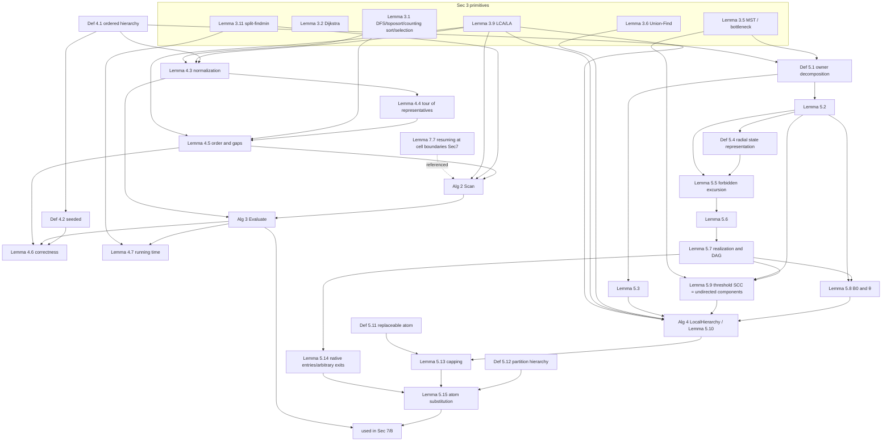

# 02 有序层次结构求值(Sec 4)与局部层次结构(Sec 5)的分析

[English](02_ordered_hierarchy_local.md) | [日本語](02_ordered_hierarchy_local.ja.md) | **简体中文**

对象:arXiv 2611.34911v1 "Linear Single-Source Shortest Path, Almost"(Gholami, Hajiaghayi)
范围:Sec 4(Def 4.1–4.2、4.1–4.3、Lemma 4.3–4.7、Alg 2 `Scan`、Alg 3 `Evaluate`)以及
Sec 5(Def 5.1、5.4、5.11、5.12、Lemma 5.2–5.15、Alg 4 `LocalHierarchy`)。
作为前提,我们参考了 Sec 2(记号、计算模型、小规模情形的处理)和 Sec 3(基本组件),并且还读了 Sec 4 所引用的 Sec 7 的 Lemma 7.7(在单元边界处恢复)的相关部分。
引用处给出 txt 的行号(`l.NNN`)和论文的页码(`p.NN`)。txt 中的公式已对照 PDF p.15–18 和 p.21–26 核对,确认完好无损。

记号:论文中没有写明的实现细节标为 **[Supplement]**;论文中的错误或含糊之处标为 **[Ambiguous]**。

---

## 0. 主要发现(摘要)

1. **满足局部构造阈值 `N > 2 L_N^4` 的最小 N 是 N = 209,953。** 低于该值时,Alg 4 走基本情形(l.2–5):每个顶点一个状态,双向连边,并用同时合并等权边的 Kruskal 树。Sec 7 和 8 中传给 Alg 4 的原子(atom)规模为 polylog n,因此**在实际规模下每个原子总是走基本情形**。Sec 5.1–5.4 的径向构造(owner 分解、壳层(shell)、θ、网格)在 Mode A 中实际上从不执行。要运行它,需要一个把阈值和 b 作为参数的 Mode B(§4)。
2. **Sec 5.2–5.3 各引理(5.2、5.5–5.9)的证明只用到 N ≥ 2 和 K ≥ 8h。** `N > 2L_N^4` 真正被用到的只有 Sec 5.4 的多项式常数(N ≥ 32、h ≤ N,以及由 K < 16h 得到的 `3hK² ≤ N^5`、c = 10 和区间上端点 `N^16 σ`)。降低阈值会破坏 5.4 的"对齐测试"、"未对齐块的 MST 长度 < σ_U/2"以及"网格哨兵",并有层次结构高度不再单调的风险。修正办法见 §4.3。
3. **补充报价(supplemental offer)`u = max{b, z+S(i)+g(i,j)}` 只为运行时间而存在**(Lemma 4.7)。正确性(Lemma 4.6)只用到"上界被保持"。去掉补充报价的变体仍保持正确性,只是运行时间变差。这可以作为差分测试的一个维度。
4. **在 Def 4.1 之下,任何输入都不可能存在经过两个及以上状态的长度为 0 的有向环。** 子节点之间长度为 0 的弧,对任意正高度都是轻弧(light arc),而按轻弧取的商图必须无环。零权分量必须由调用方收缩(Sec 5.1 l.962 "Zero-length components may be contracted")。
5. Evaluate 的正确性可转化为四条能与 oracle 对照检查的不变量:(I1) 每个报价都 ≥ δ,(I2) 受保护状态恰好发出一次 δ,(I5) 从 Scan(X,I,c) 返回时,X 之下没有键落在 I∩(−∞,c] 内,(I8) 打开时,X 之下每个尚未发出的受保护状态都满足 δ ≥ D₀(§2.8)。
6. 作为正确性检查用的参考层次结构生成器,可使用**"由逐阈值 SCC 得到精确高度的层次结构"**(对每个权值运行一次 Tarjan)。对任意有向状态图,它都满足 Def 4.1(c₀ = 1),因此可以独立于 Sec 5 来测试 Evaluate。
7. Lemma 5.9(无向 join 记录的连通分量 = 阈值 W 下的有向 SCC)可以穷举验证:在小图上,对每个 W 比较 Tarjan 的 SCC 与并查集的结果。这是 Sec 5 中最有价值的测试。
8. 数值方面的注意事项:`N^3 σ`、`N^c σ` 和 `N^16 σ` 很容易溢出 uint64。它们只用于分类和哨兵,所以用饱和算术,或把上界截到"实际最大权值 × 2"即可。距离本身(z+S+g、偏移 b−jν 等)对整数权值类型是精确计算的。对 double,向下舍入可能破坏可行性(§6)。

---

## 1. 前提(取自 Sec 2 和 3)

- `L_k = ⌈log2(k+2)⌉`,`τ(k) = 1 + log log log(k+16)`(l.284)。
- 小规模情形(l.286–290):局部构造假设 `N > 2L_N^4`。否则"每个顶点放一个状态,原有的非自环边双向连接,并同时合并等权的 MST 边。树边连接被合并的子节点,由 Lemma 3.5,子节点之间不存在更轻的边。"
- 计算模型(l.292–311):长度是不透明的实数,允许的运算是比较、加法和复制。带符号的值用两个非负和的二元组表示。乘以 2^j 通过 j 次加倍完成。整数下标可以使用 O(1) 的字运算。**Sec 4 和 5 不使用随机性**(5.3 明确写了 "deterministic",5.4 中的中位数选取是确定性的 BFPRT)。
- 所用的基本组件:
  - Lemma 3.1:DFS/BFS/拓扑排序、计数排序、中位数选取。
  - Lemma 3.2:Dijkstra(测试 oracle)。
  - Lemma 3.5:MST(三轮增长),`b_T(x,y)` 是最小瓶颈。
  - Lemma 3.6:并查集(有序的合并事件)。
  - Lemma 3.9:O(1) 的 LCA 和层级祖先(level ancestor)。
  - Lemma 3.11:split–findmin。接受分裂和减小操作,在 O(1) 内返回区间最小值。相等时按原始下标打破。

---

## 2. Sec 4 有序层次结构的求值

### 2.1 Def 4.1 有序层次结构(p.14–15,l.646–658)

**组成**
- 一个有限的有向状态图 `D`,弧长非负。
- 一个投影 `π: states → 物理(无向)图的顶点`。
- 一个有根森林 `H`,其叶子恰好是各个状态。

**条件**
- (H1) 每条弧 `x→y`(长度 ℓ)投影为从 π(x) 到 π(y) 的、长度 ≤ ℓ 的物理游走。
- (H2) 内部节点 C 至少有两个子节点,且高度 `h(C) > 0`。高度朝根方向非递减。
- (H3) 把 C 的不同子节点之间长度 `< h(C)` 的**轻弧**收缩,得到子节点上的商图,该商图无环。
- (H4) 根之间的**所有**弧(不只是轻弧)所取的根商图无环。
- (H5) 在每个内部节点,子节点由一棵**链接(link)**树连接。链接是 `(端点状态 x, 端点状态 y, 长度界 ℓ ≤ c₀·h(C))`,它证明 π(x) 与 π(y) 之间存在长度 ≤ ℓ 的物理游走。方向任意。c₀ 是绝对常数(Alg 4 的输出 c₀ ≤ 2,基本情形和精确合并 c₀ = 1)。
- (H6) 仅用于证明的链接不会变成松弛弧。

**建议的数据结构 [Supplement]**
```
struct HNode { int parent; vector<int> children; Real h; vector<Link> links; /*after normalization*/ Real nu, S; int rank_in_parent; StateId rep; Real gap_to_next; };
struct Link  { StateId x, y; Real len; };            // len ≤ c0*h(parent)
struct OrderedHierarchy { StateGraph D; vector<PhysV> pi; vector<HNode> nodes; vector<int> leaf_node_of_state; vector<int> roots; Real c0; };
```

### 2.2 Def 4.2 带种子的有序层次结构(p.15,l.659–672)

- 带权的物理源点 `(v_i, c_i)` 和初始的状态报价 Q。
- 目标距离为 `δ(v) = min_i { c_i + d(v_i, v) }`,其中 d 是物理图上的距离。
- **报价(offer)**是一个有限值;+∞ 表示"没有报价"。状态 x 处的报价,若其值 ≥ δ(π(x)),则称为**可行**。所有初始报价都必须可行。
- **紧见证(tight witness)**:一条有向状态路径,满足"初始报价 + 弧长之和 = 末状态像处的 δ"。有见证的状态称为**受保护(protected)**。对每个被请求的有限目标,映射到它的状态中至少有一个必须受保护(这是对输入的义务;Evaluate 不检查)。
- 观察:紧见证的每个前缀都是紧的(l.670)。
  - 用 oracle 计算受保护集合 [Supplement]:从初始报价 q 等于 δ(π(x)) 的状态 x 出发,只沿满足 `δ(π(y)) + ℓ(y→x) = δ(π(x))` 的弧 y→x 做 BFS。到达的状态构成受保护集合。

### 2.3 4.1 规范化与 Lemma 4.3(p.15–16,l.674–723)

**输入**:一个 Def 4.1 层次结构(N 个状态,M 条弧)。
**输出**:每个幸存的内部节点的单位 `ν(C)` 和质量(物理直径的上界)`S(C)`;用于给子节点定序的轻弧分配;以及根商图。

**定义**
- `F`:把所有节点的链接收集起来作为无向边(长度 = 被证明的界)所形成的森林。有 d 个子节点的节点贡献 d−1 条链接,所以 F 是状态上的一个森林。长度为 0 的链接也包含在内。
- 质量 `S(C)`:C 的子树上 (a) F 中被选中的边的长度,以及 (b) 内部节点的高度 h,二者之和。叶子的质量为 0。F[C] (F 中张成 C 之下各状态的子树)上的路径长度 ≤ S(C),且 S(C) ≥ h(C) 成立。
- **规范化链接**:对于内部节点的子节点 C 及其父节点 P,当 `4·S(C) ≥ h(P)` 时,把 C 与 P 链接。
- 对由规范化链接相连的每个集合(它构成一棵连通子树),以其中最小的高度 `h_min` 为起点,建立 2 的幂次表 `h_min·2^k`。`ν(C)` 是表中 ≤ h(C) 的最大值,满足 `ν(C) ∈ (h(C)/2, h(C)]`。没有链接的节点可视为有自己的表(`ν = h`)[Supplement]。
- 在未链接的边界处,`ν(P) > 2S(C)` 成立(由 `h(P) > 4S(C)` 和 `ν(P) > h(P)/2` 得到)。
- 对单位相等的父子链接做**收缩**。C 的子节点变成 P 的子节点,C 的链接移到 P。收缩后节点的 S 使用**最顶端的原始质量**(P 的 S)。
- 自环弧被丢弃。根之间的弧进入根商图。其余每条弧在规范化之后放在它的 LCA 处。其中 `ℓ < ν(LCA)` 的是轻弧,它们决定子节点的排序。

**Lemma 4.3**:时间 O(M+N)。父节点的单位 ≥ 2 × 子节点的单位,`Σ_C S(C)/ν(C) = O(N)`。每个父子对要么**二进对齐(dyadically aligned)**(父节点的单位是子节点单位的 2 的幂倍),要么满足 `2S(C) < ν(P)`。前提是 c₀ 为常数。

**伪代码**
```
Normalize(H):
  F ← ⋃_C links(C)                         // undirected forest, length = len
  precompute F's preorder, root distances rd, and LCA (Lemma 3.9)
  in postorder S(C) = h(C) + Σ links(C).len + Σ_{internal child C'} S(C')   // S of a leaf is 0
  for internal node C (with parent P): linked[C] ← (4·S(C) ≥ h(P))
  for link set Λ (connected component under linked, with topmost node top):
     hmin ← min_{C∈Λ} h(C)
     table ← [hmin, 2hmin, 4hmin, … ] built by doubling until it covers max_{C∈Λ} h(C)
     downward from top: idx(C) ← decrease from idx(parent), stopping at table[idx] ≤ h(C)
     ν(C) ← table[idx(C)]
  contraction: when linked[C] and ν(C) = ν(P), absorb C into P (S(P) and ν(P) unchanged)
  for arc (x→y, ℓ): discard if x = y
     if root(x) ≠ root(y), add to the root quotient
     otherwise L ← LCA(x,y), ci, cj ← the children of L containing x, y (level ancestor)
        if ℓ < ν(L): light[L].push(ci→cj, tail x, head y)
  topologically sort the root quotient and each L's light (the ranks determined by ν are reassigned in §2.4)
```
- 计算模型:实数只使用比较、加法和加倍。表的下标是整数。
- 测试:
  - `ν(P) ≥ 2ν(C)`。
  - `ν(P)/ν(C)` 是 2 的幂,或 `2S(C) < ν(P)`。
  - `ν(C) ∈ (h/2, h]`(使用收缩前的值)。
  - `S(C) ≥ max_{x,y∈C} d_phys(π(x),π(y))`(用 Dijkstra oracle)。
  - 记录满足 `Σ S/ν ≤ κ·N` 的 κ。
  - 收缩之后,每个节点的轻商图仍然无环。

### 2.4 4.2 子节点顺序与 Lemma 4.4、4.5(p.16–17,l.725–779)

**输入**:规范化后的层次结构、F 的前序,以及每个节点 X 的轻弧(`ℓ < ν(X)`)。
**输出**:对每个 X,子节点的一个拓扑序(rank)、每个子节点的代表(一个状态)`x_i`,以及相邻子节点之间的间隙 `g(i,j) = g(j,i)`。g 是 π(x_i) 与 π(x_j) 之间物理游走长度的上界。

**Lemma 4.4**:按完成顺序的逆序访问各代表的物理游走,其长度 ≤ `2 Σ_i S(i) + 2dν(X) + 2S(X)`。
**Lemma 4.5**:`Σ_X Σ_{i,j} g(i,j)/ν(X) = O(N)`。整体 O(M+N) 时间。

**伪代码**(代价按"F 的边 = 被证明的界,选中的弧 = 弧长"计)
```
OrderChildren(X):
  for child i: prov[i] ← any state under i      // [Supplement] the state with the smallest F-preorder is recommended
  out[i] ← the light arcs leaving child i, sorted by the F-preorder of their tail states
  acc ← 0; cur ← ⊥; finish ← []
  for child r (in F-preorder of prov[r]; O(N) by counting sort):
     if visited[r]: continue
     if cur ≠ ⊥: acc += D_F(cur, prov[r])     // D_F = rd(a)+rd(b)−2rd(lca)
     cur ← prov[r]; DFS(r, prov[r])
  topo ← reverse(finish)                       // ranks of the children
  for k: g(topo[k], topo[k+1]) ← mark[topo[k]] − mark[topo[k+1]]
  rep[i] ← x_i

DFS(i, entry):
  visited[i] ← true; x_i ← entry
  for arcs a=(t→y, ℓ) of out[i], cyclically from the preorder position of entry:
     j ← the child of X containing y
     if visited[j]: continue                   // non-tree arcs are not followed
     acc += D_F(cur, t); cur ← t                // move within F[i]
     acc += ℓ; cur ← y
     DFS(j, y)                                  // on return cur = x_j = y
     acc += ℓ; cur ← t                          // return by traversing the arc backward
  acc += D_F(cur, entry); cur ← entry
  mark[i] ← acc; finish.push(i)
```
- 论文通过对(父节点、子节点、前序)三元组做计数排序,建立了一张能在 O(1) 内查到循环起始位置的表(l.773–777)。简化版本可以用 O(log) 的二分查找代替(记为偏离)。
- 计算差值(`D_F` 以及 mark 的差)需要减法。论文用带符号的二元组完成。整数权值下是精确的。
- 边界:没有出轻弧的子节点立即完成(l.776)。若子节点是叶子,则 S = 0,F[i] 是单个点。
- 测试:
  - 所有轻弧都沿 rank 指向前方。
  - `g(topo[k],topo[k+1]) ≥ d_phys(π(x_k), π(x_{k+1}))`。
  - `Σ g ≤ 2ΣS(i)+2dν+2S(X)`(恰好是 Lemma 4.4 的公式)。
  - 记录满足 `Σ g/ν ≤ κ'N` 的 κ'。

### 2.5 4.3 槽(slot)、截止时间、run 与补充报价(p.17–18,l.781–832)

**状态**
- 每个节点处于未打开、活跃(live)或已退役(retired)之一。
- 每个叶子接受键的减小,直到它被发出(settled)或退役。
- 最小值按 (值, 叶子 ID) 的字典序比较。

**窗口**
- 名义槽(nominal slot)是半开区间 `[a,b)`。永久截止时间 c 是**含端点的**。
- 候选 z 在满足 `a ≤ z < b` 且 `z ≤ c` 时称为**到期(due)**,其中 c 是继承的物理截止时间的最小值(没有则为 +∞)。

**打开与过期**
- 内部节点 C 在父节点的实际窗口内找到一个有限的最小键 `D₀` 时打开。
- 绝对过期时间是 `D₀ + S(C)`。所有进入 C 的紧到达都不晚于该时间(三角不等式)。
- 当所有叶子都已 settled 或退役,或者已覆盖其过期时间(含端点)时,它结束。

**局部槽的起点**(Pettie–Ramachandran 的对齐规则,l.794)
- 若 `D₀ + S(C) < b`,起点是 `D₀`。
- 否则,起点是满足 `b − jν(C) ≤ D₀` 的最大值,其中 b 是**父节点名义槽的右端**(在 Lemma 7.7 l.1887 中明确写出)。j 通过反复做减法求得,代价 O(1 + S/ν)。
- 在根处,总是使用第一条规则。
- 起点位于父节点的槽之内:在未对齐的边界处是因为 `2S < ν(P)`,在对齐的边界处是因为整除性。
- 若最后一个槽越过了在本次调用中过期的子树的界,则把该界作为额外的上限向下传播,并抑制超过上限的发出。网格始终与名义槽的端点保持对齐。

**叶子布局与 run**
- 按子节点的 rank 以 DFS 顺序排列层次结构的叶子。每个节点占据一个连续区间。
- 已打开的 X 持有一个链表。该链表包含已登记的活跃子节点,以及未登记子节点的**极大连续 run**,按其原始顺序排列。
- 已过期或已完成的子节点从链表中移除。run 保持其位置,不必与相邻的 run 合并。
- run 的最小键由 split–findmin 维护。X 首次打开时,整个子节点列表是单个 run。

**分裂 run**
- 当持有到期最小值 z 的叶子属于直接子节点 i(i 通过层级祖先找到)时,把该 run 替换为"非空的左子 run、子节点 i、非空的右子 run"。区间至多被分裂两次。
- 游标放在**第一个新建出来的片段**上,使 rank 较低的子节点先得到机会。

**补充报价**
- 对每个新建的子 run,在与 i 相邻的子节点 j(左侧为 rank i−1,右侧为 i+1)的代表 `x_j` 处报价 `u = max{b, z + S(i) + g(i,j)}`。
- 可行性:从最小叶子出发,可通过 F[i] 到达 x_i(长度 ≤ S(i)),再沿间隙游走到达 x_j。
- 由于该值被垫高到 b,同一个槽内不会有 rank 更低的子节点新变成到期。

### 2.6 Algorithm 2 `Scan(X, I, c)`(p.18,l.834–864)

**输入**:一个活跃节点 X、名义槽 `[a,b)` 的一个部分 `I = [a', b')`,以及一个含端点的截止时间 c。
**输出**:被发出的 (状态, 值) 对和待处理的报价。

```
Scan(X, I=[a',b'), nominal=[a,b), c):               // Alg 2
  p ← X.list.first                                   // l.2 cursor order (topological order)
  while p ≠ end:
    if p is an unregistered run:                     // l.3
      (z, leaf) ← SF.min(p.interval)                  // Lemma 3.11
      if a' ≤ z < b' and z ≤ c:                       // l.4 due
        i ← LevelAncestor(leaf, depth(X)+1)
        (L, i, R) ← split p (no empty pieces are created); SF.split at most twice
        register(i)                                   // l.5
        if L ≠ ∅: j ← last child of L; offer(x_j, max{b, z + S(i) + g(i,j)})   // l.6
        if R ≠ ∅: j ← first child of R; offer(x_j, max{b, z + S(i) + g(i,j)})
        p ← (L ≠ ∅ ? L : i); continue                 // l.7
      p ← next(p); continue                           // a run that is not due is passed
    else:                                             // registered child i, l.8
      if i is a leaf:
        if key(i) is due (in I and ≤ c) and i is not yet emitted:   // l.11
          emit(i, key(i)); settled[i] ← true
          for arc (i→y, ℓ): if !settled[y] and !retired[y]: SF.decrease(y, key(i)+ℓ)
          unlink(i)
      else:
        if i is unopened:                             // l.9
          D0 ← value of SF.min(i.interval)             // still due because it is registered (I3 in §2.8)
          origin(i) ← (D0+S(i) < b) ? D0 : max{ b − jν(i) ≤ D0 }
          expiry(i) ← D0 + S(i); status(i) ← live; i.list ← [run(all children of i)]
        c_i ← min(c, expiry(i))
        for nominal slots J = [o_k, o_k+ν(i)) of i from the current k, while J∩I ≠ ∅ and o_k ≤ c_i:   // l.10
          Scan(i, J∩I, J, c_i)
          if i is completed: break
          if J ⊆ I: k ← k+1 else break               // a clipped slot resumes in the next portion
        if i is completed or (c_i < b', i.e. the expiry time has been covered): retire(i); unlink(i)
      p ← next(p)
  retire the completed pieces and the pieces that have covered the permanent deadline     // l.12
```
- `retire(C)` 只遍历仍与 C 链接的片段。它对已登记的子节点递归,并遍历未登记 run 之下的整棵子树。新近退役的叶子被标记。之后的报价在插入之前会检查该叶子的 settled / retired 标记。
- 在一次访问中,活跃节点会推进所有与该次访问相交的局部槽,即使没有新的报价(l.863)。
- 在普通调用中,`I` 是"名义槽 ∩ 从父节点传来的窗口"。在 Lemma 7.7(归 Sec 7 负责)中,它在外部单元边界处被截断,游标在下一个单元中从第一个活跃 rank 处恢复。补充报价的垫高使用名义的 `b`(而不是 `b'`;l.1890)。
- **[Supplement]** 上面的 while 循环以及"仅当 J ⊆ I 时才推进 k"的规则,是根据正文中的"时钟跨访问持续"和 Lemma 7.7 的"恢复被截断的槽"重构出来的。

### 2.7 Algorithm 3 `Evaluate(D, H, Q)`(p.19,l.866–882)

```
Evaluate(D, H, Q):
  Normalize(H); OrderChildren(all X)                       // l.2  Lemma 4.3, 4.5
  layout ← DFS order of the leaves (following child ranks); SF ← split–findmin (all keys +∞)
  SF.split at each root boundary; insert the smallest initial offer per state with SF.decrease   // l.3
  for root X (in topological order of the root quotient):    // l.4
    if SF.min(X) = +∞: continue                             // l.5
    if X is a leaf: emit(X, key); relax outgoing arcs        // l.6–7
    else:
      D0 ← SF.min(X); origin ← D0; c ← D0 + S(X); X.list ← [run(all children)]   // l.9
      for k = 0,1,…: I ← [D0+kν, D0+(k+1)ν); if D0+kν > c: break          // l.10
        Scan(X, I, I, c); if X is completed: break                           // l.11
  return the emitted (state, value) pairs                                    // l.12
```
- 物理顶点 v 的最终距离,是满足 `π(x) = v` 的状态 x 的发出值的最小值(由调用方取,Sec 8 l.2192)。

### 2.8 Lemma 4.6(正确性)概要与可检查的不变量

**命题**:受保护状态 x 发出 δ(π(x))。其余每个发出的值都 ≥ δ(π(x))。

**概要**
- 上界:弧(H1)和间隙证明(Lemma 4.4)保持上界。
- 下界一侧(不漏掉任何紧到达)按如下顺序用嵌套归纳证明:对根 → 对同一节点按时间顺序的各部分 → 对一个部分内按子节点 rank → 对剩余高度递归。
  1. 在一个部分 `[u,v)` 内,考虑紧路径进入目标子节点的最后一次进入。
     - 若前驱的时间早于 u,则它在更早的部分中已被处理。
     - 若前驱的时间不早于 u,则该跨越的长度 `< v−u ≤ ν(C)`,所以它是轻弧;前驱位于 rank 更低的子节点中,并且已经发出(H3 + Lemma 4.5)。
     - 对于种子或从 C 外部进入的情形,由调用不变量,报价已经就位。
  2. 第一个尚未发出的状态有一个到期的报价。未登记的 run 在需要其 rank 之前就已有到期的最小值。由于弧长非负,活跃的报价不会落入过去的窗口。指向 rank 更低子节点的弧,只产生不小于槽右端的值。边界报价被垫高到 b。
  3. 首次打开时:不存在严格早于最小值的紧到达。过期时间至多为 `D₀+S(C)`(物理直径的上界,Lemma 4.3)。在过期时退役,只发生在覆盖该时间(含端点)之后。
- 依赖:Def 4.1(H1、H3、H5)、Lemma 4.3(S 界定直径)、Lemma 4.5(rank 与间隙)、Lemma 3.11(区间最小值)、Def 4.2(前缀的紧性)。

**可在实现中检查的不变量**(仅在 debug 构建中启用;oracle 是物理图上 Dijkstra 得到的 δ 以及 §2.2 的受保护集合)
- **I1 上界**:每次调用 `SF.decrease(x, v)` 都有 `v ≥ δ(π(x))`,包括补充报价。
- **I2 发出**:每个状态至多发出一次,发出值 ≥ δ。受保护状态一定会发出,且其值等于 δ。
- **I3 时钟单调性**:当节点 X 处理部分 `[a',b')` 时,新的键 ≥ a'。落入 X 中 rank 低于游标的子节点的键 ≥ b'(这是轻弧指向前方的推论)。
- **I4 槽纪律**:发出的值 z 在发出时位于部分 I 内,且 z ≤ c。在同一节点内,发出的槽号单调递增。
- **I5 无遗漏**:从 `Scan(X,I,c)` 返回时,X 之下没有未发出、未退役的状态的键落在 `I ∩ (−∞, c]` 内。
- **I6 过期的可靠性**:X 退役时,X 之下所有受保护状态都已发出(同时也检查 `δ ≤ D₀+S(X)`)。
- **I7 起点对齐**:子节点的起点位于父节点的名义槽之内。子节点的网格与 b 对齐(二进对齐,或 `D₀+S < b`)。
- **I8 打开时的下界**:当 X 在 D₀ 处打开时,X 之下每个未发出的受保护状态都有 `δ ≥ D₀`。

### 2.9 Lemma 4.7(运行时间)(p.20,l.922–948)

- 命题:O(M + N τ(N) + Q)。对输入的一次扫描只保留每个状态的最小初始报价。
- 分解:
  - 得益于补充报价,每个子 run 的失败访问只有 `O(1 + (S(i)+g(i,j))/ν(X))` 次。
  - 对已登记子节点的访问代价为 `O(1 + S(i)/ν(X))`。
  - 求和后,由 Lemma 4.3 和 4.5,它们是 O(N)。
  - 退役是 O(N)。有 O(N) 次补充减小和 O(M) 次原始松弛。
  - split–findmin 的代价为 `O(q + q' + Nτ(N))`(Lemma 3.11)。
- 空间 O(M+N)。计算模型是实数的比较与加法加上整数下标。不使用整数字典或以实数为键的堆(l.942)。
- 简化实现:用线段树(O(log N))代替 split–findmin。记为复杂度上的偏离(D-*)。

### 2.10 Sec 4 的边界值与退化情形

| 情形 | 论文的处理 / 建议 |
|---|---|
| 只有单个状态的根 | "只处理它最好的有限报价"(l.723)。Alg 3 l.6–7 |
| 没有有限报价的根 | 跳过(l.5)。该根的状态不发出 |
| 自环弧 | 被规范化丢弃(l.719) |
| 长度为 0 的弧 | 允许(Def 4.1 说是非负)。但子节点之间长度为 0 的弧总是轻弧,所以经过两个及以上状态的长度为 0 的有向环违反 Def 4.1。由调用方收缩它(Sec 5.1 l.962)。建议在输入校验中拒绝 |
| 并列(Ties) | 最小值按 (值, 叶子 ID) 比较(l.784)。发出的值不依赖于并列如何打破 |
| 不连通(多个根) | 按拓扑序处理根商图。根商图的无环性是对输入的义务(H4) |
| h(C) = 0 | Def 4.1 禁止 |
| D₀ + S(C) 恰好等于 b | 第二条规则(因为 `<` 不成立) |
| 值恰好在过期时间 | 包含(含端点)。父节点窗口的右端不含(l.803–807) |
| 大的 c₀ | Lemma 4.3 的常数增大 `max(1,c₀)` 倍。不影响正确性 |

### 2.11 Sec 4 的建议测试

1. **参考层次结构生成器 [Supplement]** `build_threshold_scc_hierarchy(D, π)`
   - 按递增顺序扫描不同的弧长 W,并在满足 `ℓ ≤ W` 的弧上计算 Tarjan SCC。在 SCC 合并之处创建一个高度为 W 的节点。
   - 子节点是"`< W` 处的 SCC",所以按轻弧(`< W`)取的商图就是 SCC 的缩点图,无环。
   - 链接取自"由 `≤ W` 的弧张成子节点商图的一棵树"的弧(c₀ = 1)。
   - 把物理图取为弧 (π(x), π(y), ℓ) 构成的无向多重图,则 (H1) 成立。
   - 为避免长度为 0 的环,生成时只使用正长度。
   - ~~同时构造高度按 `h(C) = 2W` 等倍数缩放的变体,得到轻弧确实位于子节点之间的层次结构。~~
     **更正(2026-11-27)。** `h(C) = 2W` 这一变体不是有序层次结构:节点 C 是长度 ≤ W(C) 的弧的一个强连通分量,所以只要高度高于 W(C),不同子节点之间的每条这样的弧都是轻弧(长度 < h),子节点上的轻商图是强连通的,于是在每个内部节点处 H3(Def 4.1,l.650)都不成立。恰好在把高度降低时才有效:任何满足 0 < h'(child) ≤ h'(C) ≤ W(C) 的高度,都以 c₀ = 各节点上的最大值 ⌈(C 的最长链接) / h'(C)⌉ 满足 Def 4.1(把所有高度减半得到 c₀ = 2)。由 `tests/unit/paper/hierarchy/test_reference_hierarchy_heights.cpp` 修正。
2. **差分测试**
   - (a) 基本情形的局部层次结构(Kruskal)+ 单顶点源:把每个物理顶点上的最小值与 Dijkstra 比较。
   - (b) 任意有向状态图 + 参考层次结构:受保护状态的发出值 = δ,所有发出值 ≥ δ(I1、I2)。
   - (c) 多个源 `(v_i, c_i)`。
   - (d) 启用与禁用补充报价的两个版本,受保护状态的发出值一致。
   - (e) 两种 split–findmin 实现的差分测试。
3. **不变量测试**:在 `SSSP_PAPER_CHECKS` 下断言 §2.8 的 I1–I8,并运行 10,000 个小型随机图(N ≤ 60)。
4. **结构性测试**:Lemma 4.3 和 4.5 的性质(§2.3、§2.4)。统计 `Σ S/ν`、`Σ g/ν`、槽的数量和失败访问的数量,并记录这些值除以 N 后保持有界且与 N 无关。运行时间通过测量来确认。
5. **手算示例**:在三个状态的链上(两个子节点,一条轻弧),手算槽、分裂和补充报价的值,并检查是否一致。

---

## 3. Sec 5 针对任意正长度的局部层次结构

前提:连通图 G,权值为正,有 N 个顶点和 m 条边。`L_N = ⌈log2(N+2)⌉`。

### 3.1 5.1 Owner 分解(Def 5.1、Lemma 5.2、5.3)(p.21–22,l.960–1018)

**构造**(`b = L_N^4`;外层构造使用不同的 b)
1. 构建 MST T(Lemma 3.5)。删除满足 `w(uv) > D_T(u,v)` 的非树边(得到约简图)。此后每条边都满足 `b_T(u,v) ≤ w(uv) ≤ D_T(u,v)`。`D_T` 由 LCA 和到根距离得到。
2. `A₀`:对有根的 T 按后序遍历。计算子节点剩余大小之和 + 1,当它达到 b 时,标记该顶点并返回 0。若没有标记任何顶点,则放置一个单独的 pivot([Supplement] 推荐取根)。`|A₀| ≤ max{1, ⌊N/b⌋}`,且 T − A₀ 的每个分量的顶点数都少于 b。
3. `A = A₀ ∪ {张成 A₀ 的极小子树中度 ≥ 3 的顶点}`。`|A| = O(1+N/b)`,且 T − A 的每个分量至多有两个 pivot 邻居。
4. 走廊(corridor)切割:
   - 在有两个 pivot 邻居的分量中,删除连接这两个 pivot 的走廊(树路径)上一条权值最大的树边([Ambiguous] 并列时的打破规则未写明 → 按边下标决定)。
   - 对于两个相邻的 pivot,删除它们之间的边。
   - 剩下的分量就是 **owner 单元(cell)**,每个恰好含一个 pivot。
5. `p(v)`:v 所在单元的 pivot。`R_v = D_T(v,p(v))`,`r_v = b_T(v,p(v))`(在 pivot 处为 0),`h = b+1`(单元内到 pivot 的跳数上界),`R_v ≤ h·r_v`。
6. 被删除的走廊边在 A 上构成一棵树 `T_A`。`σ(p,q)` = `T_A[p,q]` 上的最大权值 `= b_T(p,q)`,`σ(p,p) = 0`。

- 运行时间:组合部分是线性的。连同 T_A 及其合并层次结构(排序)在内,O(N + |A| log(|A|+1))。

**Lemma 5.2**
- 对于单元间的边 xy(权值 w),`w ≥ max{r_x, r_y, σ(p(x),p(y))}`。
- 对于半径不同的单元内的边,`w ≥ max{r_x, r_y}`。
- 对每条边,`w ≤ h(r_x+r_y) + N σ(p(x),p(y))`,由经过两个 pivot 的树路径得到。

**Lemma 5.3**:对每个 pivot q,`b_T(v,q) ≥ r_v`。

- 测试:
  - T − A 的各分量的顶点数少于 b,且 pivot 邻居 ≤ 2。
  - 每个单元恰有一个 pivot。
  - 在每条边上检查 Lemma 5.2 的三个不等式。
  - 对每个 (v, q) 检查 Lemma 5.3。
  - `σ = b_T`。
  - 把 b 作为参数,取 b ∈ {1, 2, 3, N+1} 运行(b = 1 使每个顶点都是 pivot;b > N 给出一个 pivot)。

### 3.2 5.2 局部状态图(Def 5.4、Lemma 5.5–5.7)(p.22–24,l.1020–1107)

**边的分类**
- **macro**:满足 `w ≤ N³ σ(p,q)` 的单元间的边。被删除的走廊边总是 macro。macro 边满足 `σ ≤ w ≤ N³σ`,并带有一个具名的走廊最大值(其键 σ)。
- **radial**:其余所有边。`w ≤ 3h·max{r_x, r_y}` 成立(由 Lemma 5.2 和 `σ < w/N³` 得到;对 N ≥ 2 成立)。
- 没有正的 radial 边连接两个 pivot。
- `N³σ` 沿整数 N 的二进制展开,通过三轮加法和加倍构造(每个 pivot 树最大值 O(log N))。

**壳层(shell)构造**
- `K` = 不小于 8h 的最小的 2 的幂。
- 两端半径均为正的 radial 边,若半径之比 ≤ K² 则为 **near**,若比值 > K² 则为 **far**。
- 由 near radial 边连接正半径顶点所得的分量是一个 **near 分量**(孤立顶点也算一个分量)。
- 设 a 为该分量的最小半径,**原生壳层(native shell)** `i(v)` 由 `a K^{i(v)} ≤ r_v < a K^{i(v)+1}` 定义。
  - 沿 near 生成树,相邻顶点的下标之差 ≤ 2。从最小顶点出发遍历该树,并缓存 K 的幂。O(m + N log K)。
- **窗口**(状态的集合):
  - 内向窗口(inward window)j(j ≥ 0)包含壳层 j 和 j+1。
  - 外向窗口(outward window)j(j ≥ 0)包含壳层 j−1 和 j。
  - 为每个窗口创建顶点的**单独副本**,并把两端都在该窗口内的 near radial 边双向加入。
  - 这个窗口内图的连通分量称为**块(block)**。
  - 正半径顶点 v 至多有四个副本:`in_{i(v)}`(原生内向)、`in_{i(v)−1}`(当 i ≥ 1 时)、`out_{i(v)}`(原生外向)和 `out_{i(v)+1}`。
  - pivot 有两个副本,`in(p)` 和 `out(p)`。

**弧**(长度是原始的物理长度;只有切换弧(switch)的长度为 0)
| 种类 | 尾 → 头 |
|---|---|
| 窗口内 | 同一窗口内各副本之间的 near 边,双向 |
| 内向 near 转移 | 内向窗口 j 中的副本 → 原生壳层为 `i < j` 的邻居的内向窗口 i(= 原生内向) |
| 外向 near 转移 | 外向窗口 j 中的副本 → 原生壳层为 `i > j` 的邻居的外向窗口 i(原生外向) |
| far(内向) | 半径较高的端点的**每一个**内向副本 → 半径较低的端点的原生内向 |
| far(外向) | 半径较低的端点的每一个外向副本 → 半径较高的端点的原生外向 |
| 阶段切换(Phase switch) | 每个顶点的每个内向副本 → 原生外向(长度 0)。对 pivot,`in(p)→out(p)` |
| Pivot radial | v 的(正的)内向副本 → `in(p)`,`out(p)` → v 的原生外向([Ambiguous] "from positive inward states" 与 far 规则一样,读作"每一个内向副本") |
| macro | 对每个方向 x→y,x 的**每一个**副本 → y 的原生内向 |
| 源点 | 在源点的原生内向处,以给定的代价放置初始报价 |

**Def 5.4**(径向状态表示)就是上面的有向图,连同到物理顶点的投影以及每个顶点的原生内向入口。它的参数是坐标(此处为 Sec 8 中的 r_v、J_v)、比值 K,以及 radial / macro 的分类。

**Lemma 5.5(被禁止的偏离)**
- 前提:`N > 2L_N^4`、macro 测试 `w ≤ N³σ`、`K ≥ 8h`。
- 命题:设 M > 0 为最短路径上一段连续 radial 路段中最大的半径或边权。则该路段两端的半径不可能都 `≤ M/K`。
- 证明:该路段的代价 ≥ M。另一方面,经过两个 pivot 的路径代价为 `2hM/K + M/N² ≤ M/4 + M/4 < M`。
- 实际用到的**只有 N ≥ 2 和 K ≥ 8h**。

**Lemma 5.6**:把最短路径上的一段极大 radial run,在半径最小的顶点处分成两部分。在第一部分中,半径从不超过"到目前为止的最小值 × K"。在第二部分中,半径从不低于"到目前为止的最大值 ÷ K"。

**Lemma 5.7**
- O(N) 个状态,O(m+N) 条弧。
- 每条物理测地线都能以相同的长度从原生内向初始状态实现。
- 排除 macro 弧后收缩块,得到一个 DAG。
  - 内向转移严格减小壳层下界的数值。
  - 外向转移严格增大它。
  - 切换是单向的,从内向到外向。
- 逆命题:状态路径投影为物理游走。因此所有副本上的最小值 = 物理距离。单个副本的距离可能更大(甚至为 ∞)。

**伪代码(构造)**
```
BuildRadialStates(G, T, owner):           // Alg 4 l.7–8
  for edge e=xy: kind[e] ← (p(x)≠p(y) and w ≤ N³σ(p(x),p(y))) ? MACRO : RADIAL
  near components ← Union-Find (or BFS) over radial edges with both endpoints r>0 and ratio ≤ K²
  for component: a ← minimum r; determine i(v) along a spanning tree by comparisons with powers of K
  create copies: in[v][0/1], out[v][0/1]; in/out for pivots
  add arcs according to the table above (recording the arc kind: INTRA, NEAR_T, FAR_T, SWITCH, PIVOT, MACRO)
  block ← components connected by INTRA arcs
```
- 测试:
  - (a) 在状态图上用多源 Dijkstra,每个顶点各副本上的最小值 = 物理 Dijkstra(带多个源和任意初始代价)。
  - (b) 每个副本的距离 ≥ 物理距离。
  - (c) 排除 macro 后收缩块的图是 DAG。
  - (d) 在 Dijkstra 树中最短路径的 radial run 上,穷举检查 Lemma 5.5 和 5.6。
  - (e) 状态数 ≤ 4N,弧数 ≤ c(m+N)。

### 3.3 5.3 阈值分量与 join(Lemma 5.8、5.9)(p.24–25,l.1109–1180)

**定义**(对于状态 z;可行路径只包含 radial 弧和切换弧)
- `I₀(z)`:macro 边的最小权值,要求从该边头部的重置(原生内向)可到达 z。
- `O₀(z)`:macro 边的最小权值,要求该边的某个尾副本可从 z 到达。
- 为空时取 +∞。取到最小值的 macro 边(及其具名的键 σ)被保留。
- `B₀ = max{I₀, O₀}`。
- `I*(z), O*(z)`:在同样的可行路径上,包含其前或后的 macro 边在内,被最小化的**瓶颈**(最大的物理弧权)。`θ(z) = max{I*, O*}`。

**计算**
- `I₀`:按拓扑序遍历块 DAG,向前传播最小值。种子是 macro 头部处的原生内向副本,取值为 w。
- `O₀`:反过来。种子是所有尾副本。
- `I*`:按块 DAG 的顺序遍历。在一个块内,求解"块 MST S 上的多源瓶颈 `min_x max{c_x, b_S(x,v)}`"。后序时取自身种子与来自子节点的值(提升到边权)中的最小值,前序时把父节点的值向下传给子节点。块之间的转移用 `max(value, arc length)` 松弛。`O*` 做法相同,只是方向反过来。
- join 记录:每个 pivot 放一个辅助顶点,并创建三种 join。
  - 每条块 MST 边以其物理权值连接其两个端点。
  - 每个 θ(z) 有限的状态 z,以权值 θ(z) 连到其 owner 的辅助顶点。
  - 辅助顶点之间以走廊权值相互连接。
- **core**(在阈值 W 处):对于 pivot 树限制在走廊权值 ≤ W 之后的一个非平凡分量,指包含其 pivot 状态的那个 SCC。

**Lemma 5.8**:对 B₀ 有限的状态,`r ≤ θ` 且 `B₀ ≤ θ ≤ 3hK² B₀`,以及 `σ ≤ θ ≤ 3hK²N³σ`。B₀ 和 θ 对同一批状态是有限的。

**Lemma 5.9**:固定 W > 0。保留块 MST 边、权值为 θ 的状态到 owner 的 join,以及权值 ≤ W 的走廊边。它们限制在状态上的无向分量,**与长度 ≤ W 的弧所构成的有向图的 SCC 一致**。把所有不等式改成 `<` 的版本同样成立。有 O(N) 个合并事件,O(m) 条弧不需要阈值秩。

- 运行时间:块 MST 和两次扫描为 O(m + N log log N)。确定性。
- 测试:
  - (a) 穷举计算 I₀、O₀、I*、O* (对每条 macro 边做 BFS 和瓶颈 Dijkstra)并比较。
  - (b) Lemma 5.8 的不等式。
  - (c) **Lemma 5.9 的穷举检查**:对每个不同的 W(弧长 ∪ join 权值),对 `≤ W` 和 `< W` 两种情形都比较 Tarjan 与并查集。

### 3.4 5.4 组装局部层次结构、Algorithm 4 与 Lemma 5.10(p.25–28,l.1182–1300)

**逐块处理**
- 单点块:只保留它唯一有限的附着 join,不做内部尺度测试。
- 含两个及以上状态的正半径块 U:
  - `s_U` = 窗口中存在的最低原生壳层的下边界(对外向窗口 0,是实际的最小正边界)。`s_U ≤ r_x < K² s_U` 成立,且窗口内的边 `≤ 3hK² s_U`。
  - 对窗口内比 `t_U ∈ [s_U/2, s_U]`(稍后确定)更轻的边所构成的分量 Y,**仅在层次结构中**收缩。
    - 在 Y 内 owner 和半径共享(`r_Y ≥ s_U`),且 Y 避开 pivot(Lemma 5.3)。因此 Y 落在 T−A 的一个分量之内,顶点数少于 b。
    - 对每个 Y 构建精确的 Kruskal 合并树(对 < b 条边排序,同时合并等权边)。代价 O(N log(b+2))。
  - 若 U 内 θ 的最小值为 ∞,则 U 的整个层次结构都是局部的。否则 `z_U = argmin θ`,`σ_U` 是 `B₀(z_U)` 的具名键。`σ_U ≤ θ(z_U) ≤ N^{O(1)} σ_U`,`s_U ≤ θ(z_U)`。

**常数**:`c = 10`。由 `N > 2L_N^4` 得到 `N ≥ 32`、`h ≤ N` 和 `K < 16h`,从而 `3hK² ≤ 768N³ ≤ N^5` 以及 `N·3hK² ≤ N^{c−2}`。

**对齐测试**
- 若 `s_U ≥ σ_U/N^c`,则为**对齐(aligned)**。
  - 对齐块的显著权值(≥ s_U/2)与 σ_U 相差不超过一个多项式因子。
- 未对齐的块,其 MST 总长度 `< σ_U/2`,并在其第一个 macro 附着之下构成一棵局部树。它的所有成员 θ 相等,并使用从 `s_U` 开始的**单独网格**。没有附着的块也同样处理。
- 测试通过按 σ 键分组并按中位数划分来完成。`N^c σ` 对每个键只计算一次。整体 O(N + |A| log² N)。

**全局加倍网格**
- 对每个具名走廊键 σ,构成区间 `[min(σ, 分配给该键的对齐 s_U), N^16 σ]`(`θ ≤ N^8σ`,块权值 ≤ `N^13 σ`)。
- 把每个有限的 θ(z) 放入它自己那个键的区间中。
- 对端点排序并合并重叠的区间。对每个合并后的分量,从其最小值开始铺设一个加倍网格。整体 O(|A| log N)。
- 一个值通过在 O(log N) 个网格点上二分查找来分类,用时 O(log log N)。
- 对对齐的 U,`t_U` = 包含 s_U 的那一类的下边界。对单独网格的 U,`t_U = s_U`(O(log(hK+2)) 个类)。

**合并节点**
- 按类的顺序处理全局对齐的合并事件。对每个类 `[h₀, 2h₀)`,做一次**同时合并**,并把由该类及以下所有权值生成的分量记录为一个**高度为 h₀** 的节点。
- 轻弧按 `< h₀` 测试,连接弧按 `< 2h₀` 测试(c₀ = 2)。
- 局部树(Y 的树、单独网格的块)在其附着事件处被拼接进去。

**Algorithm 4 `LocalHierarchy(H)`**(l.1244–1261)
```
LocalHierarchy(H):                       // H: connected, k vertices, positive weights
  if k ≤ 2·L_k^4:                        // l.2 base case (Sec 2 l.286–290)
     one state per vertex (native entry = itself), original non-loop edges as arcs in both directions     // l.3
     keep the lightest edge per vertex pair, then build the MST and the Kruskal tree merging equal-weight edges simultaneously
     node height = the weight of that merge, links = the MST edges of that weight (c0 = 1)              // l.4
     return                                                                         // l.5
  MST (Lemma 3.5) → remove tree-dominated edges → owner cells (b = L_k^4)          // l.6
  radial / macro classification (T_A maxima via LCA and level ancestor, Lemma 3.9)  // l.7
  inward and outward windows, macro resets (§3.2)                                   // l.8
  propagate I0, O0, I*, O* (§3.3)                                                   // l.9
  build the linear list of join records and classify the significant weights on the grids   // l.10
  combine equal-class joins with Union-Find (Lemma 3.6), splice in local trees, order the light child arcs   // l.11
  return the state representation and the hierarchy with physical links             // l.12
```

**Lemma 5.10 的后处理**(l.1286–1300)
- 丢弃空的辅助节点,并压缩只有一个子节点的节点。
- 根之间的弧进入缩点商图。
- 通过 LCA 和层级祖先,把每条弧分配给"公共父节点处的那一对子节点"。
- 对每个父节点(高度 h₀),由 `< 2h₀` 的弧构建子节点邻接表,并把 DFS 发现边作为链接。
- 用 `< h₀` 的弧对子节点做拓扑排序。
- 若状态图有多个 SCC,则按缩点顺序排列各极大分量(得到多个根)。

**Lemma 5.10**
- 对 N ≥ 1,它返回一个有序层次结构,且每个顶点都有一个原生入口。
- 每条测地线都能以相同的长度从原生入口实现,且每条状态弧都投影为一条可行的物理游走。
- 时间 O(m + N log log(N+4))。O(N) 个节点,O(m+N) 条弧。连接常数 ≤ 2。计算模型是比较与加法(+ 整数下标)。

**[Supplement] Mode B 的简化组装(精确高度)**
- 按权值对 join 记录排序(O(N log N)),并同时合并等权者。节点高度 = 该权值 W,子节点 = `< W` 的分量。
- 轻弧是 `< W`(由 Lemma 5.9 的严格版本保证无环),链接是 `≤ W` 的弧(c₀ = 1)。
- 它完全跳过网格(5.4 的后半部分),所以值得最先构建,作为**正确性的参考实现**。

### 3.5 5.5 用局部层次结构替换连通子图(Def 5.11、5.12、Lemma 5.13–5.15)(p.28–29,l.1302–1364)

**Def 5.11 可替换原子(Replaceable atom)**(截止值 c > 0)
- 一个状态集合,其内部无向图 H 是连通的。边为正,可双向使用,并投影为物理游走。
- H 的给定生成树的每条边都 < 2c。
- 外部的弧、种子和目标可以关联到任意状态。
- 当它是更大层次结构的叶子时,父节点的高度 ≥ c。

**Def 5.12 划分层次结构(Partition hierarchy)**
- 一个森林,其叶子划分状态集合,每个部分是单点或可替换原子。
- 高度、轻弧顺序、根的顺序和链接在这些部分上满足 Def 4.1(两个子节点用其底层状态之间的所有弧进行比较)。
- 有父节点的原子,其截止值 ≤ 父节点的高度。

**替换步骤**
1. 对 H 应用 Alg 4。
2. 保留高度**严格低于** c 的极大局部子树。未被其中任何一棵覆盖的单点叶子也保留。
3. 若剩下多棵,则给它们一个高度为 c 的公共根。
4. 把旧的进入弧和种子重定向到其端点的原生内向副本。
5. 在旧尾部的**每一个副本**上安装原来的外部出口。
6. 旧目标的各副本保留原来的物理像。

**Lemma 5.13(为局部层次结构设上限)**
- 结果是一个单根的有序层次结构,高度 ≤ c,且新根处添加的链接 < 2c。
- 顺序:低于 c 的环被禁止,这是因为被移除的、高度 ≥ c 的节点的轻商图的缘故。
- 连接:用长度为 0 的证明把同一旧状态的各副本连起来,并且也连接 H 的树边两端的副本。取收缩后商图的一棵生成树。

**Lemma 5.14**:无论穿过多少次原子,紧见证都得以保持。每个内部段是 H 内的一条最短路径,Lemma 5.7(或基本情形)把它从原生内向实现到某个出口副本。

**Lemma 5.15**:若每个原子的状态数都少于 b,则所有替换都产生有序层次结构并保持见证。代价 O(m + N log log(b+4))。

- 测试:
  - 替换之后通过 Def 4.1 检查器。
  - Evaluate 的输出(每个物理顶点上的最小值)在替换前后一致。
  - 高度 ≤ c,根的链接 < 2c。
  - 外部出口安装在所有副本上。

### 3.6 Sec 5 的边界值与退化情形

| 情形 | 处理 |
|---|---|
| N = 1 | 基本情形(一个状态,唯一的节点是叶子)。`LocalHierarchy` 返回一个就是单个叶子的根 |
| N ≤ 209,952 | 总是基本情形(§0-1) |
| 边权 0 | 禁止作为 Alg 4 的输入(权值为正)。调用方收缩零分量(l.962)。在基本情形中创建高度为 0 的节点会违反 Def 4.1 |
| 等权 | MST 按 (权值, 下标) 排序(l.365)。合并时同时处理等权(基本情形、Y 的树、精确高度版本)。最大走廊边的并列是 [Ambiguous] → 按下标决定 |
| 多重边、自环 | 自环被丢弃。基本情形中每个顶点对只保留最轻的多重边。在 radial 版本中,即使移除了"被树严格支配的边"之后,它们仍可能留下 |
| 不连通 | 违反 Alg 4 的前提。按每个连通分量调用(Sec 7 和 8 中的调用方) |
| 一个 pivot(b ≥ N) | 没有 macro 边,θ = ∞。每个块都变成局部的。有效但平凡 |
| 极端的半径比 | 在 near 范围内壳层下标相差 ≤ 2。far 转移会重新锚定网格 |
| `N > 2L_N^4` 不成立 | 切换到基本情形(Alg 4 l.2)。论文因"被排除的规模有绝对上界"而把它视为 O(1)(l.286) |

---

## 4. 阈值与参数(Mode B 的材料)

### 4.1 使用位置

| 参数 | 定义 | 使用位置 |
|---|---|---|
| `2L_N^4` | 局部构造阈值 | Alg 4 l.2、Lemma 5.5 和 5.7 的前提、5.4 中的 "N ≥ 32, h ≤ N" |
| `b = L_N^4` | 划分大小 | 5.1 中 A₀ 的标记、T−A 的分量 < b、Y < b(代价 O(N log b))、Lemma 5.15 |
| `h = b+1` | 到 owner 的跳数界 | `R ≤ h r`、Lemma 5.2 的上界、radial 界 `3h`、K |
| `K` = 不小于 8h 的最小 2 的幂 | 壳层比值 | Lemma 5.5(`2h/K ≤ 1/4`)、near 与 far、壳层、Lemma 5.8(`3hK²`) |
| `N³` | macro 测试 | radial 界(`Nσ < w/N²`)、Lemma 5.5(`M/N²`)、Lemma 5.8(`3hK²N³σ`) |
| `c = 10`, `N^c` | 对齐测试 | 5.4:未对齐 ⇒ MST 总长度 < σ/2 |
| `N^16` | 区间上端点(哨兵) | 5.4:网格范围,二分查找宽度 O(log N) |

### 4.2 降低阈值时会失效的引理

- **不会失效的**(对 N ≥ 2 和任意 b ≥ 1 成立):Lemma 5.2、5.3、radial 界 `w ≤ 3h max r`(N²/(N²−1) ≤ 3/2 对 N ≥ 2 成立)、5.5(`1/N² + 2h/K ≤ 1/4 + 1/4 < 1`)、5.6、5.7、5.8、5.9。
  - **这些证明中实际上并未用到 N > 2L_N^4**(Lemma 5.5 和 5.7 只是把它写作前提)。
- **会失效的**(5.4,依赖 `h ≤ N` 和 `N ≥ 32`):
  - `3hK² ≤ N^5` 和 `N·3hK² ≤ N^8` 不再成立。例如,N = 1000 且 b = L^4 = 10⁴ 时,h > N。
  - 结果是,"未对齐块的 MST 总长度 < σ_U/2"不再有保证,局部树的高度可能最终高于其外围的全局合并。Def 4.1 的高度单调性以及 Lemma 5.10 的"局部子节点位于一个真正的严格阈值分量中"都会失效。
  - `θ ≤ N^8 σ` 和"块权值 ≤ N^13 σ"也会失效,当某个值超过哨兵 `N^16 σ` 时分类失败。
  - Lemma 5.10 的运行时间主张(用 O(log log N) 次比较分类、`O(N log(b+2))`)失效。正确性不受影响。
- 注意,如果只降低阈值而保持 b = L_N^4,则当 N ≤ b 时不做任何标记,于是只有一个 pivot,构造变得平凡。**Mode B 也必须把 b 作为参数。**

### 4.3 Mode B 的方案(记为偏离)

1. 把 `LocalParams { size_threshold, b, h=b+1, K=pow2≥8h, macro_factor=N³, align_cut, grid_top }` 作为参数。
2. 把 5.4 中的 `N^c` 替换为 `Λ = 2·N·3hK²`(这恢复了 未对齐 ⇒ MST 总长度 ≤ N·3hK²·σ/Λ = σ/2)。把上端点 `N^16σ` 替换为 `2·(3hK²)²·N³·σ`,或截到 `2·实际最大权值`。这样,对任意 N ≥ 2 和 b ≥ 1,证明都成立。
3. 作为一个更简单的正确性参考,提供无网格的**精确高度组装**(§3.4 [Supplement]),并把它的输出(每个物理顶点的距离)与网格版本做差分比较。
4. 推荐的设置:b ∈ {1, 2, 3, 4, ⌈log2 N⌉},阈值 = 2(N ≥ 2 时的 radial 版本)。b = 1(每个顶点都是 pivot,所有边都是 macro)和 b > N(一个 pivot,没有 macro 边)作为两种极端的退化测试。

---

## 5. 含糊之处、笔误与矛盾(附证据)

| # | 位置 | 内容 | 建议的解释 |
|---|---|---|---|
| A1 | Sec 4.1 l.684–689 | "对单位相等的父子链接做收缩"(l.710)是否只适用于规范化链接。在未链接的边界处 `ν(P) > 2S(C) ≥ 2ν(C)`,所以单位只可能在同一个链接集合内相等 | 限定于规范化链接(结果相同)。收缩后节点的 S 取最顶端的那个(l.713) |
| A2 | Sec 4.1 | 没有链接的节点的 ν 没有明确写出 | 作为单节点集合,表从 h 开始,所以 `ν = h` |
| A3 | Sec 4.2 l.726 | 临时代表的选择是任意的 | F 前序最小的状态(为了确定性) |
| A4 | Alg 2 l.2 | 写的是"cursor order (Lemma 4.4)",但该顺序由 Lemma 4.5(拓扑序)给出 | 视为引用笔误 |
| A5 | Alg 2 l.10 | 如何推进"those of its live slots that meet I"(恢复被截断的槽)写在 Sec 7 的 Lemma 7.7 中,仅凭 Sec 4 无法确定 | §2.6 的重构(仅当 J ⊆ I 时才推进 k) |
| A6 | Sec 4.3 l.794 | 起点规则中的 b 是父节点名义槽的右端还是实际窗口的右端 | 名义的(在 Lemma 7.7 l.1887 中明确) |
| A7 | Sec 4.3 l.826 | u 中的 b 是名义的还是部分的端点 | 名义的 b(l.1890 "New subruns use b₁ for padding") |
| A8 | Def 4.1 | 没有说明对长度为 0 的环的处理。由于 H3,带有经过两个及以上状态的长度为 0 的有向环的输入无法满足它 | 作为前置条件,在输入校验中拒绝。收缩零分量是调用方的责任 |
| A9 | Lemma 4.6 | 发出是"每个状态一次",但未受保护状态的发出值取决于实现(打破并列、补充报价) | 测试只比较受保护状态和每个物理顶点上的最小值 |
| A10 | Sec 5.1 | 如何在并列的最大走廊边之间选择,以及没有标记时如何选择 pivot | 下标最小的边;根 |
| A11 | Sec 5.2 l.1052 | pivot radial 弧中的 "from positive inward states" 是否指所有内向副本 | 与 far 规则一样,所有内向副本 → `in(p)` |
| A12 | Sec 5.2 l.1040 | 外向窗口 0 应包含壳层 −1 和 0,但壳层 −1 不存在。这对应于 5.4 l.1185 中的 "actual minimum positive boundary" | 外向窗口 0 只包含壳层 0。`s_U = a` |
| A13 | Sec 5.4 l.1216 | "具名走廊键"的集合是"取到 B₀ 的 macro 边的键"还是"T_A 的所有边权"。走廊 join(T_A 的边)也需要在网格上分类,所以必须包含后者 | 取 T_A 的所有边权作为具名键,并为它们构成区间 |
| A14 | Lemma 5.5 和 5.7 | `N > 2L_N^4` 在前提中,但证明中并未使用 | §4.2 |
| A15 | Sec 5.4 l.1206 | "3hK² ≤ 768N³" 用到了 `h ≤ N`。`h = L^4+1 ≤ N` 由 `N > 2L^4` 得出 | 正确。在 Mode B 中不成立 |
| A16 | Lemma 5.10 l.1270 | 它说"The base case is given in Section 2",但 Sec 2 的描述只有三句话,而精确的 Kruskal 过程(如何同时处理并列)依赖于对 Lemma 3.5 的引用 | 把等权的 MST 边一起合并(高度 = 该权值,≥ 2 个子节点) |
| A17 | Sec 4.3 l.859 | "Place settled leaves in singleton intervals"。split–findmin 只支持减小 | settled 的叶子作为已登记的子节点,本来就在单点区间中。之后不再触碰它(不需要把键重置为 ∞ 的操作) |
| A18 | Lemma 4.7 | O(M + Nτ(N) + Q) 以 LCA 和层级祖先的预处理(Lemma 3.9)以及 split–findmin(Lemma 3.11)在 O(Nτ(N)) 内实现为前提 | 简化版本(线段树、二分查找)记为偏离 |

---

## 6. 数值表示方面的注意事项(影响实现)

- 正确性依赖于"上界绝不会向下漂移"(I1)。`double` 加法中的向下舍入可能破坏可行性。最初的差分测试使用 `uint64_t` 权值(现有的 `WeightTraits` 对整数是精确处理的)。
- 起点 `b − jν` 通过反复做减法计算,对整数是精确的。ν 是 `h_min·2^k`,所以当权值为整数时它是整数。
- `N³σ`、`N^c σ`、`N^16σ` 和 `3hK²` 会溢出 uint64(取 h ≈ 10⁵、K ≈ 2²⁰ 时,3hK² ≈ 3·10¹⁷)。它们只用于分类和哨兵,所以使用饱和算术(`__int128` + 截到某个界),或截到 `2·max_weight`(§4.3)。
- 可能偏离计算模型的做法:用 `log2`/`frexp` 计算壳层下标或网格类。论文只用比较、加倍和缓存的幂来计算。Mode A 不使用它们。

---

## 7. 依赖图



---

## 8. 建议的实现模块(`src/paper/`)与测试

命名空间是 `sssp::paper`。权值类型 `W` 预期为 `uint64_t` 或 `double`(`include/sssp/graph.hpp` 中的 `WeightTraits`)。

此表是设计时提出的方案;当前的模块名和测试名,以 `docs/PAPER_MAPPING.md` 为准(main 上已存在部分的文件路径和签名已于 2026-11-27 更新,冒号之后的测试用例名是计划中的名称,未做更新,标为 "planned" 的条目尚不存在)。

| 文件 | 公开函数与类型 | 论文中的对应 | 测试(`tests/unit/paper/…`) |
|---|---|---|---|
| `src/paper/hierarchy/ordered_hierarchy.hpp/.cpp` | `OrderedHierarchy<W>`, `StateGraph<W>`, `PhysicalLink<W>`, `validate_ordered_hierarchy(H, physical) -> ValidationReport` | Def 4.1, 4.2 | `test_ordered_hierarchy_validate.cpp`(逐一构造 H1–H6 的每种违反,并检查其被检出) |
| `src/paper/hierarchy/reference_hierarchy.cpp`(测试支持) | `build_threshold_scc_hierarchy(D, pi)` | §2.11 [Supplement] | `test_reference_hierarchy.cpp` |
| `src/paper/hierarchy/normalize.cpp` | `NormalizedHierarchy<W> normalize(const OrderedHierarchy<W>&)`(ν、S、收缩、弧的分配) | Sec 4.1, Lemma 4.3 | `test_normalize.cpp`: `UnitsAtLeastDouble`, `DyadicOrMassSeparated`, `MassBoundsPhysicalDiameter`, `MassOverUnitLinear`, `LightQuotientAcyclicAfterContraction` |
| `src/paper/hierarchy/child_order.cpp` | `void order_children(NormalizedHierarchy<W>&)`(rank、rep、gap) | Sec 4.2, Lemma 4.4, 4.5 | `test_child_order.cpp`: `LightArcsForward`, `GapIsPhysicalUpperBound`, `TourBoundLemma44`, `GapOverUnitLinear`, `NoOutgoingLightArcsChild` |
| `src/paper/primitives/split_findmin.hpp` | `SplitFindmin<W>`(Lemma 3.11,两级分块;归 Sec 3 负责),另有 `DyadicSplitFindmin`、`OneLevelBlockedSplitFindmin`、`BlockedSplitFindmin` 以及测试参考 `SplitFindminRef`。原方案中简化的 `SegTreeSplitFindmin` 没有构建 | Lemma 3.10, 3.11 | `tests/unit/paper/primitives/test_split_findmin.cpp`, `tests/unit/paper/primitives/test_split_findmin_contract.cpp`, `tests/property/paper/test_split_findmin_property.cpp` |
| `src/paper/hierarchy/evaluate.hpp/.cpp` | `EvalResult<W> evaluate(const SeededOrderedHierarchy<W>&, const EvalOptions<W>& = {})`; `evaluate_normalized(const NormalizedHierarchy<W>&, span<const StateOffer<W>>, const EvalOptions<W>& = {}, Diagnostics* = nullptr)`。`Scan` 是内部函数。`EvalOptions{ bool supplemental_offers = true; EvalHooks<W>* hooks = nullptr; }`。`PortionedEvaluator`(Lemma 7.7 的逐单元访问)已在 main 上,并运行同一个 Scan 状态机(P3-EVAL-PORTIONED) | Alg 2, Alg 3, Lemma 4.6, 4.7, Lemma 7.7 | `test_evaluate.cpp`(手算的轨迹)、`test_eval_invariants.cpp`(I1–I8 检查器的自测)、`test_eval_oracle.cpp`(oracle 的自测)、`tests/differential/paper/test_evaluate_vs_dijkstra.cpp`(`BaseCaseSingleSource`, `MultiSource`, `RandomDirectedStateGraph`, `SupplementalOffersOffEquivalent`, `ZeroLengthArcsAcyclic`,在 10^4 个随机层次结构上检查 I1–I8,非整数 double 在舍入容差之内)、`tests/property/paper/test_evaluate_property.cpp`(Lemma 4.7 的访问计数)。对 `PortionedEvaluator`:`test_portioned_evaluate.cpp`, `tests/differential/paper/test_portioned_vs_evaluate.cpp`, `tests/property/paper/test_portioned_evaluate_property.cpp`。(文件名已按 main 更新,2026-11-27) |
| `src/paper/local/base_case.cpp` | `LocalHierarchyResult<W> local_hierarchy_base_case(const CsrGraph<W>&)` | Sec 2 l.286–290, Alg 4 l.2–5 | `test_local_base_case.cpp`: `KruskalSimultaneousTies`, `NoLightArcs`, `ValidatesDef41`, `SingleVertex` |
| `src/paper/local/owner_decomposition.cpp` | `OwnerDecomposition<W> owner_decomposition(const CsrGraph<W>&, size_t b, Diagnostics* = nullptr)` | Sec 5.1, Def 5.1, Lemma 5.2, 5.3 | `test_owner_decomposition.cpp`: `ComponentsBelowB`, `AtMostTwoPivotNeighbours`, `OnePivotPerCell`, `Lemma52Inequalities`, `Lemma53TreeAccess`, `SigmaEqualsTreeBottleneck`, `ExtremeB` |
| `src/paper/local/radial_states.cpp` | `RadialStateGraph<W> local_radial_states(const CsrGraph<W>&, const OwnerDecomposition<W>&, Diagnostics* = nullptr)`, `build_radial_states(g, coordinate, …)` | Sec 5.2, Def 5.4, Lemma 5.5–5.7 | `test_radial_states.cpp`: `MinOverCopiesEqualsDijkstra`, `CopiesNeverBelowPhysical`, `BlockDagAcyclic`, `ForbiddenExcursion`, `RunningShellLemma56`, `SizeBounds` |
| `src/paper/local/threshold_joins.cpp` | `ThresholdJoins<W> compute_joins(const OwnerDecomposition<W>&, const RadialStateGraph<W>&, Diagnostics* = nullptr)`(I₀、O₀、I*、O*、θ、块 MST、join 记录) | Sec 5.3, Lemma 5.8, 5.9 | `test_threshold_joins.cpp`: `BruteForceI0O0`, `BruteForceBottleneck`, `Lemma58Bounds`, `Lemma59ExhaustiveNonStrict`, `Lemma59ExhaustiveStrict` |
| `src/paper/local/assemble.cpp` | `LocalAssembly<W> assemble_local_hierarchy(const OwnerDecomposition<W>&, const RadialStateGraph<W>&, const ThresholdJoins<W>&, …)`(网格、对齐、Y 的树、同时合并、链接、顺序) | Sec 5.4, Lemma 5.10 | `test_local_assemble.cpp`: `ValidatesDef41C0Two`, `GridVsExactHeightsSameDistances`, `AlignedUnalignedSplit` |
| `src/paper/local/local_hierarchy.cpp` | `LocalHierarchyResult<W> local_hierarchy(const CsrGraph<W>&, Diagnostics* = nullptr, const LocalHierarchyParams& = kPaperLocalParams)`(Alg 4 的入口;按阈值分支,并在基本情形中留下一个 `FallbackRecord`) | Alg 4 | `test_local_hierarchy.cpp`: `ThresholdBoundary209952`, `RealizesGeodesics` |
| `src/paper/local/atom_replacement.cpp` | `CappedLocalHierarchy<W> cap_local_hierarchy(const CsrGraph<W>&, span<const EdgeId>, W cutoff, …)`, `AtomSubstitution<W> substitute_atoms(const PartitionHierarchy<W>&, Diagnostics* = nullptr, const LocalHierarchyParams& = kPaperLocalParams)` | Sec 5.5, Def 5.11, 5.12, Lemma 5.13–5.15 | `test_atom_replacement.cpp`: `CappedHeightsAtMostC`, `RootLinksBelow2C`, `ExitsOnAllCopies`, `EvaluateInvariantUnderReplacement` |
| `src/experimental/paper_experimental/local_params.cpp`(planned, P5-EXP-LOCAL) | Mode B:以 `LocalParams` 为参数的版本、按 `Λ` 对齐、精确高度组装 | §4.3 | `test_local_mode_b.cpp`(planned, P5-EXP-LOCAL): `ModeBMatchesDijkstra_b{1,2,3,logN}`, `ModeBGridMatchesExact` |

**建议的实现顺序**(可并行的块标为 "‖")
1. `ordered_hierarchy`(类型与检查器)‖ `reference_hierarchy` ‖ `base_case` ‖ `SegTreeSplitFindmin`。它们互不依赖。
2. `normalize` → `child_order`(使用 Lemma 4.3 的结果)。
3. `evaluate`(使用简化的 split–findmin)。让差分测试 (a) 基本情形和 (b) 参考层次结构变为 GREEN。**到这一步,在实际规模下运行的路径(基本情形 + Evaluate)就完整了。**
4. ‖ `owner_decomposition` → `radial_states` → `threshold_joins`(让 Lemma 5.9 的穷举检查变为 GREEN)。可与 3 并行推进。
5. `assemble` 的精确高度版本(Mode B)→ 网格版本(Mode A)。取二者之差。
6. `atom_replacement`(先与 Sec 7 和 8 的负责人就接口达成一致)。
7. 用 Sec 3 负责人提供的真实实现替换 split–findmin 和 LCA/LA,并测量运行时间(操作计数)。
